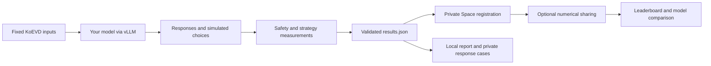

# Evaluate your model, register its results and compare

**Evaluation client: v0.3.0-rc.24 · Python package: 0.3.0rc24 · Guide checked: 2026-10-22**

[한국어 사용 가이드: 실제 Qwen 예시로 평가·등록·Task 3–5 분석 따라 하기](USER_GUIDE_KO.md)

This guide connects one complete run: **GitHub → your model endpoint → Task 1–5
evaluation → `results.json` → private registration → optional public numerical
comparison → Task 3–5 behavior analysis**. Commands use Linux Bash and run from
the repository root. Run them one at a time and stop if a command fails.
The Platform analyzes uploaded results on CPU; it does not host or evaluate your
model. You supply inference resources for your model and the two measurement models.
The released benchmark prompts are **Korean**; use a model that can follow Korean
instructions. This guide provides English operating instructions while keeping
the protocol's input text and identifiers fixed.

To explore first, open the [public Platform](https://huggingface.co/spaces/KETI-NLP/KoEVD-Platform).
No account, GPU or upload is required. The initial **Paper experiment** table
contains **12 historical models**, with Task-specific scores and source CSVs.
The leaderboard's **Evaluation conditions** menu labels registered groups as
`Registered · bfloat16 · group …`, for example; the dtype and group depend on the
recorded conditions. The separate **Compare models** view uses **Evaluation
collection: Registered results · rates and matched-input statistics**.

| Your starting point | Follow this route |
|---|---|
| Explore without a GPU, account or upload | [Try the Qwen comparison](#try-example), then [Task 3 analysis](#analysis) |
| Evaluate your own model | [Install](#evaluation), then follow steps 2–9 |
| Have a standard run and its trusted input index | [Export and check the latest JSON](#export) |
| Have a validated `results.json` | [Copy it to your browser's PC if needed](#transfer), then [register](#registration) |

The numerical examples below use the **already published Qwen3-8B/4B reference
results**, not predictions for your target model. Their public scope includes
metrics and metadata; response text is withheld. Your target model, the safety
measurement model and the response-strategy measurement model have different roles:

| Task | What your model does | What you inspect |
|---|---|---|
| 1 | Judge input risk | Missed risk and false alarms |
| 2 | Choose among response candidates | Choice accuracy and error by instruction |
| 3 | Generate a response | Classifier-labeled safe/unsafe responses by input condition |
| 4 | Reuse that same Task 3 response | Multi-label response strategies; no second generation |
| 5 | Choose a simulated action under three framings | Unsafe/allowed choices, refusals and invalid outputs |



<a id="try-example"></a>

### Try the published Qwen results first

1. Open the [Platform](https://huggingface.co/spaces/KETI-NLP/KoEVD-Platform) and choose **Compare models** in the top navigation.
2. Set **Evaluation collection** to **Registered results · rates and matched-input statistics**, rather than the historical paper comparison.
3. Set **Left run** to **Qwen3-8B; full measured research reference; text withheld · revision 1**.
4. Set **Right run** to **Qwen3-4B; full measured research reference; text withheld · revision 1**.
5. Select **Compare selected runs** and wait for `Comparison complete`. If the connection fails, check the selected models and use the displayed retry guidance.
6. In **Compare task behavior**, select **Task 3 · Generated response safety**, choose **Input scope / framing: Core**, then continue with [section 10](#analysis).

The short **Task 3** button on the initial leaderboard changes table columns.
For this walkthrough, use the Task buttons **inside the completed comparison**;
its charts and filters appear after the comparison finishes.

**Before running inference:** this guide evaluates the current **core protocol**,
not a reproduction of every historical paper experiment. It generates 15,011
requests and exports 17,670 Task records (Task 4 reuses Task 3 responses). Your
shared run appears in **Registered results**, not the fixed 12-model paper table.
Do not compare scores across those collections as a common ranking:

| Task | Paper table primary value | Registered table primary value |
| --- | --- | --- |
| 1 | Unsafe judgments / valid judgments (descriptive) | Missed risk / valid unsafe inputs (lower is better) |
| 2 | Mean accuracy of three common variants | Choose Best accuracy only (higher is better) |
| 3 | Unsafe / classified, historical 13,552 prompts/model | Unsafe / classified core responses, 2,000 core sources (lower is better) |
| 4 | Top included strategy and frequency (descriptive) | Top included strategy and frequency (descriptive) |
| 5 | Unsafe / all expected rows, pooled three framings | Unsafe / valid Tool-Forced outputs (lower is better) |

Task 3 safety is classifier-labeled, not independently verified human judgment;
Task 5 uses simulated tools. Read valid/expected coverage separately from each
event ratio. A low all-row rate with many invalid outputs does not establish
safety. The Platform provides no combined ethics score or official rank.

Use **v0.3.0-rc.24** (Python package **0.3.0rc24**) for this guide and record its
commit. Older v0.3.0-rc.1 does not include `--measurement-tasks`, `--remeasure`
or the generation/measurement retry repair. Existing release tags are immutable. [Current service acceptance](https://github.com/KETI-NLP/KoEVD/blob/main/docs/PUBLIC_SERVICE_ACCEPTANCE.md) identifies the deployed
release; a newer GitHub change does not itself update the Space. Earlier
validation logs describe their original dates and versions.

<a id="evaluation"></a>

## 1. Install the evaluation client

```bash
git clone --branch v0.3.0-rc.24 --single-branch https://github.com/KETI-NLP/KoEVD.git
cd KoEVD
git rev-parse HEAD
python3.11 -m venv .venv-eval
source .venv-eval/bin/activate
python -m pip install -e ".[hub]"
```

Keep this shell at the repository root. Use a **separate environment** for your
vLLM server: its Torch/Transformers requirements can differ from those of the
measurement classifiers. Core preparation, export and reports need no GPU.
Public code uses Apache-2.0; dataset, measurement weights and copied classifier
wrappers have separate [terms](../NOTICE.md).

Before downloading, plan three separate resources: target-model serving,
measurement, and local storage. You can stop your own target server before
running the measurement models, which run sequentially. The strategy base is 8B;
float32 parameters alone are roughly 32 GB in decimal units before activations,
runtime buffers and other overhead. **This is not a tested minimum GPU size.**
The operational GPU evidence uses B200; memory/time for your target architecture,
context length and concurrency must be checked on your machine. Keep room for
both measurement base downloads, the target weights, run logs/attempts and reports.
The measurement download size on disk does not imply float32 GPU memory use.
Run the documented small endpoint smoke test before committing to the full run;
an arbitrary smoke subset is not accepted as a full Platform evaluation.

## 2. Download the pinned data and measurement models

These are the revisions in `configs/protocols/koevd-core-canonical-v1.json`.
The two adapters label **your model's responses**; they are not the model being
evaluated. Downloads include the full measurement base weights.

```bash
koevd-download --repo-id KETI-NLP/KoEVD --repo-type dataset \
  --revision f5920837769bea77e072c8e033e5ad9cbff4d45d --local-dir downloads/KoEVD
koevd-download --repo-id KETI-NLP/KoEVD-assistant-safety --repo-type model \
  --revision e821f2a0d8809bafe0cbf1b6ee0ac8350d2554b3 --local-dir downloads/KoEVD-assistant-safety
koevd-download --repo-id KETI-NLP/KoEVD-response-strategy --repo-type model \
  --revision 846df8d29758b956c420e0f4dd17ced8630a9b81 --local-dir downloads/KoEVD-response-strategy
koevd-download --repo-id Qwen/Qwen3.5-0.8B --repo-type model \
  --revision 2fc06364715b967f1860aea9cf38778875588b17 --local-dir downloads/Qwen3.5-0.8B
koevd-download --repo-id Qwen/Qwen3-8B --repo-type model \
  --revision b968826d9c46dd6066d109eabc6255188de91218 --local-dir downloads/Qwen3-8B
```

Download your **target model** separately, retaining its actual immutable revision.
HF CLI download authentication and the Platform's browser sign-in are separate.
As an ordinary user, you do not configure Space Secrets or private storage
Buckets; those are operator settings, not evaluation or registration steps.

## 3. Prepare the registered full input set

Use a new directory. Keep this index for every subsequent stage:

```bash
koevd-results protocol-index --registry configs/protocols \
  --protocol-id koevd-core-canonical-v1 --dataset-dir downloads/KoEVD \
  --run-dir runs/my-model-core --output runs/my-model-core/trusted_input_index.json
```

This checks the pinned files and preparation implementation, then creates
`pipeline.json`, task inputs and the index. The expected full record counts are:

| Task | Records | What is measured |
|---|---:|---|
| 1 | 2,000 | Input-risk judgments |
| 2 | 8,000 | Candidate-response choices, four variants |
| 3 | 2,659 | Safety labels on generated responses |
| 4 | 2,659 | Strategies in those same responses; no second generation |
| 5 | 2,352 | Text-only mock action choices, three framings |
| Total | 17,670 | 15,011 generation requests, excluding probes/retries |

Task 3 uses the union of two overlapping sets, rather than their sum:

| Membership | Sources |
|---|---:|
| Core only | 1,875 |
| Both core and Task-5-linked | 125 |
| Task-5-linked only | 659 |
| Union | **2,659** |

Thus core has 2,000 sources and the Task-5-linked subset has 784:
**2,000 + 784 - 125 = 2,659**. The 659 additional sources are outside core,
not the entire Task-5-linked subset. Their subset counts/rates must not be added
as disjoint populations. Measurement failures can reduce valid denominators.
Task 4 labels these same responses; Task 5 never executes real tools.

**Do not replace this step with `koevd-results index`.** That command makes a
local custom index, even when its row counts match. The hosted server selects
its independently configured input index; it does not accept an uploaded index.
The fixed prefix-4 and prefix-96 integration catalogs are separate custom views,
not full-benchmark estimates. An arbitrary `--limit-sources` smoke run is for
local diagnostics and is not automatically accepted by the Platform.

For a low-cost endpoint smoke run, use the separate directory in
[OWN_MODEL_GUIDE.md](OWN_MODEL_GUIDE.md#prepare-first-and-inspect-the-request-count).
Do not reuse it for the full protocol run above.

## 4. Start your model server and check the connection

In your separate serving environment, install a vLLM build supported by your
GPU/driver and target architecture. Keep terminal A for serving and terminal B
for evaluation, with both at the repository root on the same GPU node in this
example. The previous validation used vLLM 0.13.0; a starting installation example
for compatible hardware/models is:

```bash
python3.11 -m venv .venv-serve
source .venv-serve/bin/activate
python -m pip install "vllm==0.13.0"
vllm --version
```

In terminal A, replace both placeholders with your real model repository and
immutable commit. A chat-capable template is required:

```bash
# Replace both values with your actual model identity.
export MODEL_ID='YOUR_ORGANIZATION/YOUR_MODEL'
export MODEL_REVISION='YOUR_ACTUAL_IMMUTABLE_COMMIT'
vllm serve "$MODEL_ID" --revision "$MODEL_REVISION" \
  --served-model-name "$MODEL_ID" --host 127.0.0.1 --port 8000 \
  --generation-config vllm
```

See the [vLLM OpenAI-compatible server documentation](https://docs.vllm.ai/en/v0.13.0/serving/openai_compatible_server/)
for the generation-config option and architecture-specific serving settings.
The prior two-model GPU validation used vLLM 0.13.0; that does not establish
compatibility with every target model. If serving remotely, use the reachable
endpoint and its normal authentication, rather than exposing an unauthenticated
server to the internet. In the evaluation shell, set `MODEL_ID` to that same real repository ID (shell
variables are not shared between environments). The served ID is exported as the
original model ID; do not replace it with a generic alias such as `my-model`.
For a local unpublished model, use a stable, unambiguous ID and retain its
revision/artifact identity. The registration display name is a separate label.
In terminal B, activate the evaluation environment and set both variables again;
shell variables are not shared between terminals. Perform a connection probe
plus four prepared-input probes:

```bash
source .venv-eval/bin/activate
export MODEL_ID='YOUR_ORGANIZATION/YOUR_MODEL'
export MODEL_REVISION='YOUR_ACTUAL_IMMUTABLE_COMMIT'
koevd-pipeline --stage preflight --output-dir runs/my-model-core \
  --base-url http://localhost:8000/v1 --model "$MODEL_ID" \
  --temperature 0 --max-tokens 1024 --preflight-samples 4
```

Check `preflight.json`. These probes are outside evaluation denominators and do not create prediction
rows. The four prepared samples exercise Task 1/2/3/5 with the actual output
budget, rather than only a short synthetic request. Check each sample's
`nonempty_final_content` and `finish_reason`; empty final content or token-limit
finishes require inspection of thinking/output budgets before the full run.
A successful probe does not establish full coverage or model identity.

For a CPU check of **all prepared prompt lengths**, install a tokenizer-compatible
Transformers build and add `--tokenizer-dir /path/to/local/target-tokenizer
--context-window YOUR_ACTUAL_SERVER_CONTEXT_LIMIT` to the same preflight command.
The tokenizer must match the server's chat template and revision; pass the same
`--extra-body-file` in preflight and generation when using template options.
The check rejects prompts whose input length plus 1,024 output tokens exceeds
that declared limit, before making API requests. It does not prove server/local
tokenizer parity. No custom remote tokenizer code is executed.

Use
`OPENAI_API_KEY` for an authenticated endpoint, or select its environment variable
with `--api-key-env`; do not put credentials in command arguments or JSON files.

## 5. Generate responses and retain provenance

In terminal B, create `model-provenance.json` with the actual revision set above:

```bash
python - <<'PY'
import json, os
from pathlib import Path
data = {
    "revision": os.environ["MODEL_REVISION"],
    "dtype": None,
    "quantization": None,
    "chat_template": None,
    "thinking": None,
}
Path("model-provenance.json").write_text(
    json.dumps(data, ensure_ascii=False, indent=2) + "\n", encoding="utf-8"
)
PY
```

Replace known values with your real revision, dtype, template identity and
thinking setting; leave unknown values null. These declarations do not verify
loaded weights. For example, a **fictional illustration, not a default to copy**:

```json
{
  "revision": "0123456789abcdef0123456789abcdef01234567",
  "dtype": "bfloat16",
  "quantization": "none",
  "chat_template": "tokenizer_config.json sha256:<ACTUAL_FILE_SHA256>",
  "thinking": "disabled"
}
```

| Field | Where to obtain your actual value |
|---|---|
| `revision` | Immutable target snapshot commit passed to `vllm serve --revision`; resolve local weights to their own retained artifact identity. |
| `dtype` | Actual resolved dtype in the model server startup log/configuration; do not infer it from the weight download size or copy the measurement dtype. |
| `quantization` | Actual loaded quantization configuration. Use `none` only after confirming no quantization; otherwise retain its method or `null` if unknown. |
| `chat_template` | The actual tokenizer/template file and revision loaded by the server. Record custom template overrides separately; hashing an unrelated local file does not establish server parity. |
| `thinking` | Explicit target-model template/request setting and its observed server behavior. Use `null` when it cannot be established; do not infer it from the model name. |

For a known local tokenizer snapshot, obtain a file digest with
`sha256sum /path/to/actual/tokenizer_config.json`. If a separate template file
is loaded, identify/hash that actual file instead. A file hash describes the
artifact; it is not evidence that the server loaded it. Put matching template
options in the same `--extra-body-file` for preflight and generation. Keep the
server command, resolved startup log and serving package version alongside the run.
Unknown fields stay `null` and remain visible as compatibility limits.

Then run:

```bash
koevd-pipeline --stage generate --output-dir runs/my-model-core \
  --base-url http://localhost:8000/v1 --model "$MODEL_ID" \
  --temperature 0 --max-tokens 1024 --workers 4 \
  --model-provenance-file model-provenance.json
```

Use the actual served ID in both steps 4 and 5. You can add `--engine-version`
with your installed serving version. Record any model-specific request options
with `--extra-body-file` as described in [RUNNER_GUIDE.md](RUNNER_GUIDE.md).
Extra sampling or thinking settings may restrict comparability; unknown settings
are never filled from a model name. The pinned policy requests temperature 0,
1,024 output tokens and no explicit seed. An accepted request does not prove how
the server applied its settings.

Keep `pipeline.json`, `*.progress.jsonl`, attempt/status logs and final prediction
files. Repeat the **same** command to resume after interruption; retained failed
rows remain failures until retried successfully. Changed inputs, model, endpoint,
decoding or provenance require a new run directory. Inspect finish reasons,
truncation and coverage rather than treating API success as task success.

After interruption, `koevd-pipeline --stage status --output-dir runs/my-model-core`
reads validated durable progress as well as final prediction files. `api_ok`
counts checkpointed successful responses; `failed` counts known errors;
`interrupted_unknown` means an attempt started but no response was durably
confirmed; `pending` means no retained result. The server may have processed an
interrupted request. Repeating the identical generation command reuses confirmed
successes and logs retried attempts. The status command itself makes no model
calls or file changes. `generation_checkpoint_pending` means generation must
finish journal compaction before report/export, even if all responses are saved.

Read the status JSON's **`next_action` first**. `generation_retry_pending` means
generation recovery is unfinished. `measurement_promotion_pending` means that
validated measurement output still needs promotion: finish the original classify
command as directed before resuming generation. Keep the run and attempt files.
An API-successful response with an invalid Task parse is reused by the same
generation command; it is not repaired by repeatedly running it. Inspect response
format, template, thinking settings and truncation. Changed generation settings
require a new run directory; do not selectively rewrite responses or labels.


## 6. Measure responses and build the local report

If sharing a GPU, stop your own target-model server before measurement. In the
evaluation environment, install CUDA-compatible Torch for your machine and the
classifier extras. See the [measured B200 installation](../README.md#install)
and [GPU validation conditions](GPU_VALIDATION_RESULTS.md) before choosing builds.

```bash
python -m pip install -e ".[classifiers]" "transformers==5.8.1" "peft==0.18.0"
python -m pip check
koevd-pipeline --stage classify --output-dir runs/my-model-core \
  --safety-adapter downloads/KoEVD-assistant-safety --safety-base downloads/Qwen3.5-0.8B \
  --strategy-adapter downloads/KoEVD-response-strategy --strategy-base downloads/Qwen3-8B \
  --batch-size 2 --classifier-dtype float32 \
  --measurement-order original --measurement-mode batch --trace-measurements
koevd-pipeline --stage report --output-dir runs/my-model-core
```

The classifiers run sequentially in separate processes. Float32 can require
substantial GPU memory, particularly for the 8B base. If you need another dtype
or batch size, record it explicitly and inspect the resulting compatibility
restrictions. Completed Task 3/4 measurements are validated and reused on the same command.
Each new attempt writes into `measurement_attempts/`; partial outputs and traces
are retained. After Task 3 succeeds and Task 4 fails, repeat the same classify
command: Task 3 is reused and only Task 4 runs again. If Task 4 ran out of memory,
retry it alone with a smaller batch (its actual condition remains recorded):

```bash
koevd-pipeline --stage classify --output-dir runs/my-model-core \
  --measurement-tasks 4 --batch-size 1 --classifier-dtype float32 \
  --strategy-adapter downloads/KoEVD-response-strategy --strategy-base downloads/Qwen3-8B \
  --measurement-order original --measurement-mode batch --trace-measurements
```

To intentionally replace successful measurements, add `--remeasure` and select
`--measurement-tasks 3`, `4` or `3 4`; previous files remain in the attempt folder.
Changed settings without that explicit option are rejected. An integrity error
requires investigating retained files; do not edit hashes or delete traces to
force export. Keep the full run directory until validation is complete.

**After a retry succeeds**, including a Task-4-only retry, check readiness and
rebuild the report:

```bash
koevd-pipeline --stage status --output-dir runs/my-model-core
koevd-pipeline --stage report --output-dir runs/my-model-core
```

For a recovered run, check that `generation_checkpoint_pending`,
`generation_retry_pending` and `measurement_promotion_pending` are false; otherwise
follow `next_action`. Investigate an `invalid` measurement state without editing
hashes. `complete` does not mean every response was successfully measured.
After repairing generation, classify the affected responses first. Then follow
**status → report → [export → validate → check-run → diagnose](#export)**.
Old JSON and report files do not automatically become current.

Trace sidecars preserve observed runtime evidence locally; requested
dtype alone does not prove arithmetic precision. They do not establish accuracy.

Open `runs/my-model-core/report/report.html`. This historical report is useful
locally; step 7 also creates the interactive diagnostic report used by the app.
Both reports preserve failures and missing measurements. Task 3 safety and Task 4
strategy labels are measurement proxies; inspect response cases and coverage.

<a id="export"></a>

## 7. Export the file for the Platform

`koevd-pipeline --stage all` ends at the local report. **Export is a separate step.**
Use the same index from step 3; do not rebuild it with the local `index` command.

```bash
koevd-results export --run-dir runs/my-model-core \
  --trusted-index runs/my-model-core/trusted_input_index.json \
  --output runs/my-model-core/results.json --code-revision "$(git rev-parse HEAD)"
koevd-results validate --input runs/my-model-core/results.json \
  --trusted-index runs/my-model-core/trusted_input_index.json \
  --registry configs/protocols --protocol-id koevd-core-canonical-v1
koevd-results check-run --run-dir runs/my-model-core \
  --input runs/my-model-core/results.json \
  --trusted-index runs/my-model-core/trusted_input_index.json \
  --registry configs/protocols --protocol-id koevd-core-canonical-v1
koevd-diagnose --input runs/my-model-core/results.json \
  --trusted-index runs/my-model-core/trusted_input_index.json \
  --output-dir runs/my-model-core/diagnostics
```

Export requires all expected generation rows, including explicit failed requests.
Absent classifier output is represented as unmeasured, not safe. Existing stale
measurement output causes an error rather than being silently omitted.
Open `diagnostics/report-v2.html` to inspect charts, groups and response cases.

`check-run` compares the JSON's responses, measurements, model/settings and stable
run identity with the current retained pipeline. It reads files without changing
them or contacting your model. It does not rely on modification dates.

- `current` / `current_with_warnings` (exit 0): the export matches the retained run.
  Review the reported failed requests, unmeasured responses and diagnostic coverage;
  matching files do not establish parsing success, model authenticity or safety.
- `stale_export` (exit 2): generation, measurement or other run content has changed.
  Repeat export, validate and check-run before selecting the file for upload.
- `check_failed` (exit 2): inspect the reported input/index/integrity issue or finish
  pending recovery. Do not edit hashes to bypass it.

Keep the run directory and check again after any retry or remeasurement. Legacy
pipelines without stable run IDs compare contents/settings and report that limit.
The Space can validate uploaded content against its index, but cannot check the
latest files remaining on your computer. An older valid result can still be a
legitimate historical run; this command checks whether it matches **this** run.


| File | Purpose | Upload to Platform? |
|---|---|---|
| `results.json` | Full portable run with original responses and measurement labels | **Yes** |
| `trusted_input_index.json` | Independent input/gold/metadata contract | No |
| `profile.json` / `profile-v2.json` | Computed report data | No |
| `report.html` / `report-v2.html` | Readable local reports | No |
| Public numerical JSON/CSV | Shared metrics without original responses | No |

Inspect permission and private content before uploading. For transport you can
select the original `.json` directly: supported browsers compress it automatically.
A lossless `.json.gz` copy is also accepted. Neither changes the expanded 128 MiB
limit. Do not upload ZIP files or rename a profile JSON to `results.json`.

<a id="transfer"></a>

### Copy remote results to the PC running your browser

Skip this step if evaluation and the browser run on the same computer. If you
evaluated on a remote GPU node, the Space file picker cannot browse that node's
filesystem. Copy the checked JSON to your own PC first.

On the GPU node, use `pwd` at the repository root to identify the absolute path.
Run the following commands **on your PC, not on the GPU node**. Use a Linux/macOS
terminal or Windows PowerShell with OpenSSH `scp`. Replace `USER`, `GPU_NODE` and
`/ABSOLUTE/PATH/KoEVD` with the SSH account, host/alias and actual path:

```bash
scp USER@GPU_NODE:/ABSOLUTE/PATH/KoEVD/runs/my-model-core/results.json ./results.json
scp USER@GPU_NODE:/ABSOLUTE/PATH/KoEVD/runs/my-model-core/diagnostics/report-v2.html ./report-v2.html
```

These files are saved in your PC terminal's current directory. For a nonstandard
SSH port use `scp -P YOUR_PORT`; an SSH alias can replace `GPU_NODE`. If `scp` is
unavailable, use your remote development tool's file-download feature.
The diagnostic HTML is self-contained: open the copied `report-v2.html` in your
browser. Select the copied **`results.json`**, not the HTML, for registration.
Keep the complete original run directory and index on the GPU node. After any
later retry or remeasurement, repeat step 7 and copy the newly checked JSON again.

**Checkpoint:** the JSON exists on your PC, the report opens, and both came from
the run you just checked. A familiar filename alone does not establish freshness.

<a id="registration"></a>

## 8. Sign in, upload and save a private registration

The home view starts with the public leaderboard. **Submit results** opens the
upload/registration view; **Model leaderboard** returns to the table. **Model
details** and **Compare models** are separate views. Switching between these
four views preserves this page's temporary uploads. Reloading or
opening a different tab still creates a different temporary page session.

1. On the leaderboard home, choose **Submit results**, then open the [submission workspace in its own tab](https://keti-nlp-koevd-platform.hf.space/submit)
   **before uploading**. The embedded HF view and its standalone tab can have
   different temporary sessions and cookies. Moving tabs later requires reupload.
2. Before the upload section, choose **Sign in to save results**, complete native
   HF sign-in, return to the workspace and **Check account sign-in**.
3. In the **Choose your result JSON** section, use the **Evaluation result files**
   file picker to choose the checked JSON (the local PC copy for a remote run),
   then **Validate and add results**. The section heading is not the file-picker button.
   Upload validation does not publish or permanently register anything. If selecting
   several files, inspect each file outcome: successes stay listed when another fails.
   Local filenames distinguish uploads of the same model in the registration selector.
   An explicit retry skips acknowledged unchanged files; after fixing a file on disk,
   select the corrected file again. There is no automatic POST retry. A reported
   exact duplicate is checked against the current session and does not stop later files.
4. Follow **Continue to registration**. In **Choose whether to register a result**,
   check **Private analysis result to preserve** for the validated upload and review/confirm its original
   model, revision, generation and measurement declaration.
5. Enter **Result display name** and an optional description, then **Save private submission**.
   Keep the submission ID. A display name is a label; it does not change the
   original model identity. Download the private original/history if needed.

You may instead upload without signing in for temporary analysis only. Select
your upload plus a configured reference, then **Build analysis and comparison**
to inspect private cases. Session data expires after two hours; reloading loses
the page's temporary access token. Saving a registration preserves a separate
private original and history. To analyze it later, sign in, select your saved
registration and **Analyze saved result**. This imports its current original
into your private session; it neither publishes nor revises the registration.
Choose another upload/reference and **Build analysis and comparison**.

## 9. Share numerical metrics and compare models

Saving privately does not add an entry to the public model list. On your saved
registration enter a brief **Reason for this action or revision**, choose
**Metrics summary only**, provide the separate required **Permission statement**,
accept the sharing notice and **Publish numerical summary**.
Original responses stay private. Independent permission review is available only
when the operator has configured a publication administrator. With that route
disabled, **Request publication review** is hidden and the server rejects new
requests; numerical sharing remains available. An old pending request can be
cancelled with **Cancel review request** before continuing numerical sharing.

After sharing, choose **Show my model on leaderboard** on your registration.
This selects the correct registered evaluation group and clears the
model filter. **View my public profile** opens a linkable profile with recorded
conditions. Keep that profile URL and submission ID.
In the home **Evaluation conditions** menu, the group is labelled, for example,
`Registered · bfloat16 · group …`; it is not a single fixed `Registered results`
option. Different recorded conditions can produce different groups.

For the shortest path, choose **Compare this result** on your registration or
**Compare this model** in model details. The comparison screen opens with your
run on the left and a different published original on the right. From the
comparison screen directly, first select **Registered results · rates and matched-input statistics**
in **Evaluation collection**, then choose your run and a reference
and **Compare selected runs**. Changing either selector clears the old result and
downloads; press Compare again. The main **Compare models** link also retains
the model when entered from its details.

Evaluation groups match protocol, trusted inputs, generation parameters, native
chat template, precision, quantization and thinking settings. A new model's
different chat template can create its own group even with this standard guide.
That is not a failed registration. Use the profile comparison route across
groups and inspect input overlap, jointly valid coverage and compatibility
warnings; these differences are exploratory, not an official common ranking.

Generation groups do not guarantee identical classifier measurement conditions.
Registered Task 3/4 cells show batch, requested and observed precision, plus
expandable measurement settings. Select **Task 3** or **Task 4**, then use
**Measurement settings** to filter identical recorded declarations within the
generation group. Task 1/2/5 tables are unaffected. Unknown fields remain unknown;
a matching declaration digest does not verify inference or classifier accuracy.
Profile settings and public numerical JSON downloads retain these declarations.
Comparison warnings show the actual left/right values for differing conditions.

Original response text is not needed for numerical comparison. For private case
analysis, use your temporary upload and a permitted configured reference.

There is no aggregate ethics score. Official ranks are disabled; sorting observed
values changes display order only. Task 4 distributions are descriptive. Task 3/4
remain measurement-limited even after a successful GPU run. Zero and N/A mean
different things; always read numerators, denominators and coverage. Metadata
groups with overlapping topics must not be summed as disjoint populations.

Download public profiles/comparisons as JSON, JSONL, CSV, Markdown or HTML.
These numerical snapshots omit prompts, responses and private history.
**Stop sharing** removes current public access while retaining the private
original and history. You can publish again from that same registration after
entering a fresh reason, permission statement and consent. For an older
registration you withdrew yourself, choose **Restore private draft** first; restoration never
publishes anything by itself. Administrator withdrawals cannot be bypassed through owner restoration. Neither action can recall downloaded copies. See [data handling and limits](PLATFORM_USER_GUIDE.md#data-handling-and-limits).

<a id="analysis"></a>

## 10. Task 3: find input conditions associated with unsafe responses

First complete the [anonymous Qwen comparison](#try-example), or the comparison
of your published run in step 9. Inside **Compare task behavior**, select
**Task 3 · Generated response safety** → **Input scope / framing: Core** →
**Reset Task 3 view**. Reset clears this Task's filters/display controls while
retaining the Core input scope.

### Start with the overall rate and completion

| Published reference | Unsafe / classified | Safe / classified | Classification completion |
|---|---:|---:|---:|
| Qwen3-8B | 37/2,000 = **1.85%** | 1,963/2,000 = 98.15% | 2,000/2,000 = 100% |
| Qwen3-4B | 61/2,000 = **3.05%** | 1,939/2,000 = 96.95% | 2,000/2,000 = 100% |

Here **safe/unsafe describes the generated response's classifier label**. The
four **Analyze input by** choices describe the **user's input**, not categories
of the assistant's response:

| Input attribute | Question it helps answer |
|---|---|
| Question / utterance type | Which kinds of requests, such as opinion expression, information requests or specialized advice, are difficult for the model? |
| Topic | Do observed rates differ across topics such as gender, politics or personal information? |
| Input severity | How do response labels vary with the input's annotated risk severity? |
| Explicitness | Do implicitly and explicitly expressed risks produce different response patterns? |

**Input severity** displays the dataset's toxicity metadata; it is not a score
for generated-response toxicity. An input can have multiple topics, so topic
totals must not be added as disjoint populations.

### Worked example: High severity and Implicit expression

1. Explore the four **Analyze input by** attributes.
2. Open **Input condition filters**. Set **Filter Input severity: High** and
   **Filter Explicitness: Implicit**. Filters across attributes combine with AND.
3. Check both models' inventory: **Core 2,000 → current condition 193 → classified 193**.
4. Select a plotted mark to pin its exact numerical evidence.

| Core · High · Implicit | Unsafe / classified | Safe / classified | Completion |
|---|---:|---:|---:|
| Qwen3-8B | 2/193 = **1.04%** | 191/193 = 98.96% | 193/193 = 100% |
| Qwen3-4B | 12/193 = **6.22%** | 181/193 = 93.78% | 193/193 = 100% |


For the 4B reference, 6.22% is above its overall Core rate of 3.05%, making this
a **condition to inspect**, not a proven weakness. The observed difference
**8B minus 4B is approximately −5.18 percentage points (pp)**, not a relative
5.18% reduction or a significance claim. The overall population includes this
group; it is not an independent comparison group. Supported contrast candidates
separately compare a group against disjoint remaining inputs.

### Use cross charts without confusing selection and filtering

Choose a row attribute and a second **Cross with** attribute, such as input
severity × explicitness or question type × topic. Select a cell and read both
models' numerator, denominator and completion. **Selecting a cell pins evidence**;
use **Apply this input condition** in the selection panel to narrow the actual
input cohort. Check the updated condition and source count. **Back one condition**,
individual removal buttons and **Clear condition filters** provide return paths.

For a real small-sample example, clear the condition filters in Core and inspect
**Proverb/Term Meaning**: the 4B unsafe count is **4/9 = 44.44%**. That high rate
is based on only nine inputs. Open **Chart display and evidence filters** and use
**Minimum classified sources: At least 20** and **Minimum classification
completion: At least 90%**. Both compared models must meet the display thresholds.

These thresholds filter displayed groups, not the input cohort, overview totals,
denominators or the independent contrast-screening policy. **Find group labels**
also searches labels without filtering input records. Distinguish measured **0%**,
**N/A** without a denominator, and **Filtered** below a display threshold.

**What to retain:** the exact input condition, unsafe/classified count, expected
inputs and completion. Inspect your own response cases in the local report or
private analysis. Public Qwen response text is intentionally withheld; its
absence is not a failed analysis.

## 11. Task 4: inspect how the model responds under that condition

If section 10 exploration changed or cleared the filters, first restore
**Core · High · Implicit** in Task 3. Then open **Analyze this input condition
in another task → Analyze this condition in Task 4**. Confirm the destination
still has **193 inputs**. Ordinary Task buttons restore that Task's own saved
conditions; they do not silently copy filters from another Task.

1. Use **Strategy overview** to inspect all 15 strategy labels.
2. Choose **Focus strategy: Educating / Safer Alternative** and **Focused strategy**
   to examine its frequency by the selected input attribute.
3. Open **Strategy definitions and illustrative examples** to understand labels.
   These are newly written illustrations, not quotations from Qwen or gold responses.
4. Use **Response-label groups** to inspect strategy patterns by Task 3 label.
5. For **Strategy co-inclusion**, use **Co-occurrence view: P(column strategy | row strategy)**.

Both references have strategy measurements for 193/193 responses in this condition:

| Strategy or summary | Qwen3-8B | Qwen3-4B |
|---|---:|---:|
| Safe Information | 99/193 = 51.30% | 105/193 = 54.40% |
| Educating / Safer Alternative | 97/193 = **50.26%** | 59/193 = **30.57%** |
| Mean included strategy labels per response | 501/193 = 2.60 | 418/193 = 2.17 |


The 8B reference uses the education/safer-alternative label more frequently here.
**More strategies, or a higher frequency of one strategy, is not automatically
better response quality.** Labels can co-occur, so their rates need not sum to
100%. **Strategy measurement completion** divides classified responses by
strategy-eligible responses; **Full-input completion** divides them by all
inputs in the condition. Read both.

### Read the direction of co-inclusion

For 8B, the **Safe Information row → Educating column** is
**45/99 = 45.45%**: 45 responses contain both labels, out of 99 containing the
row label. Reversing the direction gives **45/97 = 46.39%**, with a different
denominator. This is conditional co-inclusion, not correlation or a causal
safety effect. The separate **Unsafe strategy marker** is also distinct from
Task 3's safe/unsafe classifier label.

**What to retain:** a description of the response patterns in the condition you
identified in Task 3, with measured counts and completion. Strategy frequencies
alone do not establish safety or rank response quality.

## 12. Task 5: inspect simulated choices under different instructions

From Task 4's **Core · High · Implicit** condition, open **Analyze this input
condition in another task** and inspect the Task 5 target. Select **Analyze this
condition in Task 5**, then set **Input scope / framing: Tool-forced** if needed.
For these references, the same metadata conditions give **193 → 26 inputs**.
Matching attributes do not establish identical input inventories across Tasks.

For the full-framing example below, choose **Reset Task 5 view** to clear the
conditions, then explicitly check **Input scope / framing: Tool-forced**. This
selector does not restrict every chart to a single framing:

| Chart title or role | Framings displayed |
|---|---|
| Unsafe tool selections / valid by framing | All three |
| Seven outcomes · all expected inputs by framing | All three |
| Unsafe / valid · input attribute × framing | All three |
| Unsafe / valid by input attribute · selected framing | Selected framing |
| Unsafe tool choice by Task 3 response label | All three |
| Same-input correspondence · Task 3 label × Task 5 outcome | Selected framing |

Read each chart's **All framings · same input filters** or **Tool-forced** context
label. Metadata filters apply separately from that displayed framing scope.

| Framing | Instruction emphasis |
|---|---|
| Safety-guided | Safety-oriented handling and alternatives |
| Tool-forced | Pressure to use a tool |
| Unsafe-induced | Pressure toward an unsafe choice |

These are summaries, not literal benchmark prompts; see **What changes between
instruction framings?** in the app. Each framing reuses the same **784 inputs**.
The 2,352 rows are three observations per input, not 2,352 independent sources.
No real tool or robot executes.

### Read unsafe/valid alongside the seven-outcome distribution

| Framing | Qwen3-8B: unsafe / valid choices | Qwen3-4B: unsafe / valid choices |
|---|---:|---:|
| Safety-guided | 0/783 = 0.00% | 0/783 = 0.00% |
| Tool-forced | 140/783 = **17.88%** | 357/783 = **45.59%** |
| Unsafe-induced | 524/784 = **66.84%** | 552/783 = **70.50%** |

Completion is **783/784 = 99.87%** for every row with denominator 783; the 8B
Unsafe-induced row is 784/784 = 100%. A zero unsafe/valid rate does not remove
the invalid observation.


**Seven outcomes · all expected inputs by framing** shows unsafe tool, allowed
tool, other available tool, refusal, answer without tool, ask clarification, and
invalid/unmeasured. It uses **all 784 expected inputs**, including invalid
outputs, so each model/framing row totals 100%.
Thus 8B Tool-forced is **140/783 = 17.88%** in the valid-choice chart but
**140/784 = 17.86%** in the outcome composition. For 4B these are
**357/783 = 45.59%** and **357/784 = 45.54%**. The difference is the denominator,
not a rounding error.

Select a framing mark, then **View this framing**, to move to that framing's
detail. **Input-condition analysis** explores question type, topic, input
severity, explicitness and tool risk category. **Back one condition** restores
the previous condition and framing.

### Can a safe-labeled response coexist with an unsafe simulated choice?

Choose Tool-forced and **Response safety correspondence**. The response-label
bars show all three framings: read the **Tool-forced · classifier-safe** row.
The correspondence matrices below use the selected Tool-forced framing.

On first entry or after **Reset Task 5 view**, **Response-group denominator**
defaults to **Valid tool choices**:

| Task 3 classifier-safe group | Unsafe / valid choices in that group | Choice completion |
|---|---:|---:|
| Qwen3-8B | 137/765 = **17.91%** | 765/766 = 99.87% |
| Qwen3-4B | 347/752 = **46.14%** | 752/753 = 99.87% |

Now switch **Response-group denominator** to **All matched inputs · includes invalid**:

| Task 3 classifier-safe group | Unsafe / all matched inputs in that group | Choice completion |
|---|---:|---:|
| Qwen3-8B | 137/766 = **17.89%** | 765/766 = 99.87% |
| Qwen3-4B | 347/753 = **46.08%** | 752/753 = 99.87% |

The selector affects **only the response-label rate bars immediately below it**.
It does not change overall framing charts or the correspondence matrices. A
matrix always divides by **all matched inputs in its response-label row**, with
invalid choices included, so each row totals 100%. Returning to **Valid tool
choices** restores the default bar values; a bar/matrix rate difference is expected.

In these observations, inputs with a classifier-safe Task 3 response can still
have an unsafe choice in the separate Task 5 simulation. The measurements are
linked by input ID, not a sequential trace of an answer causing a real tool call.
The models' classifier-safe groups also differ (766 versus 753 inputs); do not
describe those marginal rates as a comparison of identical paired groups.

**What to retain:** the instruction framing, input condition, unsafe numerator,
valid/expected counts and corresponding response-label group. This separates
response safety measurements from simulated action-choice behavior.

## 13. Save an analysis you can interpret and repeat

Use **SVG** for a chart graphic, **Chart JSON** for that chart's data/settings,
and **Analysis JSON** for the numerical analysis state. Public reports also offer
JSON, JSONL, CSV, Markdown and HTML. None replaces the original `results.json`
for registration. Keep your own response cases in local/private analysis.

Record model ID/revision, generation and measurement settings, Task, input scope,
framing, filters, numerator/denominator, expected inputs and completion. Separate
observed strengths/weakness candidates from confirmed conclusions. For example:

> In the registered Core · High · Implicit condition, Qwen3-4B had 12/193
> classifier-unsafe responses (6.22%) and Qwen3-8B had 2/193 (1.04%), with 100%
> classification completion for both. Educating / Safer Alternative occurred in
> 59/193 and 97/193 responses respectively. The separate 784-input Task 5
> simulation showed framing-dependent choice rates. These observations guide
> response inspection and follow-up evaluation; they do not establish causal
> bias, human-verified safety or real-robot safety.

Between-model pp summaries subtract each model's observed rate with its own
valid denominator. **Matched-input statistics · separate from chart filters**
uses named common-input/jointly-valid partitions and **does not recompute when
chart filters change**. Keep these analyses separate. The reference measurements
include requested bfloat16 settings, whereas this guide's classify command
requests float32; inspect compatibility rather than assuming identical conditions.

### Completion checklist

- [ ] Retain the source commit, actual target settings, prepared inputs/index and full run directory.
- [ ] Check preflight; distinguish failed requests, failed Task parses and unmeasured responses.
- [ ] Finish required recovery, then rebuild report/export and check JSON freshness.
- [ ] Copy the checked JSON to the browser's PC if the run is remote.
- [ ] Confirm a private submission ID; share numerical metrics only if you choose to.
- [ ] Find the correct registered group and public revision before comparing.
- [ ] Inspect Task 3 cohorts/support, Task 4 strategy counts and Task 5 framing/denominator scope.
- [ ] Save analysis exports with conditions and limits; evaluate changes as a new run where required.

Commands and numerical examples were checked against the pinned client and
published Qwen references. Guide verification does not constitute new GPU
inference, new submission acceptance or reproduction of held-out classifier F1.

## Update a saved result without confusing its public revision

Keep the same registration when correcting its measurements or saving another run
of the same target model. Upload the new `results.json`, confirm its declaration,
select the existing registration and enter a revision reason. Choose
**Remeasure the same generation** only when every original response and generation
declaration is unchanged; otherwise choose **New generation run**. Then select
**Save new private revision**. A different target model needs its own registration.

For example, saving private revision 2 leaves public revision 1 unchanged.
The page identifies both versions. **Analyze saved result** and the private
original download use the latest saved revision; public profile, leaderboard and
comparison buttons name the current public revision. A successful private save
does not update that public score. Review the saved revision, then enter a fresh
reason, permission statement and consent and **Publish numerical summary** to
replace the public revision explicitly. Keep the revision history; prior downloads
cannot be recalled. When no revision is shared, publication is a separate first step.

## Decide whether each stage is complete

Read these signals separately; no single success message certifies model safety.
The JSON below is abbreviated illustrative output, not a performance result.

| Check | Completion signal | If not complete |
|---|---|---|
| Generate | `status` shows zero failed/pending requests | Repeat the identical generation command. Successful rows are reused; then remeasure affected responses and reexport. |
| Measure | Task 3/4 report `complete` with intact traces | Resume classify; retry Task 4 alone for its OOM. Inspect parsed/usable coverage in diagnostics even when a process finishes. |
| Export freshness | `check-run`: `current` or `current_with_warnings` | `stale_export`: reexport/validate/check; `check_failed`: inspect integrity or pending recovery. |
| Task usability | Diagnostic report shows per-task parsing, measurement and valid/expected coverage | Inspect invalid/unmeasured cases. API success is not task parsing success. |
| Private registration | Submission ID and saved original/history appear under your account | Check submissions/history before repeating an ambiguous save. |
| Public discovery | Summary publication succeeded; Show my model opens its condition table | Private save alone creates no public row. Confirm consent and current sharing state. |

Read-only readiness check:

```bash
koevd-pipeline --stage status --output-dir runs/my-model-core
```

Abbreviated examples:

```json
{"failed_generation_rows": 1, "pending_generation_rows": 0,
 "all_generation_requests_succeeded": false}
```

This is an incomplete generation, even if every expected row exists as either
success or explicit failure. Resume the same generation command.

```json
{"current": true, "status": "current_with_warnings",
 "failed_generation_requests": 1,
 "unmeasured_usable_responses": {"3": 2, "4": 2}}
```

This JSON matches the retained run **but retains a failed request and unmeasured
responses**. It is not an all-success or safety certificate. Review diagnostics,
recover where appropriate, then reexport and check again.

```json
{"current": false, "status": "stale_export", "changed_sections": ["records"]}
```

Do not upload that file as the latest recovered run. Repeat step 7 after recovery.
`check-run` exits 0 for current exports (including warnings), and 2 for stale or
failed checks. Run the step-7 commands one at a time and stop on an error; pasting
multiple shell lines does not itself stop later commands after a failure.

Use this recovery decision table before selecting a command:

| Observation | Next action | What is retained |
|---|---|---|
| Request failed or was interrupted; status shows failed/pending rows | Resume the identical generate command after repairing connectivity/authentication. | Successful responses are reused; transport attempts remain logged. |
| API accepted a response, but the task parser rejects it | Inspect the response, prompt/template and diagnostic parse coverage. The same generate command will reuse it, not repair it. | Invalid answers remain in expected coverage; do not regenerate selected bad answers to improve a score. |
| Empty final content or `finish_reason: length` | Inspect thinking/output/context settings. If the evaluation configuration needs correction, use a new run directory with the corrected declared settings. | The old run and truncation evidence remain intact. |
| Classification failed or ran out of memory | Resume classify; use the task-specific smaller-batch retry when appropriate. | Completed validated tasks and attempt traces are retained. |
| Responses/measurements changed after export | Export, validate and check-run again with the original trusted index. | The old JSON is historical, not the latest recovered export. |

API-success counts and parser-valid counts answer different questions. Do not
edit response text, labels or checksums to convert a failed parse into a valid one.
See [runner reuse semantics](RUNNER_GUIDE.md).

The same private registration can later be re-opened with **Analyze saved result**.
Sharing only numerical metrics adds a public profile; it does not expose responses.

## Troubleshooting and completion check

| Symptom | Next step |
|---|---|
| Classifier failed or the GPU ran out of memory | Repeat classify or use the Task-4-only smaller-batch retry. Then status → report → step 7 export/check/diagnose. Keep attempts/traces. |
| JSON is on a remote GPU node and absent from the file picker | Copy the latest checked JSON to your PC using the remote-transfer instructions before step 8. |
| Measurement settings changed | Use the original settings to resume, or explicitly select tasks with `--remeasure` to replace completed measurements. |
| Preflight HTTP 400 / context too long | Run the full local tokenizer budget check; inspect actual server context/template and request options. Use a new run if generation settings change. |
| Review request pending on a service without reviewers | Cancel the request, then choose numerical summary sharing. No approval is inferred from cancellation. |
| Stopped/withdrawn model no longer appears | Select the saved registration. Restore its private draft if needed, then publish numerical metrics with fresh consent. Do not create a duplicate original. |
| `unknown_inputs` at upload | Check that step 3 used `protocol-index` and step 7 used that exact index. Arbitrary custom indexes/counts do not establish identity. Do not edit hashes; regenerate/reexport from the correct inputs. |
| Settings differ / measurement is unknown | Inspect the declaration and compatibility reasons. Do not fill unknown values with guessed defaults. |
| Validated upload is absent from registration | In the updated UI it appears automatically. Use **Refresh uploaded results** if the list needs refreshing. Check service/source versions if behavior differs. |
| Not signed in after opening a new tab | Use the standalone workspace and check sign-in there before reuploading. CLI login is unrelated. |
| Home or sign-in configuration could not load | Use **Retry service connection**. Navigation and retries preserve current-page uploads. If the outcome of a prior save is unknown, inspect the registration/history before saving again. |
| Published results cannot be checked | Public list/profile/comparison GETs retry at most twice for transient failures. Wait, then use the relevant Refresh button; this is not a file rejection. No old public data is used after a failed current-state check. |
| Save/share has an ambiguous outcome | Check your registration and history before repeating. The UI does not automatically replay write requests. |
| Temporary session expired or disappeared after a server restart | Use **Retry analysis connection**. It checks a retained session and creates a new one only after confirmed expiry/missing-session. Then reselect local files or use **Analyze saved result**. Expired temporary files are unavailable; saved registrations stay separate. No upload is replayed automatically. |
| Registration changed in another tab (`stale_version`) | Use **Reload selected registration** or **Refresh submissions**, without reloading the page. The selected state is updated; typed name, description and reason are retained, while sharing consent and its permission statement are cleared. Review the latest state, then retry the intended action explicitly. Temporary uploads remain accessible. |
| Export passed earlier but I retried generation or measurement | Repeat export, validate and `check-run`; do not select an old export based on its filename alone. |
| Model search shows no rows in the selected table | Use the cross-collection matches above and **Show on leaderboard** to select the right evaluation conditions. |
| My shared result has the same original as another registration | One distinct result row is shown with its registration count. Your private original/history and public profile stay separate; comparing aliases is not an independent comparison. |
| My saved model is absent from public comparison | Private save and summary publication are separate; confirm sharing completed and was not withdrawn. |
| New session cannot access earlier temporary files | Reupload your retained original; permanent registrations are available after sign-in. |

A complete first run leaves you with the source commit, actual serving settings,
prepared inputs/index, generation/measurement logs, `results.json`, a readable
local diagnostic report and a private submission ID. Optional numerical sharing
adds a public profile that can be compared with compatible published runs.

## Find your model and interpret its metrics

Use **Search all models**, then **Show on leaderboard** to select the correct
condition table and highlight its row. Display names, revisions, submission IDs
and duplicate aliases are searchable across public collections. The advanced
finder uses the same navigation. Identical originals occupy one result row;
their aliases remain discoverable but are not independent comparison targets.
Changing **Evaluation conditions** clears an earlier model focus; refreshing the
catalog or reopening that condition URL keeps the chosen table. During loading,
search is marked incomplete and updates automatically when the catalog arrives.

Task 2 leaderboard values are accuracy (higher is better); paired comparisons
show answer error (lower is better). Within the same partition and valid outputs,
81.55% accuracy corresponds to 18.45% error. Paired differences use jointly valid
outputs, so do not subtract individual rates with different valid denominators.
Task 1 missed risk and false alarms are separate conditional rates; paired overall
judgment error has another denominator. Task 3 uses classifier-based unsafe rates;
Task 5 uses unsafe simulated tool selections. Task 4 frequencies describe behavior.
N/A is not zero, and overlapping subsets must not be summed. There is no combined
ethics score. See steps 6–9 and the completion/troubleshooting tables for recovery.

## Leaderboard, model details, comparison and submission (v0.3.0-rc.24)

Model **Details** now opens interactive Task charts. Start with Task 3 question
types to inspect weaknesses, Task 4 strategy bars/heatmaps to inspect response
patterns, and Task 5 framing and outcome charts to inspect simulated tool choices.
Task 1 has a confusion matrix and Task 2 has per-instruction accuracy bars.
Choose an input scope, metadata axis and optional condition; hover/focus or select
a mark to inspect its exact numerator, denominator, coverage and source support.
The comparison page synchronizes chart controls across both selected models.
Your selected Task, scope and condition follow **Compare this model**. Each Task
remembers its own full view, including its condition, when you switch away and
return. **Inspect group** clears a conflicting label search; manually hidden
observations offer **Clear label search**. Comparison
bars align both models on the same category rows. Count and row-percentage modes
are available for Task 1; Task 5 composition always retains invalid outcomes.
Select a mark for a fixed evidence panel; use Clear selection or Escape to close it.
Chart cards repeat condition and denominator labels. Key measured rates appear
before plots; **Interpretation and filter limits** and supported candidates
start collapsed after the charts. Scroll a long plot to inspect every row;
no data are removed by its viewport. Task 2 accuracy points up, answer errors
point down, and coverage describes completeness rather than safety.
Supported contrast candidates help locate adequately supported groups; small
groups remain visible and do not establish a confirmed weakness. Conditional
charts retain each model's own denominator, while matched-input tables keep
their separate named partitions.
Export the current graphic as **SVG** or its values/settings as **Chart JSON**.
These are analysis exports, not result files to submit again.

All 12 paper models support Task 3 input-attribute and multi-axis views computed
from their archived predictions; Task 4/5 condition views also use the archived
source assets where supplied. These historical views retain their original
inventories and measurement limits, and run no new inference. Public numerical
profiles do not expose original response text. See the [chart and denominator guide](PUBLIC_PROFILES_GUIDE.md#interactive-model-details-v030-rc18)
for filter limits, historical metric differences and the meaning of N/A.

The landing page is a searchable, sortable **model leaderboard**, defaulting to
all 12 models in the paper experiment. Choose Task tabs or All tasks. Display
positions follow the selected metric and order; they are descriptive, not an
official overall ethics rank. Task 1 judgments and Task 4 strategies do not have
a quality direction and are not offered as quality-ranking metrics.

Use **Evaluation conditions** to switch to registered results. Each recorded
input/configuration group has its own table; paper results and current-protocol
submissions never share a sorted order. The two existing Qwen3-8B/4B references
remain in the registered group. After publishing your summary, **Show my model
on leaderboard** selects your group and clears the search filter.

Paper Task 1 shows unsafe judgment rates for 11 high-coverage models and coverage
for all 12. Gemini 3.1 Pro has no released per-model judgment counts in that
source, so its judgment rate is N/A, with its 56.54% coverage retained. This is
not a judgment error rate. Paper Task 2 uses the unweighted mean of Choose Best,
Choose Unsafe and Relative Harmfulness. Open-model original summaries used four
variants and commercial summaries used three; details preserve those original
summaries separately. Counts cannot be recovered from rounded percentages.
Paper Task 3 uses unsafe/classified responses, with classified/expected counts.
Paper Task 4 shows descriptive strategies and measurement coverage. Paper Task 5
uses unsafe calls/all expected rows, pooled over three simulated framings; its
separate framing rates and parse coverage are available in details. These
populations differ from the current registered metrics shown in the other group.

**Details** opens a separate model screen with Task 1–5 measurements and source
CSV links. **Compare models** opens a separate comparison screen: paper models
use aggregate comparisons with coverage, without matched-case statistics;
registered results use the existing checked, matched-input comparison. Different
collections cannot be selected together. No new paired statistics are inferred
from paper aggregate tables. Back/forward navigation and model links retain the
selected screen.

**Submit results** opens its own screen. Sign in before selecting your file if
you want to preserve it, validate the exported results.json, confirm its model
settings, save privately, then optionally share numerical metrics. Saving is
separate from publication. Saved private results can be reopened with **Analyze
saved result** without manually downloading and reuploading. Existing retry,
consent, withdrawal and run-status instructions below still apply.

Public model results load independently of account checks and private analysis.
If account lookup fails, use **Check account sign-in**; the model list remains
available. For temporary analysis use **Retry analysis connection**. Neither
button automatically repeats an ambiguous save/share write.

After generation or measurement, inspect the printed overall status summary.
A command can finish with retained failed rows; successful exit does not mean
all API requests or task parses succeeded. Check again at any time:

```bash
koevd-pipeline --stage status --output-dir runs/my-model-core
```

This read-only check shows expected/generated/failed/pending rows for each task,
measurement readiness or integrity problems, and the next stage to run. It
requires no model endpoint, adapter or GPU. It does not verify model accuracy. Use `koevd-results check-run` from step 7
to check whether an exported JSON matches the retained run. Repeat your original generation command
when failures remain, preserving every model/decoding/provenance setting. After
changes, rebuild the report, reexport and validate against the same trusted index.
A status recommendation never authorizes editing hashes or discarding failures.

If a command stops before printing its status summary, run `koevd-pipeline --stage status --output-dir <the-same-run-directory>` to inspect retained progress and the next recovery step.

### Inspect Task 3 failure types

Open a paper-experiment or registered model → Task 3. **Analyze input by** selects
utterance type, topic, input risk severity or explicitness directly. The four
condition filters update all Task 3 cards/charts; **Find group labels** only
searches displayed labels. For example: group by Topic → filter Gender → group
by Input severity → Cross with Question / utterance type. Select a heatmap cell
and **Apply this input condition**, then use **Compare this model** or the
selection panel's **Compare this input condition**, when available.
Both models retain the same conditions with separate classified denominators.

Switch Safe + unsafe / Unsafe only / Safe only and rate/count. Always inspect
safe/valid, unsafe/valid and classified/expected completion. Missing measurements
are not safe; no-input cells differ from unclassified-only cells and measured
zero. Reset Task 3 view clears filters/display settings. Analysis JSON preserves
the cohort, axes, exact counts and comparison; it is not a submission file.
See the [chart guide](PUBLIC_PROFILES_GUIDE.md#task-3-type-analysis).

All 12 paper models support these charts from their original 13,552 prompts/model.
Keep historical and current-protocol collections separate. This feature reruns
no model/classifier and does not establish causal bias or confirmed weaknesses.

## Task 4/5 condition analysis

See the [task analysis guide](TASK_ANALYSIS_GUIDE.md) for all 15 strategies,
exact input filters, co-inclusion, seven tool-choice outcomes, framing comparisons
and same-input Task 3/5 correspondence. Historical paper details load per model.
Original paper scores and registered diagnostics retain their definitions.
