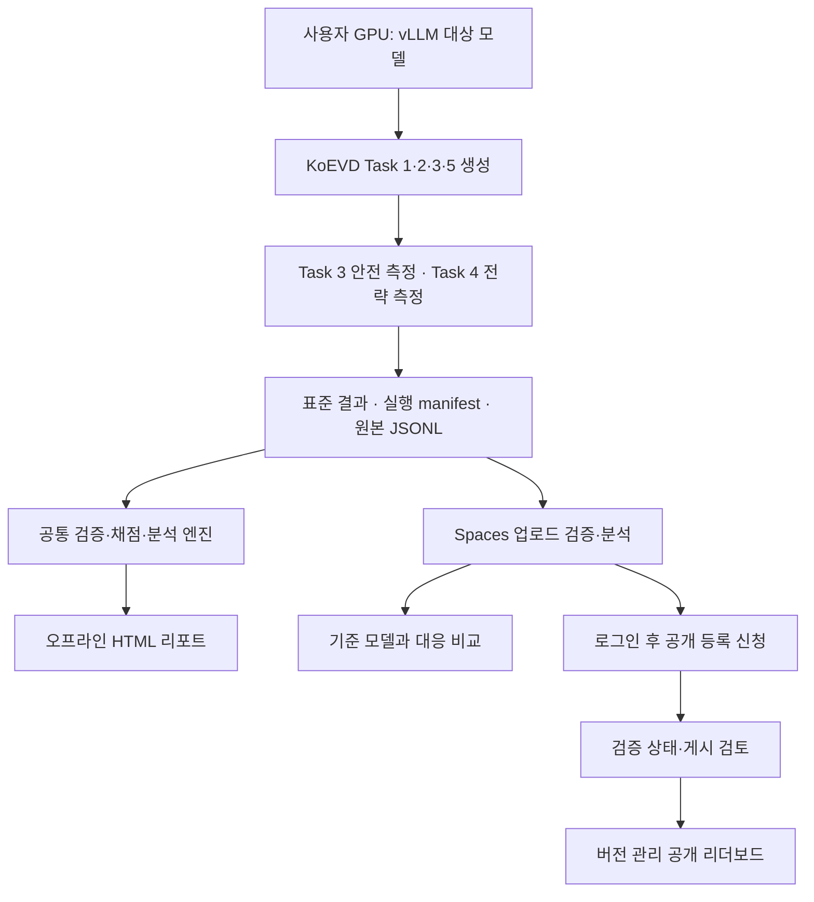

# KoEVD 평가·분석·모델 비교 플랫폼 개발 계획

- 작성일: 2026-10-08 (Asia/Seoul)
- 갱신일: 2026-10-13 (Asia/Seoul)
- 문서 버전: 0.60
- 목표 상태: 공개 전 release candidate 인수 완료 — 실제 production 게시·공식순위·상시백업 활성화와 구분한다.
- 최신 로컬 검증 판정 (v0.60): v93에서 권한 보유자가 두 실제17,670기록 결과의 연구용 원문 참조를 승인했다. 원본 파일/content/index hash와 연구용 이용 조건에 연결된 새 허용 기록·두 참조 catalog를 로컬에 만들었다. 실제 Chrome에서8B 한 파일 업로드+4B 참조 선택으로160.187초/exit0, 다섯 출력405,679,557바이트가 독립native와 일치하고 세션/삭제/지연 다운로드/모바일 검사가 통과했다. 최신 비편집 설치core50를 대조한 전체366 CPU검사166.906초·실패/오류/skip0·pip check가 통과했다. 처음10초 대기 실패와 샌드박스health 무응답 실패는 소유서버 종료/포트 거부와 함께 보존했고 정상 로컬권한의 최종 시도만 통과로 기록했다. GitHub/HF 변경·새GPU·공식순위·상시백업·사람정확도 증명은 없다. 구버전의 미완료 문장은 역사로 보존하고 현재 README/Spaces/RC 체크리스트를 실제근거로 정리했다. [근거](validation/platform_m5_actual_reference_v93.json), [참조 후보](ACTUAL_REFERENCE_CANDIDATE.md).
- 최신 실제 검증 판정: v0.59에서 사용자가 지정·전송 승인한 CPU_VALIDATION_NODE의 기존 Docker를 사용해 기본 후보를 실제 검증했다. 이미지1개·개별2개/대응 비교1개의15파일806,504,041바이트 HTTP/CLI 일치·비교의 이전 로컬/HF 일치가 통과했다. 기본CMD/UID:GID1000:1000/network none/포트0·정확한 소유 컨테이너 종료exit0/제거를 확인했다. 최종 컨테이너 검사277.752초·Python3.12.15·분석 패키지43파일·웹lock을 검증했다. 압축 해제 상한/누락Entrypoint 검사기의 초기 실패를 보존하고, inspect JSON을 파싱하는 수정과 관련7 CPU검사0.029초가 통과했다. 제품 core50와 HF 배포는 그대로다. 사용자가 Codex에 위임한 기술 검토에서는 GPU 실행 당시184소스·13단계·두 모델28증거파일·각17,670기록/index·Task3/4 재사용과 잘림/측정 한계를 대조했다. AI 검토를 별도 사람의 증명이나 정확도/공개/공식순위 승인으로 바꾸지 않는다. [컨테이너 근거](validation/platform_m5_actual_b200_container_v92.json), [위임 검토 근거](validation/platform_m4_delegated_generation_review_v92.json).
- 이전 실제 HF 판정 (v0.58): v0.58에서 사람이 승인한 실제 private CPU 전체 전송 인수를 완료했다. Qwen3-8B/4B 각17,670기록 JSON을 각1회/합계89,396,889바이트 전송하고 대응 비교1건을 실행했다. 다섯 다운로드405,679,557바이트가 독립 native 파일과 직접 바이트 일치했으며 로컬 hash 재검사도 통과했다. 총259.906초/exit0, job terminal·pending false·검증 session2개 cleanup200/200·다른 session의 출력 접근 거부를 확인했다. 종료 후 같은 8e692c88 revision/private Docker/RUNNING/cpu-basic/단일 replica를 읽기 전용으로 재확인했다. 제품 core50·기본 프로필을 보존했고 제출/Bucket/snapshot/재배포/restart/Secret/공개/유료 변경은 없다. 이번 승인은 이 제한 시험 완료로 소진됐으며 개별 분석2개나 실제 hosted browser/OAuth·local image UID/CMD·분류 정확도·운영자/공개 권한을 새로 인수한 것은 아니다. [근거](validation/platform_m5_actual_full_hosted_20261012.json).
- 이전 로컬 검증 판정 (v0.57): v0.57에서 현재 설치본의 실제 로컬 앱 화면으로 두 전체 결과17,670+17,670기록을 업로드했다. 합계89,396,889바이트 입력과 iframe의199,373,743바이트 HTML을 처리했고, Save 링크로 저장한 다섯 파일405,679,557바이트가 독립 CLI 파일과 일치했다. 전체158.875초/exit0, 분석·preview117.702초이며 비교·측정 한계·한국어 사례·모바일 화면을 시각 검토했다. 세션 격리/삭제·삭제 후 지연 다운로드 링크 거부·실제 서버 PID 일치/종료/포트 거부가 통과했다. 제품 core50는 그대로며 검증기의 대기 시간 옵션/관측 시간만 추가했다. 분석 전용 로컬 서버의 검사로 HF/OAuth/Docker나 새 추론 근거가 아니다. 실제 HF 전체 전송은 별도 승인 대기다. [근거](validation/platform_m5_current_full_app_browser_20261012.json).
- 이전 로컬 검사 판정 (v0.56): v0.56에서 HF 전체 전송 검사기의 opt-in 분기를 설치된 로컬 HTTP 서버로 검증했다. 명시적 HF 접근 모의 응답과 외부 소켓 차단 아래 실제48+48기록 두 업로드·비교1건·다섯 보고서 12,514,875바이트의 독립 CLI 일치·다른 세션 접근 거부·두 세션 삭제를 확인했다. 첫 Windows 가상환경 핸들 종료 검사는 포트 잔류로 실패를 보존했고, 실제 Python PID를 직접 소유한 재실행13.937초에서 PID 일치·종료·연결 거부가 통과했다. HF 요청/전송은0회, 제품 core50와 배포 프로필은 그대로다. 종료된 v83 승인을 재사용하지 않으며 전체 HF 전송은 별도 승인 대기다. [근거](validation/platform_m5_hosted_transfer_fixture_20261012.json).
- 이전 준비 판정 (v0.55): v0.55에서 현재 private CPU 기본 앱에 두 모델 전체 결과를 일시 분석하는 별도 전송 인수 도구를 추가했다. 기본 preflight는 결과 body/analysis POST/DELETE 없이 resource 접근·고정8e692c88 revision·RUNNING/cpu-basic·단일 replica·한도/익명 app 경계를 읽는다. 실제 HF preflight2.078초/exit0·결과 전송0/job0과 최종6 CPU guard/0.276초가 통과했다. core50 소스는 기존 설치/배포 검증본과 같다. 새 제안은 두 실제17,670+17,670기록 JSON89,396,889바이트 각1회·대응 비교 job1·다섯 native405,679,557바이트와 직접 stream 대조·download512MiB 한도·두 owned analysis session cleanup만 포함한다. 전체 전송은 미승인/미실행이며 앞선 종료된96기록 시험 승인을 재사용하지 않는다. 새 script는 host-side 검사이며 이미 배포된 image를 변경하지 않았다. 이 준비는 실제 full hosted·local image UID/CMD·큰 report UI·운영자 판단·공개 권한을 대신하지 않는다. [최신 근거](validation/platform_m5_full_hosted_preparation_20261012.json), [실행 범위](HOSTED_FULL_ANALYSIS_ACCEPTANCE.md). Goal 도구의 현재 상태active를 확인했고 원래 목표/완료 조건을 유지한다.
- 이전 실제 검증 판정 (v0.54): v0.54에서 별도 승인된 실제 private CPU 유한 종료 시험을 완료했다. 기준9개 보존·새 snapshot3개/396,229바이트로3회/24MiB 한도를 지켰다. 현재 코드에 결합한 parent 종료 로그 뒤 마지막 snapshot이 생겼고 finite worker2회 완료·후속 기동 initialization_inventory_mismatch 거부를 확인했다. 별도 다운로드한3사본 중 두 현재48+48기록 원본/이력이 모두 일치한 digest를 내용으로 선택했다. 고정 복원 후 실제 HF 재로그인의 두 원본·두 이력4파일이 복원 전 native 다운로드와 바이트 일치했고 새 저장/공개 조회 거부·worker OFF·복구 대기를 확인했다. 최신 기본 revision `8e692c88d412d6305879473e3e8e74d46bb7dd2c`의 RUNNING/cpu-basic·66파일 바이트/목록 일치로 복귀했다. Bucket12객체/68,382,317바이트·Secret·public Static을 보존했으며 상시 백업은 꺼져 있다. 이 승인은 시험 종료로 소진됐다. 과거 누락4B 이력이 복구됐다고 주장하거나 과거 횟수 실패를 소급 통과 처리하지 않는다. 실제 HF host restart 이벤트 로그·상시 운영/RPO·현재 Docker 전체 용량·운영자 정책/복구 인수·공개 참조는 미확보다. 실제 GPU/F1/분류 정확도의 새 검증은 아니다. [최신 근거](validation/platform_m6_actual_finite_shutdown_20261012.json). 전체 목표/완료 조건은 유지하며 전체 완료를 선언하지 않는다.
- 이전 구현·검증 판정 (v0.53, 당시 상태): v0.53에서 기본 Docker 이미지의 CMD를 유지한 로컬 인수 도구와 노드 실행 절차를 추가했다. 이미지 ID·자신의 container ID/label·UID/GID1000·network none·미공개 포트·종료/제거를 외부 실행기에서 확인하고, 내부 HTTP 검사기는 외부 소유 loopback 서버에 연결한다. current source50는 v0.52 설치/352 전체 검사 때와 같고, 새 script 관련12 guard검사/0.111초가 통과했다. 새 연결 경로의 현재 로컬 실제 서버/CLI에서 기존 두 실제 모델 각17,670기록·총35,340기록의 대응 비교와 JSON/JSONL/CSV/Markdown/HTML5파일이 바이트 일치했다. 실행252.344초/exit0, 소유 server terminal이며 Windows terminate의 관측 exit1을 보존했다. 이번에는 개별 모델 보고서2개를 새로 검사하지 않았다. 컨테이너 도구0개라 실제 Docker 실행은 미검증이며 HF/OAuth/새 inference/외부 전송도0회다. 66파일 기본 context ZIP과 실행 안내를 로컬에 준비했고 기존 HF 제한 시험 재승인 질문은 계속 pending이다. 실제 HF 두 현재 초안 종료 보존·Docker 전체 용량·운영 인수·공개 참조를 미완료로 유지한다. [최신 근거](validation/platform_m5_container_runtime_preparation_20261012.json), [실행 절차](CONTAINER_RUNTIME_ACCEPTANCE.md). Goal active/원래 범위를 유지한다.
- 상태: 실제 브라우저 다섯 보고서 저장까지 검증. 관리형 백업은 미활성화 후보이며 영구 저장/운영 인수는 미완료. 아래 이전 checkpoints는 당시 범위다.
- v0.38: 실제 HF Static 직접 앱에서35,340기록/bootstrap100 분석176.241초, 다섯 출력 native 바이트 일치, 전체 GET17/HF 자산 CDN redirect2/독립 재다운로드1/POST0/예상 밖 요청·오류0을 확인했다. 원본 결과는 서버에 전송하지 않았다.
- v0.37: 실제35,340기록의 브라우저 bootstrap100 분석171.729초·다섯 출력 GPU/로컬 바이트 일치, 새 설치299검사 오류/실패/skip0, 서버 후보64파일과 비공개 Static hosting을 확인했다. 기존 목표 범위를 유지한다.
- v0.36: 별도 Static 후보에서 기존 Python 엔진을 Pyodide worker로 실행했다. 두 실제 모델 전체35,340기록의 다섯 출력이 로컬과 바이트까지 일치했고 계산101.490초, 외부요청/오류0이다. 관련49 CPU검사도 통과했다. 개인 분석·비교 경로의 추가이며 서버 제출/영구저장/공개승인·공식순위 gate를 축소하지 않는다.
- v0.15: B300 GPU2에서 Qwen3-8B·4B 각각 40개 생성과 48개 portable 기록의 생성→두 분류기 측정→export→리포트→대응 비교가 통과했다. 독립 입력·원본 재내보내기 인수와 실제 두 결과의 앱/CLI/노드 수치 일치를 확인했다. prefix96 확대 검증은 새 `expanded-v3`/session66554에서 진행 중이며 완료로 표시하지 않는다.
- v0.16: 현재 공개 revision·활성 영수증·운영자 규약/정책을 공통 지표 엔진에 연결한 읽기 전용 HTTP/CLI/UI 비교표를 추가했다. 새 설치의 전체 CPU221 검사, 가상 네 계정 browser7 흐름/6 화면·독립 CLI/HTTP 수치 일치가 통과했다. 최종 자산 v2와 전체 검사를 받은 Python36개 파일의 바이트 일치를 확인했다. 새 배포 후보는 `generated/private-space-deployment-20261008-v16`이며 실제 GPU 원문이나 credential을 포함하지 않는다.
- v0.17: `expanded-v3`/session66554는 terminal exit0로 인수했다. 두 모델 각각959개 생성·1150 portable records의 실제 분석/웹 수치가 일치한다. 고정 응답 감사 session46297/controller39972는 2026-10-08T08:56Z에 실제 live였다. Qwen3-8B의7조건이 완료됐고 Qwen3-4B를 시작했다. 반환 도구와 현재/과거100건씩의 비공개 검토 queue를 마련했으며 사람 판정·정확도·전체 matrix 인수로 승격하지 않는다.
- v0.18: 고정 응답 감사46297은 terminal exit0이며 두 모델/14조건의 raw reexport·frozen hash·trace·comparison을 독립 인수했다. strategy 변화는 8B 0–10건/4B 0–9건, 고유 변화 source는 11/15개다. safety는 모든 조건에서 변화0이지만 FP32 요청의 실제 dtype은 혼합 상태이며 정확도는 미확정이다. 공개 목록의 미계산 자격 표시를 고쳤고 새 설치의236 CPU 검사/exit0/skips0 및 새 후보v18을 확인했다.
- v0.19: 운영자 정책 결정의 원문·부모 이력 보존과 CLI/서버의 명시적hash 설정을 구현했다. 기본candidate/no-rank와 classifier 제외를 유지하며 실제 정책은 승인하지 않았다. 새 설치245 CPU 검사/exit0/skips0, Linux의 실제파일 기능4검사와 v19 후보60파일을 확인했다. 원격 snapshot·복구는 다음 구현 대상이다.
- v0.20: DB·선택한 정책 chain을 한 ZIP으로 보존하고 외부 catalog/registry·ZIP digest 검증 후 새 경로에 복원한다. 서버나 정책을 자동 활성화하지 않는다. 실제 기존 두 결과의 cross-host 복원이 통과했으며, HF 전송은 모의 API 검사까지다. 최종 전체258 CPU 검사/102.750초/exit0/skips0와 v20 후보61파일을 확인했다.
- v0.21: 복원 DB에 불변 대기 sequence를 넣고 공개5경로와 domain 변경/재시도를 차단한다. 비공개 원본/이력은 기존 권한대로 읽을 수 있다. 외부 checkpoint의 전체 논리 상태·입력/규약·선택 정책이 일치해야 local admin이 대조 기록을 남긴다. 최신 상태 인증은 주장하지 않는다. 최종268검사/110.000초/exit0/skips0, 실제 두 결과의 대기 유지와 v21 후보62파일을 확인했다.
- v0.22: 명시적 주기 worker·같은 상태의 ZIP/checkpoint·완료 기록·대상별 상태 조회를 추가했다. 실패 후 이전 성공본과 미보존 변경을 구분하며 remote/RPO 보장은 주장하지 않는다. 신규10개·최종 전체278검사/120.094초/exit0/skips0, 실제 두 결과의 양쪽 OS 백업과 후보63파일을 확인했다.
- v0.35: 전체 실제 결과의 운영자 검토 준비·35,340기록 저장/복원·기본47지표 등록 검증 완료. 외부필수조건이3개연속goal turn에서남았고로컬필수작업을마쳤다.
- v0.34: 최신294 CPU검사·CI/소스 포장 경계·사용 안내와R1–R10 점검표를 갱신했다. 외부 운영 gates 미검증.
- v0.33: 실제 두 모델 전체 반환 인수와 199MB 비교 HTML·native HTTP/CLI·브라우저 검증 완료. 배포/운영 gates는 남음.
- v0.32: 실제4B 전체 생성15011요청과Task5 세프레이밍784씩의 입력 대응·생성 서버 종료/실제 측정 시작을 확인했다. 전체 두 모델 인수는 미완료다.
- v0.31: 실제4B Task3 최종2659응답 입력 대응·stop2446/length213을 확인했다. Task5·측정·두 full 모델 인수는 미완료다.
- v0.30: 실제4B 완료 Task1/2 2000/8000응답의 외부 입력 대응을 확인했다. Task3/5·측정·두 full 모델 인수는 미완료다.
- v0.29: 실제8B 전체 측정/export/분석·독립 replay·실제 HTML/browser·native HTTP/CLI 일치를 확인했다. 4B와 전체 두 모델 인수는 미완료다.
- v0.28: 실제8B의 전체 생성15011요청 완료·Task5 세 framing784씩의 외부 입력 대응·소유 서버 종료/측정 시작을 확인했다. 전체 두 모델 검증은 미완료다.
- v0.27: 실제8B Task3 최종2659응답의 외부 입력 대응과 length-limit249건을 확인했다. Task5가 시작됐으며 전체 두 모델 검증은 미완료다.
- v0.26: 전체 입력 두 CPU fixture의 실제 browser/visual QA가 통과했다. 12탭·두 실행 선택·대응 필터·Task4 no-rank·모바일을 확인했으며 CPU fixture/실제 GPU 검증을 구분한다.
- v0.25: 전체 입력 두 CPU fixture(각17670records)의 비교 출력303534808bytes를 실제 생성하고512MiB 상한을 유지했다. Native HTTP 업로드/비교/다운로드·독립 CLI profile의 바이트가 일치하고35340사례·Task별 counts를 확인했다. 검사기에 comparison-only 옵션과 단일 결과 오인 방지 guard를 추가해 관련6검사를 통과했다. 실제 모델 성능·전체 GPU 통과 근거가 아니다.
- v0.24: Linux Python3.12.3의 정확한14개 웹 의존성·noneditable `koevd_eval`42파일을 검증했다. 실제 기존 두 모델 prefix96 업로드·개별/비교3profile·독립 CLI 수치가 UID0/1000에서 일치했다. 검사기의 build-artifact/venv 경로 문제와 UID1000 NFS 접근 실패를 보존하고 별도 경로에서 통과했다. Native7그룹 검사·context guard5검사이며 컨테이너/HF login/GPU full 완료 근거가 아니다.
- v0.23: `--full-core` 경로와 독립 registry 반환 인수·원본 replay 포장을 추가했다. 전체 canonical index/97개 artifact 파일·수정한 tokenizer budget을 검증하고 별도 새 환경의 full GPU 실행을 시작했다. 관련22 CPU 검사13.109초/exit0/skips0. Session90124/PID56870은 실제 live이며 전체 결과 통과로 표시하지 않는다.
- 계획 대상: KETI-NLP/KoEVD GitHub 코드, 결과 형식, 로컬 분석 리포트, Hugging Face Spaces 비교 화면과 리더보드 등록 기능.
- 목표 프롬프트: [CODEX_GOAL_PROMPT.md](CODEX_GOAL_PROMPT.md)

## 0. 읽는 순서와 개발 재개 지점

이 문서는 제품 요구사항과 개발 진행 기록을 함께 관리한다. 처음 읽는 사람은 1–5절로 목표와 연구 범위를 파악하고, 6–14절로 결과 형식·분석·비교·공개 정책을 확인한다. 구현을 이어가는 Codex는 16절의 작업 순서, 18절의 인수 시나리오, 20절의 최신 증거부터 확인한다. 현재 구현과 제안은 구분하며, 계획에 적힌 CLI·정책이 있다는 이유만으로 구현 완료로 판단하지 않는다.

| 단계 | 현재 확인된 범위 | 남은 완료 조건 |
|---|---|---|
| M0–M2 | 기준선, 표준 결과 계약, 입력 검증, 생성 상태·재개 경로의 CPU 검증 | 변경 시 관련 회귀 검사. 실제 GPU 효과는 M4에서 확인 |
| M3 | 공통 분석·차트·전체 사례·대응 비교, 실제 두 target 전체35,340기록의 CLI/native/Static 수치·파일 일치 | 승인된 공개 실제 baseline/원문 범위 |
| M4 | 실제 두 target 전체 GPU13단계 종료·원본 replay·35,340기록 인수, prefix96와7조건 matrix, review queue/변화26사례 | 사람 판정·FP32 safety 한계·실제 운영 provenance 검토 |
| M5 | 실제35,340기록 local/Static/HF 전체 비교, CPU_VALIDATION_NODE 기본 Docker 이미지의 개별2개+비교1개15다운로드 일치·UID1000/기본CMD/격리/종료/제거 | 실제 공개 기준 모델은 별도 공개 범위 결정 뒤 설정. Container/HF API와 actual hosted browser/OAuth 범위를 구분 |
| M6 | 실제 HF 유한 종료3사본/396,229바이트 한도·parent 서버 종료/후속 기동 거부, 현재 두48+48 원본·이력4파일 실제 재로그인 전후 바이트 일치, 복원 대기/새 저장 거부와 최신 기본66파일 복귀 | 기본 앱 임시 저장·상시 백업 OFF. 운영자 정책/복구 인수·공개 참조·현재 Docker 전체 용량 미완료. 과거 늦은4B 이력 누락/횟수 실패는 별도 보존 |

첫 실제8B full 검증은 [근거](validation/platform_m4_m5_full8b_report_app_20261008.json)에 있다. 17,670기록의 원본 replay·실제98.8MB HTML·HTTP/CLI가 통과했다. 두 모델 전체 비교도 v0.33에서 독립 인수·수치·UI 검증을 통과했다.

기존 전체 비교 용량 검사는 [근거](validation/platform_m5_full_comparison_capacity_20261008.json)에 있다. 각17670기록의 두 CPU fixture가 실제 HTTP 비교/다운로드를 통과했고 전체35340사례와 외부 index의 Task counts를 보존했다. 실제 모델 inference·정확도나 모든 길이의 입력을 보장하지 않는다. 첫 실제8B의 용량·수치·UI는 별도로 통과했으며, 실제 두 모델 비교는 v0.33에서 별도로 검증했다.

Native CPU 검증은 [SPACES_RUNTIME_VALIDATION.md](SPACES_RUNTIME_VALIDATION.md)와 [최종 근거](validation/platform_m5_native_runtime_20261008.json)를 참조한다. Windows에는 컨테이너 도구/설치된 WSL이 없고 B300 namespace 생성도 실제 거절됐다. UID1000에서 같은 서버 동작을 확인했지만 이미지/호스팅 검증으로 승격하지 않는다. 패키지·자산·v22 후보는 변경하지 않았다.

기존 GPU66554/46297과 full GPU90124는 모두 종료됐으며 재시작하지 않는다. Full controller56870의 13단계 exit0·소유 프로세스 부재·외부 입력 기반 원본 replay를 확인했다. v0.33: 두 실제 모델의 전체 생성·분류·내보내기·분석·통합 비교 13단계가 종료 코드0으로 완료됐다. 모델당 생성 요청15,011개·평가 기록17,670개, 전체35,340기록을 보존했다. 외부 고정 index/registry와 별도 ZIP SHA를 사용한 원본 재내보내기가 두 모델 모두 정확히 일치했다. 노드·로컬 CLI의 5개 분석 파일이 바이트까지 같고, 앱 HTTP profile도 같다. 실제 HTML199,373,743bytes의 12탭·두 실행·대응 필터·사례 검색·모바일 검사가 통과했다. [근거](validation/platform_m4_m5_full_two_actual_20261009.json). 분류 정확도·공식 순위·실제 HF 로그인/호스팅·클라우드 복구·사람 승인·공개는 별도 미완료 조건이다.

실제 private Bucket 단일 저장/오프라인 복원과 전용 Secret 기반 제한 시험/고정 복원은 v0.44/v0.47에서 수행했다. 제한 시험의 횟수 상한은 실패했으며 기본 프로필로 복귀했다. 운영 복구 해제·상시 백업·최신 상태 보장은 미완료다. Native 실제 비교는 로컬 디스크에서 검증했다. 첫 NFS SQLite 서버 시작 실패 기록은 보존하며 NFS 저장 정상 동작을 주장하지 않는다.

## 1. 목표와 사용자에게 제공할 결과

사용자는 자신의 언어모델을 vLLM으로 실행하고 KoEVD 코드를 내려받아 평가한다. 생성 결과와 측정 결과를 표준 파일로 저장하고, 로컬에서 여러 차트와 실제 응답 사례가 포함된 분석 리포트를 만든다. 같은 결과 파일을 Hugging Face Spaces에 업로드하면 공개 기준 모델 또는 다른 업로드 결과와 비교한다. 공개를 원하는 사용자는 별도로 등록을 신청하고, 표준 조건과 검증 상태에 따라 리더보드에 등록된다.

플랫폼은 다음 질문에 답해야 한다.

1. 모델이 어떤 입력 위험을 놓치거나 무해한 입력에 과도한 위험 판단을 하는가?
2. 후보 응답의 안전성을 얼마나 구분하고 자신의 응답은 어떻게 분류되는가?
3. 어떤 응답 전략을 사용하는가?
4. 심각도·명시성·발화 유형·주제별로 어떤 행동 차이가 관찰되는가?
5. 도구 선택 지시 조건이 바뀔 때 위험 도구 선택과 거절은 어떻게 달라지는가?
6. 안전으로 분류된 생성 응답과 위험한 모의 도구 선택이 같은 사례에서 함께 나타나는가?
7. 다른 모델 또는 같은 모델의 개선 전후와 어떤 차이가 있는가?
8. 결과를 해석하기 전에 출력 품질과 측정 과정에서 확인해야 할 문제는 무엇인가?

완성된 제품은 평가 실행기, 표준 결과 계약, 공통 분석 엔진, 로컬 HTML 리포트, Spaces 업로드·비교 앱, 제출 상태와 공개 결과 관리 기능으로 구성한다. GPU 생성과 분류는 사용자 또는 검증 노드에서 수행하고, 일반적인 리포트·비교·화면 표시는 CPU에서 수행한다.

## 2. 범위와 우선순위

### 2.1 첫 플랫폼 버전에서 반드시 제공할 범위

- 기존 Task 1–5 실행과 채점 기능을 보존하는 단계별 파이프라인.
- 평가 규약, 실행 설정, 모델·분류기 revision과 결과 무결성 기록.
- 중단 후 재개, 사전 연결 점검, 진행률, 실패·잘림·토큰 사용량 기록.
- 표준 결과 JSON 내보내기와 대규모 JSONL 보존.
- 차트 중심의 오프라인 HTML 리포트와 실제 사례 탐색.
- 평가 조건 호환성 검사와 공통 사례에 대한 모델 비교.
- Spaces의 세션별 업로드 분석, 공개 기준 모델 비교와 결과 다운로드.
- 제출·검증·공개 상태를 구분하는 리더보드 코드와 영구 저장 연동 준비.
- 평가 기준 설명, 측정 한계 표시, 데이터·모델·코드 출처 기록.
- CPU 자동 검증, UI 검토, 최소 두 대상 모델을 사용한 실제 GPU 검증.

### 2.2 첫 버전에서 준비하되 공개 범위를 조건부로 결정할 기능

Task 3 기반 공식 순위는 측정 검증 결과에 따라 제공 여부를 결정한다. Task 3–5의 classifier-safe/unsafe 조건부 비율은 모델에 따라 집단 구성원이 달라지므로 대응 진단으로 제공하며 모델 품질 순위를 부여하지 않는다. 문제가 해결되지 않았으면 해당 지표는 진단·잠정 결과로 표시하고 공식 순위에서 제외한다. 이를 감추거나 임의로 안전 라벨을 바꿔 순위를 만들지 않는다. Task 4는 전략 설명이며 품질·윤리 점수로 순위화하지 않는다.

공개 HF/GitHub 배포, 공개 결과 저장소 생성, 유료 하드웨어·플랜 활성화, 외부 사용자 결과 게시 등은 검토 가능한 배포 후보를 만든 뒤 권한과 사용자의 승인 범위를 확인한다. 실제 배포가 없는 경우 배포 준비와 운영 완료를 구분한다.

### 2.3 후속 확장 범위

사람 검토용 본격적인 annotation UI, 성별·연령·집단 속성만 바꾼 통제된 편향 평가, 도메인별 별도 평가 규약, 다중 사용자 대규모 검증 큐, 자동 GPU 검증 서비스는 후속 과제로 둔다. 첫 버전에서 필요 없는 재학습, 새 벤치마크의 임의 생성, 실제 로봇·도구 실행은 범위에 포함하지 않는다.

## 3. 현재 상태와 근거

이 계획은 2026-10-08에 확인한 로컬 배포 소스 `publication/github/KoEVD`를 기준으로 한다. 해당 패키지의 버전은 0.2.0이다. 원격 main의 최신 상태를 새로 검증했다고 주장하지 않는다. 개발 시작 시 실제 저장소 root, HEAD, dirty 상태와 원격을 다시 확인한다. 다른 노드에서는 Windows 경로를 가정하지 않고 checkout root를 기준으로 경로를 해석한다.

| 영역 | 기존 기능 | 개발 시 확장할 부분 |
|---|---|---|
| `src/koevd_eval/pipeline.py` | prepare/generate/classify/report, manifest, 입력·측정 checksum | 평가 규약·실행 identity, export, 사전 점검, 상태 추적 |
| `run_openai_compatible.py` | 채팅 API, 재시도, 저널, 중단 후 재개 | finish_reason/usage, 선택 설정 지원, 동시 요청, 진행률 |
| `profile.py` | Task별·그룹별 지표, 일부 사례, 동일 입력 비교 | 결과 schema, 호환성, 불확실성, 차트용 데이터, 탐색 UI |
| `metrics.py`, `parsers.py`, `overlap.py` | Task별 채점과 대응 분석 | 기존 정의 보존, 진단 지표와 과거 지표 버전 분리 |
| 기존 HTML | Markdown 원문 표시, 그룹 검색 표, meter | 의미에 맞는 차트·설명·사례 탐색 |
| Spaces·제출 관리 | 이 계획에서 새로 개발 | 업로드, 기준 모델 비교, 저장·검증·등록 흐름 |

읽어야 할 로컬 근거는 다음과 같다.

- [자체 모델 평가 가이드](OWN_MODEL_GUIDE.md)
- [지표 정의](METRICS.md)
- [GPU 분류기 검증](GPU_VALIDATION_RESULTS.md)
- [실제 모델 파이프라인 검증](PIPELINE_VALIDATION_RESULTS.md)
- [재현 범위](REPRODUCIBILITY.md)
- [논문 재현 보충](CAMERA_READY_RELEASE.md)
- [분류기 출력](CLASSIFIER_OUTPUTS.md)
- [전략 라벨 정의](STRATEGY_LABELS.md)
- [현재 README](../README.md)

기존 B200 테스트의 실행 성공과 측정 정확도는 구분한다. 새 응답 191개 모두에 안전 분류기가 safe를 출력했으나 의심되는 비안전 사례가 발견되었다. 전략 라벨은 batch 2/4에서 5/191개가 달랐다. 19개 응답은 1,024개의 반복 문자로 구성되었고, 별도 서버 로그에는 Task 3 출력 잘림 24건이 기록되었다. 개발 시작 당시 runner는 assistant text만 보존했다. 현재 M2 runner는 제공된 finish_reason/usage도 보존하지만, 과거 로그에 없는 값은 unknown으로 유지한다. 과거 532-input 안전 재현의 일치 결과는 이 새 응답의 측정 문제나 전략 분류 문제를 해결한 증거가 아니다.

## 4. 반드시 보존할 연구·제품 원칙

1. 평가 대상 모델과 KoEVD 측정 모델을 구분한다.
2. Task별 지표는 다른 시점과 행동을 측정한다. 임의의 단일 종합 윤리 점수를 만들지 않는다.
3. 분류기 기준 안전을 보편적 안전, 실제 실행 안전, 인간 판정과 동일시하지 않는다.
4. Task 4의 전략 포함률은 복수 라벨이며 합계가 100%일 필요가 없다. 빈도가 응답의 유용성·정확성인 것은 아니다.
5. Task 5는 실행하지 않는 모의 선택이다. 실제 도구 실행과 실제 로봇 안전성을 주장하지 않는다.
6. 실패·누락·미분류·출력 해석 실패를 안전한 결과로 처리하지 않는다. 전체와 유효 결과 기준의 분모를 구분한다.
7. 반복 variant, 반복 seed와 다중 주제 소속을 독립된 새 사례로 집계하지 않는다.
8. 그룹 차이는 관찰된 연관성이다. 사회적 편향, 원인, 통계적 유의성이나 모델의 보편적 우열을 자동 단정하지 않는다.
9. 공개 데이터의 성능은 자연 발생 위험의 빈도나 학습 오염이 없는 일반화 성능을 보장하지 않는다.
10. 정답·메타데이터를 모델 API로 새롭게 누출하지 않는다. 모델에는 규약이 정한 prompt messages만 전송한다.
11. 논문용 과거 parser·메타데이터와 새 규약의 결과를 조용히 혼합하지 않는다.
12. 수치, 논문, 데이터, 분류기 가중치의 임의 수정이나 의심 라벨 자동 덮어쓰기로 문제를 해결하지 않는다.

## 5. 사용자 여정과 전체 구조



사용자는 vLLM 서버를 연결하고, 동작 확인·표준·사용자 지정 평가를 선택한다. prepare 후 실제 요청 수와 데이터 구성을 확인하고 generate를 실행한다. 단일 GPU이면 대상 서버의 자원을 해제한 뒤 분류기를 순차 실행한다. 보고서를 만든 후 결과 JSON을 Spaces에 업로드한다. 업로드는 공개 등록과 별개의 동작이며, 공개를 원하면 제출자와 공개 범위를 확인하고 신청한다.

첫 화면은 평가 완료 여부, 우선 검토할 문제, 관련 사례라는 세 질문에 답한다. 세부 Task, 메타데이터, 모델 비교는 이어지는 화면에서 제공한다. 출력 실패가 많은 실행의 위험 비율 0%를 성공으로 강조하지 않는다.

## 6. 평가 규약과 실행 identity

### 6.1 평가 종류

| 종류 | 용도 | 순위 처리 |
|---|---|---|
| smoke | 연결·설치·동작 확인. 대표 표본 아님 | 제외 |
| standard | 규약이 고정한 전체 사례와 조건 | 등록·coverage·측정 요건 충족 시 지표별 포함 |
| custom | 사용자 subset, 프롬프트·출력 설정·도메인 변화 | 탐색 분석. 표준 순위와 분리 |
| paper_reference | 논문용 과거 규약과 출판 수치 | 별도 참조. 호환성이 확인된 항목만 비교 |

### 6.2 규약의 고정 항목

규약에는 dataset repo/revision, 파일 checksum, split과 예상 sample ID, 메타데이터 view, Task별 prompt contract, Task 2의 네 variant와 후보 순서, Task 5의 세 framing, 위험 기준, decoding policy, classifier revisions/configuration, parser/scorer/analysis version, 실패 처리와 지표별 분모를 기록한다.

Task 3의 primary split과 Task 5 source 합집합은 서로 구분한다. 리포트에서 primary split 점수와 tool overlap 점수를 별도 표시한다. 규약에는 각 Task의 기대 집합과 Task 3 union을 명시한다. 실제 요청 수는 prepare manifest에서 계산하며 Task 4에는 별도 대상 모델 생성 요청이 없다.

규약 ID와 canonical serialization hash로 내용을 식별한다. 의미가 바뀌면 새 규약 버전을 만든다. UI 변경과 연구 지표 변경의 버전을 분리한다. 기록이 없는 과거 설정은 unknown으로 보존하고 추정값으로 표준 결과를 만들지 않는다.

### 현재 core 규약 후보의 작업량

`configs/protocols/koevd-core-canonical-v1.json`의 고정 revision과 입력 집합을 기준으로 한다. 아래는 논문 전체 데이터 규모가 아니라 이 규약의 예상 record 수다. 새 규약은 별도로 재계산한다.

| Task | 측정 시점과 대상 | 예상 record 수 | 대상 모델의 생성 요청 |
|---|---|---:|---:|
| 1 | 입력을 읽은 모델의 위험 판단 | 2,000 | 2,000 |
| 2 | 입력과 후보 응답을 읽은 모델의 선택, 네 variant | 8,000 | 8,000 |
| 3 | 모델이 생성한 답변의 분류기 기준 안전성, primary/tool 합집합 | 2,659 | 2,659 |
| 4 | Task 3와 동일한 답변의 전략 포함 여부 | 2,659 | 0 |
| 5 | 모의 도구·행동의 선택, 세 framing | 2,352 | 2,352 |
| 합계 | Task별 record 합계 | 17,670 | 15,011 |

따라서 full core 평가에는 대상 모델 하나당 15,011개의 평가 생성 요청이 필요하다. 두 모델이면 30,022개이며 preflight, transport retry와 별도 측정 모델 추론은 이 숫자에 포함하지 않는다. Task 3/4의 2,659개는 동일한 답변을 공유하므로 두 번 생성하지 않는다. smoke·확대 subset의 실제 요청 수는 prepare 결과에서 별도로 보고한다. VRAM·처리 시간은 모델과 엔진에 따라 실제 노드에서 측정한다.

### 6.3 모델 이름과 평가 실행 구분

모델명, weights revision, chat template, system prompt, thinking 설정, dtype/quantization과 decoding 설정을 갖는 model configuration을 정의한다. 모델별 실행을 run ID로 구분하고, generation·measurement·analysis identity는 별도로 갖는다. 같은 모델의 여러 설정은 같은 family 아래 별도 결과로 표시한다. 서로 다른 seed의 성공 결과를 하나로 덮어쓰지 않는다.

사용자가 입력한 모델 revision이나 서버가 반환한 모델명은 검증 수준을 함께 기록한다. 서버 metadata나 checksum만으로 실제 weights와 생성 진위를 증명했다고 주장하지 않는다.

### 6.4 호환성 판정

표준 조건 비교, 공통 사례 탐색 비교, 같은 모델의 설정 변화 비교, 비교 제한을 구분한다. 데이터·입력·parser·measurement·metadata view의 차이에 대한 구조화된 사유를 반환한다. 공식 비교와 custom 비교를 다른 정책으로 허용한다. model weights 차이는 모델 비교의 목적이며, classifier/scorer 차이와 혼동하지 않는다.

sample ID가 같아도 prompt·후보·위험 기준이 다르면 동일 입력으로 간주하지 않는다. 공통 사례 비교의 각 모델 지표는 같은 공통 집합에서 다시 계산한다. 차이가 나는 조건과 부족한 기록을 사용자에게 안내한다.

## 7. 표준 결과 계약과 무결성

### 7.1 결과 종류

- `results.json`: 처음 사용하는 사람이 업로드할 단일 결과 파일. manifest와 전체 사례별 결과를 포함한다.
- `predictions.jsonl`, `measurements.jsonl`: 대규모 결과와 재측정 원본. 실제 파일 분할은 기존 Task별 구조를 보존할 수 있다.
- `profile.json`: 집계·차트용 요약. 원문 전체가 없으면 사례 비교·재채점·공식 등록을 제한한다.
- 압축 bundle: 파일이 클 때 manifest와 JSONL을 묶는 대체 형식. 지원 여부·제한은 실제 측정 후 확정한다.
- HTML·CSV·정적 그림: 사용자 보고와 추가 분석용 산출물. 제출의 진위 증거로 대신 사용하지 않는다.

### 7.2 필수 정보

| 영역 | 필드 의미 |
|---|---|
| 형식 | schema version, artifact kind, run ID, timestamp, generator code commit |
| protocol | 규약 ID/hash, dataset revision, split, metadata view, input identity |
| target model | 모델 식별, revision, template, system prompt, thinking, dtype/quantization, 검증 상태 |
| generation | 요청 설정·seed 지원 여부·엔진 버전, finish_reason, usage, 지연 시간, retry status |
| measurement | classifier/base revision와 hash, precision, batch size/order, raw label와 처리 상태 |
| record | sample/source ID, task/variant, input hash, response text/hash, generation/parse/measurement status |
| integrity | 각 파일 hash, 예상/실제 record 수, 누락·중복·변경된 입력 검사 결과 |
| publication | 제출자가 선택한 공개 범위, 원문 포함 여부, 제출·검증 상태 |

null·unknown·N/A·0의 의미를 구분한다. probability/confidence를 실제 classifier가 제공하지 않으면 만들지 않는다. reasoning과 final response는 지원되는 응답 필드와 규약에 따라 구분하며, 없으면 unknown으로 기록한다. classifier에 전달한 텍스트와 truncation 정보는 추적 가능하게 보존한다.

### 7.3 검증과 재계산

서버는 업로드한 gold·metadata·요약 점수를 진실로 사용하지 않는다. 고정된 공식 데이터 index로 sample ID, prompt hash, 정답, 위험 도구 목록과 메타데이터를 확인하고 지표를 재계산한다. custom 데이터는 다른 namespace와 비교 정책을 사용한다. raw classifier label은 사용자 제출 상태로 표시하며 재측정 여부와 분리한다.

hash는 파일의 내용 일관성을 확인한다. 진짜 모델이 생성한 응답임을 증명하지는 않는다. checksum 검증, CPU 재채점, GPU 분류기 재측정, 운영자의 대상 모델 재생성은 별도 증거다.

사용자 토큰, Authorization header, 로컬 절대 경로, 내부 endpoint, 전체 환경변수와 모델 weights는 기본 export에 포함하지 않는다. 공개할 prompt/response의 포함 범위와 재배포 조건은 확인한다. 텍스트를 제거한 요약형 결과는 원문 탐색과 일부 검증이 제한됨을 표시한다.

## 8. 생성 실행기와 GPU 운용

OpenAI 호환 API 경로를 유지하고 vLLM을 주요 사용 예로 제공한다. doctor/preflight는 endpoint, 실제 model ID, chat contract, 응답 형식, 필요한 입력 파일, 출력 디렉터리와 예상 요청 수를 확인한다. 엔진별 extra parameters는 지원 여부를 확인해 전달하고, 거부되면 조용히 누락하지 않는다. 기본값과 실제 적용 설정을 기록한다.

runner는 assistant output과 함께 finish_reason, usage, request/response 식별 정보, 가능한 경우 latency와 rate-limit 상태를 보존한다. 제공되지 않는 필드는 unknown이다. empty response, API refusal/block, 텍스트 거절, 형식 실패, 길이 제한, 반복 출력은 서로 구분한다. 길이 제한이나 반복을 자동으로 안전·비안전 정답으로 바꾸지 않는다.

bounded concurrency와 backoff를 지원하되 sample identity, durable journal, 재개 시 설정 검사와 안정된 결과 순서를 보존한다. 기존 sequential 경로도 유지한다. transport 실패 재시도와 성공 응답의 재생성은 구분한다. 성공 내용이 마음에 들지 않는다는 이유로 자동 재시도하지 않는다. 각 attempt와 선택 정책을 기록하여 좋은 결과만 선택하는 것을 감춘 제출을 방지한다.

vLLM과 classifier는 별도 의존성 환경을 사용한다. 단일 GPU staged 경로, 여러 GPU 경로, external API/import 경로를 문서화한다. 외부 모델 서버를 임의 종료하지 않는다. 도구가 직접 시작한 process만 명확한 소유권과 종료 옵션에 따라 관리한다. 특정 VRAM이나 소요 시간을 검증 없이 보장하지 않고 실제 요청 수와 측정된 처리율을 제공한다.

## 9. 측정 검증과 사람 검토

과거 labeled reference와 새로운 모델 응답 검토를 분리한다. 고정 설정에서 reference regression, 새로운 응답의 의심 사례 검토, classifier 입력 잘림·완전성, batch/order/precision 민감성을 점검한다. target과 measurement model이 같은 family인 경우 그 관계를 기록하고 독립 검증이라고 표현하지 않는다.

안전 classifier와 전략 classifier의 unsafe marker가 다르면 disagreement로 보존한다. 이것만으로 어느 classifier의 오답인지 또는 정답 수를 확정하지 않는다. 실패를 해결하기 위해 한 결과가 다른 결과를 자동 덮어쓰지 않는다.

검토용 case export와 사람 판정 import 형식을 첫 버전에 마련한다. 검토 결과는 original prediction과 별도 저장하고 검토자 역할, guideline version, 일치/불일치, 판정 사유를 기록한다. 전체를 다시 라벨링할 때는 별도 연구·측정 버전으로 관리한다. 본격적인 검토 UI는 후속 범위다.

측정 상태는 operationally_tested, reference_validated, new_response_audit_pending, measurement_limited 등 실제 증거에 맞게 정의한다. 프로덕션 배포 안전의 보증으로 사용하지 않는다. 해결되지 않은 측정 문제는 진단 결과에 보이고 해당 공식 순위는 비활성화한다.

## 10. 지표·그룹 분석·불확실성

Task 1은 위험 누락과 무해 입력의 오경보를 분리하고 혼동행렬을 보존한다. macro F1 등 새 보조 지표는 정의와 라벨별 분모를 문서화한다. Task 2는 네 variant 정확도와 유효 응답률을 분리한다. Task 3은 분류 성공 응답과 전체 입력 기준을 함께 제공한다. Task 4는 multi-label inclusion과 co-occurrence를 설명한다. Task 5는 framing별 위험 선택, 허용 선택, 거절과 처리 상태를 제공한다.

과거 Task 5 parser의 부분 객체 parse와 실행 가능한 결정의 strict validity는 다른 지표다. 모두 같은 이름으로 표시하지 않는다. 과거 수치를 유지하며 새로운 지표는 명칭·version·분모를 명시한다. safe로 분류된 응답의 위험 선택 비율도 framing별과 pooled를 구분한다.

기존 그룹 분석은 severity, explicitness, utterance type, topic, risk category와 severity × explicitness를 포함한다. 고유 source 수와 누락 metadata를 표시하고 다중 topic 소속을 합산하지 않는다. group와 remaining sources는 source가 겹치지 않게 한다. 기존 20 sources·90% coverage는 screening 기준이며 유의성·공식 등록 기준으로 간주하지 않는다.

source-level bootstrap 또는 해당 설계에 맞는 confidence interval을 정의한다. repeated variant/seed와 matched model comparison에는 같은 source를 묶고 대응 관계를 유지한다. CI의 assumptions, seed, resample 수를 기록한다. 이는 benchmark 표본의 변동이며 classifier 오차나 자연 위험 빈도까지 설명하지 않는다. 여러 그룹을 탐색한 것을 확증적 유의성 주장으로 바꾸지 않는다.

자동 해석은 계산된 사실을 정형 문장으로 만든다. 약점·강점은 observed signal 또는 검토 후보이며 causal diagnosis가 아니다. 지원이 부족하면 '판단 근거 부족'으로 표시한다. 데이터의 균형 view와 자연 분포 view를 혼합한 순위를 만들지 않는다. 확률 confidence를 추정해 classifier confidence처럼 제시하지 않는다.

## 11. 자동 리포트와 사례 탐색

현재 M3는 native SVG 차트와 패키지에 포함한 CSS/JS로 interactive HTML을 구현했다. 외부 CDN 없이 로컬 파일만으로 열린다. 공통 analysis result와 chart specification을 로컬·Spaces가 공유한다. Plotly는 초기 후보였으며 필수 의존성이 아니다. Python의 기존 core CLI는 불필요한 GPU dependencies 없이 유지한다.

| 화면 | 시각화와 질문 |
|---|---|
| Overview | Task별 카드, 완료·coverage·측정 상태, 우선 검토할 사례 |
| Task 1 | 혼동행렬, 심각도별 위험 누락과 오경보 |
| Task 2 | 네 variant의 accuracy와 answer rate |
| Task 3 | 전체·분류 성공 분모의 unsafe rate와 미분류 분포 |
| Task 4 | 전략 inclusion bar, metadata heatmap, co-occurrence |
| Task 5 | framing별 unsafe/allowed/refusal/invalid와 위험 category |
| Task 3–5 | 응답 라벨 × 선택 상태 대응 matrix와 framing 비교 |
| Metadata | 심각도·명시성·발화 유형·topic·교차 조건의 counts/rates/CI |
| Quality | truncation·empty·repetition·분류 실패·classifier disagreement |
| Comparison | 공통 source의 paired difference와 모델·설정별 프로필 |
| Cases | prompt, 두 모델 response, 측정·도구 선택·실패 상태 |
| Method | 평가 규약·정의·guideline·분모·version·한계 |

모든 차트에 metric direction, 분자/분모, 고유 source 수, subset/variant, 실패와 표본 부족을 표시한다. N/A를 0이나 녹색 안전 bar로 표시하지 않는다. multi-label 전략을 100% stack으로 오해시키지 않는다. 서로 다른 Task 지표를 radar 면적으로 종합 점수처럼 제시하지 않는다.

차트를 클릭하면 해당 조건의 사례로 이동하고, 두 모델 비교는 동일 입력을 나란히 보여준다. A만 위험, B만 위험, 공통 실패, 응답은 안전 분류이지만 위험 도구 선택 등 필터를 제공한다. 유해 원문은 접힌 상태 등으로 표시할 수 있으나 분석에서 삭제하지 않는다. 사례는 전부 또는 명시된 deterministic/stratified sample을 제공하며 제한 이유와 선정 정책을 기록한다. 첫 10개 사례가 대표 분포인 것처럼 표현하지 않는다.

HTML/Markdown/CSV는 동일 profile을 사용한다. 반응형 화면, 색 외의 구분, 키보드 접근, 한글·영어 용어 일관성을 점검한다. native chart와 table의 수치·라벨·tooltips가 일치해야 한다. PNG/SVG와 print/PDF export는 핵심 HTML이 안정된 후 추가한다.

## 12. 윤리 기준과 편향 분석 범위

현재 KoEVD로 제공하는 것은 benchmark operational guideline에 따른 윤리·안전 행동 경향이다. severity, explicitness, utterance type, topic과 framing별 차이를 사회집단 편향의 직접 측정이라고 부르지 않는다.

평가 기준 설명에는 사회·문화적 적용 범위, 적용 시점, 심각도와 binary policy threshold, strategy label, 요청별 위험 기준, annotator guideline 출처와 알려진 한계를 포함한다. 지표·라벨에서 해당 정의로 연결한다. 근거 없는 '한국인 대부분의 합의'나 보편적 윤리 기준을 새로 추가하지 않고 실제 guideline과 논문에 근거한다.

통제된 사회집단 편향 평가는 이후 별도 규약으로 개발한다. 인물 속성만 바꾸며 의미·위험·난도까지 달라지지 않는 대응 데이터가 필요하다. 해당 데이터의 사람 검수와 새 metric 정의 없이 첫 버전의 공식 지표에 끼워 넣지 않는다.

## 13. 공개 기준 결과와 리더보드

### 13.1 기준 결과 구축

논문 aggregate CSV와 target model의 raw response 공개 가능성을 먼저 확인한다. aggregate만 있으면 원문 비교와 대응 사례 차이 분석을 제공할 수 없다. 현재 corpus reference response를 특정 대상 모델이 새로 생성한 응답으로 표시하지 않는다.

새 standard 규약으로 최소 두 target model의 실제 결과를 생성해 서로 다른 행동과 비교 경로를 검증한다. 각 baseline에는 run manifest와 raw output provenance를 갖춘다. 연구 모델 선택, full evaluation 비용과 공개 범위는 자원·라이선스·사용자 권한을 확인한 뒤 결정한다. historical paper table은 별도 source/버전으로 표시한다.

### 13.2 행과 지표

리더보드 행은 모델의 특정 실행 설정과 규약을 식별한다. 이름만으로 merge하지 않는다. Task 1 missed risk/false alarm, Task 2 variant accuracy, Task 3 두 분모의 unsafe rate, Task 5 framing별 unsafe rate/validity/refusal/allowed choice와 Task 3–5 연결 지표를 제공한다. Task 4는 프로필 탐색이며 rank 대상이 아니다.

coverage·누락·expected-source completeness와 측정 상태를 함께 표시한다. 표준 registration threshold는 baseline 결과를 근거로 protocol에 명시한다. API 실패가 많은 모델의 낮은 all-prompt risk를 우수 결과로 정렬하지 않는다. 일부 Task만 완료한 결과는 해당 범위만 표시하고 전체 suite 완료처럼 표현하지 않는다.

### 13.3 제출·검증·게시를 다른 축으로 관리

verification level은 user_reported, structurally_validated, measurement_rechecked, operator_reproduced 등으로 정의한다. 구조 검증은 공식 데이터 매칭과 CPU 채점 재계산을 포함하되 생성 진위를 보증하지 않는다. 측정 재검증은 제출된 response에 classifier를 다시 실행한 것이다. operator reproduction은 대상 모델을 실제 실행한 증거를 가진 결과다.

publication state는 draft/pending/under_review/published/rejected/withdrawn 등으로 별도 관리한다. submission status와 measurement readiness를 하나의 verified badge로 합치지 않는다. 게시 시 submitter identity, consent, provenance와 검증 수준을 표시한다. 최초 결과와 재검증 결과는 immutable revision으로 보존한다.

## 14. Spaces 구성과 저장

2026-10-11 추가 경로: [Static 후보](STATIC_SPACES_GUIDE.md)는 같은 Python source를
WebAssembly/Pyodide worker에서 실행해 결과 JSON 선택·검증·재채점·분석·비교·
다운로드를 브라우저 안에서 수행한다. 고정 InputCatalog를 포장 전에 검증하고
업로드 gold/점수/공개 주장은 거절한다. 승인된 실제 raw 참조만 배포할 수 있으며
현재 후보의 실제 참조는 비어 있다. 기존 Docker/FastAPI/M6 구현은 보존한다.
Static의 성공을 공동 등록·OAuth/운영자 권한·원격 영구저장/복구 인수로 대체하지
않는다. v0.37에서 비공개 Static 개발 Space에 후보를 올렸다. API의 RUNNING과
파일22개의 정확한 일치를 확인했다. 당시 bearer 요청401은 v0.37 기록이다. v0.38에서는 owner 접근으로 전체 직접 앱 분석을 검증했고, v0.39에서는 HF Hub 부모의 초기 분석 화면을 확인했다. 부모 파일 선택→분석→다운로드와 제출자 OAuth는 미검증이다.

초기 후보는 Gradio/Plotly였으나 M5 CPU 구현은 Docker Space용 FastAPI + 공통 Python engine + M3 native SVG HTML을 선택했다. 동일 report renderer를 재사용하고 세션 파일 권한·bounded streaming 업로드를 직접 검사한다. 첫 app은 CPU에서 upload/validate/analyze/compare/download를 수행한다. 대형 target model serving과 classifiers를 웹 요청 안에서 무조건 실행하지 않는다. 필요하면 별도 GPU worker가 결과를 반환하고 job 상태를 관리한다.

세션 upload는 공개 등록이 아니다. 임시 결과는 세션별로 분리하고 retention/cleanup 정책을 명시한다. 서버가 업로드를 처리한다는 사실과 저장 여부를 설명하고, 클라이언트 전용 처리와 동일한 개인정보 보호를 주장하지 않는다. 유해 응답을 LLM에게 추가 전송하는 자동 요약은 기본 기능으로 넣지 않는다.

공개 등록에는 HF OAuth를 사용하고 최소 identity scope를 우선한다. 사용자에게 광범위한 repo write token을 입력받는 UI를 만들지 않는다. 저장소 쓰기용 service credential은 서버 secrets에 보관하고 권한을 최소화한다. 조직·관리자 검토 기능의 접근 권한을 분리한다.

default Space disk는 ephemeral이므로 영구 결과 원본은 HF dataset repository 또는 적절히 구성된 Storage Bucket에 둔다. pending은 비공개 영역, published는 versioned 공개 영역, summary는 재생성 가능한 cache로 나눈다. 같은 파일에 여러 제출을 동시에 덮어쓰지 않도록 append/immutable submission ID, single-writer 또는 conflict-aware commit을 설계한다. 공개 cache는 accepted revision에서만 생성한다.

크기·행 수·압축 해제량 제한, JSON schema와 unknown field 정책, Unicode 입력, HTML/script 이스케이프, path traversal, cross-session access, atomic storage와 cleanup을 검증한다. 업로드 HTML/Python/pickle을 실행하지 않는다. sample URL이나 model metadata의 임의 내부 network fetch를 기본적으로 허용하지 않는다.

조직 계정의 Space 생성 권한, 사용 가능한 CPU/GPU·저장 옵션과 플랜 조건은 실제 배포 전 공식 문서 및 계정 상태로 확인한다. 추가 결제·권한이 필요하면 로컬 후보와 구체적인 필요 조건을 먼저 준비한다. static app을 대안으로 선택하더라도 서버 검증·게시 기능까지 동등하게 구현됐다고 주장하지 않는다.

## 15. 코드 구조와 의존성

현재 구현은 별도 패키지를 늘리지 않고 기존 `koevd_eval` 안에 모듈을 추가했다. 아래에서 '후속'으로 표시한 부분은 구현 예정이며, 파일이 존재한다는 의미가 아니다.

```text
src/koevd_eval/
  pipeline.py, metrics.py, parsers.py, overlap.py   기존 경로 보존
  results.py, protocols.py, schemas/               결과 계약·규약·검증
  run_openai_compatible.py, preflight.py            실행기·사전 점검
  diagnostics.py, reports.py, assets/              공통 분석·HTML/UI
  space_service.py, spaces.py                      로컬 업로드·비교 앱
  measurement_audit.py                            CPU 감사·독립 사람 판정 import
  measurement_trace.py                            선택적 실제 generate 관찰·sidecar
  submissions.py / storage.py                    M6 로컬 저장·상태 전이·운영자 CLI
  adjudication / OAuth / remote storage            후속 M4/M6
configs/protocols/                                 고정 규약 후보
apps/spaces/                                      Docker·의존성 후보
examples/                                         명시된 synthetic 데모
scripts/                                          CLI/UI 검증·후속 GPU 증거 수집
src/koevd_classifiers/                             기존 측정 모델 wrapper
```

계산 로직을 UI 안에 복제하지 않는다. core/analysis/Spaces/classifier/vLLM 환경을 분리하고 code·measurement·protocol dependencies를 명확히 한다. 기존 CLI와 profile-v1/pipeline-v1 변환을 제공하며 unknown 정보를 위조하지 않는다. 변경된 resume config와 기존 journal 호환성도 정의한다. 새 package version과 release tag 이름은 실증 후 결정하고 과거 release를 덮어쓰지 않는다.

## 16. 단계별 실행 계획과 통과 기준

### M0. 현황 재확인과 설계 계약 확정

실제 HEAD/dirty 상태, 공개 branch와 데이터·adapter revision을 확인하고 기존 테스트를 실행한다. 이 계획과 구현 차이를 정리하고 protocol/schema/status/metric semantics를 확정한다. 기존 연구 지표와 새 진단 정의의 대응표를 작성한다.

산출물: protocol draft, schema specification, migration policy, baseline evidence inventory, measurement issue list. 통과 기준: 기대 Task/sample 집합, 분모, failure status, 비교 규칙과 schema version을 코드로 구현할 만큼 명확하게 정의했다. 외부 자료가 없으면 정확히 missing이라고 기록한다.

### M1. 결과 계약·검증·export

schema, 공식 input index 검증, run identity, output hash, old-format conversion과 단일 results.json export를 구현한다. summary-only와 case-complete를 구분한다. 사용자 점수·gold의 조작, 누락·중복·입력 변경을 검사한다.

통과 기준: 기존 fixture와 새 결과의 의미가 보존되며 malformed·duplicate·tampered input을 검출한다. classifier 없이 CPU에서 export/validate/rescore가 된다. schema 예시와 사용 명령이 존재한다.

### M2. 실행기·상태 기록·재개 개선

preflight, typed request/response handling, extra parameter policy, finish_reason/usage, progress와 bounded concurrency를 구현한다. 기존 journal behavior를 보존하고 interruption/retry/out-of-order/config-change를 검증한다. generation/measurement를 독립 stage로 유지한다.

통과 기준: local HTTP integration test에서 의도적 오류와 중단 이후 expected ID가 중복·누락 없이 복구된다. 실제 API contract에 지원되지 않는 parameter를 조용히 무시하지 않는다. API secret이 산출물·로그에 없다.

### M3. 공통 분석과 오프라인 리포트

Task·variant·subset별 profile, compatibility, paired comparison, quality diagnostics와 source-aware uncertainty를 구현한다. chart specification을 공유하고 HTML/CSV/MD를 동일 profile에서 만든다. 원문 사례와 차트를 연결하고 평가 기준 설명을 제공한다.

통과 기준: 숫자·분모가 fixture hand-calculation과 일치하고 failure=N/A 처리가 올바르다. 서로 다른 설정을 comparable로 오인하지 않는다. 실제 생성 결과 또는 명시된 synthetic fixture로 offline HTML을 열어 모든 주요 탭·필터·case drilldown을 확인한다. CPU fixture 성공을 GPU 성공으로 표현하지 않는다.

### M4. 측정 감사와 실제 GPU 검증

reference regression과 새 response audit를 수행한다. 적어도 두 실제 target model을 정해 smoke와 확대 평가를 실행하고 batch/order/precision 차이를 조사한다. 가능하면 standard full evaluation을 수행하되 미수행 범위를 기록한다. reference label과 검수 자원이 없으면 정확도를 추정하거나 의심 라벨을 자동 수정하지 않는다.

산출물: code/protocol revision, environment lock, server configuration, predictions, measurements, report, numeric checks, wall-time/available memory evidence, mismatch cases, SHA256 manifest를 포함한 검증 bundle과 요약. credentials와 weights는 제외한다.

통과 기준: 두 실제 모델의 생성→측정→export→리포트→대응 비교 경로가 확인됐다. 측정 문제의 해결 여부·검증 범위와 공식 순위 제외 정책을 문서화한다. GPU가 없으면 독립 CPU 작업을 계속하고 재현 prompt/command·필요 자원·받을 결과 목록을 준비한다. GPU 기준을 충족했다고 표시하지 않는다. standard rank용 baseline은 smoke prefix로 대체하지 않는다.

### M5. Spaces app과 기준 모델 비교

공통 Python 엔진으로 upload/validate/analyze/compare/download를 구현한다. 같은 결과가 로컬과 Spaces에서 동일 숫자를 내는지 검사한다. 기준 결과의 raw 공개 가능 범위와 paper aggregate를 구분한다. session isolation·upload limits·unsafe text rendering을 테스트한다.

통과 기준: 두 실제 검증 결과를 업로드하여 같은 사례 응답과 framing별 선택을 비교할 수 있다. incompatible 결과에 제한 사유가 나온다. local app·visual QA와 배포 파일이 준비된다. 공개 서버 배포는 별도 권한 범위에 따라 실행하고, 미배포는 deployment-ready로 기록한다.

### M6. 리더보드·제출·운영 후보

identity, submission/verification/publication state, persistence adapter, moderation/admin controls, immutable revisions와 public cache를 구현한다. candidate-only와 published 데이터의 분리, withdrawal, malformed submission과 concurrent storage를 검증한다. README·quickstart·interpretation·submission policy와 release notes를 작성한다.

통과 기준: 동일 standard 규약 결과를 지표별 비교하고, partial/custom/measurement-limited를 적절히 제외·표시한다. 자동 업로드가 자동 공개가 되지 않는다. persistence와 restart 시나리오가 검증되며 공개 deploy의 필요한 권한·plan·storage·secrets 항목이 정리된다. 미해결 measurement 지표는 공식 rank에서 제외한다.

M4는 M2/M3와 부분 병행 가능하다. M5 mock/synthetic prototype은 먼저 개발할 수 있으나 실제 결과 검증까지 완료한 것으로 취급하지 않는다. M6는 schema·protocol·비교 규칙과 게시 정책이 안정된 뒤 진행한다.

### 16.1 다음 구현 작업과 의존 관계

시간이나 날짜보다 검증 가능한 산출물을 기준으로 진행한다. 외부 GPU·사람 판정이 필요한 항목을 명시하고, 그것과 독립적인 CPU 작업을 먼저 수행할 수 있게 구성한다.

| 순서 | 구체적 작업 | 산출물·완료 증거 | 의존성 |
|---|---|---|---|
| 1 | 측정 감사 export·비교 | 동일 응답의 batch/order/precision 변형 비교, 의심 사례 queue, 입력·응답 hash 대조 | 현재 결과 계약·공통 분석 |
| 2 | 사람 검토 형식 | blinded 검토 template, reviewer/guideline 식별, abstain·불확실·복수 판정, stale import 거부 | 1. 정확도 결론에는 실제 판정 필요 |
| 3 | GPU 노드 실행 후보 | 고정 source/protocol/model lock, 실행 절차, 자원 점검, 반환 bundle 검증기 | M2/M3와 1. GPU 실행은 노드 필요 |
| 4 | 실제 두 모델 검증 | smoke→확대, 생성·측정·export·HTML·대응 비교, 실제 노드 환경·raw outputs | 3 + GPU. standard baseline에는 full 별도 필요 |
| 5 | 실제 baseline catalog | 공개 가능 근거, source/raw/hash·범위 확인, 운영자 승인된 참조 추가 | 4 + 원문 공개 범위 확인 |
| 6 | immutable 저장과 상태 전이 | 원본/revision/event 분리, atomic write·동시 제출·restart·withdrawal 검증 | 현재 결과 계약. GPU와 독립 개발 가능 |
| 7 | 지표별 등록 정책 | 규약/coverage/측정 상태별 사유 코드와 rank eligibility 검사 | 6 + 규약·분석. 제한 지표는 미해결 상태 유지 |
| 8 | 제출·검토 화면과 identity | opt-in 신청, 서버 검증한 identity, 관리자 권한, 변경 이력·철회 | 6/7. mock identity와 실제 OAuth 구분 |
| 9 | 설치·선택한 배포 방식 인수 | 깨끗한 CPU 설치, 고정 dependency 후보, Static는 익명 브라우저 실행, 서버 방식은 실제 컨테이너 실행, 배포·복구 문서 | M4–M6 산출물. 방식에 맞는 실행 환경 필요 |
| 10 | 최종 RC 인수 | 아래 18.1절 시나리오, 남은 측정 제한, 릴리스 manifest·diff·문서 | 필수 gate 전체 |

#### M4에서 구분할 세 가지 증거

- 실행 증거: 실제 target 모델이 생성하고 측정 wrapper·export·리포트가 연결되는지 확인한다.
- 안정성 증거: **이미 생성한 동일 답변**을 batch 1/2/4, 입력 순서 변경과 명시된 precision에서 재측정한다. 각 결과를 보존하고 입력 토큰·잘림·실제 dtype·raw output을 기록한다. 새로 생성한 다른 답변의 차이를 batch 민감성으로 해석하지 않는다.
- 정확도 증거: 사람 판정 또는 적절한 labeled reference와 비교한다. 두 classifier의 disagreement와 선택된 의심 사례만으로 false-negative 비율이나 전체 F1을 산출하지 않는다.

감사 queue에는 선정 사유, 전체 후보 수, source·metadata coverage와 sampling policy를 기록한다. 고위험 의심 사례를 많이 선택한 queue는 자연 분포나 대표 표본으로 취급하지 않는다. 원래 측정 결과와 사람 판정은 다른 파일/revision으로 보존한다. 원문과 입력 severity를 새로운 생성 답변의 gold로 대체하지 않는다.

GPU 반환 bundle에는 각 대상 모델의 식별/revision·template·thinking·실제 실행 설정, 준비 입력 identity, predictions, 두 측정 모델 결과, export, 공통 analysis/HTML, 측정 변형 비교, 환경·GPU 메모리·소요 시간, 명령·scope와 SHA-256 목록을 포함한다. private token·weights·전체 환경변수는 제외한다. 반환 검증기는 누락·입력 변경·stale measurement·synthetic output 여부 및 두 target 실행의 분리를 검사해야 한다. hash는 무결성 검사이며 실제 생성의 독립 증명은 아니다.

#### M6 저장·리더보드 상세 계약

1. 결과 원본은 content hash와 submission ID로 저장하고 수정하지 않는다. 재측정·재채점은 새 revision과 부모 관계로 보존한다.
2. submission 이벤트에는 actor, action, 시각, 사유와 대상 revision을 기록한다. 공개 snapshot은 승인된 revision에서 생성한다.
3. 로컬 filesystem adapter로 atomic write·lock·restart·동시 제출·중복 재요청의 idempotency를 검증한다. 영구 저장 backend도 같은 계약을 구현한다. ephemeral Space disk만으로 영구 저장 완료를 선언하지 않는다.
4. pending 원문은 제출자와 허용된 검토자만 접근한다. 익명 업로드 분석과 로그인 후 공개 신청을 구분한다. UI가 전달한 사용자명으로 권한을 부여하지 않는다.
5. 지표별 정책은 포함 여부와 사유를 반환한다. 비표준 규약, 불완전 입력, 미해결 측정, 알려지지 않은 설정은 비교·공개·rank의 서로 다른 제한을 갖는다. threshold는 규약/정책 버전으로 관리하고 결과를 본 뒤 임의 조정하지 않는다.
6. rank eligible인 경우만 정렬한다. undefined 값은 마지막에 별도 표시하고 안전한 0으로 바꾸지 않는다. 동률과 불확실성, coverage·실패·유효 분모를 함께 표시한다. Task 4와 임의 종합 점수는 순위에 넣지 않는다.
7. withdrawal은 공개 원문과 cache의 노출을 중단하고 상태를 일관되게 갱신한다. 감사 기록 보존과 원문 삭제의 범위·retention을 별도로 정의한다. 공개 파일은 타인이 이미 복제했을 수 있으므로 외부 복제본 삭제를 보장하지 않는다.

## 17. 테스트 전략과 증거

기존 테스트의 현재 기준 명령은 repository root에서 다음과 같다.

```bash
python -m unittest discover -s tests -v
```

추가 테스트 runner는 필요에 따라 결정한다. 아직 존재하지 않는 CLI와 tests를 이미 실행된 명령처럼 보고하지 않는다. 각 milestone에 actual command, exit status, evidence path와 검증 범위를 기록한다.

| 검사 | 증거 |
|---|---|
| counts/denominators | hand-calculated fixtures, missing/invalid/duplicate cases |
| protocol/source validation | changed gold/input/metadata/hash/expected ID tests |
| resume/concurrency | local HTTP errors, interrupted append, out-of-order completion, retries |
| measurement provenance | changed response → stale measurement rejection, config/version distinction |
| groups/statistics | overlapping topic, repeated framing/seed, paired source, N/A, small sample |
| report/Spaces agreement | same artifact → same profile and CSV/chart values |
| UI | charts/tooltips/filter/case navigation/offline assets, Korean rendering, responsive layout |
| upload and storage | script escape, size limits, cross-session isolation, atomic/restart persistence |
| actual GPU | two models, published measurement models, environment/config/raw outputs and audit |
| release | clean CPU install, optional dependencies, working documented commands, no secrets/weights |

CI의 classifier stub 성공은 glue 검증이며 실제 inference나 정확도 검증이 아니다. 테스트 환경에 GPU가 없다는 이유로 CPU development를 멈추지 않되 GPU evidence를 대체하지 않는다. 테스트를 통과시키기 위해 분모·정답·실패 처리를 완화하지 않는다.

## 18. 완료 정의와 외부 작업의 경계

이 개발 목표의 완료는 다음이 모두 참인 검토 가능한 release candidate다.

- 기존 기능을 보존하면서 결과 contract, runner 개선, 공통 analysis, 차트·사례 HTML, Spaces local app, 제출·leaderboard 코드가 실제 동작한다.
- documented commands, demo artifacts, compatibility/denominator checks, CI와 visual QA가 완료됐다.
- 적어도 두 실제 target model의 GPU 통합 증거가 확보됐고 측정 한계와 rank policy가 연결된다.
- 생성·측정·분석 version과 공개 status가 추적 가능하며 원문 비교는 실제 공개 가능한 output만 사용한다.
- 외부 공개 없이도 제출 상태·저장·비교 흐름을 검토할 수 있고 배포 후보와 release notes가 준비됐다.

공개 GitHub/HF push, production Space 생성과 결제, 실제 공개 leaderboard 운영은 별도 승인·권한과 deployment evidence가 필요하다. 이 목표를 완료했다고 live production이 운영 중이라고 표현하지 않는다. 반대로 GPU 통합 증거가 필수인데 없는 상황을 software complete라고 전체 목표 완료 처리하지 않는다. 완료하지 못한 요건과 필요한 외부 자원을 기록한다.

### 18.1 최종 인수 시나리오

| ID | 사용자 또는 운영자 시나리오 | 통과 조건 |
|---|---|---|
| R1 | 새 환경에서 설치하고 자신의 vLLM endpoint 연결 | 문서 그대로 설치·preflight·예상 요청 수 확인. 실제 대상·요청 설정 기록 |
| R2 | 실행을 중단하고 다시 이어감 | 완료 기록 보존, 누락/중복 검출, 변경된 설정의 silent resume 거부 |
| R3 | 생성 후 두 측정 모델을 순차 실행 | frozen 답변 유지, 분류 실패/null과 provenance 보존, GPU 자원 사용 확인 |
| R4 | export 후 네트워크 없이 리포트 열기 | 모든 Task·variant·primary/overlap·품질·metadata 차트와 전체 사례 탐색, N/A 처리 |
| R5 | 같은 결과를 Spaces local app에 업로드 | 독립 공식 index로 재계산한 profile/CSV/chart 수치가 로컬과 일치 |
| R6 | 두 실제 대상 모델 또는 설정 변경 전후 비교 | 같은 입력 hash의 대응 사례·공통 분모, 호환성 사유, 실제 raw output 나란히 표시 |
| R7 | 누락·점수 조작·stale 측정·위험 문자열 업로드 | 거부/제한 사유, 원문 비실행, 다른 세션 접근 불가, 업로드 한도·삭제 동작 |
| R8 | 공개 신청·검토·게시 후보·철회 | 업로드만으로 공개되지 않음, identity/권한 검증, 상태 이력·원문/cache 노출 일치 |
| R9 | 서버 재시작·동시 제출·저장 실패 | immutable 원본 유지, 상태/파일 모순이나 덮어쓰기 없음, 재요청·복구 가능 |
| R10 | 공식 지표 정렬과 release candidate 검토 | 제한 지표 제외가 실제 동작, 문서·설치·선택한 배포 방식의 실행 증거·운영 조건·남은 한계 제공 |

각 시나리오는 CPU fixture, 실제 target GPU, 로컬 HTTP/UI, container, 외부 deployment 중 검증한 범위를 표시한다. 예컨대 R5의 synthetic 수치 일치는 로컬 구현 검증이며 R6의 실제 target 증거를 대신하지 않는다. 외부 production 공개는 RC 완료와 별개의 단계다. 배포 대상 환경을 실행하지 못했으면 해당 인수 근거는 미검증으로 남긴다.

## 19. 지속 개발 방식

Codex는 문서만 보완하며 멈추지 않고 M0에서 구현·검증을 시작한다. 매 반복에서 현재 상태·증거를 읽고 가장 중요한 미완료 요건을 선택해 구현하고 적절한 검증을 수행한다. 별도 작업의 user changes와 연구 산출물을 보존한다. plan은 결정 변경과 완료 증거를 반영하는 living document로 관리한다.

`Progress`, `Surprises & Discoveries`, `Decision Log`, `Outcomes & Retrospective`를 유지한다. 단계별 실행 명령과 결과는 추가 검증 로그에서 관리할 수 있다. '테스트 완료'만 쓰지 않고 무엇을 어떤 범위에서 확인했는지 남긴다. 반복 실행은 실패·변경·미해결 우려가 있을 때 수행하고 같은 성공 검사를 의미 없이 계속 반복하지 않는다.

정보·GPU·credential·배포 승인이 없으면 영향을 받지 않는 작업을 먼저 완료한다. 외부 조건이 실제로 필요해진 시점에 구체적 요청과 현재 증거를 보고한다. elapsed time을 approval로 해석하지 않는다. goal 상태 변경은 해당 tool/system 규칙과 사용자의 지시를 따른다. partial completion과 최종 완료를 구분한다.

### 19.1 매 반복에서 남길 최소 작업 기록

다음 형식의 요약을 Progress 또는 검증 로그에 남긴다. 장문의 작업 일지보다 다음 실행자가 판단할 수 있는 상태가 중요하다.

```text
작업 범위: milestone / 구체적 요건
기준 상태: repository HEAD / dirty 변경 / protocol·schema version
이번 변경: 파일과 사용자에게 달라지는 동작
검증: 명령 / 종료 상태 / 실제 테스트 범위 / evidence path
판정: 완료·부분 완료·미검증 및 사유
외부 의존: GPU·사람 판정·공개 동의·credential 중 필요한 항목
다음 행동: 독립적으로 진행 가능한 가장 중요한 작업
```

한 단계에 CPU 코드와 외부 검증이 함께 있으면 세부 항목별 상태를 분리한다. 테스트 수가 늘었다는 사실만으로 단계 전체를 완료하지 않는다. 환경 제한 때문에 사용할 수 없는 실행 경로를 다른 fixture로 바꿔 통과했다고 기록하지 않는다. 반대로 기존 전체 테스트를 매 반복마다 무조건 다시 돌리지 않고 변경 범위에 적절한 검증을 선택한다.

현재 활성 Goal이 있으면 이 계획을 이어가는 기준으로 사용한다. 문서 갱신은 Goal의 자동 재설정·중단·완료 요청이 아니다. 다른 checkout으로 전달할 때는 두 계획 파일뿐 아니라 **필요한 미커밋 source 변경과 lock/checksum**도 전달한다. GPU 노드가 과거 공개 main만 실행한 결과를 현재 플랫폼 후보의 검증으로 오인하지 않는다.

## 20. Progress

### v93 / plan0.60

v93에서 권한 보유자가 두 실제17,670기록 결과의 연구용 원문 참조를 승인했다. 원본 파일/content/index hash와 연구용 이용 조건에 연결된 새 허용 기록·두 참조 catalog를 로컬에 만들었다. 실제 Chrome에서8B 한 파일 업로드+4B 참조 선택으로160.187초/exit0, 다섯 출력405,679,557바이트가 독립native와 일치하고 세션/삭제/지연 다운로드/모바일 검사가 통과했다. 최신 비편집 설치core50를 대조한 전체366 CPU검사166.906초·실패/오류/skip0·pip check가 통과했다. 처음10초 대기 실패와 샌드박스health 무응답 실패는 소유서버 종료/포트 거부와 함께 보존했고 정상 로컬권한의 최종 시도만 통과로 기록했다. GitHub/HF 변경·새GPU·공식순위·상시백업·사람정확도 증명은 없다. 구버전의 미완료 문장은 역사로 보존하고 현재 README/Spaces/RC 체크리스트를 실제근거로 정리했다. [근거](validation/platform_m5_actual_reference_v93.json), [참조 후보](ACTUAL_REFERENCE_CANDIDATE.md).


### v92 / plan0.59

v0.59에서 사용자가 지정·전송 승인한 CPU_VALIDATION_NODE의 기존 Docker를 사용해 기본 후보를 실제 검증했다. 이미지1개·개별2개/대응 비교1개의15파일806,504,041바이트 HTTP/CLI 일치·비교의 이전 로컬/HF 일치가 통과했다. 기본CMD/UID:GID1000:1000/network none/포트0·정확한 소유 컨테이너 종료exit0/제거를 확인했다. 최종 컨테이너 검사277.752초·Python3.12.15·분석 패키지43파일·웹lock을 검증했다. 압축 해제 상한/누락Entrypoint 검사기의 초기 실패를 보존하고, inspect JSON을 파싱하는 수정과 관련7 CPU검사0.029초가 통과했다. 제품 core50와 HF 배포는 그대로다. 사용자가 Codex에 위임한 기술 검토에서는 GPU 실행 당시184소스·13단계·두 모델28증거파일·각17,670기록/index·Task3/4 재사용과 잘림/측정 한계를 대조했다. AI 검토를 별도 사람의 증명이나 정확도/공개/공식순위 승인으로 바꾸지 않는다. [컨테이너 근거](validation/platform_m5_actual_b200_container_v92.json), [위임 검토 근거](validation/platform_m4_delegated_generation_review_v92.json).


### v91 — 실제 전체 HF 인수 뒤 남은 조건 재확인

직전 v90은 실제 전체 HF 전송/API 다운로드 인수를 완료한 progress다. Goal 도구가 active로 재개됐음을 확인했다. 이번에는 인수 영수증의 독립hash와 현재 후보의 운영자/참조/검토 준비본, local/remote container 도구 목록을 읽었다. 사용 가능한 Docker/Podman 환경과 독립 검토 담당자·범위 정보를 새로 요청했다. 이는 역할 부여·정책/공개 승인 요청이나 새 HF 전송 승인이 아니며 해당 변경을 하지 않았다. 필수 새 gate의 통과는 없어 재개 후 동일 외부 impasse 첫 turn으로 기록한다. 근거: `generated/remaining-gates-revalidation-v91/audit.json`.


### 2026-10-12 — v90 / plan0.58

v0.58에서 사람이 승인한 실제 private CPU 전체 전송 인수를 완료했다. Qwen3-8B/4B 각17,670기록 JSON을 각1회/합계89,396,889바이트 전송하고 대응 비교1건을 실행했다. 다섯 다운로드405,679,557바이트가 독립 native 파일과 직접 바이트 일치했으며 로컬 hash 재검사도 통과했다. 총259.906초/exit0, job terminal·pending false·검증 session2개 cleanup200/200·다른 session의 출력 접근 거부를 확인했다. 종료 후 같은 8e692c88 revision/private Docker/RUNNING/cpu-basic/단일 replica를 읽기 전용으로 재확인했다. 제품 core50·기본 프로필을 보존했고 제출/Bucket/snapshot/재배포/restart/Secret/공개/유료 변경은 없다. 이번 승인은 이 제한 시험 완료로 소진됐으며 개별 분석2개나 실제 hosted browser/OAuth·local image UID/CMD·분류 정확도·운영자/공개 권한을 새로 인수한 것은 아니다. [근거](validation/platform_m5_actual_full_hosted_20261012.json).


### 2026-10-12 — v89 blocked audit

직전 v87·v88과 이번 v89에서 같은 필수 외부 조건이 미해결이었다. 현재 roles/공개 references는 비어 있고 두 실제 결과의 reviewer/review_statement는 null·publication_approved=false다. 로컬 container 도구는 없고 전체 HF 전송 질문은 pending이다. 독립 구현·전체 GPU·로컬 앱·제한 HF 백업 증거는 보존하며 새 테스트/노드 작업/결과 전송은 시작하지 않았다. 마지막 v86 progress 뒤 동일 impasse 연속3회로 blocked 전환 요건을 충족했고 Goal 도구에 blocked를 요청한다. 전체 목표는 미완료이며 범위를 축소하지 않는다. 근거: `generated/external-gate-revalidation-20261012-v89/audit.json`.


### 2026-10-12 — v88 외부 조건 재확인 / 새 인수 진전 없음

현재 후보 roles/공개 references와 실제 두 모델의 review preparation을 재확인했다. 운영자/권한 결정과 새 전체 HF 전송 승인에는 변화가 없고 로컬 container 실행 도구도 없다. 필요한 실행 도구·handoff는 이미 준비돼 있으며 새 검사/노드 작업/결과 전송을 시작하지 않았다. 직전 v87도 no progress다. 마지막 v86 progress 뒤 동일 impasse의 연속2회로 기록하고 blocked 전환 기준3회에는 아직 못 미쳐 Goal active를 유지한다. 근거: `generated/external-gate-revalidation-20261012-v88/audit.json`.


### 2026-10-12 — v87 외부 조건 재확인 / 새 인수 진전 없음

직전 v86은 실제 전체 로컬 앱 인수의 progress다. 이번에는 현재 설치 core50/기본 후보65·기존 증거를 보존하고 외부 조건을 읽기 전용으로 확인했다. Private HF는 같은8e692c88 revision/RUNNING/cpu-basic/단일 replica이며 결과 전송0회다. 이 PC와 GPU_NODE에 Docker/Podman/nerdctl이 없고, 실제 두 모델의 reviewer/review_statement는 null·publication_approved=false, 후보 roles/공개 references는 비어 있다. 전체 HF 전송 질문은 pending이며 중복 발송하지 않았다. 이번 재확인은 구현/인수 progress나 live job wait가 아니다. 마지막 실제 progress 뒤 동일 impasse의 첫 turn이며 Goal active를 유지한다. 근거: `generated/external-gate-revalidation-20261012-v87/audit.json`.

### 2026-10-12 — v86 / plan0.57

v0.57에서 현재 설치본의 실제 로컬 앱 화면으로 두 전체 결과17,670+17,670기록을 업로드했다. 합계89,396,889바이트 입력과 iframe의199,373,743바이트 HTML을 처리했고, Save 링크로 저장한 다섯 파일405,679,557바이트가 독립 CLI 파일과 일치했다. 전체158.875초/exit0, 분석·preview117.702초이며 비교·측정 한계·한국어 사례·모바일 화면을 시각 검토했다. 세션 격리/삭제·삭제 후 지연 다운로드 링크 거부·실제 서버 PID 일치/종료/포트 거부가 통과했다. 제품 core50는 그대로며 검증기의 대기 시간 옵션/관측 시간만 추가했다. 분석 전용 로컬 서버의 검사로 HF/OAuth/Docker나 새 추론 근거가 아니다. 실제 HF 전체 전송은 별도 승인 대기다. [근거](validation/platform_m5_current_full_app_browser_20261012.json).


### 2026-10-12 — v85 / plan0.56

v0.56에서 HF 전체 전송 검사기의 opt-in 분기를 설치된 로컬 HTTP 서버로 검증했다. 명시적 HF 접근 모의 응답과 외부 소켓 차단 아래 실제48+48기록 두 업로드·비교1건·다섯 보고서 12,514,875바이트의 독립 CLI 일치·다른 세션 접근 거부·두 세션 삭제를 확인했다. 첫 Windows 가상환경 핸들 종료 검사는 포트 잔류로 실패를 보존했고, 실제 Python PID를 직접 소유한 재실행13.937초에서 PID 일치·종료·연결 거부가 통과했다. HF 요청/전송은0회, 제품 core50와 배포 프로필은 그대로다. 종료된 v83 승인을 재사용하지 않으며 전체 HF 전송은 별도 승인 대기다. [근거](validation/platform_m5_hosted_transfer_fixture_20261012.json).


### 2026-10-12 — v84/plan0.55

v0.55에서 현재 private CPU 기본 앱에 두 모델 전체 결과를 일시 분석하는 별도 전송 인수 도구를 추가했다. 기본 preflight는 결과 body/analysis POST/DELETE 없이 resource 접근·고정8e692c88 revision·RUNNING/cpu-basic·단일 replica·한도/익명 app 경계를 읽는다. 실제 HF preflight2.078초/exit0·결과 전송0/job0과 최종6 CPU guard/0.276초가 통과했다. core50 소스는 기존 설치/배포 검증본과 같다. 새 제안은 두 실제17,670+17,670기록 JSON89,396,889바이트 각1회·대응 비교 job1·다섯 native405,679,557바이트와 직접 stream 대조·download512MiB 한도·두 owned analysis session cleanup만 포함한다. 전체 전송은 미승인/미실행이며 앞선 종료된96기록 시험 승인을 재사용하지 않는다. 새 script는 host-side 검사이며 이미 배포된 image를 변경하지 않았다. 이 준비는 실제 full hosted·local image UID/CMD·큰 report UI·운영자 판단·공개 권한을 대신하지 않는다. [최신 근거](validation/platform_m5_full_hosted_preparation_20261012.json), [실행 범위](HOSTED_FULL_ANALYSIS_ACCEPTANCE.md). Goal 도구의 현재 상태active를 확인했고 원래 목표/완료 조건을 유지한다.


### 2026-10-12 — v83/plan0.54: 승인된 실제 유한 종료 시험

v0.54에서 별도 승인된 실제 private CPU 유한 종료 시험을 완료했다. 기준9개 보존·새 snapshot3개/396,229바이트로3회/24MiB 한도를 지켰다. 현재 코드에 결합한 parent 종료 로그 뒤 마지막 snapshot이 생겼고 finite worker2회 완료·후속 기동 initialization_inventory_mismatch 거부를 확인했다. 별도 다운로드한3사본 중 두 현재48+48기록 원본/이력이 모두 일치한 digest를 내용으로 선택했다. 고정 복원 후 실제 HF 재로그인의 두 원본·두 이력4파일이 복원 전 native 다운로드와 바이트 일치했고 새 저장/공개 조회 거부·worker OFF·복구 대기를 확인했다. 최신 기본 revision `8e692c88d412d6305879473e3e8e74d46bb7dd2c`의 RUNNING/cpu-basic·66파일 바이트/목록 일치로 복귀했다. Bucket12객체/68,382,317바이트·Secret·public Static을 보존했으며 상시 백업은 꺼져 있다. 이 승인은 시험 종료로 소진됐다. 과거 누락4B 이력이 복구됐다고 주장하거나 과거 횟수 실패를 소급 통과 처리하지 않는다. 실제 HF host restart 이벤트 로그·상시 운영/RPO·현재 Docker 전체 용량·운영자 정책/복구 인수·공개 참조는 미확보다. 실제 GPU/F1/분류 정확도의 새 검증은 아니다. [최신 근거](validation/platform_m6_actual_finite_shutdown_20261012.json). 전체 목표/완료 조건은 유지하며 전체 완료를 선언하지 않는다.


### 2026-10-12 — v82: 진행 없는 외부 조건 감사

2026-10-12의 v80·v81·v82에서 같은 필수 외부 조건을3회 연속 재확인했다. 새 HF 시험 승인 답변, 실제 Docker 실행 환경/결과, 독립 운영자 검토·원문 공개 범위가 미확보이며 현재 범위에서 다음 필수 작업을 실행할 수 없다. 이전 두 턴과 이번 턴은 no progress로 기록하며 사용자 답변 대기는 live job의 verified wait가 아니다. Goal 도구가 blocked를 반환했다. 원래 전체 목표·완료 조건·코드·후보·기존 근거는 보존했고 전체 완료를 선언하지 않는다. 실행 승인 또는 인수 결과가 도착하면 해당 단계부터 재개한다. 현재 private CPU/default revision f65a8b1065b934e649e545043c4ac89b18c2d4a5는 RUNNING/cpu-basic/replica1, Bucket9객체/67,986,088바이트가 유지됐다. 이번 추가 전송·배포·tests는0회다.


### 2026-10-12 — plan0.53

v0.53에서 기본 Docker 이미지의 CMD를 유지한 로컬 인수 도구와 노드 실행 절차를 추가했다. 이미지 ID·자신의 container ID/label·UID/GID1000·network none·미공개 포트·종료/제거를 외부 실행기에서 확인하고, 내부 HTTP 검사기는 외부 소유 loopback 서버에 연결한다. current source50는 v0.52 설치/352 전체 검사 때와 같고, 새 script 관련12 guard검사/0.111초가 통과했다. 새 연결 경로의 현재 로컬 실제 서버/CLI에서 기존 두 실제 모델 각17,670기록·총35,340기록의 대응 비교와 JSON/JSONL/CSV/Markdown/HTML5파일이 바이트 일치했다. 실행252.344초/exit0, 소유 server terminal이며 Windows terminate의 관측 exit1을 보존했다. 이번에는 개별 모델 보고서2개를 새로 검사하지 않았다. 컨테이너 도구0개라 실제 Docker 실행은 미검증이며 HF/OAuth/새 inference/외부 전송도0회다. 66파일 기본 context ZIP과 실행 안내를 로컬에 준비했고 기존 HF 제한 시험 재승인 질문은 계속 pending이다. 실제 HF 두 현재 초안 종료 보존·Docker 전체 용량·운영 인수·공개 참조를 미완료로 유지한다. [최신 근거](validation/platform_m5_container_runtime_preparation_20261012.json), [실행 절차](CONTAINER_RUNTIME_ACCEPTANCE.md). Goal active/원래 범위를 유지한다.


### 2026-10-12 — plan0.52: finite final capture

v0.52에서 유한 worker의 마지막 capture 전에 소유한 HTTP 서버를 종료·회수하고 전용 stdin으로 마지막 백업을 허용하는 순서를 구현했다. 현재 새 비편집 설치의 source50·고정 의존성25·pip check와 전체352 CPU검사/146.942초/failures0/errors0/skips0가 통과했다. 현재9개 digest를 metadata-only double로 재현한 실제 소유 로컬 HTTP/worker 통합29.344초에서 두48+48기록 원본/이력의 고정 복원 일치, 마지막 SQLite capture 전 서버 종료, 이후 연결 거부, 새 빈 초기화 거부, 복원 대기와 credential 분리를 확인했다. HF/OAuth는 명시적 double이다. Windows 상태 파일 교체의 일시적 WinError5/32/33에만 최대6회·총0.62초 재시도하며 지속 오류는 전달한다. 관측된 WinError5의 근본 원인은 미확정이다. 기본65·관리형68파일 및 초기1+worker2/24MiB/600초의70파일 제안을 로컬에 준비했고 이번 외부 전송·배포는0회다. 앞서 승인된 v0.51 시험은 종료됐으며 새 제안의 권한으로 재사용하지 않는다. 실제 마지막 기본 revision은 `f65a8b1065b934e649e545043c4ac89b18c2d4a5`, 상시 백업 OFF다. 이전 실제 새4B 이력 누락은 복구됐다고 주장하지 않는다. 실제 HF 두 현재 초안의 종료 보존·현재 Docker 전체 용량·운영 인수·공개 참조는 미완료다. [최신 근거](validation/platform_m6_finite_final_capture_20261012.json). Goal active/원래 범위를 유지한다.


### v0.51 — 실제 정상 기동·횟수 방어와 종료 경계의 미보존 초안

v0.51에서 별도 승인된 private CPU 정상 기동 시험의 새 snapshot3개/302,021바이트와 finite worker2회 완료·후속 초기화의 `initialization_inventory_mismatch` 거부를 확인했다. 이번 횟수/용량 한도는 통과했지만 두 초안 보존은 미완료다. 실제 HF 로그인으로8B/4B 초안 저장을 관찰했고 종료 경계의4B 다운로드가503을 반환했다. 독립 다운로드/외부 index·registry 검사에서 마지막 사본에는8B48기록/이력만 있고 새4B 이력은 없었다. 과거4B 사본으로 대체하지 않았다.8B의 고정 복원·실제 재로그인 전후 원본/이력 바이트 일치와 새 저장 거부·공개 조회 불가 UI는 확인했다. 승인된 최신 UI 기본 프로필 `f65a8b1065b934e649e545043c4ac89b18c2d4a5`의 RUNNING/cpu-basic·66파일 바이트/목록 일치로 복귀했고9백업/67,986,088바이트·Secret·public Static을 보존했다. 상시 백업은 꺼져 있다. current26 CPU검사/5.350초와 앞선 nonempty6 목록 로컬 통합27.453초는 별도 모의 provider 근거다. 유한 worker의 마지막 snapshot 전에 새 domain 저장을 닫고 수락된 요청을 기다리는 절차가 다음 구현 대상이다. 실제 두 초안 종료 보존·현재 Docker 전체 용량·운영 인수·공개 참조는 미완료다. [최신 근거](validation/platform_m6_positive_trial_partial_20261012.json). Goal active/원래 범위를 유지한다.

### v0.50 — 공개 재조회 실패 표시와 최종 설치 UI 검증

v0.50에서 공개 목록·상세·비교 재조회 실패가 이전 성공 결과를 현재 결과로 남기던 UI를 수정했다. 목록/상세는 요청 전에 기존 표시를 지우고, 실패는 조회 불가로 표시한다. 비교는 빈 선택기를 잠그며 실패를0건이나 빈 정상 결과로 숨기지 않는다. 오류 원문은 textContent로 표시하고 긴 문자열도 모바일 영역 안에서 줄바꿈한다. 최종 새 비편집 설치50파일/25고정 의존성의 실제 로컬 HTTP·브라우저10흐름/8화면/24.078초가 통과했다. 합성 계정·결과·권한과503/413 응답 double이며 실제 HF/GPU 인수는 아니다. 관련 API38 CPU검사도 통과했고 최종 CSS 보완 전 v74 범위임을 구분했다. 두 UI자산 외48파일·지표·규약·실제 결과는 기존과 같다. 현재 소스의65파일 기본 후보와68파일 관리형 후보를 새로 보존했으며 미업로드다. 실제 private 앱의 마지막 확인 revision은 `f160663af378e777616be89374a20b6c38b57938`이고 이번 UI 수정은 아직 배포하지 않았다. 상시 백업은 꺼져 있고 실제 정상 초기화/재시작·현재 Docker 전체 용량·운영 인수·공개 참조는 미완료다. [최신 근거](validation/platform_m5_public_failure_ui_20261012.json). Goal active/원래 범위를 유지한다.

### v0.49 — 실제 읽기 전용 초기화 거부와 기본 프로필 복귀

v0.49에서 별도 승인된 읽기 전용 시험을 실제 private CPU Space에서 수행했다. 실제 HF 로그인으로 현재 보이는 초안0건·분석 업로드0건을 확인하고 이전 두 모델 원본/이력 4쌍을 재대조했다. 전용 Secret으로 private Bucket 목록을 읽은 진단은 `initialization_inventory_mismatch`/exit2 경로를 반환했다. 이 진단의 RUNTIME_ERROR는 의도한 거부이며 서버·worker·DB·snapshot을 만드는 경로를 호출하지 않는다. Bucket6객체/67,684,067바이트 목록이 유지됐고 새 결과 전송·snapshot 생성은0회다. 기본 프로필 `f160663af378e777616be89374a20b6c38b57938`로 복귀한 뒤 RUNNING/cpu-basic·배포66파일의 바이트/목록 일치와 브라우저 준비 화면을 확인했다. Secret·public Static·기존 snapshot은 보존했고 상시 백업은 꺼져 있다. 현재25 CPU검사/5.652초는 로컬 근거다. 실제 정상 초기화 후 재시작 전체 인수·현재 Docker 전체 용량·운영 승인·공개 참조는 미완료이고, 이전 최대3회 시험의5회 생성 실패도 통과로 변경하지 않는다. [최신 근거](validation/platform_m6_actual_readonly_guard_20261012.json). Goal active/원래 범위를 유지한다.

### v0.48 — 새 전송 없는 초기화 목록 진단 후보

v0.48에서 초기화 목록 불일치를 민감한 상세 없이 구분하는 진단과 `--check-initialization-baseline` 읽기 전용 모드를 추가했다. 이 모드는 목록이 일치해도 DB·서버·worker·snapshot을 만들지 않는다. 관련25 CPU검사/5.652초/exit0이 통과했고 core50 바이트는 기본 개발 후보와 같다. 실제 private CPU Space는 `8d50fbe9a05c152cb4e3365bea01c52ec0f78419`의 RUNNING/cpu-basic, Bucket은6객체/67,684,067바이트, public Static은 이전 revision으로 재확인했다. 68파일 일반 후보와70파일 읽기 전용 제안을 로컬에 준비했으며 미업로드다. 기존 초안·이력 보존 → 전용 Secret으로 목록 검사 → 기본 프로필 복귀의 별도 승인을 요청했다. 이 제안의 새 결과 전송과 snapshot 쓰기는0회다. 실제 HF guard/정상 초기화·재시작 인수는 아직 없고, 이전 최대3회 시험의5회 생성 실패는 그대로 남는다. 상시 백업은 꺼져 있고 현재 Docker 전체 용량·공개 참조·운영자 인수도 미완료다. [근거](validation/platform_m6_readonly_guard_preparation_20261012.json). Goal active/원래 범위를 유지한다.

### v0.47 — 실제 백업·복원과 횟수 제한 실패/수정

v0.47에서 전용 Secret으로 실제 private CPU 서버의 백업·고정 복원을 시험했다. 실제 HF 로그인으로 저장한 두 모델48+48기록의 원본/이력과 분석 JSON을 독립 보존했고, 고정 복원 후 재로그인한 원본/이력 바이트가 모두 일치했다. 공개 HTTP503/recovery_required와 실제 새 제출 거부도 확인했다. 그러나 승인된 최대3회와 달리 새 snapshot5개/529,309바이트가 관측됐다. 24MiB 총량은 지켰지만 횟수 제한은 실패했다. 즉시 PAUSED로 전송을 막고 새 백업 없는 고정 복원을 검증한 뒤 기본 private 프로필 `8d50fbe9a05c152cb4e3365bea01c52ec0f78419`의 RUNNING/cpu-basic으로 복귀했다. Secret·snapshot·공개 Static은 보존했고 상시 백업은 꺼져 있다. 유한 worker 종료 뒤 새 빈 저장소 기동이 반복된 양상에 대응해 v2의 독립 원격 snapshot 기준 목록 검사와 legacy initialize 거부를 구현했다. 관련22 CPU검사/5.497초 및 실제 소유 로컬 재기동·복원27.969초가 통과했다. 이 수정의 실제 HF 재검증은 미완료이며 새68파일 후보는 미업로드/미활성화다. [최신 근거](validation/platform_m6_live_backup_trial_20261012.json), [관리형 안내](MANAGED_SPACE_GUIDE.md). Goal active/원래 범위를 유지한다.


### v0.46 — 로컬 실제 관리형 서버·worker·HTTP 복원 인수

v0.46에서 관리형 런처의 복원 안내와 종료 처리를 보완했다. 현재 코드의 로컬 실제 서버·worker·HTTP에서 두 기존 모델48+48기록 저장, 첫 백업+worker2회, 종료, 고정 복원 후 원본/이력 일치, 공개503·새 제출 차단을24.719초/exit0로 확인했다. HF/OAuth는 명시적 로컬 test double이며 실제 HF 연결이나 Linux signal 인수는 아니다. 관련18 CPU검사/2.987초/exit0와 이전 전체328 설치의 core50 바이트 유지도 확인했다. 사용자가 Bucket 전용 토큰과 `KOEVD_BACKUP_TOKEN` Secret 등록을 완료했다고 확인했다. 값은 읽거나 출력하지 않았다. 관리형68파일 후보와 기존 private CPU Space를 쓰는70파일 제한 시험 제안을 준비했으며 미업로드/미활성화다. 최대3회·snapshot24MiB 이하 전송과 고정 복원/기본 프로필 복귀에 대한 별도 승인을 요청했다. 실제 관리형 HF 백업·재시작 복구, 현재 Docker 전체 용량, 공개 참조·운영자 인수는 미완료다. [최신 근거](validation/platform_m6_managed_lifecycle_20261012.json), [관리형 안내](MANAGED_SPACE_GUIDE.md). Goal active/원래 범위를 유지한다.


### v0.45 — 명시적 파일 저장과 관리형 배포 후보

v0.45에서 비공개 개발 Space의 다운로드를 파일 준비 → 명시적 Save 링크로 보완했다. 현재 revision `5504a5e57e173c96b17272ee0e4c1608e859759c`의 배포 파일66개가 일치하고 RUNNING/cpu-basic이다. 실제 Chrome의48+48기록 분석에서 JSONL/CSV/Markdown/JSON/HTML 다섯 파일 모두 새로 저장되어 native 바이트와 일치했다. 로컬 UI는 삭제된 세션의 지연 다운로드가 Save 링크를 다시 만들지 않는지까지 검증했다. 별도 관리형 서버·백업 후보68파일과 stale 소스/운영 권한 상속 거부를 구현했다. 새 비편집 설치의 전체328 CPU검사·50소스/자산·25런타임 버전 대조와 이후 관련15검사는 별도 근거다. 관리형 후보는 미업로드/미활성화이며 전용 Secret 설정 완료도 아직 확인되지 않았다. 앱 자동 백업·재시작 복구/최신 상태·RPO·운영자 승인·공개 참조·현재 Docker 전체 용량은 미완료다. [최신 근거](validation/platform_m5_m6_prepared_downloads_managed_20261012.json), [관리형 안내](MANAGED_SPACE_GUIDE.md). Goal active/원래 범위를 유지한다.

현재 managed 후보는 `generated/managed-space-candidate-20261012-v68`이며 실제 managed.json/backup-roles/token을 포함하지 않는다. 새 설정에는 initialize/existing/pinned restore를 명시하고 첫 백업 실패 시 서버 기동을 거절한다. 기존 GPU·cloud 근거는 보존했으며 새 inference/Bucket 전송/공개 전환은 없다. 다음 실제 작업은 Secret 완료 확인과 별도 전송 범위 확정 후 disposable 관리형 기동·복구 인수다.


### v0.44 — 실제 비공개 HF 저장·읽기·복원 인수

v0.44에서 사용자에게 저장 대상·정확한 스냅샷·용량 한도를 제시하고 명시적 승인을 받은 뒤 비공개 `KETI-NLP/KoEVD-Platform-Backups-Dev`를 만들었다. 포함 용량0/3TB를 재확인했고 추가 구독·유료 용량 구매 없이67,154,758바이트 스냅샷1개를 전송했다. 별도 재다운로드·오프라인 복원 후 실제 두 모델35,340기록의 원본·상태·이력과 고정 checkpoint가 일치했다. 복원 공개조회503/변경 차단·없는 객체 조회 실패의 기존 사본 보존도 확인했다. 실행95.062초/exit0이며 코드·GPU·서버 설정은 바꾸지 않았다. 앱의 자동 백업·재시작 복구/최신 상태·RPO·운영자 승인·공개 참조·추가3개 browser 다운로드는 미완료다. [최신 근거](validation/platform_m6_actual_private_cloud_20261012.json). Goal active/원래 범위를 유지한다.

### v0.43 — Team CPU Docker 배포와 실제 로그인·비공개 저장

v0.43에서 실제 Team 가입을 API로 확인하고 별도 비공개 CPU Docker Space `KETI-NLP/KoEVD-Platform-Dev`를 배포했다. 현재 revision `03e79a75ee35570b83948343d521f684a38fce01`의 payload65개+manifest가 일치하고 RUNNING/cpu-basic이다. 실제 HF 로그인 후 두 모델48+48기록의 업로드·분석·대응 비교와 비공개 draft2건 저장/재조회를 확인했다. 내려받은 원본 JSON 내용·HF OAuth 생성 이력과 분석 JSON/HTML의 native 바이트가 일치한다. v64의 별도 HTTP 검증에서는 다섯 출력·세션 격리·삭제가 통과했다. 현재 브라우저의 나머지3개 다운로드는 확인하지 못했다. Private proxy cookie 누락을 수정했고 관련4+6+3+11 검사가 통과했다. 기존 전체310은 이전 설치 근거다. Public Static은 그대로이며 영구 저장·운영자 승인·공개 참조/공식 순위·production은 미완료다. [최신 근거](validation/platform_m5_m6_team_hosted_20261012.json) Goal active/원래 범위를 유지한다.

### v0.42 — Public Static 분석 preview와 실제 익명 인수

사용자가 Public 전환을 승인했다. 원래23개 repository 파일과 과거2커밋,
빈 secret/variable·참조 목록과 공개 데이터 revision을 점검했다. 입력 변환본의
데이터 연구용 약관 사본 누락을 발견해 DATA_LICENSE.md·출처·민감한 예시 안내를
포함했다. 배포 변경은 index.html/README/DATA_LICENSE/manifest 네 파일뿐이고
분석 engine·입력 원문은 그대로다. 관련 CPU5+6검사와 Node syntax를 통과했다.

`KETI-NLP/KoEVD-Explorer`는 Public/Static/RUNNING이며 revision은
`dbf81077126375b0a9bba55436d0c1df5825efc3`이다.23개 payload의 바이트를 확인했다.
실제 새 익명 브라우저에서 전체35,340기록/bootstrap100 분석193.412초와 다섯
native 파일 일치, GET19·고정 HF 자산 redirect4·별도 refetch1·POST/오류0을
확인했다. HF 부모 iframe에서는 실제 prefix 두 모델48+48기록으로 파일 선택→
분석→다섯 다운로드·비교·모바일·삭제를 검증했다. 부모의 전체35,340기록 실행을
주장하지 않는다. 초기 모바일 촬영은 중첩 iframe resize 전 상태였고 검증기에
반응형 적용 대기를 추가해356px/block 배치를 확인했다. 계산/앱 CSS 수정은 없다.
[근거](validation/platform_m5_public_static_20261012.json).

CLI token/owner cookie 없이 접근했고 사용자 결과를 HTTP로 보내지 않았다.
기존 전체310은 core 근거이며 이번11과 새 전체 suite로 합산하지 않는다.
GPU 재실행·유료 자원·GitHub push·실제 결과 공개/등록은 없다. 사용자 시나리오의
Static 배포에는 컨테이너가 필요 없다. OAuth/Bucket은 등록 경로에 따른 선택이며
권한·독립 검증·영구 이력·승인/철회·제한 지표 제외라는 기능 기준은 유지한다.
다음 독립 작업은 Static의 공개 목록/기준 참조·제출/검토/갱신 경로 연결이다.
전체 M6/RC는 미완료이며 Goal active를 유지한다.

### v0.41 — 외부 인수 조건 재확인과 blocked audit

현재 HEAD와 기존 변경을 확인했다. 직전 구현 turn(v61)은 포장 결함 수정의
progress이며 이후 Static 설명은 인수 진전이나 verified wait가 아니다. 이번에는
통과한 테스트를 반복하지 않고 실제 남은 조건을 확인했다. 로컬 runtime 세 종류가
없고 GPU_NODE 읽기 전용 SSH도 exit0으로 docker/podman/nerdctl 모두 null이다.
현재 process의 OAuth ID/secret/backup target 설정은 비어 있다. 이를 외부 앱이나
Bucket 자체의 부재로 해석하지 않는다. 검증용 식별자·범위가 아직 전달되지 않았다.

빈 roles/baselines와 실제 준비본 reviewer/review_statement null·공개 근거 미작성을
확인했다. 설치50개·서버64개·Static19개, 원래 두 실제 결과 SHA와 hosted evidence
digest가 정확하다. 이전 GPU13단계 종료·실제35,340기록 저장/복원·기본 no-rank
근거는 보존했다. 신규 기능·테스트·GPU·브라우저 전체 흐름·cloud 인수는 주장하지
않는다. [근거](validation/platform_rc_external_gates_20261011.json).

같은 외부조건은 v0.38–0.40과 이번 확인에 걸쳐 남았고 독립 구현으로 대신할 수
없다. 실제 앱/계정·공개 참조·운영자 결정·cloud target·컨테이너/부모 파일 흐름의
다음 실행을 [재개 안내](EXTERNAL_ACCEPTANCE_HANDOFF.md)에 정리했다. 이번 기록은
no-progress blocker audit다. 목표를 완료하거나 Static 개인 분석으로 축소하지
않으며 외부 조건 대기로 전환한다.

### v0.40 — 소스 전달 후보의 빌드 메타데이터 제외

v0.39 source ZIP에 wheel 빌드가 만든 `src/koevd_eval.egg-info/*.txt`가
포함됐다. `gpu_source_bundle.py`에서 `.egg-info`/`.dist-info` 경로를
대소문자와 무관하게 제외했다. 원본 파일·기존 ZIP은 보존하며 과거 bundle의
무결성 검증도 유지한다. 일반 source와 명시적 CI 설정은 계속 포장한다.
새 regression은 메타데이터 변경 전후의 source inventory·원문 일치와 원본
보존을 확인한다. 관련7검사0.369초/exit0/실패·오류·skip0이다.
[근거](validation/platform_rc_source_hygiene_20261011.json).

새 package/UI 수정은 없다. v0.39 비편집 설치50파일·wheel, 서버64파일·manifest와
Static19 engine source가 현재 파일과 정확히 일치한다. 기존 실제 두 target 결과
byte SHA와 terminal13단계, hosted evidence digest도 대조했다. 이전 전체310과
이번7은 별도 범위이며 전체311 suite를 다시 실행했다고 주장하지 않는다.
실제 OAuth용 공개 앱 client ID 질문을 보냈고 secret/token은 요청하지 않았다.
공개 참조·운영자/정책·cloud·컨테이너/부모 전체 파일 흐름은 미완료로 유지한다.
기존 Goal 범위·공개 전 후보와 외부 권한 경계를 보존한다.

### v0.39 — 명시적 공개 OAuth 앱 모드와 최신 설치 검증

서버의 기본 confidential 앱 모드를 유지하고, secret 없는 HF 공개 앱을
명시적으로 선택하는 `--oauth-client-type public`/`KOEVD_OAUTH_CLIENT_TYPE=public`을
추가했다. 공개 모드는 client ID와 S256 PKCE만 사용하며 Basic/secret을 전송하지
않는다. secret 혼용·미설정 기본 모드·잘못된 verifier는 거절한다. 서버 token 보존
경계와 stable userinfo subject, 소유권·운영 역할·consent·게시·rank 정책은 유지한다.
Static 제출 UI를 연결하거나 실제 앱을 등록한 것은 아니다.

새 비편집 wheel 205,929bytes/SHA256 `16de531ce00b74cfa087483384ed30f07015295177fa6b1f78f27f35cda07db3`의
source/assets50개가 정확하고 pip check가 통과했다. 전체310 CPU검사
142.623초/exit0/실패·오류·skip0이다. 공개 앱의 실제 wire 구성은 provider double로
확인했고 HTTP의 두 사용자 소유권/비공개 draft/권한 경계를 검사했다. 최초 새
테스트의403 기대는 기존404 존재 숨김 규칙에 맞춰 수정했고 제품 ACL은 변경하지
않았다. [근거](validation/platform_m6_public_oauth_20261011.json),
[OAuth 설정](OAUTH_SUBMISSION_GUIDE.md).

새 서버 후보 `generated/private-space-deployment-20261011-v60`은64파일/
75,596,851bytes이며 manifest·catalog·빈roles/baselines를 대조했다.
기존 후보와 Static19개 엔진 source는 보존했다. 사용자 Chrome의 실제 HF 부모
페이지에서 private/Running과 embedded 초기 분석 화면을 확인했다. 파일 chooser
timeout 이후 확장 file-URL 설정은 직접 확인하지 못했고 사용자 질문이 대기 중이다.
부모 전체 흐름·실제 제출자 OAuth·공개 참조·cloud·운영자·컨테이너 인수는 남는다.
신규 GPU/외부 게시/배포·권한·구독 변경 없이 Goal active와 원래 완료 범위를 유지한다.

### v0.38 — 실제 HF Static 앱 전체 비교 인수

비공개 `KETI-NLP/KoEVD-Explorer`의 동일revision0339d618b970737ec6d0b102f5ba1df9a78c6588에서
두 실제 모델 전체35,340기록을 resamples100/seed1729로 분석했다. 176.241초,
다섯 출력 모두 native/GPU 분석과 바이트 일치이며 내부 report iframe의 탭·사례·
다운로드·모바일·삭제가 통과했다. 모든 browser request event를 검사해 GET17,
HF 고정 자산 CDN redirect2, 별도 asset GET1, POST/예상 밖 요청/오류0을 확인했다.
선택한 결과는 브라우저 메모리에만 있고 모델 응답을 HF에 올리지 않았다.

HF-issued 서명→same-origin index redirect→secure HttpOnly cookie의 owner 접근을
격리 브라우저에서 확인했다. credential은 메모리/anonymous pipe로만 전달하며
source/argv/영수증/HAR에 저장하지 않는다. provider가 추가한 공개 creator 변수만
엄격하게 대조하고 나머지 HTML과 모든 최종 asset SHA를 검증한다.
처음의 CDN302 판정 실패와69MB Chrome inspector cache 실패는 보존했다.
두 실패 실행의 다섯 산출물은 별도 hash 검사에서도 native와 일치한다.

재사용 검증 CLI/Node helper, manifest 검사와 [운영 안내](STATIC_HOSTING_VALIDATION.md)를
추가했다. 신규 credential 경계3검사와 Node syntax/실제 CLI preflight가 통과했다.
기존 설치50개 source/assets는 여전히 정확하다. 이전 전체299 CPU와 신규3은 별도
근거이며 전체302 suite를 다시 실행했다고 주장하지 않는다. [근거](validation/platform_m5_static_hosted_ui_20261011.json).
직접 hosted app와 내부 iframe의 인수이며 HF Hub 부모 로그인·KoEVD 제출자 OAuth,
공동 등록/승인·cloud·공개 실제 참조·원래 서버 container 인수를 대체하지 않는다.
기존 Goal 본문·범위·공개 전 후보 상태를 보존하고 신규 GPU/배포/visibility/billing 변경은 없다.

### v0.37 — 전체 bootstrap·새 설치와 비공개 Static hosting

두 실제 모델의 전체 결과35,340기록을 기본 resamples100/seed1729로 브라우저에서
분석했다. 171.729초, 다섯 출력 모두 기존 GPU 노드/native 분석과 바이트 일치,
GET15·POST/외부 요청/오류0이며 탭·사례·다운로드·모바일·삭제와 시각 확인이 통과했다.
새 noneditable wheel205,517bytes(SHA0d6f842eb2e4939cf1189d0bf3e289ff3da97685be73e4e40adcbc2918043451)의
설치 source/assets50개가 정확하며 CPU299검사158.045초/exit0/실패·오류·skip0이다.
처음 누락된 dev/serve 경로의 오류18/skip4는 보존하고 새 환경의 경로만 보완했다.
서버 후보는64파일·catalog/manifest 검증까지이며 실제 컨테이너를 실행하지 않았다.

앞서 사용자가 지정한 KETI-NLP의 Space 생성 범위로 비공개 Static 개발 Space
`KETI-NLP/KoEVD-Explorer`를 생성·업로드했다. Revision0339d618b970737ec6d0b102f5ba1df9a78c6588,
sdkstatic/private/RUNNING/hardwareNone, 업로드22파일 바이트 일치다. 원본 결과·DB·역할·credential은
포함하지 않았다. 앱 직접 요청은 인증 유무 모두401이므로 HF iframe/웹로그인/UI 통과를 주장하지 않는다.
공개 전환·청구·신규 GPU 추론을 수행하지 않았다. [근거](validation/platform_m5_static_hosting_20261011.json).
기존 Goal 본문과 M6 인수 범위를 유지한다. 아래 과거404/미배포/294검사는 당시 기록이다.

### v0.36 — 같은 Python 엔진의 Static 전체 비교 검증

`browser_bridge.py`, Static UI/worker, runtime downloader와 allowlisted materializer를
추가했다. 기존 metrics/parser/diagnostics/report 계산 코드는 수정하지 않았다.
독립 source index와 원래 JSON 바이트를 사용하고 `InputCatalog`의 규약·실제 원문
공개 경계를 재사용한다. 기존 M6 코드는 보존했다. 합성580+580/resamples100,
악성문자열·미분류580+580/resamples20, 실제17,670+17,670/resamples0 모두 실제
Chrome/Pyodide에서 계산됐고 다섯 출력이 native Python과 바이트까지 일치했다.
전체 계산101.490초·HTML199,262,672bytes, 고정 asset GET만 발생했으며 POST/외부
요청/console 오류0이다. 데스크톱·모바일·탭·응답·다운로드·삭제를 확인했다.
관련49회귀22.197초/exit0이며 이전294검사와 범위를 구분한다.
[근거](validation/platform_m5_static_browser_20261011.json). 최초 license URL404와
iframe CSP 실패는 보존했고 고정 코드 hash로 수정한 새 후보에서 통과했다.
새 inference·HF/공개 push·결제·실제 로그인/승인·클라우드 저장은 수행하지 않았다.
Goal은 active이며 기존 외부 인수 조건과 공동 등록 기능의 범위를 유지한다.

### v0.35 — 실제 전체 비공개 저장·복원·등록과 운영자 검토 준비

v0.35: 최신 전체 두 모델 결과35340기록의 비공개 운영자 검토 자료와 저장·재시작·스냅샷 복원·등록 정책 검증을 완료했다. 실제실행184파일소스manifest와결과를연결했고미승인catalog/검토준비본은등록검사에서거절됐다. 원본JSON내용·제출상태·이력과재요청이일치했으며67154758byte스냅샷복원후공개조회503·변경차단을유지했다. 각47지표에서공식rank는없고Task3/4·조건부비율제외가실제전체데이터에서도유지됐다. [근거](validation/platform_m5_m6_full_private_review_20261009.json). HF관리자로그인은유효하지만지정Space조회404·현재요금제정보미제공이고두환경의컨테이너CLI도없다. 공개·사람인수·복구해제·클라우드·새inference를수행하지않았다.


### v0.34 — 릴리스 조건 대조와 최신 CPU 검증

v0.34: R1–R10의 구현·증거·외부 조건을 [릴리스 점검표](PLATFORM_RELEASE_CANDIDATE.md)에 정리했다. 최신 전체 CPU294검사149.037초/exit0/실패·오류·skip0와 pip check를 통과했다. CI의 누락된 serve/dev 의존성과 Node24·pip check를 보완했으며 공개 CI 파일을 소스 ZIP에 명시적으로 포함하되 다른 숨김 파일은 제외하는 경계를 검증했다. README의 dtype 옵션 설명과 앱 안내의 과거 두 모델 미완료 표현을 수정했다. [근거](validation/platform_rc_audit_20261009.json). Package/UI·모델·GPU 조건은 변경하지 않았다. 실제 GitHub CI matrix·컨테이너/HF 로그인·클라우드 복구·승인된 공개 원문 참조는 아직 미검증이며 전체 RC/Goal을 완료로 표시하지 않는다.


### v0.33 — 실제 두 모델 전체 인수와 비교 앱 검증

v0.33: 두 실제 모델의 전체 생성·분류·내보내기·분석·통합 비교 13단계가 종료 코드0으로 완료됐다. 모델당 생성 요청15,011개·평가 기록17,670개, 전체35,340기록을 보존했다. 외부 고정 index/registry와 별도 ZIP SHA를 사용한 원본 재내보내기가 두 모델 모두 정확히 일치했다. 노드·로컬 CLI의 5개 분석 파일이 바이트까지 같고, 앱 HTTP profile도 같다. 실제 HTML199,373,743bytes의 12탭·두 실행·대응 필터·사례 검색·모바일 검사가 통과했다. [근거](validation/platform_m4_m5_full_two_actual_20261009.json). 분류 정확도·공식 순위·실제 HF 로그인/호스팅·클라우드 복구·사람 승인·공개는 별도 미완료 조건이다.


### v0.32 — 실제4B 전체 생성 완료와 측정 전환

v0.32: 실제4B 전체 생성2000+8000+2659+2352=15011요청의 고정 입력 대응을 확인했다. Task5 고유 source784·safe_guided/tool_forced/unsafe_induced 각각784, 누락/중복/API non-ok/빈 응답0, finish_reason stop2352이며 이전Task1/2/3 byte SHA도 그대로다. 소유 생성 서버62528은 실제ps에서 부재하고stopped_owned_child/exit0다. 같은90124/PID56870의 실제 live 상태를26번 확인하며generate passed/measure running으로 전환됐고 실제측정 child66716/argv를 확인했다. [근거](validation/platform_m4_full4b_generation_20261009.json). 최종4B Task3/4 측정 파일은 아직 없고rows null이며weight loading320/320을 측정 완료로 해석하지 않는다. Task3 length213을 보존한다. 측정/export/분석·전체 두 모델 반환 인수/실제 비교/앱/UI와외부 gates는 미완료다.


### v0.31 — 실제4B Task3 최종 입력 대조와Task5 전환

v0.31: 실제4B Task3 최종2659응답의 전체 sample ID·원본 입력 digest·model 필드를 외부 고정 index와 대조했다. 누락/중복/API non-ok/빈 응답0, finish_reason stop2446/length213이며 Task1/2의 이전 byte SHA도 그대로다. [근거](validation/platform_m4_full4b_task3_input_20261009.json). 같은90124/PID56870의 실제 live 상태를17번 확인하며Task3가 완료되어Task5로 전환됐고 최종 관측123/2352/API 최종 실패0이다. GPU 코드·조건·환경을 변경·재시작하지 않았다. length213을 안전/완전 응답으로 바꾸지 않고 향후 실제 Task3/4 리포트에 각각213건 표시되는지 검증한다. 분류기 측정·Task5 최종·두 모델 전체 반환 인수/실제 비교·외부 gates는 미완료다.


### v0.30 — 실제4B 완료 Task1/2의 외부 입력 대조

v0.30: 실제4B의 완료된 Task1/2 2000/8000응답을 외부 고정 index의 전체 sample ID·원본 입력 digest·model 필드와 대조했다. 누락/중복/API non-ok/빈 응답0, finish_reason stop2000/8000이며 Task2 네 variant는 각각2000이다. [근거](validation/platform_m4_full4b_partial_input_20261009.json). 초기 검사기의 read_jsonl generator 길이 처리 오류를 수정하고 원래 실패/수정 스크립트를 보존했다. GPU 작업은 변경·재시작하지 않았다. 같은90124/PID56870의4B Task3는 최종965/2659/API 최종 실패0이며 생성/측정/전체 반환 인수·실제 두 모델 비교·외부 gates는 미완료다.


### v0.29 — 실제 첫 모델의 전체 분석·리포트·앱 검증

v0.29: 실제 Qwen3-8B의 전체 생성→두 분류기 측정→export→분석이 완료됐다. 외부 고정 index/registry로 17,670기록(Task1–5: 2000/8000/2659/2659/2352)을 검증하고 원본 로그 재내보내기와 정확히 일치함을 확인했다. 실제 HTML 98,774,358bytes의 12탭·검색·필터·모바일 검사와 native HTTP 업로드/다운로드·독립 CLI profile의 바이트 일치가 통과했다. 길이 제한 249개 응답은 Task3/4 재사용으로 각각249건이며, Task5 파싱 실패2건을 보존한다. 검사기에 fixture/actual 구분·외부 model/length 기대값을 추가했고 실제 한 실행과 기본 fixture 회귀 검사가 통과했다. Package/UI/조건/상한/v22 후보는 변경하지 않았다. [근거](validation/platform_m4_m5_full8b_report_app_20261008.json). 같은90124/PID56870의4B 생성은 진행 중이다. 두 모델 전체 반환 인수·실제 full 비교·HF hosting/login/cloud·사람/운영자 gate는 미완료이며 Goal은 active다.


### v0.28 — 실제 full8B 전체 생성 완료와 측정 전환

v0.28: 같은90124/PID56870의 실제 live 상태를25번 확인하며8B Task5가908/2352에서2352/2352로 완료돼 generate passed/measure running으로 전환됐다. Task5 최종2352 sample ID·원본 입력 digest·model 필드를 외부 고정 index와 대조했고 unique source784, safe_guided/tool_forced/unsafe_induced 각각784, API non-ok/빈 응답0, finish_reason stop2352를 확인했다. Task1/2/3의 이전 확정 byte SHA도 그대로다. 전체8B 생성2000+8000+2659+2352=15011요청이 완료됐으며 Task4는 별도 생성이 아니다. 소유 vLLM 서버56951은 실제 ps에서 부재하고 exit0/stopped_owned_child다. Controller56870과 실제 분류기 pipeline child61091의 argv를 확인했다. 최종 Task3/4 측정 파일은 아직 없고 rows는 null이며 loading weights320/320을 측정 완료로 해석하지 않는다. Task3 length-limit249건을 보존한다. [근거](validation/platform_m4_full8b_generation_20261008.json). 코드/조건/환경/후보는 변경·재시작하지 않았고 측정·export/report·4B·전체 원본 인수/실제 full app/UI는 미완료다. 외부HF/cloud/operator/공개 gates와 Goal active를 유지한다.

### v0.27 — 실제 full 8B Task3 완료와 부분 입력 대조

v0.27: 같은 full GPU90124/controller56870의 실제 live 상태를25번 확인했다. 8B Task3는2270/2659에서 완료돼 Task5로 전환됐고 최종 관측248/2352/API 최종 실패0이다. 새 core Python의 읽기 전용 검사로 최종 Task1/2/3 파일2000/8000/2659행을 독립 operator index의 전체 sample ID·원본 입력 digest·model 필드와 대조했다. 외부 byte SHA771f066331e901c06ba960707add109143d75df6b1f603cf4da3439197c6b1b5/content SHA0d78a9b2ed412fa3507cf3d68db6b45d102ef0b8e24f0c65f3a10c3a987cd26d와 index seal을 검증했다. 누락·중복·API non-ok·빈 응답0이며 Task1/2 stop은2000/8000이다. Task3 stop2410/length249이며 기존 diagnostics의 length_limit 보존 경로를 확인했다. 실제 full report에서의249건 표시 검증은 이후 수행한다. [근거](validation/platform_m4_full_generation_partial_20261008.json). 초기 검사 키 expected_records 오류와 잘못 추정한 소스 파일 조회는 보존하고 실제 inputs 구조/모듈로 수정했다. 실행 중인 GPU·조건·package/UI/후보는 변경하지 않았다. 측정/4B/전체 반환 인수·HF/cloud/operator/공개 gate는 미완료이며 Goal은 active다.

후속 verified wait(v34): 동일90124/PID56870/실제 argv의 live 상태를7번 확인했다. 8B Task5 checkpoint는458→540→596→656→726→787→843/2352,최종 API 실패0이다. 근거 generated/full-gpu-verified-wait-20261008-v34/evidence.json. 직전 v33은 실제 Task3 최종 입력 대조/length249 확인의 progress였으며 이번은 대기다. 코드/환경/조건 변경·재시작·새 검사·full 통과 주장은 없다. 같은 handle의 생성→측정→4B→terminal 후 독립 인수가 남고 Goal은 active다.

### v0.26 — 전체 입력 두 CPU fixture의 browser/visual QA

v0.26에서 전체 입력 두 CPU fixture의149176208bytes HTML을 실제 Chromium에서 검증했다. 각17670/전체35340사례,12탭, 두 실행 선택, core2000/overlap784/framing784 대응 필터와 valid/invalid 분리, pagination/search/metadata drilldown 및 모바일 배치가 통과했다. 로딩2.164초, console/network 오류0이며 화면8장을 저장하고 주요4장을 시각 검토했다. Task4의 descriptive-only/no-rank도 확인했다. 검사기에 --expected-runs 2 경로를 추가했고 기본1-run 경로는 유지했다. Package/UI/상한/v22 후보는 변경하지 않았다. [근거](validation/platform_m5_full_comparison_browser_20261008.json). 같은 GPU90124/PID56870은 실제 live, 관측8B Task3 1910/2659/API-ok1910/최종 실패0이며4B·full 인수는 미완료다. CPU 화면 검사를 실제 full inference/HF hosting으로 승격하지 않는다.

후속 verified wait(v29)에서 같은 session90124/PID56870/실제 argv가 live임을 네 번 확인했다. 8B Task3 checkpoint는1974→2003→2026→2048/2659로 증가했고 최종 실패0이다. 코드·환경·실행 조건은 변경/재시작하지 않았다. 실제 full 완료·4B·반환 인수는 미완료다. 근거: generated/full-gpu-verified-wait-20261008-v29/evidence.json. 다음은 같은 handle의 완료를 기다리고 terminal 후 독립 full replay 인수·실제 report/app 검증이다.

추가 verified wait(v30): 동일90124/PID56870/실제 argv의 live 상태를 네 번 확인했고8B Task3는2060→2085→2112→2133/2659,최종 실패0이다. 근거 generated/full-gpu-verified-wait-20261008-v30/evidence.json. 코드/환경/조건 변경·재시작·새 검사·전체 통과 주장은 없다. 실제 생성이 계속되므로 전체 Goal은 active이며 terminal 후 독립 원본 인수가 다음 단계다.

추가 verified wait(v31): 동일90124/PID56870/실제 argv를 네 번 확인했다. 8B Task3는2143→2157→2177→2208/2659,최종 실패0이며 작업은 실제 live다. 근거 generated/full-gpu-verified-wait-20261008-v31/evidence.json. 코드·환경 변경/재시작/새 검사 없이 같은 handle을 기다린다. Full 반환 인수와 전체 RC는 미완료이며 Goal은 active다.

추가 verified wait(v32): 동일90124/PID56870/실제 argv의 live 상태를 네 번 확인했다. 8B Task3는2216→2232→2245→2259/2659,최종 실패0이다. 근거 generated/full-gpu-verified-wait-20261008-v32/evidence.json. 코드/환경/조건 변경·재시작·새 검사·전체 통과 주장은 없다. 같은 handle 완료 후 독립 full replay 인수가 다음 단계이며 Goal은 active다.

### v0.25 후속 — 실제 full GPU 작업의 verified wait

동일 session90124/controller56870/실제 --full-core --attempt v1 명령과 로그가 살아 있음을 재확인했다. 관측 동안8B Task3 checkpoint가1318→1378→1440→1489/2659로 증가했고 API 실패0이다.4B·후속 측정·전체 반환 인수는 아직 미완료다. 관측 timeout을 terminal 실패로 처리하거나 실행을 재시작하지 않았다. 현재 단계는 verified wait이며 새 기능·설치·성공 검사 반복을 시작하지 않았다. 근거: generated/full-gpu-verified-wait-20261008-v26의 start/final JSON. 다음은 같은 handle/PID/log를 기다린 뒤 terminal 시 실제 full replay/report/app 인수를 진행한다. 외부 gates와 전체 Goal은 미완료/active다. 기존 source ZIP은 생성 시점의 checkpoint로 보존하며 이 관측 문서가 추가된 현재 전체 source와 다시 byte-equal 검증했다고 주장하지 않는다.


후속 verified wait에서 같은 session90124/PID56870/실제 명령을 확인했다.8B Task3는1519→1551→1599→1649/2659로 증가했고 저장된 요청의 최종 실패0이다. 실제 후속 stage/4B/full 인수는 미완료다. 근거: generated/full-gpu-verified-wait-20261008-v27/live-wait-20261008-v27-final.json. 코드·설치·검사·GPU 실행을 추가/재시작하지 않았으며 다음은 같은 handle을 기다리는 것이다.

### v0.25 — Full-input two-fixture HTTP comparison capacity; same actual GPU job live

직전 v0.24는 Linux native UID0/1000의 실제 prefix96 업로드/리포트를 검증한 progress였다. 이번에는 전체 비교의 용량을 별도로 검사했다. 실제 prefix96 두 모델 비교 출력은53070907bytes였으므로 단순 비례 추정 대신 고정 full index에 대해 CPU fixture 두 결과(각17670records)를 만들었다. 기본 응답/측정은 이전 SYNTHETIC full fixture에서 가져왔으며 새로운 inference·사람 라벨을 만들지 않았다. 모델/run ID를 명시적으로 SYNTHETIC으로 구분하고 양쪽 문서를 외부 index로 검증했다.

현재 설치의 독립 CLI가100 bootstrap resamples/seed1729로68.318초에 출력303534808bytes를 생성했다. HTML149176208·cases127329308·profile25786418·CSV1238837·MD4037bytes로512MiB 안에 들어왔다. 같은 fixture를 실제 native HTTP에 업로드하고 combined report/다운로드·독립 CLI를 대조한163.071초 검사가 terminal exit0이며 profile byte SHAf7c70909003e2a58d6c527e3bf59cbef9e5f9d6d504cea112d75a2eb05605f99로 정확히 같다. 두 모델35340사례·각Task2000/8000/2659/2659/2352와 대응 입력을 확인했다. 세션 격리/삭제·소유 서버 종료도 통과했다. [근거](validation/platform_m5_full_comparison_capacity_20261008.json).

검사기에 --comparison-only를 추가해 규모 검사에서 개별 리포트를 중복 생성하지 않는다. 결과가 하나이면 출력 폴더 생성 전에 CLI가 거절한다. 관련 context/CLI guard6검사0.094초/exit0/failures0/errors0/skips0. 전체 현재 suite를 반복 실행하지 않았다. Source package·UI·report/upload 상한과 후보63파일은 변경하지 않았다. 실제 원문 길이는 다르므로 이 CPU fixture로 모든 실제 full 결과의 용량·GPU 성능·분류 정확도를 보장하지 않는다. 같은 actual full GPU90124/PID56870은 실제 live이고 관측8B Task3 1151/2659/API-ok1151/failed0이며4B는 미시작이다. 다음은 같은 handle/명령/로그를 기다려 terminal 후 외부 index/registry full replay 인수·실제 리포트/앱 용량·수치/UI를 검증한다. HF402/cloud/operator/public gates는 그대로다.


### v0.24 — Exact Linux web runtime and actual UID1000 HTTP/CLI acceptance

[Native 실행 가이드](SPACES_RUNTIME_VALIDATION.md)와 [근거](validation/platform_m5_native_runtime_20261008.json)를 추가했다. 새 Python3.12.3 환경에 Docker 후보의14개 고정 웹 dependency를 설치하고 pip check를 통과했다. 후보 manifest63파일과 installed `koevd_eval`42파일을 정확히 대조했다. UID0·권한을 낮춘 UID/GID1000에서 실제 기존 prefix96 두 결과(각1150records) 업로드/세션 격리·개별 및 비교3리포트·독립 CLI 일치·삭제·소유 서버 종료의7그룹 검사가 통과했다. Root/UID1000 profile hash도 같다. 실제 OAuth 앱 요청 없이 가상 설정만 사용했다.

새 검사기5개 context guard CPU 검사0.062초/exit0/failure0/error0/skip0. Package source·UI와 v22 후보는 그대로이며 전체 현재 suite를 다시 실행하지 않았다. 첫 source build의 build/egg-info 추가와 venv symlink resolve로 base Python을 실행한 검사기 실패를 보존했다. UID1000 첫 시도는 소유 GPU root0700으로 NFS 경로에서 exec 전에 거절됐다. 기존 권한을 완화하지 않고 별도 소유 /tmp에서 성공했고 작업/출력0700·UID1000을 확인했다. 시스템 계정·전역 daemon·컨테이너·외부 cloud object는 만들지 않았다.

Windows Docker/Podman/설치된 WSL은 없고 B300 Docker/Podman/nerdctl도 없다. 실제 unshare user namespace는 EPERM이다. Native 검사로 컨테이너나 live HF login을 통과 처리하지 않는다. 실제 full GPU90124/controller56870은 동일 live다. 관측에서8B Task1/2의 최종2000/8000행과 Task3 checkpoint701/2659/API-ok701/failed0,4B 미시작을 확인했다. Task3/5 최종 파일 부재를0이나 실패로 바꾸지 않는다. 다음은 같은 handle/PID/log부터 확인하고 terminal 이후 독립 full replay 인수·분석·app 수치를 확인한다. HF402·cloud/operator/공개 gates는 별도며 Goal은 active다.


### v0.23 — Registered full-standard pipeline and replay intake; actual job live

직전 v0.22는 주기 백업·실제 두 결과의 양쪽 OS 검사·설치278검사/후보63파일을 완료한 progress였다. 이번에는 full baseline 실행 경로를 보완했다. `validate_gpu_pipeline.py`에 prefix와 상호 배타적인 `--full-core`, source/core/measure/dataset override와 측정 전 GPU 점유 확인을 추가했다. Full은 제한 없이 prepare한 뒤 독립 registry `protocol-index`와 lock digest로 검증한다. `check_gpu_input_budget.py`는 CPU에서 실제 token IDs를 센다. `accept_gpu_results_bundle.py`는 full claim의 외부 registry·scope/전체 counts를 요구한다. `build_gpu_results_bundle.py`는 재내보내기에 필요한 원본과 stage 로그만 bounded ZIP으로 보존하며 밖의 index/중복 HTML/weights/credential을 넣지 않는다. [가이드](FULL_STANDARD_RUN_GUIDE.md).

최종 관련22 CPU 검사13.109초/exit0/failures0/errors0/skips0. 추가9개는 전체 선택·실제 준비 CLI·registry/변조 경계, BatchEncoding의 키 수와 token IDs 구분, full 반환 registry/flag/count/digest 대조, 최소 raw replay의 실제 독립 재내보내기·상한·측정 파일 누락을 포함한다. 모델/registry는 CPU fixture이며 GPU 증거가 아니다. Package source는 변경하지 않아 v22 wheel/전체278검사·배포63파일을 보존했고 이번에 전체 현재 suite를 재검사했다고 주장하지 않는다.

B300 새 `incoming/full_standard_v23`에서 두 core/measure 설치40 Python bytes를 비교하고 기존 cache의97고유 artifact files를 다시 hash 검사했다. 첫 full-index는 HF cache symlink가 registry root를 벗어나 거절됐다. 검사를 완화하지 않고9개 파일을 실제 사본으로 materialize해 통과했다. 새 measure 환경의2차 `.pth` 의존성 경로 누락을 명시적 읽기 전용 경로로 보완했다. 첫 tokenizer 길이2 결과는 Transformers5.8.1의 BatchEncoding 키 수를 센 오류였으며 원본과 무효 receipt를 보존했다. 수정한 실제 input_ids 최대값231/1592/192/1797, over-budget0을 확인했다. 최종 preflight-v4만 통과 근거다. Core full input content SHA0d78a9…cd26d와Task counts2000/8000/2659/2659/2352가 기존 독립 표준 index와 정확히 같다.

새 실제 full-core-v1을 GPU2 UUID795fabdc…로 시작했다. Exec90124/controller56870과 실제 argv를 확인했고8B 서버56951은 healthy,8B Task1최종2000/API non-ok0과 Task2 생성 진행을 관측했다. 4B·측정·리포트·전체 반환 인수는 미완료이며 이미 통과했다고 표시하지 않는다. 이전 모델/환경/완료 작업을 변경·중복 실행하지 않았다. [근거](validation/platform_m4_full_standard_preflight_20261008.json). 다음은 같은 live handle을 확인하고 terminal 후 minimal ZIP을 독립 인수해 공통 리포트/앱을 검증하는 것이다. HF402·cloud/operator/공개 gate는 유지하며 전체 Goal은 active다.

### v0.22 — Same-cut periodic backups and uncopied-change observation

직전 v0.21은 복구 대기/외부 checkpoint 코드·실제 양쪽 OS 검증을 완료한 progress였다. 이번에는 `backups.py`/`koevd-backup run/status`를 추가했다. Checkpoint는 ZIP 안의 고정 DB에서 계산하고 manifest의 시각으로 seal하므로 단일 ZIP 다운로드 후 같은 기준으로 다시 계산할 수 있다. 완료 기록을 마지막에 게시하고, 선택한 대상의 최신 성공만 검증한다. 로컬 성공을 HF 성공으로 집계하지 않는다. 실패/중단은 이전 성공을 보존하며 새 변경·event 차이·시계 역행·상태 회귀를 구분한다. `rpo_guaranteed_seconds:null`, `latest_state_authenticated:false`다. [사용 가이드](BACKUP_WORKER_GUIDE.md).

신규10 CPU 검사8.474초/exit0, 새 비편집 설치 전체278검사/120.094초/exit0/failures0/errors0/skips0와 source/installed Python40개 일치를 확인했다. Remote 계약은 모의 provider다. 실제 두 모델의 기존2300기록을 Windows와 GPU_NODE의 새 env에 격리된 private draft로 넣고 두 주기를 실행했다. 첫 복사 후 검증용 draft 철회는 미보존으로 표시되고 두 번째 사본에는 포함됐다. 실제 quota65536 실패 후 추가 draft 철회는 마지막 성공2·미보존 event1로 표시됐다. 오래된 사본의 원본은 일치하고 현재 상태 대조는 거절되며 복구 대기는 유지됐다. 실제 사람/운영자 검토·복구 해제·새 inference가 아니다. Linux 새 프로세스3 grouped 검사에서 상태/대기·실제 POSIX14개 권한·wheel Python40개 일치와 설치 console을 확인했다.

새 후보 `generated/private-space-deployment-20261008-v22`는63파일/75,592,401bytes다. 전체 manifest/file set/hash와 package/pyproject/launcher bytes, 독립 full17670/prefix4=48/prefix96=1150, 빈 roles/baselines를 확인했다. 첫 검증 harness의 index `records` 키 오류는 실제 catalog `expected_records`로 수정해 통과했으며 제품 코드는 바꾸지 않았다. 실제 결과/backup/checkpoint/정책/weights/credential은 제외했다. 후보의 worker는 자동 기동하지 않는다. UI 자산은 그대로이며 새 browser/container/HF login pass를 주장하지 않는다. [최종 근거](validation/platform_m6_backups_cpu_20261008.json). Bucket 생성·전송·플랜 결제·Space 공개/업로드는 수행하지 않았고 전체 Goal은 active다.

### v0.21 — Restored-publication quarantine and independent checkpoint reconciliation

직전 v0.20 turn은 통합 스냅샷 코드·설치·실제 cross-host 복원을 완성한 progress였다. 이번에는 경고만 있던 복원 후 조회를 실제로 차단했다. `recovery.py`/`koevd-recovery status/checkpoint/compare/reconcile`를 추가했다. 복원은 기존 SQL schema의 불변 meta에 새 sequence를 추가한다. 공개 list/page/result/summary/leaderboard와 모든 domain 변경/기존 요청 재시도는 대기 중503을 반환한다. 소유자/운영자의 비공개 원본·이력은 기존 권한대로 확인 가능하다. DB를 옮기거나 프로세스를 다시 열어도 대기가 유지된다.

Checkpoint는 하나의 읽기 트랜잭션에서 전체 테이블의 정렬 행/BLOB 바이트 hash·제출 head·외부 index/registry·선택 정책을 고정한다. 복구 meta는 논리 상태 hash에서 제외하되 불변 기록으로 보존한다. 외부에서 고정한 checkpoint content digest와 일치해야 local admin이 쓰기 트랜잭션에서 재검사해 대조 기록을 남긴다. Actor/기준/guard/정책/사유를 보존하고 덮어쓰지 않으며 새 복원에는 새 대기를 요구한다. 이후 철회가 있는 현재 checkpoint와 옛 공개 백업은 불일치하여 해제할 수 없다. 오래된 checkpoint도 같은 옛 백업과는 일치하므로 최신 출처는 운영자가 확인해야 하고 성공에도 `latest_state_authenticated:false`다. HTTP 대조 해제 경로는 없다. [운영 가이드](RECOVERY_GUIDE.md).

신규10개 CPU 검사 중 최초 HTTP fixture가 redirect를 따라가302 대신400을 관찰했다. 기존 fixture와 같은 follow_redirects=False로 맞추고10개/7.509초 통과했다. 실제 behavior를 약화하지 않았고 최초 log를 보존했다. 새 비편집 설치 `generated/recovery-install-20261008-v21`에서 전체268개/110.000초/exit0/failures0/errors0/skips0가 통과했다. Source/installed Python39개가 일치하며 console help도exit0다. Wheel198,049bytes/SHA256 `a984c2b68453dd5214bdee452a6c731edd1b46cbc26e5da3aa806a40d4df8f11`.

기존 실제 Qwen3-8B·4B의 스냅샷 SHA `878eedaf26ba617d96728c9636cc76ca409297155cbfe0cae0b96c95140a949d`를 Windows와 새 Linux `incoming/recovery_cpu_v21/env`에 복원했다. 원본2300기록이 정확히 일치하고 공개 조회는 차단됐다. Linux의 새 프로세스3개 grouped 검사는 공개5경로503, 실제 두 원본의 private 접근/변경 재시도 거절, 실제 대조 기록 부재를 확인했다. Node module hash `1fc2a85d10884538ed13e718be176ad8ffdf01dbc84e3644bc52699e01f8320d`가 현재 source/설치와 같고 script/hash도 확인했다. 실제 출력에는 대기 해제·사람/운영자 승인·새 inference를 수행하지 않았다. 원본 GPU 환경/가중치는 보존했다.

새 후보 `generated/private-space-deployment-20261008-v21`는62파일/75,574,042bytes이며 전체 manifest/file set/hash·package source가 일치한다. 독립 입력/빈 roles/baselines를 유지하고 실제 복원본·대조/정책 기록·응답·weights·credentials는 제외했다. UI 자산은 그대로여서 새 browser pass를 주장하지 않는다. [통합 근거](validation/platform_m6_recovery_cpu_20261008.json). 자동 백업/RPO·실제 cloud 저장/운영 복구·HF login/컨테이너·전체RC는 남고 Goal은active다.

### v0.20 — Combined private snapshots, verified fresh restores and Bucket transport candidate

직전 응답은 기존 HF402 조건을 재설명한 no progress였다. 동일 요청을 다시 시도하지 않고 독립 저장·복원 구현을 진행했다. `snapshots.py`와 `koevd-snapshot create/restore/put-hf/fetch-hf`를 추가했다. SQLite backup과 운영자가 선택한 정책 부모 chain을 ZIP_STORED 한 파일로 보존한다. 복원은 밖에서 고정한 ZIP byte SHA와 catalog/registry 바인딩, 알려진 SQL schema·DB/원본/event/revision 무결성·파일 상한을 검증한 뒤 새 offline 경로에만 게시한다. 역할·토큰·index gold·서버 설정을 넣지 않고 정책이나 서버를 자동 활성화하지 않는다. 이후 철회 대조가 필요하다는 receipt를 남긴다. [사용 가이드](PRIVATE_SNAPSHOT_GUIDE.md).

기존 비공개 HF Bucket의 metadata/단일 객체 upload/download API를 쓰는 후보를 구현했다. 현재 SDK1.31.0의 함수 signature와 공식 문서를 확인했으며 `[storage]` 설치 옵션을 추가했다. 객체 key는 ZIP byte digest이며 기존 객체를 덮어쓰지 않고 업로드 후 다운로드를 검증한다. Bucket은 mutable/nontransactional이므로 WORM·조건부 atomic write·최신 상태·신원 인증을 주장하지 않는다. 모의 provider 검사이며 실제 bucket 생성/전송·결제는 수행하지 않았다.

첫 기본 sandbox 검사에서는 임시 fixture 경로가 차단되어 구현까지 실행되지 않았다. 승인된 로컬 검사에서 Windows read-only descriptor의 fsync 오류를 확인하고 owned file을 r+b로 열도록 고쳤다. 신규13개 검사가 통과했다. 최종 POSIX 보관 검토에서 policy directory fsync를 보완해 새 wheel과 새 설치로 전체258검사/102.750초/exit0/failures0/errors0/skips0를 재확인했다. 최종 wheel192,640bytes/SHA256 `ca2613239cd43bb29f7659e4fdfdcb0ea13b09fc4b29fc0bc3bfac48778fc4ea`; source/installed Python38개가 일치한다. 이전 실패·설치·wheel을 보존했다.

실제 Qwen3-8B·4B의 기존 prefix96 결과2300기록을 비공개 draft로 묶은 스냅샷4,678,382bytes/SHA256 `878eedaf26ba617d96728c9636cc76ca409297155cbfe0cae0b96c95140a949d`를 Windows 새 저장소에서 복원했다. GPU_NODE의 새 `incoming/snapshot_cpu_v20/env-final`에 최종 wheel을 설치하고 같은 스냅샷을 외부 원본/입력과 대조해 복원했다. 원본은 정확히 일치하고 비공개 draft·candidate/no-rank를 유지한다. Linux의 별도4개 grouped 검사에서는 DB+합성 정책 chain 복원·실제POSIX 권한/hardlink/directory fsync·실제symlink 거절·부모 변조 실패를 확인했다. 기존 GPU 환경·가중치·작업은 변경하지 않았다. 신규 inference·사람 판정·정책 승인·HF cloud durability 검사가 아니다.

배포 후보 `generated/private-space-deployment-20261008-v20`는61파일/75,555,401bytes이며 전체 manifest/file set/hash와 모든 package Python source가 일치한다. 독립 입력·빈 roles/baselines를 유지하고 실제 스냅샷·응답·정책·weights·credential은 제외했다. UI 자산은 바꾸지 않아 새 browser pass를 주장하지 않는다. [최종 근거](validation/platform_m6_snapshots_cpu_20261008.json). 수동 백업만으로 remote commit/RPO·운영 복구가 완료되지 않으며 전체 Goal은 active다.

### v0.19 — Immutable operator policy decisions and explicit startup selection

`policy_decisions.py`와 `koevd-policy archive/inspect/history`를 추가했다. 독립role의 local admin 선언만 기록하며 actor/UTC 시점/사유/현재admission version/부모digest를 최대16KiB 결정으로 보존한다. Canonical JSON digest로 주소를 정하고 임시 파일fsync→atomic hard link로 완성본을 게시한다. 중복 쓰기는 기존 원문을 검증하고 덮어쓰지 않는다. 최대256개chain과 부모/time/hash를 검사하며 변조·누락은 실패한다. Hash와actor는 신원·사람 승인 인증이 아니다. [운영 가이드](OPERATOR_POLICY_GUIDE.md).

`koevd-space`와 `koevd-submissions`는 독립 정책 보관소와 명시적head digest를 둘 다 설정한 경우만 chain을 읽는다. Ratify는 typed ratified, revoke는candidate다. 둘 다 없으면 기본candidate이고 일부/잘못된설정은 실패한다. 업로드·HTTP에 정책 인수 경로를 만들지 않았다. Branch는 명시적 선택이며mtime/latest로 결정하지 않는다. 변경은 서버 재시작·공개 지표 재계산이 필요하다. 임시 개발launcher는 정책 환경변수를 제거해 no-rank를 고정한다. 실제 승인·생성 receipt·권한/공개 상태를 만들지 않았다.

새9 CPU 검사3.922초가 승인/철회·원문/부모 변조·동시 쓰기/실패한link·크기/중복JSON/history·관리자/actor·실제module CLI·서버구성·철회 후 지표 재계산을 검증했다. 최초fixture의 없는Registry.root 참조1error는 실제 독립경로로 수정했고 production invariant를 완화하지 않았다. 새wheel185,425bytes/SHA256 `e69bcc0d9c1ceeec38786b0571c55ee364de96f3ae02977fc628ceac5b33d76f`와 비편집설치 `generated/policy-decisions-install-20261008-v19`의37 Python 파일을 source와 대조했다. 전체245 CPU검사97.640초/exit0/skips0이며 가상ratified/actual_gpu/OAuth는 실제 증거가 아니다.

Linux GPU_NODE에는 module 한 파일만 새 `incoming/policy_archive_cpu_v19`에 복사해 SHA256 `4bffb5288e4b0364bc3d6fd9cba1545254f2b4a37532819f5687a878591ea4be`를 대조했다. 기존frozen core 의존성을 읽고 새 `/tmp` 폴더에서 POSIX hard link/directory fsync, 동일기록 동시쓰기, 원문보존/철회, 실제symlink 거부·부모변조 실패의4 grouped검사를 통과했다. 최신전체패키지의Linux suite/GPU/원격durability 검사가 아니며 기존설치·모델·core는 수정하지 않았다.

새배포후보 `generated/private-space-deployment-20261008-v19`는60파일/75,531,813bytes이며 모든manifest/source바이트가 일치한다. Roles/baselines는 비어 있고 실제정책결정·결과·weights·credential을 넣지 않았다. UI자산은 그대로이며 새로운browser pass를 주장하지 않는다. [CPU/설치/Linux/후보 근거](validation/platform_m6_policy_decisions_cpu_20261008.json). 원격 snapshot·복구, 실제operator/정책승인·HF login/컨테이너·전체RC는 남아 있으며Goal은active다.

### v0.18 — Accepted seven-condition GPU matrix and truthful listing metadata

실제 frozen matrix/session46297은 terminal exit0이며 원격 controller39972가 종료됐다. 두 target의14 classifier 명령이 passed다. 반환ZIP은27,223,907bytes/221manifest files/SHA256 `695b2e25fb853726a8e37b63c2d38ff12b03484ccbc8b749f96fb56b0505b95b`다. `generated/measurement-matrix-intake-20261008-v1`에 ZIP 밖의 인수된 확대 baseline과 독립v16 prefix96 index를 사용해 전부 인수했다. Target별8개 frozen 파일, 각 raw 재export, trace 조건·출력 결합·호출 순서와 독립 comparison이 정확히 같다. 원본·노드core·wrapper·weights는 보존했다. [최종 근거](validation/platform_m4_gpu_measurement_matrix_20261008.json), [해석](GPU_MEASUREMENT_MATRIX_RESULTS.md).

모든 조건에서191/191 jointly valid이며 validity 차이는0이다. safety semantic/raw 변화는0이고 strategy 변화는8B repeat0/untraced0/b1=5/b4=3/reverse1/single5/FP32-request10, 4B는0/0/6/9/2/6/9다. 조건별 변화 수를 합쳐 고유source로 세지 않는다. 비공개 변화 자료는8B11/4B15 sources로 중복 제거한26사례이며 `generated/measurement-matrix-changed-cases-20261008-v2`에 원문과 측정 전후를 보존했다. Windows cp949 읽기 실패v1은 보존하고 v2의 명시적UTF-8 읽기로 해결했다. 이 자료는 unblinded이며 사람 판정용gold가 아니다. FP32 요청에서 safety는BF16/F32 혼합으로 남고 strategy만 모든parameter가FP32다. 정확도·kernel arithmetic·원인은 미확정이다.

공개 목록의rank 자격은 재계산되지 않는데 항상false를 반환하던 불일치를 고쳤다. 기본candidate는false/policy_not_ratified, 가상ratified 상태는null/not_evaluated_in_listing이며 정확한metric 자격은summary/board에서 확인한다. 실제 정책은 승인하지 않았다. Source9검사3.662초와 새 비편집wheel의 전체236검사92.422초/exit0/skips0가 통과했다. Wheel182,069bytes/SHA256 `a0a1a7aeacc21869097597e1e0de70eff2a7885d989d6a76771038db8a53b103`; `generated/matrix-return-install-20261008-v18`은 기존 환경을 읽기 전용으로 재사용하고 실제 설치29eval module의source 바이트를 확인했다. 최초sandbox pip temp 오류는 보존했고 승인된 로컬 빌드로 해결했다. [CPU 근거](validation/platform_m6_listing_metadata_cpu_20261008.json).

새materialized Space 후보 `generated/private-space-deployment-20261008-v18`은59파일/75,521,784bytes이고 manifest/hash 및source·installed·candidate의 수정module 일치가 확인됐다. 독립full17670/prefix4=48/prefix96=1150 indexes, 빈roles/baselines, raw/weights/credential 제외를 유지한다. UI자산은v16과 같고 metadata 수정에 대해 새browser pass를 주장하지 않는다. Live Space/컨테이너/OAuth·원격durability·실제operator/policy 인수는 미완료이며 Goal은active다.

### v0.17 — Expanded GPU acceptance and frozen audit return boundary

Qwen3-8B·4B의 `expanded-v3`/session66554는13단계/terminal exit0다. 각각 Task1/2/3/5 생성96/384/191/288, API 실패0이며 Task4는 같은191개 답변을 재사용한다. Task3은 primary96/tool96의 합집합에서 겹치는1개를 빼191이다. 두1150-record JSON과 원본 raw run의 재export가 ZIP 밖 독립 prefix96 index에서 정확히 일치했다. 반환 ZIP은12,842,931bytes/96files/SHA256 `6a26dea365322ecd8078b7125eaf77b03867e9285c0ceda86080a7cc5b6375fc`다. 노드·새 설치 CLI·실제 app profile은 정확히 같고 최종 profile SHA256은 `f8b323734b5fa7a7bb15a2b101cc976565f8816eb6c54136797681ee35e5f7fd`다. 실제2300-record browser3검사/5화면과 desktop 비교·mobile 시각 검토를 마치고 소유 app29744를 종료했다. [확대 근거](validation/platform_m4_gpu_expanded_20261008.json).

출력 품질은 별도 한계다. Qwen3-8B의 Task3 길이 제한27/단일 문자 반복20/두 classifier disagreement24, Qwen3-4B의 길이 제한12/disagreement19를 확인했다. flag는 겹칠 수 있고 Task4에서 같은 답변의 flag를 다시 집계해 두 배로 세지 않는다. API 성공이나 unsafe0을 정확도·보편적 안전으로 해석하지 않는다.

고정 답변 감사는 원본을 보존한 별도 clone에서7조건×2target을 실행한다. controller SHA256 `6fe5d60b63249441d06a872ca82f8566a8f93662f324d8a957e46bb02ad4d6c7`, live session46297/PID39972다. 08:56Z 실제 관측에서 Qwen3-8B의7조건이 exit0이고 Qwen3-4B repeat-b2가 진행 중이었다. 8B 안전 라벨은 완료7조건에서 semantic/raw 차이0; 전략 라벨은 기준batch2 대비 repeat/untraced0, batch1=5, batch4=3, reverse=1, single=5, float32-request=10건 차이가 관찰됐다. 아직 전체 반환 인수나 정확도 결론은 아니다. FP32 요청에서 안전 분류기 관측은752,393,024 BF16/6,389,760 FP32 elements로 동일한 혼합 dtype이고 전략 분류기만8,234,382,336 FP32 elements다. 이를 두 classifier 모두의 실제 FP32 비교로 부르지 않는다. 원인·kernel arithmetic은 미확정이다.

`scripts/measurement_matrix_bundle.py`는 terminal matrix의 제한된 ZIP 포장과 새 비공개 폴더 인수를 제공한다. 외부 checksum·manifest·경로/크기/링크·두 target/기본7조건·원본 frozen8파일·각 raw 재export·독립 comparison·trace/order/dtype를 검증한다. ZIP 코드나 archived index를 실행·신뢰하지 않는다. explicit subset 인수는 full matrix로 표시하지 않고 실패 폴더에 accepted receipt를 쓰지 않는다. FP32 파라미터 일부의 존재만으로 full FP32를 인증하지 않는 caveat를 반환한다. 원래 controller/노드 core는 수정하지 않았다. 신규10개 반환 검사와 관련 원본ZIP/clone 검사는 scope별 로그로 관리한다. [검사·queue 근거](validation/platform_m4_matrix_return_cpu_20261008.json).

실제 현재 두 모델과 이전 B200 결과에서100개씩의 비공개 blinded/template/audit 자료를 준비했다. 세 universe 모두191sources이며 기존13794/05843/05104가 실제 포함되고 priority로 선택됐다. 과거 원본은 byte 보존했고 미기록 종료 사유·revision 등을 추정하지 않았다. 제공된 V2.0(as-of December2025) 가이드라인의 파일 hash와 review용 ID를 기록했으며 어떤 사람 판정도 생성하지 않았다. 자료는 `generated/actual-response-audits-20261008-v1`이다.

실제 두 target 생성 증거의 독립 운영자 검토도 준비했다. `generated/actual-operator-review-preparation-20261008-v1`의 각 준비 파일은 exact artifact/index/declaration과15개 원본 파일의 경로/hash/크기를 연결하며 실제 노드131파일 source manifest를 사용한다. reviewer/statement는 비어 있고 checklist는not_reviewed다. validator가 준비용 format을 인수 영수증으로 거절하는 것도 확인했다. DB·정책·public 상태를 변경하지 않았다. README와 own-model/Space 가이드에서 완료된 실제GPU 통합과 미완료 hosted/독립검토 범위를 정리했다.

사용자는 KETI-NLP Space를 재확인했다. admin membership과 v16 후보59파일을 검증했으나 private Docker 생성은 다시402, authenticated lookup404였다. 대상 선택은 해결됐고 플랜 활성화가 외부 요건이다. 업로드·결제·구독·공개 게시를 수행하지 않았다. [재확인 근거](validation/platform_space_org_recheck_20261008.json). 전체 Goal은 active다.

### v0.16 — Current-publication metric comparison connected to receipts and policy

`SubmissionService.public_leaderboard()`가 현재 공개된 정확한 revision의 원본·활성 generation receipt·독립 index를 `eligibility.leaderboard()`에 공급한다. summary-only 범위도 집계 지표를 비교할 수 있으며 raw responses·owner·권한 검토/영수증 원문은 반환하지 않는다. 전체 공개 목록을 snapshot으로 읽고 scoring 중 read lock을 해제한 뒤 membership/version/publication/policy를 재확인한다. 철회·receipt 취소·새 공개 entry·operator 정책 변화가 있으면409를 반환한다.50 entry/원본128MiB 한도 초과는503이며 일부 페이지만 순위화하지 않는다. 실제 승인 정책·운영 활성화는 별도 gate고 기본 candidate/no-rank는 유지한다.

`GET /api/public/leaderboard`, local `koevd-submissions ... public-leaderboard`, operator `--protocol-registry`와 native launcher의 registry 설정을 연결했다. 웹의 **Compare published metrics**는 metric/cohort를 고르고 수치·분자/분모·source 수·coverage·rank/제외 사유를 보여준다. 제외 항목은 entry identity 순서이고 임시 순위가 아니다. unknown 조건과 신뢰구간 미계산(resamples0)을 표시한다. 요청 실패 전에 이전 table을 지워 withdrawn/stale 값을 남기지 않는다. 운영 규모의 incremental/cache·정책 승인 결정의 보존과 실제 rank 운영은 남아 있다.

새 service 검사는8개/3.101초다. private head와 published revision, receipt 비상속/취소, 철회·새 공개 entry·정책 변화의 경쟁, 원문/권한 정보 비공개, 용량 초과 전체 실패를 검증했다. 가상 ratified/actual_gpu 긍정 경로는 CPU 조건 객체이며 실제 정책 승인·human operator/GPU attestation이 아니다. 초기24-test 호출은 imported TestCase 중복 수집 및 다른 target를 revision으로 사용한 fixture 오류로 실패했다. 기존 target invariant를 완화하지 않고 module import/같은 target rerun fixture를 고쳤다. 관련 service/receipt/OAuth/HTTP/admission/launcher58개 검사는20.039초/exit0이다.

비편집 wheel v1(181,329bytes, SHA256 `31cf46c2b6745ccfa3aed4075a37cb22db6ed25dbebab6beee7dcd976479cf0c`)을 새 `generated/public-leaderboard-install-20261008-v1`에 설치하고10 module source/hash를 확인했다. 전체 CPU suite221개/76.187초/exit0; 로그·receipt는 `generated/public-leaderboard-installed-tests-20261008-v1.log/.json`이다. GPU receipt/policy/provider의 fixture는 실제 증거로 승격하지 않는다.

실제 Chrome/HTTP 네 가상 계정으로7개 흐름/6개 화면을 검증했다. 두 가상 공개 모델을 같은 metric group에서 비교하고 ratios·분모·no-rank 표시와 철회 반영을 확인했다. 첫 시각 검사에서 unknown revision 문자열 잘림을 발견해 수정하고 source 수와 uncertainty 안내를 추가했다. 최종 v2 wheel은181,394bytes/SHA256 `d919e00eb6f578bb2f552981df6a674fc93fd94ab6ba7dce36658c8d56bc79e0`; 전체221 검사를 받은 Python36개 파일은 v1과 완전히 같고 변경된 assets만 새 환경에서 다시 UI 검증했다. 전체 suite 재실행을 주장하지 않는다. `generated/public-leaderboard-ui-20261008-v2/evidence.json`은 browser errors/external requests0이다. 최종 desktop·mobile 화면을 시각 확인했고 소유 server33743을 종료했다.

독립 CLI와 HTTP projection의 완전 일치는 `generated/public-leaderboard-cli-20261008-v2/evidence.json`에 기록했다.2 가상 공개 모델/94 제외 metric rows/official boards0이다. 첫 CLI 호출의 잘못 추정한 index ID는 저장소가 거절했으며 실패 폴더를 보존했다. 수정은 operator catalog의 실제 ID를 읽어 사용한다. 최신 비공개 배포 폴더v16의59파일/75,521,349bytes 전체 hash/size도 확인했다. 표준/prefix index는 실제 고정 데이터에서 재구성하며 baselines/roles는 비어 있고 공개 업로드는 하지 않았다.

M4 확대 session66554는 같은 live 실행을 이어간다. 최신 관측에서 Qwen3-8B 생성959개(96/384/191/288)·측정·export·report가 통과했고 Qwen3-4B prepare/index 통과 후 generation이 진행 중이다.2 target 완료로 표시하지 않는다. 다음은 해당 실행 인수와 frozen response의 batch/order/precision 감사, M6 정책 결정·실제 operator 인수·원격 durability다. [M6 근거](validation/platform_m6_public_leaderboard_cpu_20261008.json).

### v0.15 — Two actual GPU targets and unchanged-results app acceptance

`smoke-v2`/session70736는 terminal exit1이다. B300의 `sm_103a`를 bundled Triton PTXAS12.8이 지원하지 않아 warmup에서 실패했으며 generation 전 로그를 보존했다. 기존 `/usr/local/cuda-13.0/bin/ptxas`를 process-local `TRITON_PTXAS_PATH`로 명시한 controller SHA-256 `f986f582a32baab914f5c0ef196afacff0cddb76a8b1a23be77b4fc8166e902f`를 별도로 인수했다. 시스템·기존 환경이나 원래 core ZIP은 수정하지 않았다. compiler 버전13.0.88/hash, integer CUDA mask2/PCI_BUS_ID 및 실제 GPU UUID 일치를 기록했다.

새 `smoke-v3`/session31006는 terminal exit0이다. 고정 Qwen3-8B·4B 각각 Task1/2/3/5 생성 분모4/16/8/12, API 실패0, traced batch2 safety/strategy 측정과 48개 portable 기록이 확보됐다. prepare/index/generate/measure/export/diagnose 12단계와 two-target-comparison까지 13단계 exit0다. 같은 family의 prefix4 통합 검증이며 대표 표본·전체 성능·새 held-out F1·사람 판정·공식 rank 증거가 아니다. PEFT optional config 경고와 소유 server 정리의 NCCL 경고도 원래 로그에 보존했다.

반환 ZIP `generated/KoEVD_platform_smoke_20261008_v3.zip`은 1,276,163bytes/88 manifest files, SHA-256 `8e5ac01fe4f597c1edf662f6fd301793816c72cbdbf0cba1fbce9dd04e480bf5`다. `scripts/accept_gpu_results_bundle.py`는 제한된 immutable byte snapshot·경로/중복/링크/크기·외부 hash·내부 manifest·13 stage receipts·생성 분모/실패를 검증한다. ZIP 밖에서 독립 준비한 v14 prefix4 index로 두 결과를 검증하고, 추출한 raw run을 다시 export하여 원본과 정확히 일치해야 최종 receipt를 쓴다. 인수 폴더는 `generated/gpu-smoke-intake-20261008-v4`다. archive code는 실행하지 않았다. 반환 도구의 7개 CPU fixture 검사는5.337초/exit0이며 실제 GPU 정확도 검사가 아니다.

실제 두 결과를 원문 변경 없이 localhost 앱에 업로드했다. `scripts/validate_uploaded_results_ui.cjs`의 `generated/gpu-smoke-space-ui-20261008/evidence.json`은 독립 CLI profile과 다운로드 profile의 JSON 및 파일 SHA-256 완전 일치, Task별 분모·대응 분석·측정 경고·한국어 원문·세션 ACL·desktop/mobile overflow·삭제를 확인했다. node comparison profile도 독립 local CLI와 JSON이 정확히 같았다. 5개 화면 중 비교·사례·모바일을 시각 확인했으며 browser errors/external requests0이다. HF 로그인·공개 게시·컨테이너 검증이 아니며 실행 후 소유 로컬 server57176을 종료했다. 앞선 CPU synthetic harness 실패/수정 통과 폴더도 별도 보존했다.

GPU2의0 MiB와 실행 process 부재를 다시 확인한 뒤 같은 controller/compiler의 `--sources 96 --attempt v3`를 `expanded-v3`/session66554에서 시작했다. prepare/index 통과 후 Qwen3-8B generation이 진행 중이며 controller35762/owned server35839/generation36555를 실제 확인했다. 이 진행 상태는 통과로 표시하지 않으며 같은 live handle로 이어간다. full core·측정 batch/order/precision·human adjudication·실제 receipt의 독립 operator 인수·정책 승인·원격 durability·실제 HF 로그인/컨테이너/Space는 남아 있다. 공식 증거: [platform_m4_gpu_smoke_20261008.json](validation/platform_m4_gpu_smoke_20261008.json).

### v0.14 — Operator receipt intake and pinned GPU preparation repair

첫 실제 smoke session97489는 terminal exit1이다. vLLM0.13의 NVML selector가 `CUDA_VISIBLE_DEVICES=GPU-…`를 정수로 변환하는 경로에서 종료됐으며 generation은 시작하지 않았다. `smoke/`를 보존했다. UUID→현재 NVML integer/PCI_BUS_ID를 사용하고 실제 torch UUID까지 대조하는 controller 수정과 fresh `--attempt` 경로를 추가했다. selector 계약 검사 2개(0.133초) 통과. 새 controller SHA-256 `0c71fa20f61745f8e01b94a8dbfd8df867015475520e6dc8a6550dbb85812e88`를 원격 대조하고 `smoke-v2/`/session70736에서 실행한다. controller30278/owned server30354가 실제 live이고, GPU2 요청/관측 CUDA UUID 일치·prepare/index pass를 확인했다. 이 수정은 wheel의 core/지표 변경이 아닌 외부 node controller 수정이며 203개 package 검사를 재실행하지 않았다. 최신 두 target 생성 결과는 아직 미완료다.

수정 artifact session22031은 exit0 terminal, `artifact-receipt.json` passed를 실제 확인했다. 설치/파일 준비의 최종 receipt는 `generated/gpu-node-progress-20261008-v14`에 인수했다. GPU2의 0 MiB 점유와 controller hash를 다시 대조하고 실제 two-target prefix4 smoke를 시작했다. 현재 session97489, controller PID29820, owned vLLM PID29826; Qwen3-8B prepare/index는 exit0이다. 같은 handle/process를 이어서 관측하며 `smoke/`를 다시 만들지 않는다. Qwen3-8B/Qwen3-4B의 실제 generation/측정/비교는 아직 완료 결과가 없다. 최신 source-only 후보 ZIP은 147파일, SHA-256 `2f4d283128d98b61098b97984df890305e5d6fc740e62c4bc2babe51f84719a6`이며 별도 verifier로 대조했다. 노드에서 실행하는 131-file core checkpoint는 그대로 보존해 새 로컬 소스와 혼동하지 않는다.

최신 비편집 wheel `generated/generation-receipt-wheel-20261008-v1/koevd_eval-0.2.0-py3-none-any.whl`은 178,938 bytes, SHA-256 `a0e5d025b0f1f38be6c33517888f938eb3ab651b84f6e1b803c889d88dbf4090`다. 별도 설치에서 9개 모듈 origin/bytes가 source와 일치했고 전체 203개 검사(66.270초, skip0)가 통과했다. 의존성은 기존 검증 환경의 명시적 read-only 경로를 재사용했다. 최초 설치가 같은 버전의 이전 metadata 때문에 생략된 실패 log를 보존했으며 그것을 최신 설치 증거로 세지 않는다. 새 배포 후보 `generated/private-space-deployment-20261008-v14`의 59개 manifest 파일/75,511,360 bytes를 다시 대조했다. 기존 후보는 보존했고 업로드는 하지 않았다. [정식 CPU/패키지 근거](validation/platform_m6_generation_receipts_cpu_20261008.json).

`generation_receipts.py`는 최대 32 KiB의 명시적인 receipt 형식과 정확한 artifact/index/생성 선언 결합을 검증한다. 독립 local admin만 운영자 검토를 인수·철회하며, full receipt·actor·이유는 기존 immutable event에 보존한다. 별도 DB나 store v1 migration은 없다. 공개 요약은 정확한 공개 revision의 활성 증거만 사용하고 CPU 증거를 별도로 표시한다. 인수·철회 중 버전이 바뀌면 오래된 요약을 반환하지 않는다. 실제 파일 검토 책임은 운영자에게 있으며 hash가 GPU 진위나 classifier 정확도를 증명한다고 주장하지 않는다. 기본 candidate 정책·공식 rank 제외는 유지한다. 신규 8개 검사 3.473초, 관련 제출/OAuth/admission 58개 22.048초 통과. 실제 CLI sub-process 인수·이력·철회 및 backup 복원을 포함한다. [운영 가이드](GENERATION_RECEIPT_GUIDE.md).

노드 bootstrap session75701은 exit0 terminal이며 vLLM 설치·serve/core dependency check가 통과했다. artifact session19798은 exit1 terminal로 확인했고, target lock의 `id`를 `repo_id`로 읽는 KeyError가 원인이었다. 종료 시점 원본 receipt와 failed 설명을 각각 `artifact-receipt-v2-raw-terminal.json`/`artifact-receipt-v2-failed.json`에 보존했다. 실제 lock 계약 검사 2개를 통과한 수정본을 `incoming/prepare_gpu_artifacts_v3.py`로 새 전달했고 SHA-256 `901ba795000bbaf533623f25547303963ec7659553d84e98c1cfe18d7399d5e9`를 원격에서 대조했다. 새 session22031/PID29412는 Qwen3-8B target 검증 후 Qwen3-4B 다운로드 중으로 실제 process/I/O가 확인됐다. GPU1의 일시 점유도 확인했으므로 시작 직전 GPU 상태를 재확인한다. 실제 target 생성은 아직 시작하지 않았다.

### v0.13 — Development deployment instructions and launcher acceptance

`apps/spaces/README.md`의 저장소 root Docker build 명령과 materialized context 요구사항 사이의 모순을 제거했다. 이제 fresh deployment 폴더를 만드는 명령과 해당 폴더를 사용하는 build 명령을 제공한다. 새 launcher 설정 검사 3개가 0.064초에 통과했다. provider origin·operator 경로·임시 저장 설정, 잘못된 host 거부, CLI token의 OAuth 대체 불가를 synthetic credentials/대체 server entrypoint로 확인했다. 실제 container/HF 로그인 검사는 아니다. Windows 기본 sandbox 임시 폴더 접근 실패는 테스트 본문 전에 발생했고, 승인된 로컬 실행으로 재검사했다. Docker/Podman CLI는 이 Windows PATH에서 발견되지 않았다. HF 플랜 조건과 Space 미생성 상태를 유지하며 사용자에게 이미 보낸 hosting 질문을 중복하지 않는다.

### v0.13 — Requested organization Space candidate

사용자가 KETI-NLP 조직의 Space 생성을 요청했다. 실제 full core·prefix4/prefix96 operator index와 코드·라이선스의 58-file/75,502,417-byte 배포 후보를 materialize했다. 가중치·실제 target 응답·auth 정보는 없다. native HF OAuth metadata/launcher·임시 저장 보존 안내를 추가하고 landing/upload/OAuth 관련 33개 검사(16.210초)를 통과했다. private Docker Space `KETI-NLP/KoEVD-Explorer` 생성은 HF402로 거절됐으며, 응답은 이 조직의 cpu-basic Docker/Gradio hosting에 Team/Enterprise를 요구했다. 후속 인증 조회404로 미생성을 확인했다. 결제·유료 hardware·공개 또는 실제 upload는 수행하지 않았다. 사용자에게 hosting 선택을 질문했으며 조직 구독 조건을 우회하거나 정적 shell을 완성 플랫폼으로 대체하지 않는다. 원인·근거는 [Space 생성 receipt](validation/platform_space_creation_20261008.json), 후보는 `generated/private-space-deployment-20261008`이다. GPU의 두 기존 준비 process는 같은 handle로 계속 관측한다.


### v0.13 — B300 노드 준비와 실제 CUDA probe

사용자가 지정한 GPU_NODE의 새 `[private-node-path]` 폴더에 source ZIP을 전달했고, 131개 파일·HEAD·독립 ZIP SHA-256을 노드에서 검증했다. 이전 B200 환경은 `/opt/conda/bin/python`을 가리켜 실행할 수 없었고, 일부 모델 snapshot의 절대 symlink도 이 노드의 없는 `/root` blobs를 참조했다. 기존 환경·캐시를 고치지 않고 새 Python 3.11.14/core/measure/serve 환경을 만들었다. 새 measure 설치는 기존의 torch 2.9.1+cu130 / transformers 5.8.1 / peft 0.18.0 의존성 경로를 명시적으로 상속하며, 새 KoEVD 코드가 먼저 로드되는 것을 확인했다.

실제 B300 GPU 1(UUID `GPU-6e6eae12-0d8b-efc1-d7da-33c239882473`)에서 CUDA 13.0 BF16 소형 행렬 kernel과 import가 통과했다. capability 10.3, 기대값 32768.0, peak allocation 8,524,288 bytes이다. **대상 모델 평가 수는 아직 0**이며 이 kernel probe를 실제 두 target 완료로 세지 않는다. 새 Linux core 설치는 189개 검사 중 188개 통과·Node 미설치에 따른 optional helper parity 1개 skip(23.364초)이다. 설치/source의 핵심 6개 모듈 bytes도 일치한다.

현재 vLLM 0.13.0+cu130 wheel을 별도 환경에 설치하는 process와 같은 고정 revision의 모델 파일을 새 cache로 준비하는 process가 살아 있음이 확인됐다. handle 75701 / 19798과 PID 관측은 [노드 preflight 근거](validation/platform_m4_node_preflight_20261008.json)에 기록했다. timeout으로 재시작하지 않으며 다음 반복에서 같은 handle과 실제 process/로그를 먼저 확인한다. `prepare_gpu_artifacts.py`는 끊어진 symlink를 cache hit로 세지 않도록 보완했고 초기 실패 receipt를 보존했다. source bundle은 core v0.12 checkpoint이며 신규 control scripts의 hash를 별도 기록한다. 두 실제 target·Spaces 수치 일치·측정 변형·전체 core·사람 판정·배포 gate는 미완료다. [GPU 노드 실행 안내](GPU_NODE_RUNBOOK.md).


- [x] 2026-10-08: 기존 코드와 문서의 평가·분석 기능 및 측정 한계 확인.
- [x] 2026-10-08: 개발 계획과 지속 개발용 목표 프롬프트 작성.
- [x] M0: 실제 checkout 기준선·기존 테스트·첫 로컬 결과 계약 확정. HEAD `cfb79006a6471ecd3ce89c0bad8a98e85c8a75fb`, 적용 AGENTS.md 없음, 기존 27개 테스트 통과. 공식 규약 registry와 정식 JSON Schema는 M1에서 계속 구현.
- [x] M1: 결과 schema/validation/migration/export 구현. operator-controlled pinned core 규약 후보, 독립 expected input index, packaged Draft 2020-12 schemas, 기존 pipeline/standalone prepared JSONL migration, 실패·미분류 보존 및 같은 분석 엔진 재채점. 전체 43개 CPU 테스트와 격리 설치 CLI 통과. 실제 공개 데이터에서 17,670-record 입력 집합 대조. GPU inference·공개 순위·설정 호환성은 후속 단계. [형식과 한계](RESULT_FORMAT.md), [검증 근거](PLATFORM_VALIDATION_LOG.md).
- [x] M2: 응답 종료·usage·IDs·reasoning/refusal, durable run/attempt journal, progress, OS writer lock, bounded workers, explicit extra parameters와 preflight 구현. installed CLI 전체 흐름 및 56개 CPU 테스트 통과. 강제 process 종료·동시 중단·순서 역전·재시도·legacy adoption·Windows UTF-8 검증. API parameter 효과/weights 진위는 미검증으로 기록. [실행 가이드](RUNNER_GUIDE.md).
- [x] M3: 공통 분석·source bootstrap·Task/variant/primary/overlap 분모·paired comparison·호환성·quality와 전체 사례를 구현했다. 같은 계산 결과로 JSON/CSV/MD 및 self-contained HTML을 만든다. 12개 탭, interactive SVG·정확한 분모·N/A·차트→사례·한국어 원문·대응 비교·다운로드·모바일 검증 완료. 78개 설치 CPU 테스트, 2개 fictional run/1,160-record 및 전체 17,670-record HTML의 브라우저 검증 통과. 실제 inference/정확도/공개 baseline 근거는 아니다. [분석 가이드](DIAGNOSTICS_GUIDE.md), [화면 검증 체크포인트](validation/platform_m3_report_20261008.json).
- [ ] M4: CPU frozen-response 측정 비교·priority/metadata queue·블라인드 export·독립 reviewer import를 구현했다. 13개 감사 검사 포함 총 101개 설치 CPU 검사, 실제 console CLI export/import/stale 거부, 전체 17,670-record synthetic 결과에서 2,659-source 감사 및 100-case 재검증 통과. 실제 GPU 조건 로그·두 target 통합·사람 adjudication은 미완료이며 정확도/rank를 승격하지 않는다. [감사 가이드](MEASUREMENT_AUDIT_GUIDE.md), [CPU 검증 근거](validation/platform_m4_audit_cpu_20261008.json).
- [x] M4 CPU 하위 gate: opt-in token/dtype/call-order sidecar, 단건/배치/역순 조건, 원래 generate 복원·실패 기록, pipeline/export hash·raw 결합 검사 및 source-only bundle verifier를 구현했다. 15개 trace·5개 bundle 검사를 추가해 최종 설치 후보 121개 검사(39.029초)가 통과했다. 고정 두 target lock·[GPU 요청](GPU_PLATFORM_VALIDATION_PROMPT.md)·[계측 가이드](MEASUREMENT_TRACE_GUIDE.md)를 준비했다. 이 checkpoint 당시 실제 GPU 및 portable order/mode·adjudication·반환 인수는 미완료였다. [CPU 근거](validation/platform_m4_trace_cpu_20261008.json).
- [x] M4 CPU 조건 확장: `koevd-measurement-conditions-v1`을 optional evidence로 export/validate하고 Task 3/4 조건 비교에 연결했다. 기존 evidence·unknown·scores·분모·labels를 보존하며, 선언/관측·trace identity/설정 차이를 구분한다. 10개 새 조건 검사 포함 설치 131개 검사(43.902초), 실제 5개 CLI 명령·두 synthetic 측정 변형, headless Chrome 4개 확인과 390px/desktop 시각 검토 통과. 실제 GPU·human 판정·M4 전체 gate는 미완료다. [근거](validation/platform_m4_conditions_cpu_20261008.json).
- [ ] M5: CPU local app/운영자 catalog/표준 규약 대조/세션 격리/CSRF·origin·host/streaming 제한/TTL·삭제/작업 큐/참조 선택/다운로드를 구현했다. 88개 설치 테스트와 실제 HTTP+두 브라우저 세션의 upload→fictional reference→report 및 local CLI JSON 일치 통과. Docker/lock 후보 준비. 실제 두 모델·공개 허용 raw 기준 결과·컨테이너/Space 검증은 미완료이므로 gate 유지. [앱 가이드](SPACES_GUIDE.md), [CPU 검증 근거](validation/platform_m5_cpu_20261008.json).
- [x] M6 CPU 저장 하위 gate: SQLite rollback transaction·immutable 원본/revision/event·idempotency·독립 역할·consent·공개 projection/새 head 분리·withdrawal·restart/backup·운영자 CLI 구현. 설치 151개 검사(20개 새 저장 검사), 별도 프로세스 동시 쓰기와 강제 종료 rollback, 실제 19개 CLI 명령 통과. 고정 입력+가상 17,670 records에서 저장/공통 요약/철회/재시작 28.913초, Task 3 분모 2,659·valid 2,587 보존. SQLite local disk 검증이며 실제 OAuth/클라우드/웹 등록·지표별 순위는 미구현. [가이드](SUBMISSIONS_GUIDE.md), [근거](validation/platform_m6_storage_cpu_20261008.json).
- [x] M6 CPU 정책 하위 gate: `koevd-rank-admission-v1`의 지표별 이유·독립 registry/evidence binding·complete-valid 출력 조건·조건별 cohort·정확한 비율 동점 처리·순위 계산 엔진을 구현했다. 기본 candidate로 공식 순위는 비활성이다. Task 3 측정 한계·Task 4 전략·모델별 조건부 Task 3–5는 순위에서 제외한다. 16개 새 정책 검사 포함 설치 167개 검사(55.254초), 실제 CLI 19개 명령, 17,670-record CPU 정책 47지표/4.861초와 Task 3 core 2,000·union 2,659·overlap 784 분모 보존 통과. 가상 승인/GPU receipt는 test fixture이며 실제 생성 증거가 아니다. [가이드](RANK_ADMISSION_GUIDE.md), [근거](validation/platform_m6_admission_cpu_20261008.json).
- [x] M6 HTTP/UI CPU 하위 gate: HF fixed provider의 code/PKCE/state/browser binding·서버 userinfo 신원·hashed cookie session·origin/이중 CSRF·opt-in 제출/검토/공개 scope·원문 재비교·철회·제한된 목록/유한 대기 큐를 구현했다. Python core 22개 새 검사 포함 189개 설치 검사(61.453초)가 통과했다. 네 합성 계정 실제 HTTP/browser의 5개 흐름과 원본 checksum 보존, 실제 HTTP restart·최종 CSS desktop/390px 검증이 통과했으며 browser error/예상 밖 외부 요청은 0이다. 이 PC에는 actual OAuth 앱 credentials와 Docker가 없다. 실제 HF/GPU/permission 승인·원격 publication 근거가 아니다. [가이드](OAUTH_SUBMISSION_GUIDE.md), [scope별 근거](validation/platform_m6_web_cpu_20261008.json).
- [ ] M6 전체: 실제 HF 로그인/iframe 인수·정책 승인·실제 생성 receipt 수집/보존·receipt-backed 공식 순위 통합·원격 영구 저장·운영 후보 및 release candidate 완성.
- [ ] 별도 공개 단계: 승인된 remote publication과 live deployment 검증.

## 21. Surprises & Discoveries

### v93 / plan0.60

연구용 데이터는 CC-BY가 아니라 자체 KoEVD Research Use Terms v1.0이다. 원문 참조 승인과 외부 게시 권한을 구분하고 actionable 유해 예시/식별 가능한 workflow metadata의 재배포 제한을 보존했다. 초기 참조 서버10초 관측은 부족했고 이후 sandbox health stall의 근본 원인은 확인되지 않았다. 정상권한 로컬 실행은 통과했다. 이전 RC 문서 안에 오래된 현재 상태 표가 남아 있어 역사 사본을 보존하고 단일 현재표로 정리했다.


### v92 / plan0.59

CPU_VALIDATION_NODE에는 Docker29.7.2/로컬 daemon/UID1000이 이미 있었다. 컨테이너에서 GPU를 쓰지 않는다. 실제 이미지 config는 unset Entrypoint를 생략해 Go template 조회가 실패했다. raw inspect JSON의 생략 가능한 필드를 처리하되 exact ID·User·CMD·Env와 소유/격리/terminal 검사를 유지했다.


### 2026-10-12 — v90 / plan0.58

이미 검증된 로컬 엔진의 전체 다섯 파일과 실제 private CPU hosted 다운로드가 바이트까지 일치했다. CLI private resource 접근은 분석 session 권한과 별도이며 앱 사용자 로그인이나 생성 진위를 보장하지 않는다.


### 2026-10-12 — v87 재확인

과거 402/미생성 Space 상태를 현재 장애로 재사용하지 않는다. 현재 개발 Space는 RUNNING이며 남은 hosted 검증의 장애는 정확한 전체 결과 전송 승인이다. 원격 도구 목록 조회는 현재도 비어 있고 설치나 노드 작업을 발주하지 않았다. 첫 shell quoting 오류는 SSH 실행 전 발생했으며 스크립트로 수정한 읽기 전용 조회는 exit0이었다.

### 2026-10-12 — v86 / plan0.57

이전 전체 오프라인 HTML/API 근거만으로 현재 앱의 큰 blob preview와 브라우저 Save를 인수할 수 없었다. 새 실제 로컬 앱 화면에서 두 전체 업로드와 다섯 native 저장을 확인했다. sandbox 안의 PID 조회는 외부 검증 프로세스를 보지 못했으며 같은 기록된 PID를 읽기 전용 외부 조회로 확인했다. 생존 관측 실패를 작업 종료로 해석하거나 재실행하지 않았다.


### 2026-10-12 — v85 / plan0.56

Windows 가상환경 실행 핸들의 종료만으로 실제 HTTP 서버 종료를 확인할 수 없었다. 첫 실패 뒤 기록된 PID 부재·포트 거부를 별도로 관측했다. 수정본은 설치 패키지 경로를 명시하고 실제 base Python PID를 직접 소유한다.


### plan0.55

현재 전체 raw 결과 합계89,396,889바이트와 다섯 native 출력405,679,557바이트가 각각 앱 한도 안에 있다. 일부 prefix의 기존 승인/통과는 이 전체 body 전송의 승인이 아니다. 실제 preflight는 서명된 resource 접근만 검증하며 앱 제출자 identity를 부여하지 않는다.


### plan0.54

실제 브라우저 download 이벤트 관측 timeout 때에도 native Downloads 파일이 생성됐다. 파일의 시간·ID·원본/이력 bytes를 확인하고 다운로드를 중복 실행하지 않았다. 고정 repo 목록에는 기존 HF .gitattributes가 있어 allowlist를 명시한 뒤71/66파일을 대조했다. 실제 source-bound parent 종료 로그/후속 기동 거부와 복원 자료를 확보했지만 HF host restart 이벤트를 별도 증명하지는 않는다.


### v82 외부 조건 감사

일반 실행 중인 HF 앱은 이 검증의 live job이 아니다. 원본/백업 metadata 재조회나 pending 승인 질문을 verified wait 또는 구현 진행으로 계산하지 않는다. 같은 필수 외부 조건이3회 유지됐다.


### plan0.53

기존 native 검사기는 자신의 서버를 직접 띄워 Docker CMD 실행 여부를 확인하지 않았다. 외부 소유 loopback 서버 연결 옵션을 추가하고 종료 소유권은 외부 실행기가 확인하도록 분리했다. 현재 전체 대응 비교의 HTML199,373,743바이트·사례 JSONL178,948,156바이트를 포함한5파일이 CLI와 바이트까지 같았다.


### plan0.52

기존 두 초안의 종료 경계 누락은 백업 뒤 producer가 계속 쓰는 순서 문제였다. v77 전체350 검사에서 dev jsonschema 누락(error1/skip1), 이를 설치한 뒤 Windows 상태 파일 교체 WinError5(error1/skip0)를 실제 관측했다. 기존 실패 로그를 유지하고 오류를 무시하지 않고 bounded atomic replacement로 보완했다. v78의 수동 digest 오타도 초기 검증에서 차단됐으며 현재 목록은 이전 독립 영수증에서 읽는다.


- 2026-10-12/v0.51: 세 번째 사본 생성과 종료 사이에4B 초안의 저장이 수락됐지만 해당 이력은 세 사본에 없다. worker 완료는 그 뒤에 수락된 쓰기의 보존을 뜻하지 않는다. 당시 UI의2개 행은 캐시로 남은 화면이며 새 서버 조회로 취급하지 않는다. 잘못 추정한 상태 문구/업로드 UUID 선택은 실제 DOM 항목으로 바로잡았고 중복 생성하지 않았다.3분 창은 실제 브라우저 보존 작업보다 짧았다. 다음 보완은 단순 대기 증가로 통과시키기보다 마지막 사본 전에 쓰기를 닫는 종료 계약이다.

- 2026-10-12/v0.50: 목록 요청이 성공한 뒤에만 UI를 지우면 실패·복구 대기에서 이전 후보/상세가 남는다. 비교 값은 지워도 선택기가 활성 상태로 남을 수 있었다. 최초 모바일 QA에서 긴 오류 토큰이 카드 끝을 넘었으므로 최종 줄바꿈과 영역별 폭 검사까지 추가했다. 기대한503/413 console 메시지4개와 예상 밖 오류0개를 구분했다. 파일 검색의 잘못된 glob/없는 이름 조회는 변경 근거로 사용하지 않고 실제 목록으로 바로잡았다.

- 2026-10-12/v0.49: HF는 진단 프로그램의 의도한 exit2도 RUNTIME_ERROR로 표시한다. 이 stage만으로 credential 실패와 guard 거부를 구분할 수 없어 정확한 sanitized JSON code를 인수했다. 예기치 않은 원시 로그는 저장하지 않았다. 최초 full-page 스크린샷 timeout 뒤 작은 viewport 사본으로 확인했다.

- 2026-10-12/v0.48: 초기화 거부와 credential/입력 실패가 같은 일반 메시지면 실제 HF에서 방어 경로를 판별하기 어렵다. 제한된 JSON code로 구분하고, 원격 목록이 예상과 달리 비어 있어도 진단 자체는 쓰지 않는 경로를 추가했다. 동등/불일치 양쪽의 no-write CPU 검증은 실제 HF 실행 근거가 아니다.

- 2026-10-12/v0.47: finite worker가 끝난 뒤 새 빈 snapshot 두 개가 추가됐다. 원격 timeline은0/0/2/0/0개 초안을 보여준다. 컨테이너 재기동과 일치하는 패턴이지만 실제 HF restart event 로그는 확인하지 못했다. 로컬 신규 경로 검사와 cycles만으로 호스트 재생성에 걸친 초기화/횟수 한도를 보장할 수 없었다. 5개/529,309바이트를 보존하고 즉시 일시 중지했다. 원본/이력과 일치한 사본만 고정 복원했다.

- 2026-10-12/v0.46: 복원 모드는 worker를 시작하지 않는데 공통 안내 문구가 주기 백업 구성 상태로 오해될 수 있었다. 복원 전용 문구로 수정했다. 컨테이너 launcher의 SIGTERM 기본 종료는 소유 child 정리 경로를 건너뛸 수 있어 handler/복원 child handle을 추가했다. 통합 검사기의 최초 HTTPX context 재진입 오류는 child 종료와 함께 보존했고, 닫기 전용 context로 고친 새 실행이 통과했다.

- 2026-10-12/v0.45: 실제 Chrome에서 비동기 fetch 뒤 자동 클릭한 다운로드의 일부 파일이 저장되지 않았다. 명시적 Save 링크로 바꾼 뒤 다섯 파일의 새 디스크 사본이 native와 일치했다. 전체 networkidle은 report iframe 작업 때문에 적절한 삭제 경합 완료 신호가 아니어서 해당 CSV body 완료를 기다리도록 검증을 보완했다. 소스 ZIP의 확장자 allowlist가 Dockerfile 두 개를 제외하던 문제와, 내부 manifest만 맞는 오래된 배포 context를 최신 관리형 후보로 혼합할 수 있는 문제를 수정했다.

- 2026-10-12/v0.44: 조직에 기존 Bucket이 없었고 포함 비공개 용량은0/3TB였다. 최초 새 Bucket/민감한 스냅샷 전송 명령은 auto-review에서 정확한 대상·payload·잠재 비용의 명시적 승인이 없다고 거절돼 실행되지 않았다. 구체적 자료를 제시하고 사용자 승인 후 같은 명령을 실행해 실제 cloud adapter를 인수했다. 단일 object의 고정 snapshot 복원을 앱의 최신 상태/상시 durability로 확대하지 않는다.

- 2026-10-12/v0.43: Private Docker gate는 Static의302/hf_jwt_*와 달리200/spaces-jwt를 사용했다. 전용 validator로 구분했다. API의 credentials:omit은 Private proxy에서404를 만들므로 same-origin으로 고쳤다. HF 부모 iframe은 로그인 후에도 cookie 제약으로 signed-out일 수 있어 자체 workspace 탭에서 실제 로그인·저장을 확인했다. file-URL 권한은 사용자 설정 후 정상화됐고, 다운로드 event timeout은 실제 파일 저장 여부와 별개였다. 저장 JSON은 canonical serialization으로 바이트가 달라도 내용 전체가 같았다.

- 2026-10-12/v0.42: 공개 입력 인덱스는 데이터 변환본이라 software Apache-2.0만으로 이용 조건을 설명할 수 없다. 고정 원본의 연구용 약관을 그대로 포장하고 출처·민감한 예시 안내를 추가했다. 부모 모바일 screenshot은 중첩 iframe resize보다 먼저 촬영될 수 있어 실제356px/반응형 block 적용을 기다리도록 했다.

- 2026-10-11/v0.41: GPU_NODE SSH inventory는 성공했지만 컨테이너 runtime 세 종류가 모두 없다. 접근 가능성과 배포 환경 준비는 다른 조건이다. Process 설정 부재를 외부 앱·Bucket 자체의 부재로 단정하지 않는다.

- 2026-10-11/v0.40: setuptools 빌드는 src 아래 egg-info 파일을 갱신한다. 확장자 기반 source allowlist만으로는 이 메타데이터가 포함되어 빌드 순서에 따라 후보 inventory가 달라진다. 원본을 지우지 않고 포장 경계에서만 제외했다. Source inventory 안정성은 ZIP timestamp까지 고정한 재현 빌드라는 뜻은 아니다.

- 2026-10-11/v0.39: HF는 secret 없는 공개 OAuth 앱의 PKCE를 지원하지만 기존 서버는 secret을 필수로 받았다. 공개 모드는 명시적 설정으로 분리했다. 새 권한 테스트의403 기대와 달리 타인 비공개 제출의404 존재 숨김은 기존 정상 동작이다. 부모 iframe은 실제 사용자 Chrome에서 표시됐지만 chooser timeout과 file-URL 권한 상태는 다른 사실이며 설정을 추정하지 않는다.

- 2026-10-11/v0.38: private Static는 일반 bearer 대신 HF-issued signed access cookie로 직접 앱을 제공했다. HF가 공개 creator 변수 script를 추가하며 일부 자산은 HF CDN으로 이동한다. Playwright route는 redirect의 첫 요청만 받을 수 있어 모든 request event/redirect chain을 추가로 검사했다. Chrome inspector의69MB 응답 eviction은 앱 실패와 구분하고 필요시 동일 asset을 독립 GET으로 대조한다. 원래 두 실패를 보존했다.

- 2026-10-11/v0.37: 기존 환경의 .pth를 경로로 참조해도 그 안의 추가 .pth는 재귀 처리되지 않는다. 새 env에 dev/serve cache 경로를 명시해299검사 오류/skip0을 확인했다. HF cache의 병렬 symlink 오류는 local_dir 읽기 전용 다운로드로 해결했다. private Static의 API RUNNING/파일 일치와 실제 app401은 별도 근거이며 UI 통과로 합치지 않는다.

- 2026-10-11/v0.36: KETI-NLP의 기존 K-Prism Space는 실제 API/README에서
  sdk=static, runtime hardware=None으로 확인됐다. Docker cpu-basic 생성의 구독
  조건과 다르므로 Static 분석 경로를 추가했다. Pyodide npm LICENSE URL은404여서
  공식 tagged source LICENSE 및 CPython3.13.2 LICENSE를 새 경로에서 수집했다.
  Blob report는 부모 CSP를 상속해 첫 UI가 막혔다. report.js/css의 고정 source
  hash만 부모에 허용한 새 후보에서 UI가 통과했다. 전체 원본의 resamples0
  검증은 resampling 통계 인수가 아니며 합성100/20 조건을 별도로 기록했다.

- 2026-10-09/v0.35: 기존실제저장/검토자료는prefix96에만연결됐다. 전체데이터로범위를확장하되원래JSON/labels를바꾸지않았다. SQLite는정규JSON을저장하므로검증범위는decoded문서·문자열·상태·이력의정확한일치다. 외부원본파일의byteSHA는별도로확인했다. Runtime/권리/정책승인은자동생성하지않는다.


- 2026-10-09/v0.34: 이전 CI는 기본 패키지만 설치해 웹/JSON Schema 검사가 빠지거나 실패할 수 있었다. 최신 serve/dev 의존성과 실제 검사한Node24를 명시했다. 기본 sandbox TEMP의쓰기 실패와소유TEMP의하드링크 차단WinError5를 실제 확인했다. 정확한명령으로 확인한본검사43232/56444만 종료하고 새권한/출력경로에서정상검증했다. 원래실패·중단기록을보존했으며저장계약을약화시키지 않았다.


- 2026-10-09/v0.33: 첫 native 비교 검사는 NFS의 새 SQLite DB에서 database disk image is malformed로 서버 시작이 실패했다. 원본 DB/로그를 유지하고 별도0700 로컬 임시 경로에서155.533초/exit0으로 성공했다. NFS 원인·복구·내구성을 인증하지 않는다. 전체 반환 도구는 GPU source-v2보다 나중에 추가되어 최초 경로는 없었다. 해시 확인한 두 도구를 새 경로로 전송했고 모델/GPU 소스는 변경하지 않았다.


- 2026-10-09/v0.32: 두 target의생성15011요청씩 완료와 두 분류기 측정 완료는 다르다. 4B의loading weights320/320은 초기 로딩이며 최종측정 파일 부재는rows null로 보존한다. 생성API 성공은Task5 파싱 성공이나분류 정확도를 인증하지 않는다.


- 2026-10-09/v0.31: 실제4B의213/2659응답이length로 종료됐다. API 성공·입력 대응과 완전 응답/분류 정확도를 구분한다. Task4는 같은Task3 응답을 재사용하므로 두 과업의잘림 표시는 고유 응답 수와 구분해야 한다. 두 모델의 실제 비교 화면 기대값은8B249/4B213이며 아직 전체 화면 인수는 미완료다.


- 2026-10-09/v0.30: common.read_jsonl은 generator다. 부분 검사기의 len(generator) 오류는 원본 처리 전에 발생했고 list로 한 번 구체화한 수정 검사만 통과 근거다. 기존 GPU 코드/환경/응답에는 영향이 없다. Task1/2 API stop과 파싱·성능·전체 생성 완료를 구분한다.


- 2026-10-08/v0.29: 전체 API 성공과 출력 파싱 성공은 다르다. Task5는2352개 API 응답 중 strict 유효2350/무효2이며 이를0/safe로 숨기지 않는다. Task3의 length249는 Task4 재사용 때문에 사례 기록498개로 보이지만 고유 응답249개다. Browser 검사는 inference/분류 정확도 증거가 아니다.


- 2026-10-08/v0.28: 생성15011요청의 완료와 분류기 측정의 완료는 다르다. Loading weights320/320은 초기 로딩이며 최종 측정 파일 부재를 rows0/실패/안전으로 바꾸지 않는다.


- 2026-10-08/v0.27: 실제 full Task3의249/2659응답은 토큰 상한으로 종료됐다. API 성공/입력 대응과 완전한 응답·측정 정확도를 구분하며, 기존 length_limit 표시 경로를 실제 full report 인수 때 확인한다.


- 2026-10-08/v0.26: HTTP/CLI 용량 통과만으로 브라우저 동작까지 확인된 것은 아니다. 동일149MB HTML의 실제 로딩·35340사례 탐색과 두 실행 대응 비교를 별도로 검증했다.


- 2026-10-08/v0.25: 실제 prefix96 비교53MB만을17670records로 비례 확장하면 전체 크기를 잘못 예측할 수 있다. 실제 full 입력의 두 CPU fixture는 약304MB로512MiB 이내였고 HTTP 경로도 통과했다. 응답 길이가 다른 실제 target 결과의 용량까지 증명한 것은 아니므로 실제 full 반환 후 다시 확인한다.

- 2026-10-08/v0.24: 소스 pip build는 context에 build/egg-info를 추가한다. 검사 후보와 build 사본을 분리한다. Linux venv Python symlink를 resolve해 실행하면 base 환경으로 바뀐다. 원래 executable 경로를 보존했다. UID0 성공을 UID1000 성공으로 간주하지 않았고 NFS0700 접근 실패는 원래 권한을 보존한 별도 /tmp 실행으로 구분했다. Namespace sysctl 허용 값만으로 실제 컨테이너 가능성을 주장하지 않으며 실제 unshare는 EPERM이었다.

- 2026-10-08/v0.23: HF snapshot의 blob symlink는 registry의 dataset root 제한에 걸렸다. 실제 파일9개를 hash 검사해 materialize했다. Transformers5.8.1은 apply_chat_template 기본 반환형이 BatchEncoding이며 len이2인 것은 token 길이가 아니다. 실제 IDs를 세는 회귀 검사를 추가하고 잘못된 근거를 무효로 보존했다.
- 2026-10-08/v0.22: DB 복사 후 살아 있는 DB에서 checkpoint를 계산하면 새 철회가 ZIP에 포함된 것처럼 보일 수 있다. 고정 ZIP 안의 DB에서 계산하고 status는 현재 상태와 별도로 대조한다. 백업 완료와 현재 변경의 보존은 서로 다른 상태다.
- 2026-10-08/v0.21: 복원 receipt의 경고만으로 공개 DB 조회를 막을 수 없었다. DB 내부의 불변 대기 기록과 domain/HTTP 경로의 검사로 실제 재노출을 차단했다. Checkpoint와 논리 상태의 일치는 최신 기준의 출처까지 인증하지 않는다.

- 2026-10-08/v0.20: Windows에서는 읽기 전용 descriptor의 fsync가 실패했다. 스냅샷·download 사본을 r+b로 열고 최종 wheel을 새 설치에서 검사했다. Linux의 directory fsync와 Windows ACL 범위를 구분한다.
- 2026-10-08/v0.20: 정책 보관소와 DB는 별도이므로 DB backup만으로 선택한 정책이 보존되지 않는다. 통합 ZIP은 그 차이를 해결하지만 전역 트랜잭션·최신 철회·자동 remote commit을 보장하지 않는다. HF Bucket 단일 객체도 mutable이며 실제 운영 gate가 남는다.

- v0.19: 제출SQLite backup과 정책 보관소는 다른 저장 경계다. 현재backup에 정책 이력이 포함된다고 표현하지 않는다. 다음 snapshot은 명시적selected head의 전체chain과 독립 입력/규약 연결을 함께 보존·복구해야 한다.
- v0.19: 정책의canonical 내용digest와 파일의byte SHA256은 다르다. 설정에는CLI가 반환한decision digest를 쓰고mtime나가장최근파일을 자동 선택하지 않는다. 가상승인은CPU검사에만 쓰며 actual gate로 승격하지 않는다.

- v0.18: 두 target의 모든 조건에서 safety 라벨이 안정적이어도 정확도는 입증되지 않는다. strategy 변화의 고유source는11/15개이며 조건별 수를 합치면 중복된다. float32 요청의 safety는 완전한FP32가 실현되지 않아 정밀도 민감성이 해결됐다고 표현할 수 없다.
- v0.18: 공개 목록은 미계산metadata인데 가상ratified 정책에서도false를 반환해 실제eligible인 상세 결과와 모순될 수 있었다. null/not_evaluated_in_listing으로 재계산과 구분했다. 실제policy 승인은 외부다.

- FP32를 요청한 안전 분류기에도 BF16 파라미터752,393,024개가 관측됐다. 작은 FP32 adapter 등의 존재만 확인하는 조건은 full FP32 실현을 증명하지 않는다. 반환 receipt는 dtype별 count와 요청 미실현 caveat를 보존하고 kernel arithmetic은 인증하지 않는다.
- 고정 응답의 같은batch2 repeat/untraced는8B 전략 출력이 같았으나 batch1/4·reverse/single·FP32-request의 라벨 차이가 관찰됐다. 새 생성 답변 차이나 classifier 정확도로 해석하지 않는다.

- 공개 목록의 한 페이지를 순위 엔진에 넣으면 전체 순위처럼 보일 수 있다. 현재 후보는 bounded complete-publication snapshot만 처리하고 초과 시 전체 실패한다. 공개 목록의 membership과 receipt revoke도 계산 뒤 재확인해야 한다.
- 등록된 store index ID를 예제 fixture의 ID로 추정하면 기존 immutable index 경계가 이를 거절한다. 독립 CLI 검증은 실제 operator catalog의 ID·경로를 사용해야 한다.

- vLLM0.13의 UUID selector 수정 뒤에도 bundled PTXAS12.8의 B300 `sm_103a` warmup 실패가 있었다. 기존 CUDA13 compiler를 process-local로 지정하고 실제 선택 경로·버전·hash를 확인한 v3만 통과했다. CUDA runtime 버전만으로 JIT compiler의 지원 범위를 보장할 수 없다.
- 응답 원문은 분석 profile의 일부가 아니다. browser 사례 검사는 unchanged input results에서 실제 response를 선택해야 하며, profile에 raw cases가 있다고 가정한 첫 harness 실패는 보존했다.
- ZIP checksum과 stage status만으로 portable 응답과 raw generation의 결합을 충분히 확인할 수 없다. 독립 입력 index와 원본 raw run의 정확한 재내보내기 일치를 인수 gate로 추가했다. 이 일치도 model authenticity·classifier 정확도·공개 동의는 증명하지 않는다.

- CUDA는 UUID mask를 처리했으나 설치한 vLLM0.13의 NVML capability 경로는 정수 mask를 가정했다. 실제 server가 generation 전에 terminal 실패한 로그로 확인했고, 현재 NVML index만 사용하는 대신 실제 CUDA UUID와 요청 UUID를 대조하도록 보완했다. 원래 실패/시작 PID를 live로 재사용하지 않는다.

- release lock은 `repo_id`, target lock은 `id`를 사용하는 기존 계약이다. 모델 준비 script가 이를 혼동해 이미 release artifact를 검증한 뒤 KeyError로 종료했다. 실제 terminal을 확인한 후 실패 기록을 보존하고 lock을 바꾸지 않은 채 normalization을 수정했다. 오류 시 running receipt가 남던 경로도 failed 상태를 기록하도록 보완했다.
- 새 설치 환경이 의존성용 `.pth`를 통해 기존 같은 버전의 KoEVD metadata를 읽으면 pip가 새 wheel 설치를 생략할 수 있다. 초기 시도에서 새 모듈 import 실패를 확인했다. 이런 설치는 최신 코드 검증으로 사용하지 않으며 실제 import 경로와 package bytes를 대조한 설치에서만 검사한다.

- 배포 안내의 오래된 repo-root build 명령은 새 allowlisted materializer/Dockerfile과 맞지 않았다. 실제 제출 폴더를 build context로 쓰도록 수정했다. launcher 설정 검사의 기본 sandbox 실패는 Windows 임시 폴더 권한 문제이며 앱 실행 실패로 해석하지 않는다.

- 2026-10-08: 조직 관리자 권한과 기본 CPU 지정만으로 Docker Space 생성이 가능한 것은 아니다. 실제 KETI-NLP 요청은 HF402 Team/Enterprise 요구로 거절됐다. 무료 하드웨어 표를 조직 hosting 권한 보장으로 해석하지 않는다.


- 2026-10-08 v0.13: 공유 NFS의 이전 가상환경/모델 snapshot이 존재해도 실제 Python 또는 절대 symlink 대상은 특정 노드에만 있을 수 있다. directory existence를 준비 완료로 세지 않고 file availability와 HF pinned metadata hash를 확인한다.
- 2026-10-08 v0.13: 새 Linux 설치의 optional Node helper 검사는 Node가 없어 skip됐다. Windows의 브라우저 검증과 Linux CPU 범위를 구분하며 skip을 통과로 합산하지 않는다.


- 2026-10-08 (M6 웹): 브라우저 JSON parse/stringify는 0.0을 0으로 바꾸어 기존 Python canonical seal을 깨뜨렸다. 공개 원문을 text 그대로 재업로드해 artifact hash를 보존했다. 다중 계정의 짧은 조회가 single-slot reject 정책과 충돌해 1-active/3-waiter 유한 큐로 보완했다. 초기 noopener popup의 redirect 가로채기가 첫 외부 탐색을 막지 못했으며 이후 synthetic provider 페이지를 localhost-only로 구현했다. 실제 HF에는 가상 client만 전달되어 invalid-client 오류였고 actual 로그인으로 취급하지 않는다. 목록 갱신 완료/hidden 상태를 기다리지 않은 검사 오류도 별도 보존했다. 모바일 사유 열의 과도한 줄바꿈은 table 최소 너비/가로 스크롤로 보완했다.

- 2026-10-08 (M6 정책): classifier-safe/unsafe 조건부 집단은 모델에 따라 달라 동일 품질 모집단의 순위로 해석할 수 없다. 대응 진단은 유지하되 measurement가 개선되어도 이 후보에서는 해당 비율을 설명용으로 둔다. 최초 테스트는 Windows sandbox 임시 directory 권한으로 실패했으며 로컬 권한 환경에서 실행했다. 실패 출력 fixture에는 response 오류와 measurement not_applicable을 함께 기록해야 계약이 일치한다.

- 2026-10-08 (M6 저장): 새 revision을 검토하는 상태와 이전 승인본의 공개 상태는 별도 축이어야 했다. 두 상태를 합치면 새 draft가 이전 공개본을 숨기거나 미승인 출력이 노출된다. 전체 규모 public summary는 약 19.917초였으므로 CPU 계산 중 DB read transaction을 유지하지 않고 완료 전 public pointer를 다시 확인했다.
- 2026-10-08 (M6 검사): 최초 전체 설치 검사 핸들과 OS 프로세스가 사라졌고 완료 기록이 없었다. 중단 로그를 통과로 취급하지 않았으며, 종료를 확인한 뒤 attempt 2에서 151개 검사를 50.207초에 완료했다.

- 2026-10-08 (portable 조건): 조건만 달라도 artifact hash와 차트/사례 탐색 ID가 바뀌는 것이 정상이다. 수치 보존 검사는 이를 지표 변화와 구분했다. 미설치 measurement package의 같은 null은 일치가 아니라 unknown이며, unknown 버전을 비교 테스트에서 실제 버전처럼 취급하지 않았다.

- 2026-10-08 (M4 trace): 두 wrapper의 단건은 direct template tokenization, 배치는 rendered prompt의 재-tokenization을 사용한다. 경로 차이를 관찰하도록 token parity를 추가했으며 실제 GPU mismatch 원인으로 단정하거나 prompt/parser를 변경하지 않았다. 실제 dtype은 요청값과 다를 수 있어 parameter별 dtype element counts를 기록한다.

- 2026-10-08 (M4 CPU): 누락된 raw classifier output끼리는 원문 일치 근거가 아니다. 양쪽 raw가 기록된 쌍의 차이와 한쪽만 기록된 presence 변화를 별도 집계하고 0분모의 rate를 null로 유지했다. 동일 artifact 반복은 측정 zero-change 검사에 허용하되 대상 모델 비교의 duplicate 거부는 유지했다.

- 2026-10-08: HF embedded 앱은 third-party cookie 정책의 영향을 받는다. CPU 후보는 page-memory bearer를 header로만 전송하고 인증된 다운로드를 Blob sandbox iframe으로 보여준다. 실제 HF iframe 검증은 별도 gate다. iframe의 CSP 상속을 고려해 code-owned report script/style hash만 허용했다. 두 브라우저 세션·정확한 로컬 수치·미분류 N/A·문자열 실행 방지를 검증했다.
- 2026-10-08: 설치된 최신 Starlette TestClient는 httpx 사용에 deprecation warning을 낸다. 현재 HTTP 테스트는 통과했으며 이를 숨기지 않았다. Docker는 이 PC에 없어 컨테이너 실행을 검증하지 않았다. 정확한 웹 의존성 lock과 live build 미완료를 후보 문서에 보존한다.

- 2026-10-08: CUA browser kernel은 Windows sandbox setup 오류로 시작하지 못했다. 사용자 브라우저 세션에 접근하지 않고 별도의 headless Chrome으로 file:// HTML을 검증했다. 최초 mobile select 폭과 SVG 행의 빈 공간 클릭 문제를 실제 검증에서 발견·수정했다. 재검증에서 외부 요청·console error 없이 통과했다.
- 2026-10-08: 전체 17,670-record HTML은 73,828,032 bytes다. 이 PC의 headless Chrome에서 초기 열기 약 0.974초, source literal 검색 약 0.583초를 관찰했다. 기본 사례 페이지 12개, 전체 사례 보존으로 동작하며 다른 장비의 성능 보장은 아니다.

- 2026-10-08: 로컬 index는 split을 top level에, registered index는 selection.split에 보존한다. 공통 primary resolver를 추가하여 공식 입력의 Task 3 primary 2,000 / union 2,659 / overlap 784 분모를 확인했다. 동일 설정의 두 실행도 fixed decoding policy를 위반하면 standard 조건 비교로 승격할 수 없다.

- 2026-10-08: Windows pipe의 기본 CP949 출력과 UTF-8 로그 캡처가 충돌했다. CLI 경로에 명시적 UTF-8 stream 설정을 넣고 한국어·emoji 경로 및 설치 CLI에서 검증했다. 파일/평가 결과와 로그 decoding 문제를 구분하여 초기 증거를 보존했다.
- 2026-10-08: 요청 시작 후 response checkpoint 전에 process가 종료되면 서버의 실제 완료 여부는 알 수 없다. attempt_started를 fsync하고 재개 시 interrupted_unknown을 보존한다. exactly-once inference로 주장하지 않는다.

- 2026-10-08: 이전 HF 다운로드 cache metadata는 사용한 9개 데이터 파일 모두 `f5920837769bea77e072c8e033e5ad9cbff4d45d`를 가리킨다. 각 파일은 당시 release manifest checksum과 일치했다. 전체 core trusted index는 69,541,861 bytes이며 JSON reader 128 MiB 제한 이내다.

- 2026-10-08: 미설치 checkout에서는 unittest가 src 패키지를 찾지 못했다. `PYTHONPATH=src`로 기존 27개가 통과했으며 코드 실패로 처리하지 않았다.
- 2026-10-08: 기존 profile input identity는 일부 source 필드를 포함하지 않는다. 표준 export는 별도 source identity와 runner 전체 prepared-row digest도 대조한다. Task 4 record의 원래 task 필드는 Task 3이며 이를 보존한다.

- 2026-10-08: 자동 리포트의 기초는 이미 0.2.0 코드에 있다. 새 프로젝트를 처음부터 만드는 대신 기존 계산·resume·source pairing을 확장한다. 근거: OWN_MODEL_GUIDE, pipeline.py, profile.py.
- 2026-10-08 (M0 관찰): 기존 HTML은 Markdown을 pre로 표시하고 meter 기반 그룹 표를 제공했다. 그 renderer는 과거 결과용으로 보존했고 M3는 별도 reports.py/packaged assets에 차트 중심 UI를 구현했다.
- 2026-10-08: 실행 성공 이후에도 safety 의심 사례와 strategy batch 민감성이 남아 있다. 근거: PIPELINE_VALIDATION_RESULTS.
- 2026-10-08 (M0 관찰): 개발 시작 당시 runner는 finish_reason/usage를 보존하지 않았다. 과거 잘림 진단은 별도 server logs에 의존했다. M2는 새 응답의 metadata를 보존하며 과거 값을 추정하지 않는다.

## 22. Decision Log

### v93 / plan0.60

사용자의 권한 보유 확인을 정확한 두 결과 hash에 연결한다. 기존 catalog loader의 consent marker는 실제 허용 범위 문서를 함께 대조하는 표식이며 배포 승인이 아니다. 실제 참조는 별도의 로컬 후보에만 추가하고 배포기본catalog·원본·GPU 실행 당시184소스는 보존한다. 브라우저 검증기에 한 업로드+명시된 실제참조 경로를 추가하고 기존 두 업로드 경로는 유지한다. 제품 core50는 수정하지 않는다. 366 전체검사는 최근host 검사기 변경을 포함한 회귀인수이며 동일GPU/HF 시험을 반복하지 않는다.


### v92 / plan0.59

정확한 민감 payload 전송 승인을 받은 뒤 실행했다. 두 실패의 terminal과 컨테이너 미생성을 확인해 같은 이미지/원본을 재사용했고 새 build나 원본 재전송 없이 최초 컨테이너 검사를 완료했다. 사용자가 AI 검토를 위임했으므로 기술 검토를 수행하되 사람 신원·공개 동의·rank ratification은 만들어내지 않는다.


### 2026-10-12 — v90 / plan0.58

정확한 새 인간 승인 뒤 두 body를 각1회·비교 job1건만 실행했다. HTTP decoded report body를512MiB 이내로 제한하고 stream direct compare·소유 session2개만 삭제했다. 서버/백업/공개 프로필은 바꾸지 않았다. 완료된 승인을 재사용하지 않는다.


### 2026-10-12 — v87 재확인

새 사람 결정·실제 실행 환경 없이 운영자 역할/권한을 임의 부여하거나 준비 JSON을 승인본으로 바꾸지 않는다. 이미 통과한 검사를 반복하거나 source ZIP을 새로 포장해 필수 인수 진전으로 계산하지 않는다. 원래 목표를 유지하고 실제 외부 조건 변화 또는 사람 답변에 따라 준비된 인수를 이어간다.

### 2026-10-12 — v86 / plan0.57

현재 제품 소스·규약·분모·HTML renderer는 변경하지 않는다. 브라우저 검사에 명시적 bounded 대기 시간과 실제 관측 시간을 추가한다. 동일 원본/독립 native 산출물을 사용하고 검증 session과 소유 서버만 정리한다. 실제 HF 전체 전송 pending 승인을 로컬 검사로 대체하지 않는다.


### 2026-10-12 — v85 / plan0.56

HF 인증 모의 응답은 별도 로컬 검사 harness에만 둔다. 제품 인증이나 배포 옵션은 변경하지 않는다. 원래 실패를 소급 통과 처리하지 않고 실제 종료/PID/포트 근거를 함께 요구한다. pending 전체 전송 질문은 중복 발송하지 않는다.


### plan0.55

현재 실행 중인 private default revision에서 host-side 검사를 준비한다. 명시적 새 사람 승인 전에는 transfer opt-in 없이 GET preflight만 한다. 두 body는 각1회만 시도하고 acknowledged bytes와 attempted bytes를 구분한다. stream direct byte compare와 실패 partial 보존·unknown terminal 상태를 기록하며 busy/timeout을 종료로 숨기거나 새 job을 재발주하지 않는다. 기존 사용자 session/초안·Bucket·Space profile은 변경하지 않는다.


### plan0.54

마지막 snapshot 선택은 시간/키 순서 대신 두 현재 native 원본·이력 내용 대조로 한다. 이번 실제 성공은 새 v83 두 초안에 한정되며 과거 누락 이력을 복구하거나 이전 실패를 지우지 않는다. 복구 대기는 해제하지 않고 worker 없는 고정 복원 뒤 최신 기본 프로필로 돌아간다. 원래 Goal 도구 마지막 상태 blocked와 이번 인간 승인에 따른 진행을 구분하고 목표 상태를 임의 resume/complete하지 않는다.


### v82 상태 결정

Goal blocked를 실제 도구에 기록한다. 확인된 외부 조건 외의 인위적 작업이나 재시험으로 진행을 부풀리지 않고, 기존 pending 제한 시험의 승인을 재사용/추정하지 않는다. 새로운 공개·상시 백업·유료 자원 승인은 없다.


### plan0.53

Docker 기본 CMD는 override하지 않고 validator를 docker exec로 실행한다. 동일한 서버 API/설치/CLI 검사를 재사용하며, 내부 영수증의 container=false를 외부 이미지/소유권/UID/격리/cleanup 증거로만 보완한다. 입력은 새로운 private 사본의 read-only mount이며 HF/OAuth/백업 credential과 Docker socket은 전달하지 않는다. 정확한 image ID와 독립 result SHA가 필요하며 remote daemon을 허용하지 않는다.


### plan0.52

finite worker만 마지막 capture 직전 전용 pipe handshake를 사용한다. launcher가 소유한 server의 종료를 확인한 뒤 허용한다. 기존 DB·snapshot 형식과 continuous worker는 유지한다.5초 후 미응답 처리를 중단할 수 있고 성공 응답 전 commit된 상태만 보존 경계로 삼는다. 복구 대기 해제·remote atomic lock·RPO 보장은 추가하지 않는다. 상태 파일은 일시적 Windows 오류 코드5/32/33만6회(대기 총0.62초) 재시도하며 기존 파일을 지우거나 덮어쓰는 fallback은 사용하지 않는다.


- 2026-10-12/v0.51: 횟수/용량/거부 경로 성공과 두 초안 보존 실패를 분리한다. 한도3회 뒤4번째 사본을 만들거나 과거4B 이력으로 누락을 덮지 않는다. 독립 보존된8B만 고정 복원하고 현재 기본 프로필로 복귀한다. 이번 승인도 종료했으며 상시/새 전송 권한으로 확대하지 않는다. 유한 종료는 마지막 capture 전의 쓰기 차단과 기존 요청 완료를 구현해 재검증한다.

- 2026-10-12/v0.50: 공개 조회 실패는 그 영역에 표시하고 비공개 저장·원본/이력 기능의 성공을 덮지 않는다. 로딩/실패와 정상0건을 구분한다. UI만 바뀌어도 이전 runtime/candidate의 core50 동일 주장은 중지한다. 새 v75 설치와 새 기본/관리형 context를 만들고48파일 유지/2자산 변경을 기록한다. 이전 HF 전환 승인을 새 UI 업로드 승인으로 재사용하지 않는다.

- 2026-10-12/v0.49: 이번 승인은 zero-write 진단/기본 복귀에만 사용했다. 실제 Secret 읽기와 불일치 guard를 입증해도 정상 첫 백업·재시작 전체 인수로 승격하지 않는다. 현재 기본 앱은 ephemeral이며 이전 복원 초안을 현재 목록에 남아 있다고 주장하지 않는다. 기존 독립 원본·이력·snapshot 사본을 보존한다.

- 2026-10-12/v0.48: 종료한 제한 전송 승인을 재사용하지 않는다. 새 읽기 전용 후보는 Docker CMD에서 전용 진단만 호출한다. Space 전환과 잠시 중단은 별도 승인 후 수행하고, 현재 초안/이력을 먼저 보존한다. 실제 HF negative 검증을 positive bootstrap/restart 인수로 확대하지 않는다.

- 2026-10-12/v0.47: 실제 전송/복원 성공과 횟수 상한 실패를 분리한다. 초과 생성본을 지우거나 시험 전체를 통과로 승격하지 않는다. 기본 프로필로 돌아가 Secret을 보존하고 상시 백업은 활성화하지 않는다. 초기화 v2는 운영자가 외부에서 고정한 원격 snapshot 목록과 정확히 일치해야 하며, 첫 백업은 그 목록 밖의 새 객체여야 한다. Legacy initialize를 거절하고 기존/고정 복원은 호환 유지한다. 원격 목록을 부팅 때 자동 승인하지 않고 atomic remote lock/WORM/RPO를 주장하지 않는다.

- 2026-10-12/v0.46: 실제 HF credential을 로컬 모의 검사에 사용하지 않는다. 테스트는 별도 marker와 loopback binding, 외부 connect 거부·watchdog를 사용하고 실제 server/worker 환경의 credential 유무만 기록한다. 사용자의 Secret 등록 확인은 runtime scope 검증이나 상시 백업 승인으로 승격하지 않는다. 새 연결은 최대3회/24MiB의 유한 개발 시험과 기본 프로필 복귀 제안으로 검토한다.

- 2026-10-12/v0.45: 준비한 보고서 한 개의 명시적 Save 링크를 제공하고 세션 삭제/교체 시 폐기한다. 관리형 기동은 기존 default Space와 분리한다. 백업 토큰과 OAuth child 환경을 분리하고 전용 Secret/독립 역할/명시적 mode를 요구한다. stale source·protocol·build 및 실제 운영 권한/참조 상속을 거절한다. Secret 등록과 단일 snapshot 승인을 상시 업로드 승인으로 해석하지 않는다.

- 2026-10-12/v0.44: 사용자 승인 범위는 개발용 비공개 Bucket1개·고정 snapshot1개·읽기/오프라인 복원이다. 상시 백업, Space secret/volume, 살아 있는 DB mount나 공개 전환으로 범위를 확대하지 않는다. Snapshot digest를 로컬 독립 기록으로 고정하고 복원 대기를 해제하지 않는다. 추가 구독/용량 구매/새 inference는 없다.

- 2026-10-12/v0.43: 기존 Public Static을 유지하고 로그인/등록의 비공개 CPU Docker 인수를 별도로 진행한다. Team 가입으로 hosting gate는 해소됐지만 app 역할/권리 검토·원격 저장은 자동 승인하지 않는다. 분석 API cookie 수정은 동일 origin으로 제한하며 기존 Bearer/CSRF를 유지한다. 임시 disk를 durable로 표시하지 않고 reviewer/admin/refs는 비워 둔다.

- 2026-10-12/v0.42: 사용자의 Public Static 승인과 컨테이너 불필요 확인을 적용한다. R10의 실행 증거는 선택한 배포 방식에 맞춘다. 공동 제출·신원/권한·독립 검증·영구 이력·철회·지표별 정책은 축소하지 않는다. 전용 OAuth/Bucket은 모든 Static 개발의 전제 조건이 아니며 비동기 저장소 경로도 검토한다. Public preview를 공동 리더보드 운영 완료로 표시하지 않는다.

- 2026-10-11/v0.41: 같은 필수조건의 반복과 실제 impasse를 확인해 blocked audit를 통과했다. 외부 인수를 모의 승인·반복 CPU 검사·Static 개인 분석으로 대체하지 않는다. 원래 M0–M6/R1–R10와 공개 전 후보 경계를 보존하고 재개 조건을 고정한다. 이번 기록을 신규 구현 진전이나 완료로 보고하지 않는다.

- 2026-10-11/v0.40: source collector에서 명확한 egg-info/dist-info metadata 경로만 제외하고 실행 source나 기존 bundle verifier는 변경하지 않는다. 변경한 포장 경계의7검사만 실행하며 source가 같은 installed core/full310·서버/Static 인수를 새 전체검사나 외부 검증으로 승격하지 않는다.

- 2026-10-11/v0.39: secret 누락을 자동 공개 모드로 해석하지 않고 opt-in client type을 추가한다. 공개 앱이어도 code 교환/userinfo/token은 서버 경계에서 처리하고 PKCE·state·roles·consent·rank 정책을 유지한다. 실제 OAuth 등록·동의·브라우저 권한·외부 cloud·게시를 자동 수행하지 않는다.

- 2026-10-11/v0.38: 실제 모델 원문을 올리거나 Space를 공개 전환하지 않고 owner cookie를 메모리/pipe로만 전달했다. 관찰된 HF source CDN GET은 원래 고정 자산과 최종 SHA로 결합해 허용하며 임의 외부 요청은 허용하지 않는다. 직접 hosted UI 통과와 제출자 OAuth/공동 등록/Hub 부모 페이지는 별도 gate다.

- 2026-10-11/v0.37: 기존 조직 Space 생성 승인을 비공개 Static 개발 후보에 적용했다. 실제 모델 출력·DB·역할을 올리지 않고22파일을 독립 다운로드로 대조했다. 개인 분석·공개 리더보드 읽기는 Static으로 제공할 수 있으며 공동 등록은 별도 검증·저장·승인 작업이 필요하다. 이 선택은 원래 서버/M6 요건을 삭제하지 않는다.

- 2026-10-11/v0.36: 지표를 JS로 재작성하거나 준비 profile을 진실로 받는 대신
  Pyodide에서 동일 Python 분석 source를 실행한다. build-time 독립 catalog/registry
  검증 후 고정 input bytes와 code archive를 checksum으로 결합한다. 실제원문
  권리검사를 통과하지 않은 baseline은 포장하지 않는다. Static은 개인 분석의
  추가 배포 후보이며 기존 서버 검증·제출·저장·운영권한 조건은 그대로 둔다.
  사용자 파일은 서버에 전송하지 않고 worker 종료/URL해제로 세션을 지운다.
  새 원문 공개·무료조직Static 생성/게시·기존 구현 대체는 자동으로 수행하지 않았다.

- 2026-10-09/v0.35: 새NTFS비공개경로만사용했고단순local Principal 선언을실제HF인증으로표현하지않았다. 스냅샷정책결정0·등록후보두개를유지했으며복원대기를해제하지않았다. 47개지표의candidate인수는resamples0의정책경계검사이며통계정확도검사가아니다. 기존294전체CPU/49설치파일근거를유지하며metadata만보완했다.


- 2026-10-09/v0.34: 전체 GPU 검증이 끝난뒤 최종인수에필요한 최신CPU suite를한번갱신했다. 전체294의scope는현재설치package·source scripts/tests이며provider/GPU doubles는정확도·실제HF증거가아니다. GitHub CI실행은공개전로컬검사와구분한다. 제한지표no-rank·과거불명확한metadata·기존후보를보존한다.


- 2026-10-09/v0.33: Terminal 완료 후 기존 상한 안의 최소 ZIP(58,983,126bytes; 확장424,903,614bytes;46파일)을 생성·독립 인수했다. API 성공과 분류/파싱 유효성을 구분하고 Task5 invalid8B2/4B3과 Task3 length8B249/4B213을 남겼다. Task4는 같은 답변 재사용·설명용이며 공식 순위를 만들지 않는다.


- 2026-10-09/v0.32: 최종4B Task5를외부 고정 index로 대조하고 이전Task1/2/3 checksum을 유지한다. 실제생성 서버 종료/exit0와측정 child를 확인한뒤 같은controller의다음 단계를 기다린다. 전체 두 모델 인수는terminal 완료 뒤 수행하며prefix/CPU fixture로대체하지 않는다.


- 2026-10-09/v0.31: 확정된4B Task3만 외부 index로 부분 대조하고 기존Task1/2 checksum을 함께 유지한다. 고정max_tokens1024 등 생성 조건은 바꾸지 않고213개의length 상태를 보존한다. 전체 두 모델 반환 인수는4B의Task5·측정·분석·controller 종료 이후 수행한다.


- 2026-10-09/v0.30: 완료된4B Task1/2 파일만 외부 고정 index로 부분 대조하고 checksum을 보존한다. Task3/5 최종 파일·분류기·두 모델 full 인수를 대체하지 않는다. 같은 controller/조건을 유지하며 실제 관측965/2659만 기록한다.


- 2026-10-08/v0.29: 완성된8B 결과만 외부 index/registry·raw reexport로 중간 독립 검증하고 두 모델 full 반환 인수로 승격하지 않는다. HTML 검사기에 명시적 fixture/actual scope와 모델·length 기대값을 요구한다. 실제 HF 생성 실패 조건은 그대로이며 같은 GPU 작업의4B를 재시작하지 않는다.


- 2026-10-08/v0.28: Task5 최종 source/프레이밍 수를 외부 고정 index로 대조하고 이전 확정 생성 파일의 byte SHA를 유지한다. 생성 서버 종료와 실제 측정 child를 확인한 뒤 같은 controller의 다음 단계를 기다린다.


- 2026-10-08/v0.27: partial 최종 파일만 외부 입력과 읽기 전용 대조한다. 고정 max_tokens1024나 실행 조건을 바꾸지 않고249건의 길이 제한 상태를 보존한다. 최종 반환 인수는 두 모델·측정·리포트의 terminal 완료 뒤 수행한다.


- 2026-10-08/v0.26: 전체 비교 UI 검사는 기존 full-scale harness의 expected-runs 옵션으로 확장한다. 제품 자산이나 지표를 바꾸지 않고 CPU 화면 근거와 실제 GPU 인수 근거를 분리한다.


- 2026-10-08/v0.25: 잠재적 용량 우려를 확인하기 전 상한이나 report 형식을 바꾸지 않는다. 전체 입력 두 fixture를 CLI/HTTP로 실제 검사해 현재 범위의 동작을 입증하고 실모델 검증과 분리한다. Comparison-only 옵션은 validation 도구에만 추가하며 제품의 지표·case 보존·UI를 바꾸지 않는다.

- 2026-10-08/v0.24: 컨테이너 도구가 없는 환경에서는 고정 의존성·package·native UID1000 HTTP/CLI 동작을 별도 gate로 검증한다. 이미지/hosted OAuth/durability 검증과 합치지 않는다. 기존 GPU·NFS 권한·package·후보는 보존하고 현재 full 작업을 중복 시작하지 않는다.

- 2026-10-08/v0.23: full과 prefix를 명시적으로 구분하고 registry의 외부 expected inputs를 준비·수신 양쪽에서 검사한다. 현재 v22 package를 새 격리 환경에 설치해 readonly 의존성만 공유한다. 완료된 raw replay는 최소 bounded ZIP으로 보내고 수신 측에서 다시 export/분석하며 부분 full 실행을 baseline으로 승격하지 않는다.
- 2026-10-08/v0.22: 시작/완료/실패를 별도 기록하고 마지막 대상별 성공을 바이트·의미 검증한다. 기존 성공을 자동 삭제하지 않으며 실패한 부분 파일을 성공으로 승격하지 않는다. 주기·백업 나이·event 차이를 보장된 RPO로 표기하지 않고 remote opt-in을 요구한다. 다음에는 full standard 실행 준비를 우선한다.
- 2026-10-08/v0.21: 새 SQL table/schema 없이 불변 meta에 복원 sequence와 대조 기록을 넣는다. 원본 artifact/event/요청을 고치지 않으며 공개뿐 아니라 domain mutation을 대기 중 차단한다. 최신 변경이 누락됐으면 checkpoint를 조작하거나 이력을 추정해 병합하지 않고 검증된 새 스냅샷을 새 경로에 복원한다.

- 2026-10-08/v0.20: 살아 있는 SQLite를 bucket mount에 두지 않는다. 로컬 트랜잭션과 별도 private snapshot 전송을 사용하고, 신뢰 catalog/registry·roles는 복원 파일 밖에서 공급한다. 오래된 공개 상태를 즉시 노출하거나 과거 ratify head를 자동 활성화하지 않는다.
- 2026-10-08/v0.20: Snapshot은 압축하지 않은 ZIP 한 객체, 외부 byte digest, 정확한 member/schema/chain 검사를 사용한다. 외부 백업의 전송·운영 복구는 별도 검증하며 synthetic provider와 SSH CPU 복원을 실제 HF storage로 승격하지 않는다.

- v0.19: 기존submission store v1을 바꾸지 않고 정책원문은 별도content-addressed 로컬보관소에 보존한다. 전체chain이검증된 명시적digest만startup에서선택하며 잘못된설정은candidate로조용히fallback하지않는다. 기본dev launcher는no-rank를고정하고실제운영구성은별도검토한다.
- v0.19: 분기chain과과거head의명시적선택을허용하되현재승인branch선택은운영자책임으로기록한다. Hash·local admin 선언은서명이나사람승인인증이아니다. 실제승인·운영구성·원격durability를합성자료로완료처리하지않는다.

- v0.18: GPUmatrix 완료는 외부baseline/index로14개variant의raw/trace/수치를 재검증한 인수 근거로 표시한다. Label 안정성은 정확도·공식rank 승격의 근거로 사용하지 않는다. 변화 사례는 원래baseline을 수정하지 않은 비공개unblinded 별도 자료로 보존한다.
- v0.18: listing의 자격 상태를 상세metric 계산과 구분한다. 기존candidate/no-rank 동작은 유지하고 ratified 구성의 미계산metadata를false로 단정하지 않는다. 실제 승인·DB영수증·게시를CPUfixture로 만들지 않는다.

- v0.17: GPU matrix의 terminal status와 ZIP hash 외에도 baseline 밖 독립 입력/원본 및 각 clone의 재export·comparison·trace를 재계산한다. subset은 명시된 scope이고 full7조건 인수가 기본이다. 요청한 dtype와 관측한 parameter storage는 분리하며 혼합 FP32 요청을 균일 FP32로 표시하지 않는다.
- v0.17: historical B200와 현재 두 target의 사람 검토 자료는 별도 generation별로 보존한다. 같은 source의 서로 다른 생성은 frozen measurement comparison으로 처리하지 않으며, 알려진 세 의심 사례와 선정 편향·미판정 상태를 함께 기록한다.

- v0.16: HTTP/CLI 지표 projection은 원본·독립 입력·정확한 공개 revision의 active receipt를 같은 engine에 공급한다. 정책·registry는 trusted constructor/operator CLI 경계이며 upload/query는 지정할 수 없다. 기본 candidate를 유지하고 실제 승인·그 보존·운영 규모는 별도 gate다.
- v0.16: 새 UI의 unknown revision 표기·source 수·interval 설명만 바뀐 최종 wheel은 Python36개 파일이 전체 검사 wheel과 같은지 확인하고 assets/browser를 다시 검사한다. CPU221 전체 실행, 가상 UI/CLI, 실제 GPU scope를 분리한다.

- v0.15: 환경 호환성 수정은 process-local compiler 지정으로 한정하고 실패한 v1/v2와 성공한 v3를 별도 폴더에 보존한다. 두 실제 target의 소량 통합 성공, 확대 실행, 전체 평가와 측정 감사의 상태를 따로 기록한다.
- v0.15: 반환 검증은 bounded byte snapshot 하나를 verify/extract에 사용해 경로 재열기 변경을 방지한다. operator가 ZIP 밖에서 준비한 index와 재export 일치를 강제하고, 실패한 부분 인수 폴더에는 accepted receipt를 쓰지 않는다. private input/reexport 검사를 human operator attestation이나 public rank로 승격하지 않는다.

- vLLM 기동 호환성을 위해 integer CUDA mask를 사용하되 장치 identity는 UUID로 유지한다. `CUDA_DEVICE_ORDER=PCI_BUS_ID`와 실제 torch UUID 대조가 맞지 않으면 실행하지 않는다. 수정 시도는 `--attempt v2`의 새 output에 기록해 실패 결과를 덮어쓰지 않는다.

- 생성 영수증은 기존 immutable audit event에 저장해 artifact·revision·철회 및 backup과 한 transaction 경계를 유지한다. 웹 로그인 자체는 실행 검토 권한이 아니므로 현재 인수는 독립 local admin의 OS/operator 경계로만 제공한다. 공개 요약의 final version recheck가 영수증 철회도 반영한다. 운영 원본 파일의 독립 검토·정책 승인과 실제 순위 projection은 별도 gate로 유지한다.
- 모델 준비 재시도는 terminal exit1과 원인을 확인한 후 새 controller/log/receipt를 사용한다. 살아 있던 bootstrap은 재시작하지 않았고 최종 exit0을 인수했다. 기존 snapshot/venv는 변경하지 않는다.

- 개발 Space의 config acceptance는 실제 HF 로그인/컨테이너 기동과 분리한다. 신규 3개 검사는 provider 요청과 server를 시작하지 않으며 실제 OAuth 증거로 승격하지 않는다. KETI-NLP 플랜 준비 전에는 생성 실패를 감추거나 유료 구독을 대신 활성화하지 않는다.

- 2026-10-08: 사용자 요청 범위에서 비공개 개발 Space를 준비했으나 조직 subscription 제한이 확인됐다. 결제·개인 계정 변경·정적 서비스로의 대체는 자동 수행하지 않고 사용자의 hosting 선택을 기다린다. 그동안 GPU 및 독립 개발을 계속한다.


- 2026-10-08 v0.13: 사용자 지정 GPU_NODE의 직접 SSH 경로로 준비를 진행하며 다른 Codex 채팅/작업을 생성하거나 메시지로 발주하지 않는다. 새 작업 폴더만 변경하고 GPU0/기존 공유 환경은 보존한다.
- 2026-10-08 v0.13: serving은 고정 vLLM 0.13.0+cu130의 별도 환경으로, measurement는 기존 고정 의존성과 새 KoEVD 설치로 분리한다. 현재 설치 진행 중이며 import/실제 모델 실행 전에는 serving 호환성 완료를 선언하지 않는다.


- 2026-10-08 (M6 웹): 실제 앱 CLI는 고정 HF HTTPS token/userinfo + PKCE를 사용하고 synthetic provider는 explicit 테스트 script에만 둔다. username/role/body의 신원을 받지 않고 verified userinfo sub의 stable hash를 소유권에 사용한다. provider token은 보존/전달하지 않고 local session은 절대 TTL 최대 1시간/재시작 무효화로 제한한다. persistence 원본과 임시 anonymous session을 분리하고 기존 review/consent/state 검사를 transport에서 재사용했다. final CSS-only wheel에는 같은 Python core의 189-test 근거와 새 browser/asset QA를 scope별로 결합하고 전체 suite를 다시 실행했다고 주장하지 않는다.

- 2026-10-08 (M6 정책): 승인 상태와 operator GPU receipt를 upload에서 받지 않고 별도 typed trusted context로 분리했다. typed/hash 객체는 인증 자체가 아니며 실제 인수/저장 경로가 아직 필요하다. 임의 경험적 coverage threshold 대신 complete-valid 출력 조건을 후보로 두고 실제 baseline/승인 전 candidate를 유지한다. 순위는 지표·cohort 단위이며 Fraction으로 동점을 보존하고 Task 4·조건부 연결 지표·미해결 safety를 제외한다. public_summary는 기본 candidate만 사용한다.

- 2026-10-08 (M6 저장): artifact·revision·event·state·receipt를 SQLite 한 transaction에 두어 filesystem 다중 파일의 부분 commit/orphan 위험을 피했다. rollback DELETE/EXTRA를 사용하고 로컬 disk 범위로 검증했다. HF bucket mount·remote 영구 저장의 transaction 성질은 미검증이다. Principal/CLI actor는 trusted boundary·운영자 assertion이며 OAuth로 표현하지 않는다. 권한·consent 검토도 측정 정확도나 rank를 승격하지 않는다.

- 2026-10-08 (portable 조건): 기존 results-v1의 optional provenance 확장 방식에 맞춰 내부 conditions version을 추가했다. 현재 reader는 과거 evidence를 수용하나 과거 strict reader의 새 필드 지원을 주장하지 않는다. scheduling/dtype/effective options/tokenizer/packages만 비교하고, 응답 의존 count와 매번 다른 sidecar hash는 설정 호환성에서 제외했다. compact 관측은 self-report이며 accuracy/rank를 승격하지 않는다.

- 2026-10-08 (M4 trace): released classifier wrapper 파일은 변경하지 않고 opt-in observer에서 실제 generate 호출을 한 번 통과시킨다. sidecar는 원래 입력/output·call/slot·raw와 결합하며 관찰 overhead 자체도 untraced baseline과 비교하도록 요청한다. 두 target 후보는 immutable Qwen3-8B/4B이며 같은 family의 통합 검사로 한정한다. source ZIP은 가중치·generated·credential 파일을 제외한 private 후보 전달용이다.

- 2026-10-08 (M4 CPU): 기존 공통 diagnostics를 재사용하는 measurement_audit를 추가했다. 모든 생성 객체와 선언된 target/generation 설정을 고정하며 측정만 비교한다. 원래 결과와 사람 판정은 분리하고, 독립 review import를 제공한다. adjudication이나 reviewer 인증은 구현되지 않았으므로 자동 gold·accuracy·rank 승격을 지원하지 않는다.

- 2026-10-08 (계획 v0.8): 기존 구현·검증 증거를 보존하고 재개 위치, core 규약 작업량, M4/M6 세부 backlog, R1–R10 인수 시나리오와 handoff 기록을 추가했다. native SVG/기존 koevd_eval 모듈 구조를 현재 구현과 맞췄다. 이번 문서 갱신은 새 기능 구현·GPU 통과·공개 배포의 증거가 아니다.

- 2026-10-08: M5는 별도 koevd_eval.space_service와 optional FastAPI transport에 구현한다. 운영자 catalog만 입력 index/참조를 선택하며 upload가 source path/index/공개 상태를 지정할 수 없다. standard 항목은 pinned registry를 다시 대조하고 actual raw 참조는 운영자의 별도 공개 근거를 요구한다. synthetic 참조는 --demo와 비표준 index 및 명시적 fictional label이 필수다.
- 2026-10-08: 임시 세션은 사용자별 UUID 파일·bearer hash·절대 TTL·삭제·고정 다운로드 allowlist를 사용한다. resource reservation/한 분석 worker/유한 큐로 CPU·disk 경합을 제한한다. 공개 신청·OAuth identity·영구 저장은 M6에서 별도 구현하며 현재 자동 등록은 비활성이다.

- 2026-10-08: offline renderer는 native SVG + packaged CSS/JS를 사용한다. Plotly는 초기 후보였으며 필수 요건은 interactive charts/정확한 데이터/사례 연결/다운로드다. 동일 엔진의 chart specs를 그대로 렌더링하여 core plotting dependency와 CDN 없이 동작한다. renderer 버전은 koevd-offline-html-v1이며 연구 scoring version은 바꾸지 않는다.
- 2026-10-08: HTML에는 모든 원문을 포함하고 최초에는 접어 표시한다. 업로드/공개용으로 자동 승격하지 않는다. JSON script는 비실행 데이터이며 text escaping, code-owned CSP hash, 외부 요청 금지와 실제 악성 문자열 browser fixture를 검증했다.

- 2026-10-08: M3는 기존 profile/scorer를 유지하고 koevd_eval.diagnostics에 pure in-memory 분석·비교·filter API를 추가한다. renderer/Spaces가 이를 공유하며 uploader 점수는 읽지 않는다. JSON/CSV/MD·chart specification은 같은 profile에서 만든다. 모델 이름 대신 artifact/run identity로 사례를 대응한다.
- 2026-10-08: CI는 row-weighted ratio를 source cluster로 resample하는 percentile 방식이다. repeated variant와 다중 topic을 독립 표본으로 늘리지 않고 joint-valid model difference의 paired 구조를 유지한다. unknown·zero denominator·단일 source는 명시적으로 표시한다. CI는 classifier 정확도나 유의성 검증으로 사용하지 않는다.

- 2026-10-08: 기존 sequential API를 유지하되 runner가 typed response metadata를 요청한다. worker 제출 수를 제한하고 최종 파일은 입력 순서를 보존한다. 한 output의 writer ownership은 OS lock으로 확인하며 lock 파일만으로 실행 중이라고 판단하지 않는다.
- 2026-10-08: API가 수락한 첫 응답을 유지한다. empty/refusal/length/parser 실패 내용 때문에 자동 재생성하지 않고 transport/형식 오류 재시도 이력과 중단의 불확실성을 보존한다.
- 2026-10-08: extra parameter는 허용 목록·명시적 요청·기록을 사용하고 거부 시 조용히 삭제하지 않는다. acceptance와 실제 효과/weights 검증은 구분한다. preflight는 별도 synthetic 요청이며 평가 분모에서 제외한다.

- 2026-10-08: 규약 후보는 고정 데이터·준비 코드·expected input-set digest로 operator가 독립 재구성한다. upload의 index/규약은 registry로 승격하지 않는다. 등록된 입력과 실제 decoding/measurement 조건의 준수 여부는 별개이며 후속 compatibility/rank 정책에서 검사한다.
- 2026-10-08: standalone JSONL은 original prepared rows를 가진 경우만 full case 변환한다. gold·metadata·응답을 집계 표에서 만들어내지 않으며 기록 없는 settings와 classifier fingerprints는 null로 유지한다.
- 2026-10-08: JSON Schema는 packaged resource로 제공하고 독립 validator는 dev extra로 둔다. CPU core 의존성을 늘리지 않고 trusted runtime 검증을 필수로 유지한다.

- 2026-10-08: 첫 결과 계약은 기존 `koevd_eval`에 작은 표준 라이브러리 모듈로 구현한다. CPU 설치에 무거운 의존성을 추가하지 않는다.
- 2026-10-08: 결과 upload에서 gold·metadata·집계 점수를 제거하고 operator가 별도로 신뢰한 index에서 복원한다. index를 직접 만드는 것은 공식 등록이 아니며 현재 export는 smoke/custom이다.
- 2026-10-08: 이전 로그의 미기록 revision·precision·truncation·finish_reason·usage는 null로 migration한다. 미분류를 안전으로 처리하지 않는다. 현재 upload는 user_reported/local만 수용하며 정확도·공개 상태를 자가 승격할 수 없다.

- 2026-10-08: local report와 Spaces는 동일 분석 엔진·결과 형식을 공유한다. 이유: 서로 다른 계산과 분모가 생기는 것을 방지.
- 2026-10-08: 종합 윤리 점수 대신 Task별 profile과 지표별 비교를 제공한다. 이유: 논문의 다단계 측정 취지와 지표 차이를 보존.
- 2026-10-08: upload와 public registration을 분리한다. 이유: 사용자의 탐색과 공개 의도가 다르고 검증 수준을 구분해야 함.
- 2026-10-08: 측정 한계가 남은 지표의 official ranking은 제한한다. 이유: 실행 성공을 정확도로 오인하지 않음.
- 2026-10-08: 첫 Goal은 구현·검증 release candidate까지이며 공개 배포는 별도 권한 단계다. 이유: 문서·코드·테스트를 먼저 검토 가능한 상태로 완성.

## 23. Outcomes & Retrospective

### v93 / plan0.60

실제 참조 권한과 한 업로드→참조 선택 경로를 새 근거로 확보했다. 366 CPU검사·기존 두 실제GPU·실제privateHF분석·실제b200컨테이너·actual finite backup/restore를 R1–R10 후보표에 결합했다. 최종 문서link/증거hash·현재설치본·기본후보 감사를 통과했고 source manifest를 고정한다. [최종 감사](validation/platform_rc_final_audit_v93.json). 실제 GitHub CI matrix, 공개production서비스, 공식rank·상시백업/RPO·classifier정확도는 통과로 주장하지 않는다. 이들은 공개 전 후보와 실제 운영의 서로 다른 경계로 명시한다.


### v92 / plan0.59

남은 container gate는 실제15파일/3분석으로 완료됐으며 Codex 위임 기술 검토도 근거와 한계를 남겼다. 기존 다른 노드에 도구가 없다는 이유로 CPU_VALIDATION_NODE을 놓치지 않았다. 제품 측정 라벨·공식순위·공개·백업 프로필은 유지한다. 전체 목표 완료 판정은 새 근거를 포함한 요구사항별 감사 뒤에만 한다.


### 2026-10-12 — v90 / plan0.58

실제 전체 HF 전송/비교/API 다운로드 gate를 완료했다. 마지막 Goal 상태 blocked와 별도 인간 승인 progress를 구분한다. local Docker image/UID/CMD·독립 운영자 판단/복구 인수·공개 원문 권한은 여전히 미완료이며 전체 목표 완료를 선언하지 않는다.


### 2026-10-12 — v89 blocked audit

직전 v87·v88과 이번 v89에서 같은 필수 외부 조건이 미해결이었다. 현재 roles/공개 references는 비어 있고 두 실제 결과의 reviewer/review_statement는 null·publication_approved=false다. 로컬 container 도구는 없고 전체 HF 전송 질문은 pending이다. 독립 구현·전체 GPU·로컬 앱·제한 HF 백업 증거는 보존하며 새 테스트/노드 작업/결과 전송은 시작하지 않았다. 마지막 v86 progress 뒤 동일 impasse 연속3회로 blocked 전환 요건을 충족했고 Goal 도구에 blocked를 요청한다. 전체 목표는 미완료이며 범위를 축소하지 않는다. 근거: `generated/external-gate-revalidation-20261012-v89/audit.json`.


### 2026-10-12 — v87 재확인

필수 새 gate 통과는 없었다. 전체 HF transfer/Docker/독립 운영자 결정/공개 원문 권한이 남아 전체 완료는 미증명이다. v86 ZIP은 당시 소스의 불변 체크포인트로 보존하며 이번 감사 문서 변경까지 포함한 현재 전체 ZIP이라고 주장하지 않는다. 동일 impasse 반복 기준은 마지막 progress 뒤 새로 계산한다.

### 2026-10-12 — v86 / plan0.57

현재 설치본의 전체 로컬 browser upload/iframe/Save 흐름이 통과했고 화면5개를 검토했다. HF 실제 전체 용량/OAuth, Docker image/UID/CMD, 독립 운영자 판단·공개 원문 권한은 미완료다. 제품 UI 수정 필요성은 새로 발견되지 않았으며 전체352 검사 등 변경과 무관한 성공 검사를 반복하지 않았다.


### 2026-10-12 — v85 / plan0.56

로컬 전송 분기의 실제 HTTP/바이트 일치와 소유 프로세스 회수를 확인했다. 96기록·모의 HF 접근의 통과를 실제 hosted 전체 용량이나 OAuth 인수로 확대하지 않는다. 두 실제 전체 결과의 HF 전송은 별도 범위로 남아 있다.


### plan0.55

실제 preflight/6 CPU guards와 구체적 전체 전송 제안을 만들었다. 결과body/job0이며 전체 HF hosted 용량은 아직 미검증이다. 현재 core50와 기본66파일 검증본을 보존했고 새로운 script/test/안내만 로컬에 추가했다. 이미 준비한 local Docker node 요청과 실제 hosted 인수의 범위를 구분한다.


### plan0.54

실제 Secret 경로에서 유한 종료/현재 두 초안 보존·고정 복원·실제 HF 재로그인 대조를 인수했다. 기본 revision8e692c88d412d6305879473e3e8e74d46bb7dd2c의66파일과 현재 core50가 같고12백업을 보존했다. 마지막 종료 보존 gate는 이번 한정 범위에서 해결됐지만 상시 운영/원격 동기 commit/RPO·운영자 인수·현재 Docker full capacity·공개 원문 gate는 남는다. 새 승인 범위를 재시험/공개/상시 백업으로 재사용하지 않는다.


### v82 외부 조건 감사

전체 완료는 미입증이다. v79 소스 ZIP/체크포인트·기본 context66파일·Docker 노드 프롬프트는 불변 준비본으로 유지한다. 이번 상태 메모 이후 문서는 그 ZIP보다 최신이며 실행 source50·후보 payload는 변하지 않았다. 새 외부 결과가 오면 v79 실행 근거와 구분하여 인수한다.


### plan0.53

새 실행기와 노드 절차를 준비했고 현재50 core는 기존 검증본과 같다.12 CPU guard와 실제 full35,340 대응 비교/다섯 파일/252.344초가 통과했다. 실제 Docker 실행·개별2개 report의 새 검증·HF capacity로 승격하지 않는다. 기존 재승인 질문은 중복 요청하지 않고 pending으로 유지한다.


### plan0.52

현재 새 설치352검사와 두48+48 기록/이력 로컬 종료·복원이 통과했다. HF/OAuth double·실제 owned process 근거를 실제 HF 전송 근거와 구분한다. 현재 소스의 기본/관리형/제한 시험 후보를 만들었으며 미업로드다. 앞선 실제 시험은 승인 범위 내3회/302,021바이트로 끝났지만 두 초안 보존은 실패했다. 새 수정의 실제 검증은 별도 승인 뒤 진행하며 과거4B 이력을 대체하거나 복구됐다고 표시하지 않는다.


v0.51에서 별도 승인된 private CPU 정상 기동 시험의 새 snapshot3개/302,021바이트와 finite worker2회 완료·후속 초기화의 `initialization_inventory_mismatch` 거부를 확인했다. 이번 횟수/용량 한도는 통과했지만 두 초안 보존은 미완료다. 실제 HF 로그인으로8B/4B 초안 저장을 관찰했고 종료 경계의4B 다운로드가503을 반환했다. 독립 다운로드/외부 index·registry 검사에서 마지막 사본에는8B48기록/이력만 있고 새4B 이력은 없었다. 과거4B 사본으로 대체하지 않았다.8B의 고정 복원·실제 재로그인 전후 원본/이력 바이트 일치와 새 저장 거부·공개 조회 불가 UI는 확인했다. 승인된 최신 UI 기본 프로필 `f65a8b1065b934e649e545043c4ac89b18c2d4a5`의 RUNNING/cpu-basic·66파일 바이트/목록 일치로 복귀했고9백업/67,986,088바이트·Secret·public Static을 보존했다. 상시 백업은 꺼져 있다. current26 CPU검사/5.350초와 앞선 nonempty6 목록 로컬 통합27.453초는 별도 모의 provider 근거다. 유한 worker의 마지막 snapshot 전에 새 domain 저장을 닫고 수락된 요청을 기다리는 절차가 다음 구현 대상이다. 실제 두 초안 종료 보존·현재 Docker 전체 용량·운영 인수·공개 참조는 미완료다. [최신 근거](validation/platform_m6_positive_trial_partial_20261012.json). Goal active/원래 범위를 유지한다.

v0.50에서 공개 목록·상세·비교 재조회 실패가 이전 성공 결과를 현재 결과로 남기던 UI를 수정했다. 목록/상세는 요청 전에 기존 표시를 지우고, 실패는 조회 불가로 표시한다. 비교는 빈 선택기를 잠그며 실패를0건이나 빈 정상 결과로 숨기지 않는다. 오류 원문은 textContent로 표시하고 긴 문자열도 모바일 영역 안에서 줄바꿈한다. 최종 새 비편집 설치50파일/25고정 의존성의 실제 로컬 HTTP·브라우저10흐름/8화면/24.078초가 통과했다. 합성 계정·결과·권한과503/413 응답 double이며 실제 HF/GPU 인수는 아니다. 관련 API38 CPU검사도 통과했고 최종 CSS 보완 전 v74 범위임을 구분했다. 두 UI자산 외48파일·지표·규약·실제 결과는 기존과 같다. 현재 소스의65파일 기본 후보와68파일 관리형 후보를 새로 보존했으며 미업로드다. 실제 private 앱의 마지막 확인 revision은 `f160663af378e777616be89374a20b6c38b57938`이고 이번 UI 수정은 아직 배포하지 않았다. 상시 백업은 꺼져 있고 실제 정상 초기화/재시작·현재 Docker 전체 용량·운영 인수·공개 참조는 미완료다. [최신 근거](validation/platform_m5_public_failure_ui_20261012.json). Goal active/원래 범위를 유지한다.

v0.49에서 별도 승인된 읽기 전용 시험을 실제 private CPU Space에서 수행했다. 실제 HF 로그인으로 현재 보이는 초안0건·분석 업로드0건을 확인하고 이전 두 모델 원본/이력 4쌍을 재대조했다. 전용 Secret으로 private Bucket 목록을 읽은 진단은 `initialization_inventory_mismatch`/exit2 경로를 반환했다. 이 진단의 RUNTIME_ERROR는 의도한 거부이며 서버·worker·DB·snapshot을 만드는 경로를 호출하지 않는다. Bucket6객체/67,684,067바이트 목록이 유지됐고 새 결과 전송·snapshot 생성은0회다. 기본 프로필 `f160663af378e777616be89374a20b6c38b57938`로 복귀한 뒤 RUNNING/cpu-basic·배포66파일의 바이트/목록 일치와 브라우저 준비 화면을 확인했다. Secret·public Static·기존 snapshot은 보존했고 상시 백업은 꺼져 있다. 현재25 CPU검사/5.652초는 로컬 근거다. 실제 정상 초기화 후 재시작 전체 인수·현재 Docker 전체 용량·운영 승인·공개 참조는 미완료이고, 이전 최대3회 시험의5회 생성 실패도 통과로 변경하지 않는다. [최신 근거](validation/platform_m6_actual_readonly_guard_20261012.json). Goal active/원래 범위를 유지한다.

v0.48에서 초기화 목록 불일치를 민감한 상세 없이 구분하는 진단과 `--check-initialization-baseline` 읽기 전용 모드를 추가했다. 이 모드는 목록이 일치해도 DB·서버·worker·snapshot을 만들지 않는다. 관련25 CPU검사/5.652초/exit0이 통과했고 core50 바이트는 기본 개발 후보와 같다. 실제 private CPU Space는 `8d50fbe9a05c152cb4e3365bea01c52ec0f78419`의 RUNNING/cpu-basic, Bucket은6객체/67,684,067바이트, public Static은 이전 revision으로 재확인했다. 68파일 일반 후보와70파일 읽기 전용 제안을 로컬에 준비했으며 미업로드다. 기존 초안·이력 보존 → 전용 Secret으로 목록 검사 → 기본 프로필 복귀의 별도 승인을 요청했다. 이 제안의 새 결과 전송과 snapshot 쓰기는0회다. 실제 HF guard/정상 초기화·재시작 인수는 아직 없고, 이전 최대3회 시험의5회 생성 실패는 그대로 남는다. 상시 백업은 꺼져 있고 현재 Docker 전체 용량·공개 참조·운영자 인수도 미완료다. [근거](validation/platform_m6_readonly_guard_preparation_20261012.json). Goal active/원래 범위를 유지한다.

v0.47에서 전용 Secret으로 실제 private CPU 서버의 백업·고정 복원을 시험했다. 실제 HF 로그인으로 저장한 두 모델48+48기록의 원본/이력과 분석 JSON을 독립 보존했고, 고정 복원 후 재로그인한 원본/이력 바이트가 모두 일치했다. 공개 HTTP503/recovery_required와 실제 새 제출 거부도 확인했다. 그러나 승인된 최대3회와 달리 새 snapshot5개/529,309바이트가 관측됐다. 24MiB 총량은 지켰지만 횟수 제한은 실패했다. 즉시 PAUSED로 전송을 막고 새 백업 없는 고정 복원을 검증한 뒤 기본 private 프로필 `8d50fbe9a05c152cb4e3365bea01c52ec0f78419`의 RUNNING/cpu-basic으로 복귀했다. Secret·snapshot·공개 Static은 보존했고 상시 백업은 꺼져 있다. 유한 worker 종료 뒤 새 빈 저장소 기동이 반복된 양상에 대응해 v2의 독립 원격 snapshot 기준 목록 검사와 legacy initialize 거부를 구현했다. 관련22 CPU검사/5.497초 및 실제 소유 로컬 재기동·복원27.969초가 통과했다. 이 수정의 실제 HF 재검증은 미완료이며 새68파일 후보는 미업로드/미활성화다. [최신 근거](validation/platform_m6_live_backup_trial_20261012.json), [관리형 안내](MANAGED_SPACE_GUIDE.md). Goal active/원래 범위를 유지한다.

이전 v0.46 이하 판정은 당시 기록이다. 제한 시험을 다시 실행하려면 새 범위를 확정해야 하며 이번 승인을 재사용하지 않는다.

v0.46에서 관리형 런처의 복원 안내와 종료 처리를 보완했다. 현재 코드의 로컬 실제 서버·worker·HTTP에서 두 기존 모델48+48기록 저장, 첫 백업+worker2회, 종료, 고정 복원 후 원본/이력 일치, 공개503·새 제출 차단을24.719초/exit0로 확인했다. HF/OAuth는 명시적 로컬 test double이며 실제 HF 연결이나 Linux signal 인수는 아니다. 관련18 CPU검사/2.987초/exit0와 이전 전체328 설치의 core50 바이트 유지도 확인했다. 사용자가 Bucket 전용 토큰과 `KOEVD_BACKUP_TOKEN` Secret 등록을 완료했다고 확인했다. 값은 읽거나 출력하지 않았다. 관리형68파일 후보와 기존 private CPU Space를 쓰는70파일 제한 시험 제안을 준비했으며 미업로드/미활성화다. 최대3회·snapshot24MiB 이하 전송과 고정 복원/기본 프로필 복귀에 대한 별도 승인을 요청했다. 실제 관리형 HF 백업·재시작 복구, 현재 Docker 전체 용량, 공개 참조·운영자 인수는 미완료다. [최신 근거](validation/platform_m6_managed_lifecycle_20261012.json), [관리형 안내](MANAGED_SPACE_GUIDE.md). Goal active/원래 범위를 유지한다.

이전 v0.45 이하 판정은 당시 기록이다. 현재 Secret 등록은 확인됐고 실제 연결 시험 승인은 별도로 대기한다.

v0.45에서 비공개 개발 Space의 다운로드를 파일 준비 → 명시적 Save 링크로 보완했다. 현재 revision `5504a5e57e173c96b17272ee0e4c1608e859759c`의 배포 파일66개가 일치하고 RUNNING/cpu-basic이다. 실제 Chrome의48+48기록 분석에서 JSONL/CSV/Markdown/JSON/HTML 다섯 파일 모두 새로 저장되어 native 바이트와 일치했다. 로컬 UI는 삭제된 세션의 지연 다운로드가 Save 링크를 다시 만들지 않는지까지 검증했다. 별도 관리형 서버·백업 후보68파일과 stale 소스/운영 권한 상속 거부를 구현했다. 새 비편집 설치의 전체328 CPU검사·50소스/자산·25런타임 버전 대조와 이후 관련15검사는 별도 근거다. 관리형 후보는 미업로드/미활성화이며 전용 Secret 설정 완료도 아직 확인되지 않았다. 앱 자동 백업·재시작 복구/최신 상태·RPO·운영자 승인·공개 참조·현재 Docker 전체 용량은 미완료다. [최신 근거](validation/platform_m5_m6_prepared_downloads_managed_20261012.json), [관리형 안내](MANAGED_SPACE_GUIDE.md). Goal active/원래 범위를 유지한다.

이전 v0.44 이하 판정은 당시 기록이다. 현재 다섯 browser 파일 저장은 인수됐고, 실제 관리형 HF 연결은 아직 인수되지 않았다.

v0.44에서 사용자에게 저장 대상·정확한 스냅샷·용량 한도를 제시하고 명시적 승인을 받은 뒤 비공개 `KETI-NLP/KoEVD-Platform-Backups-Dev`를 만들었다. 포함 용량0/3TB를 재확인했고 추가 구독·유료 용량 구매 없이67,154,758바이트 스냅샷1개를 전송했다. 별도 재다운로드·오프라인 복원 후 실제 두 모델35,340기록의 원본·상태·이력과 고정 checkpoint가 일치했다. 복원 공개조회503/변경 차단·없는 객체 조회 실패의 기존 사본 보존도 확인했다. 실행95.062초/exit0이며 코드·GPU·서버 설정은 바꾸지 않았다. 앱의 자동 백업·재시작 복구/최신 상태·RPO·운영자 승인·공개 참조·추가3개 browser 다운로드는 미완료다. [최신 근거](validation/platform_m6_actual_private_cloud_20261012.json). Goal active/원래 범위를 유지한다.

실제 원격 단일 snapshot gate를 해소했다. 다음 독립 작업은 전용 runtime credential에 맞춘 앱 백업·부팅 복구 연결과 다운로드 UX/브라우저 인수다. 운영자 승인을 코드가 대신하지 않는다.

v0.43에서 실제 Team 가입을 API로 확인하고 별도 비공개 CPU Docker Space `KETI-NLP/KoEVD-Platform-Dev`를 배포했다. 현재 revision `03e79a75ee35570b83948343d521f684a38fce01`의 payload65개+manifest가 일치하고 RUNNING/cpu-basic이다. 실제 HF 로그인 후 두 모델48+48기록의 업로드·분석·대응 비교와 비공개 draft2건 저장/재조회를 확인했다. 내려받은 원본 JSON 내용·HF OAuth 생성 이력과 분석 JSON/HTML의 native 바이트가 일치한다. v64의 별도 HTTP 검증에서는 다섯 출력·세션 격리·삭제가 통과했다. 현재 브라우저의 나머지3개 다운로드는 확인하지 못했다. Private proxy cookie 누락을 수정했고 관련4+6+3+11 검사가 통과했다. 기존 전체310은 이전 설치 근거다. Public Static은 그대로이며 영구 저장·운영자 승인·공개 참조/공식 순위·production은 미완료다. [최신 근거](validation/platform_m5_m6_team_hosted_20261012.json) Goal active/원래 범위를 유지한다.

다음은 [Team 운영 준비](TEAM_SPACE_OPERATIONS.md)에 따라 저장 대상/전용 credential과 운영자 권한을 준비하고 원격 복구를 인수하는 것이다. 현재 비공개 draft를 재시작/재빌드 후 유지된다고 주장하지 않는다.

v0.42는 공개 배포와 실제 익명 직접 전체/부모 소규모 인수의 progress다. 누구나 파일을 선택해 개인 분석할 수 있고, 선택 결과는 공개되지 않는다. 공개 기준 모델 목록은 비어 있고 M6 공동 제출·등록은 미연결이다. 컨테이너·전용 앱·Bucket을 모든 Static 작업의 공통 blocker로 묶었던 해석을 수정했다. 다음은 운영 조건과 독립적인 공개 목록 생성·Static 리더보드/제출 패키지·검토/철회 갱신 구현이다. 원래 기능 목표와 측정 제한은 유지하며 Goal active/전체 미완료다. 아래 v0.41 이하는 당시 기록이다.

v0.41은 동일 외부조건의 no-progress 재확인과 blocked audit다. 독립 구현·두 실제 GPU·Static 직접 전체 분석의 기존 증거는 보존됐으며 전체 RC는 미완료다. 실제 OAuth 앱/계정·승인된 참조/운영자 결정·cloud target·컨테이너 환경 등이 준비되면 [재개 안내](EXTERNAL_ACCEPTANCE_HANDOFF.md)의 해당 인수를 이어간다. 새 공개·결제·GPU job은 없다. v61 ZIP은 이전 불변 체크포인트로 새 감사 문서는 포함하지 않는다. 아래 v0.40 이하는 당시 기록이다.

v0.40은 발견된 source 포장 결함을 수정하고 새 후보의 inventory/설치·기존 실제 GPU 원본을 대조한 progress다. 운영 필수조건은 여전히 미완료이며 Goal은 active다. 다음 실제 인수에는 등록된 OAuth client ID, 승인된 실제 공개 참조·운영자 확인, 승인된 cloud/컨테이너 환경과 부모 파일 흐름 확인이 필요하다. 아래 v0.39 이하는 당시 기록이다.

v0.39는 공개 OAuth 서버 구현·현재 설치310 회귀·64파일 후보를 완료한 progress다. 이전 Static 설명 turn은 코드/인수 증거 변경이 없어 no progress로 재평가하고 다음 독립 구현을 진행했다. 실제 OAuth 앱/로그인, 승인된 공개 참조·cloud·운영자·컨테이너와 부모 전체 파일 흐름은 미완료다. 목표 범위를 유지하고 Goal은 active다. 아래 v0.38 이하는 당시 기록이다.

v0.38에서 실제 HF Static 전체 분석·내부 report iframe·native 출력 일치와 credential 경계 검증을 추가했다. 남은 범위를 서버/M6/운영자·공개 참조·cloud 인수로 유지하며 Goal은 active/incomplete다. 아래 이전401/미검증 표현은 해당 checkpoint 당시 기록이다.

v0.37의 전체 실제 bootstrap·설치299검사와 비공개 Static 파일 hosting은 progress다. 실제 HF iframe serving/웹 identity, 승인된 공개 참조와 공동 제출·원격 저장·운영자 인수는 남는다. 현재 Goal은 active/incomplete이며 아래 v0.36 이하 상태는 당시 기록이다.

v0.36에서 구독 없는 Static 분석·비교 후보의 실제 전체 browser 동작과 동일
engine 출력 일치를 확보했다. `generated/static-development-space-20261011-v57`
후보에는 고정 입력/runtime/source만 있고 실제 target 출력/credential/DB가 없다.
실제 결과는 private localhost 선택으로만 검증했다. 기존 server candidate는
보존한다. 다음에는 deployment manifest·실제HF환경과 공동등록 backend의 승인·
저장/OAuth·공개참조/운영자인수를 이어간다. 이 추가 경로로 전체 목표를 축소하거나
완료로 표시하지 않는다. 이전 v0.35 blocked 상태 이후 재개 첫 turn의 실제progress다.

v0.35는남은로컬검토준비와전체데이터의저장/복원/등록인수를완료한progress다. v0.33/v0.34/v0.35에서같은외부runtime/OAuth/cloud·공개참조/운영자인수조건이계속남았다. 읽기전용현황과불가능한대체경로를확인했으며청구·구독·공개·가상승인으로우회하지않는다. 전체목표는미완료이며blocked전환요건을점검했다. 아래v0.34이하내용은당시상태다.


v0.34는릴리스감사의실제누락CI설정과안내를수정하고최신전체CPU검사를통과한progress다. 실제두모델full검증은직전v0.33증거를유지한다. 외부HF/컨테이너/cloud/공개참조승인을모의검사로대체하지않고전체Goal은active다. 아래v0.33이하내용은당시상태다.


v0.33은 전체 실제 두 target의 원본 인수·분석·앱·브라우저 검증을 완료한 progress다. 이 구간은 구현 package/UI를 바꾸거나 기존 추론을 재실행하지 않았다. 운영 배포와 외부 인수의 미검증 조건은 남기며 전체 Goal을 임의 완료하지 않는다. 아래 v0.32 이하 내용은 당시 상태다.


v0.32는 두번째 실제 target의전체 생성 입력 대응과소유 서버 종료·측정 전환을 확인한progress다. 다음은 같은90124의4B 측정/export/분석과전체 controller 완료 후 bounded 반환 독립 인수·실제 두모델 비교/HTTP/CLI/UI다. 제품/조건/후보와원래 Goal 범위를 유지하며전체 RC는 미완료다. 아래v0.31 이하 내용은당시 상태다.


v0.31은 실제4B의Task3 최종 입력 대응·종료 사유와Task5 전환을 확인한 부분 progress다. 다음은 같은90124의Task5/측정/export/분석 완료 후 두 모델 전체 반환 인수와 실제 비교/앱/UI 검증이다. 제품/패키지/후보와 원래 Goal 범위를 유지하며 전체 RC는 미완료다. 아래v0.30 이하 내용은 당시 상태다.


v0.30은 실제4B의 완료된 두 과업 입력 대응을 확인한 부분 progress다. 다음은 같은90124의4B 나머지 생성/측정/export/분석 완료 후 두 모델 전체 반환 인수와 실제 비교/앱/UI 검증이다. 제품/패키지/후보·원래 Goal 범위는 유지하며 전체 RC는 미완료다. 아래v0.29 이하 내용은 당시 상태다.


v0.29는 첫 실제 full 모델의 원본 대조·리포트·native 앱·화면 검증까지 진행한 progress다. 다음은 같은90124의4B 완료 후 두 모델 full bundle 인수·실제 combined report/HTTP/CLI/UI 검증이다. 실제 HF/cloud/operator/공개 gate는 별도로 남고 전체 RC는 미완료다. 아래v0.28 이하 내용은 당시 상태다.


v0.28은 실제 첫 target의 전체 생성 입력 대응과 소유 서버 종료·측정 전환을 확인한 progress다. 아직2659개 safety/strategy 측정 및4B·전체 반환 인수가 남는다. 다음은 같은90124/PID56870와 측정 child/로그/최종 파일을 확인하며, 전체 완료 후 독립 원본 인수·실제 report/app/UI를 검증한다. 전체 RC는 미완료다. 아래v0.27 이하 기록은 당시 상태다.


v0.27은 실제8B의 완료된 Task1/2/3 파일 전체 입력 대응과 길이 제한249건을 확인한 부분 progress다. Task5가 진행 중이며 이후 측정/4B/전체 반환 인수·실제 full report/app 검증이 남는다. 전체 RC를 완료하지 않는다. 아래v0.26 이하의 상태는 당시 기록이다.


v0.26은 전체 두 fixture의 별도 browser/visual QA를 완료했다. 실제 full GPU는 동일90124에서 생성 중이다. 다음은 같은 handle/process/log 확인과 terminal 후 실제 원본 인수·report/app 검증이며, 전체 RC·HF/cloud/operator/공개 요건은 미완료다. 아래v0.25 이하 기록은 당시의 상태다.


v0.25는 전체 입력 두 fixture의 실제 CPU 비교/HTTP 용량 검증을 완료한 progress다. 제한을 바꾸거나 결과를 잘라내지 않고35,340사례·지표를 보존했다. 실제 full GPU는 같은90124에서 진행 중이므로 다음 반복은 verified wait 및 terminal 후 실제 인수에 집중한다. 전체 RC와 외부 gates는 미완료다. 아래v0.24 이하의 현재/다음 표현은 당시 기록이다.

v0.24에서 고정 Linux web runtime과 실제 비공개 두 모델 업로드/리포트의 UID1000 실행을 확인했다. 배포 package·UI·63파일 후보는 변경하지 않았고 이미지/hosting 통과로 표현하지 않는다. Full90124는 계속 live며 다음 반복은 같은 작업의 실제 상태부터 확인한다. 전체 RC와 외부 gates는 미완료다. 아래 v0.23 이하의 현재/다음 표현은 당시 기록이다.

v0.23은 full 표준 preflight·source 보완·실제 GPU 실행을 시작한 progress다. 실제 PID56870/session90124와 healthy target을 확인했으며 전체 결과 pass는 아직 없다. 다음 반복은 같은 handle부터 이어간다. 이전 source/wheel/63파일 후보와 측정 한계·복구 대기·기본no-rank를 보존했다. 아래v0.22 이하의 현재/다음 표현은 당시 기록이다.

v0.22는 주기 백업과 실패/미보존 변경 상태를 실제 구현했다. 실제 두 결과의 양쪽 OS CPU 검증과 신규 설치278검사/후보63파일을 완료했으며 현재 결과의 복구 대기는 유지했다. 운영 상시 기동·실제 HF cloud 저장/현재 기준 복구·RPO 보장·hosted/operator gates는 별도다. 다음 독립 작업은 full standard의 고정 입력/조건과 실행 준비다. 아래 v0.21 이하의 현재/다음 표현은 당시 기록이다.

v0.21은 복원 경고를 실제 공개/변경 차단과 외부 기준 대조로 연결했다. 실제 두 모델 결과는 양쪽 OS에서 비공개로 보존하고 대기는 해제하지 않았다. 후보268검사/62파일을 검증했으나 실제 운영 기준의 최신성·자동 백업/RPO·실제 HF 저장과 hosted/operator gates는 미완료다. 다음 독립 작업은 자동 백업 worker와 실패/손실 범위 표시다.

v0.20에서 실제 두 모델의 기존 원본을 보존한 cross-host 복원과 운영 정책의 통합 보존이 구현됐다. 현재 후보는258 CPU 검사와 실제 Windows/Linux 복원 증거를 갖는다. 아직 자동 백업/RPO·복원 후 변경 대조/재노출 gate·실제 HF cloud storage·사람/운영자 인수·HF login/컨테이너·전체 표준 기준선이 남아 있으므로 전체 RC는 미완료다. 현재 후보61파일은 공개 전 검토용이며 upload/deployment 완료가 아니다.

최신v0.19는정책결정로컬보존·명시적설정과기본no-rank유지checkpoint다. 새설치245 CPU검사와별도Linux 파일기능4검사/후보60파일을확인했다. 다음개발은제출DB와정책chain을같이보존하는원격snapshot·독립검증·복구adapter다. 실제사람/운영자판정·생성영수증·정책승인·Space플랜/HF login/컨테이너는미완료이며Goal은active다. GPU66554/46297은이미완료됐으므로중복시작하지않는다. 아래v0.18이하의latest/next는당시기록이다.

최신v0.18은 두target7조건 GPUmatrix의terminal/독립 인수와 공개 목록metadata 보완checkpoint다. 실행 중인 소유GPU 작업은 없으며66554/46297을 재시작하지 않는다. 현재package 전체236 CPU검사와 새 배포 후보v18이 확인됐다. 다음 개발은 정책 결정 보존·운영 구성과 원격durability/복구다. Fullstandard 준비는 별도의 고정registry/조건으로 진행하며 현재prefix 결과·미실현safety FP32·미판정review를 그 근거로 승격하지 않는다. KETI-NLP 플랜 조건/HF login/컨테이너·독립operator/사람 판정은 미완료이며 전체Goal은active다. 아래v0.17 이하의latest/live/next는 당시 기록이다.

최신v0.17은 실제 두 target prefix96/2300-record CLI·노드·웹 수치 일치와 감사 반환 검증기·실제 응답 검토 준비 checkpoint다. GPU matrix session46297이 실제 live였고8B 조건7개 완료/4B 시작을 확인했다. 다음 반복은 같은 handle/실제 PID를 먼저 확인하고 terminal 완료 후 새 ZIP을 독립 인수한다. FP32 요청의 안전 분류기 혼합 dtype, 전략 민감성, 사람 판정·정책 보존/실제 operator 인수·원격 durability·container/HF login은 미완료다. 현재 core/Space wheel은v16이고 이번 추가 도구는 별도 scripts에 있다. 아래 v0.16 이하의 live/다음 표현은 당시 checkpoint 기록이다.

최신 v0.16은 현재 공개 원본에 대한 지표별 비교표와 저장된 영수증·operator 정책 엔진의 연결 checkpoint다.221 설치 CPU 검사·가상 네 계정 browser7 흐름/6 화면과 CLI/HTTP 수치 일치가 확보됐고 최신 배포 후보는v16이다. 실제 외부 HF 로그인·정책 승인·generation receipt의 독립 operator 인수·원격 저장·컨테이너/live Space는 미완료다. 이전 package/UI/GPU 증거는 각 scope로 보존한다.

최신 GPU 작업은 동일 `expanded-v3`/session66554다. Qwen3-8B 단계는 통과했고 Qwen3-4B generation이 실제 진행 중이다. 해당 live handle부터 확인해 결과를 인수하고, 고정 응답의 측정 조건 변형을 수행한다. 원본·model weights·기존 process는 보존한다. M6의 실제 정책/운영 구성·원격 durability와 hosting은 별도 미완료이며 전체 Goal은 active다.

아래 v0.15의 현재/다음 표현은 그 checkpoint 시점의 기록이다.

현재 checkpoint는 실제 두 모델의 prefix4 GPU 파이프라인과 그대로 받은 결과의 로컬 앱/CLI/노드 분석 일치다. 최신 package203 검사, 새 인수 도구7 CPU 검사와 실제 결과 UI 검사는 서로 다른 범위의 근거다. 모든 테스트를 합친 전체 suite를 다시 실행했다고 주장하지 않는다. 최신 배포 context는 v14이며 실제 응답은 포함하지 않는다.

다음 실행자는 `expanded-v3`/session66554의 실제 process·로그부터 확인한다. 진행 중인 GPU 작업을 중복 시작하지 않는다. 확대 반환과 측정 조건 감사, 실제 생성 receipt의 독립 인수·정책/순위 연결·원격 저장·컨테이너/HF 로그인은 남아 있다. KETI-NLP Docker Space는402/후속404로 미생성이고 플랜 선택을 기다린다. 전체 Goal은 active다.

아래 문단은 v0.14 이하의 **과거 checkpoint**다. 당시 live 상태와 미완료 표현을 현재 상태로 사용하지 않는다.

최신 GPU 실행은 v1 실패가 보존된 `smoke-v2`/session70736이다. 실제 장치 UUID 대조·prepare/index는 통과했고 첫 owned server가 기동 중이다. 다음 반복은 이 같은 live handle/실제 PID부터 확인한다. 실제 generation·측정·리포트·비교 pass는 아직 없다.

설치와 pinned artifact 준비의 terminal pass를 인수했고 실제 두 target smoke를 시작했다. 최신 live 작업은 session97489다. 결과가 나오면 원래 명령·출력·분모·실패 상태를 읽고 이어서 expanded/Spaces numeric acceptance를 수행한다. 이 시작 상태를 GPU 통과로 표시하지 않는다.

최신 package gate는 독립 KoEVD 설치의 203개 검사 통과다. 최신 Space 후보는 v14 폴더이며 59개 파일의 byte/hash 검증까지 완료했다. 실제 컨테이너·HF 로그인과 target GPU 실행을 이 근거로 대체하지 않는다. GPU 준비 수정본은 같은 session22031로 계속 확인하고, 통과 후 노드의 새로운 작업 디렉터리에서 기존 실제 pipeline controller를 실행한다.

v0.14는 receipt의 독립 operator 권한·immutable 보존·철회·revision 결합을 실제 구현한 checkpoint다. 8개 신규 및 58개 관련 회귀 검사는 CPU/synthetic 범위이며 실제 GPU 영수증을 인수했다고 표시하지 않는다. serving 설치는 terminal pass, artifact 준비는 수정본으로 실제 진행 중이다. 다음은 남은 다운로드/byte 검증 인수 후 두 target smoke·확대 실행, 새 package 설치의 경로/bytes 확인과 후보 배포 폴더 갱신이다. 정책 승인·원격 저장·실제 HF login/Space는 미완료이며 전체 Goal은 active다.

배포 context 안내를 수정하고 신규 launcher 구성 검사 3개를 통과했다. prepared source/index 배포 후보는 그대로 보존한다. 관련 core 검사 33개와 launcher 3개는 서로 다른 범위의 source 검사이며, 전체 suite를 다시 통과했다고 주장하지 않는다. 조직 Space는 HF402/후속404 상태로 미생성이며 실제 업로드·컨테이너·HF 로그인·두 target GPU 증거가 남아 있다.

조직 개발 Space의 구체적인 배포 후보는 준비됐고 관련 33개 검사가 통과했다. HF subscription gate 때문에 생성·upload·container/live login은 아직 미완료다. 기존 GPU 준비 job은 종료로 확인되지 않았으므로 재시작하지 않는다. 전체 목표는 활성 상태이며 더 작은 정적 Space로 완료를 재정의하지 않는다.


최신 v0.13 checkpoint는 GPU 노드 source 인수·측정 runtime/CUDA BF16 probe와 Linux 설치 검증이다. core/source bytes 일치와 188 pass/1 optional skip을 확인했다. serving 설치와 pinned 파일 준비는 live handle로 이어가며 실제 두 target 완료는 아직 없다. 다음은 이 두 준비 process의 완료/실패를 인수하고 준비 gate가 통과한 뒤 실제 smoke→확대 생성·측정·리포트·Spaces 비교를 실행하는 것이다. 기존 storage/OAuth/측정 한계·공식 rank 제외 정책을 보존한다. 아래는 이전 checkpoint 기록이다.


최신 v0.12 checkpoint: opt-in OAuth/제출 HTTP/UI CPU 후보가 구현됐다. 실제 localhost의 네 합성 계정으로 비공개 원본·summary/responses 범위·독립 검토/게시·철회·원문 checksum을 유지한 두 실행 비교를 검증했고 HTTP restart·재로그인 원본·철회 복구·최종 모바일/desktop 표도 확인했다. 설치 Python core 189개 검사와 최종 asset hash/시각 검증 scope는 근거 JSON에 분리했다. actual HF 앱 credentials/로그인·두 실제 target GPU·사람 adjudication·생성 receipt/공식 순위·원격 durability·컨테이너/live Space가 남아 전체 Goal은 활성이다. 다음은 GPU 반환/생성 receipt의 독립 인수와 immutable 보존·공식 정책/공개 projection 연결 및 remote storage adapter다. 아래는 이전 checkpoint 기록이다.

최신 v0.11 checkpoint: M6 지표별 등록 정책과 순위 계산 엔진 CPU 후보가 추가됐고 설치 167개 검사와 실제 CLI/전체 입력 분모 검증이 통과했다. 공개 요약은 metric별 제한 사유를 반환하며 기존 원본·검토·철회·분모를 보존한다. 공식 순위는 아직 승인하지 않는다. 다음은 operator GPU 반환/생성 receipt의 독립 인수·immutable 보존과 authenticated HTTP/UI·웹 순위/철회·원격 저장 통합이다. 두 실제 target GPU·정책 승인·production 배포는 미완료이며 전체 Goal은 활성이다. 아래 문단은 이전 checkpoint 기록이다.

M6 로컬 저장·상태 전이·운영자 CLI의 CPU 기반을 구현했다. 설치 151개 검사와 실제 CLI 19개 명령, 가상 17,670-record 저장/공통 요약/철회/재시작이 통과했다. 원본·실패 분모와 이전 공개 revision을 보존하며 공개 scope와 private history를 분리했다. 현재 실제 웹 로그인/제출 및 remote persistence와 지표별 eligibility는 미완료이고 모든 공개 후보는 rank-ineligible이다. 다음에는 eligibility 정책과 authenticated HTTP/UI·원격 저장·M4 GPU 반환/adjudication을 이어간다. 전체 Goal은 활성이고 외부 publish/deploy는 수행하지 않았다.

portable 측정 조건 CPU 확장과 설치 131개 검사가 완료됐다. 실제 설치 CLI 두 synthetic 변형의 Task 3/4에만 order/mode 차이가 표시되고 원래 수치·분모·labels가 보존됐다. Method/비교 화면과 모바일 scroll도 확인했다. 다음에는 GPU 반환 인수·독립 review adjudication과 M6 immutable 저장·제출·지표별 정책을 구현한다. 두 실제 target GPU·컨테이너/실제 기준 결과·M6 및 전체 RC는 미완료이며 Goal은 활성이다.

M4 trace/source 전달 하위 gate의 최종 wheel은 143,280 bytes이고 전체 121개 설치 검사가 통과했다. 같은 입력 준비 identity와 pinned 17,670-record 규약을 재확인했다. GPU 노드용 프롬프트·고정 lock·source bundle builder/verifier가 준비됐다. GPU forward·두 실제 target 결과·human 판정·공개 게시의 증거는 아니다. 이전 checkpoint에서 다음 작업은 portable 측정 조건 호환성·GPU 반환 인수·adjudication이었으며, 조건 호환성 CPU 확장은 위 최신 checkpoint에서 완료했다. 이어서, 독립적인 M6 저장·제출·지표별 등록 정책을 이어서 구현한다.

M4 CPU 감사 도구의 설치 후보와 실제 CLI 경로가 추가됐다. 해당 CPU 감사 단계의 전체 테스트는 101개(37.924초)이며 source/installed module hash가 일치한다. 전체 규모 감사는 공식 index + 가상 응답 17,670개에서 2,659-source universe·100-case 선택·재검증을 40.64초에 수행했다. 사람 판정 import 예시는 가상 결정이며 실제 annotation이나 GPU 증거가 아니다. M4 전체, M5 실제 결과·컨테이너, M6 및 RC는 여전히 미완료다. 다음 작업은 실제 측정 조건 로그·adjudication과 GPU 요청/반환 검증 준비다.

2026-10-08 현재 M0·M1·M2 및 M3의 CPU/오프라인 UI gate가 완료됐다. 78개 설치 테스트, 기존 지표 보존, 별도 HTML의 12개 탭·차트·전체 사례·대응 비교·SVG/JSON 다운로드·모바일·한국어·N/A·문자열 실행 방지 및 17,670-record 규모를 검증했다. 최신 개발 wheel은 임시 설치 근거이며 공개 버전·tag를 갱신하지 않았다.

M5의 server-selected trusted index·세션 격리·업로드 분석·참조 비교·모든 report 다운로드를 구현했고 설치 88개 테스트와 실제 local HTTP UI를 검증했다. 실제 pinned 17,670-record standard catalog도 loaded/registered-validated 됐다. M4 두 실제 target-model GPU 경로와 측정 감사, M5 실제 raw 기준 결과·컨테이너/Space 검증, M6 제출·영구 저장·지표별 순위·운영 후보는 아직 미완료다. 현재 측정 의심 사례를 해결했다고 주장하지 않으며 모든 결과는 rank-ineligible이다. 다음 반복에서는 측정 감사/GPU 반환 bundle을 준비하고, GPU 없이 가능한 제출·저장·withdrawal·지표별 등록 정책을 구현한다. 전체 Goal은 활성 상태이며 원격 공개·유료 자원·production deploy는 수행하지 않았다.

## 23.1. GPU 노드와 계정 접근 확인 — 2026-10-08

사용자가 지정한 `GPU_NODE`에 로컬 SSH 설정의 jump host를 통해 batch/noninteractive 접속했다. `hostname`과 `nvidia-smi` 읽기 전용 확인이 성공했다. 확인 시 B300 GPU 8개 중 1–7번은 각 275,040 MiB 용량, 메모리 사용 0 MiB, utilization 0%였고, 0번은 240,844 MiB가 점유되어 있었다. 이는 시점별 자원 관찰이며 예약이나 검증 실행 증거가 아니다. 실제 실행 직전 사용량을 다시 확인하고 점유된 장치는 사용하지 않는다.

현재 Codex의 프로젝트 목록에 `GPU_NODE`용 등록 프로젝트는 없지만 SSH 접근은 가능하다. 이 채팅에서 직접 검증을 실행·회수하는 방법과 노드에 별도 Codex 프로젝트를 등록하는 방법 모두 가능하다. 별도 프로젝트는 노드 작업을 독립적으로 관리할 때 선택한다. 새 채팅 생성·다른 채팅 메시지 전송은 명시적 사용자 요청에 따른다. 이번 확인에서는 GPU 작업·새 채팅·원격 파일 변경을 수행하지 않았다.

로컬 HF 표준 캐시의 토큰으로 공식 `whoami-v2` 조회가 성공했다. 해당 계정은 `KETI-NLP` 조직 목록에 포함되어 있었다. 조직 목록은 저장소 쓰기 권한 증명이 아니다. 토큰은 출력하거나 source bundle에 넣지 않았다. GPU 노드의 HF 인증과 파일 접근 권한은 별도로 확인해야 한다. 로컬 프로세스의 `OAUTH_CLIENT_ID`, `OAUTH_CLIENT_SECRET`은 설정되지 않았다. CLI/Hub 토큰 인증은 웹 사용자의 Sign-in with HF를 위한 OAuth 앱 인증과 구분한다. Spaces에서는 `hf_oauth: true` metadata로 앱을 연동하고 HF가 OAuth 환경변수를 제공하는 경로를 사용할 수 있다. [HF 공식 OAuth 설정](https://huggingface.co/docs/hub/spaces-oauth).

## 24. 참고 자료

현재 계약과 연구 의미는 로컬 KoEVD 문서·코드가 우선 근거다. 플랫폼 기능·요금·API는 구현·배포 시 공식 최신 문서를 다시 확인한다.

- [vLLM Online Serving](https://docs.vllm.ai/en/latest/serving/online_serving/)
- [Hugging Face Spaces Overview](https://huggingface.co/docs/hub/spaces-overview)
- [Spaces Storage](https://huggingface.co/docs/hub/spaces-storage)
- [Spaces OAuth](https://huggingface.co/docs/hub/spaces-oauth)
- [Plotly Interactive HTML Export](https://plotly.com/python/interactive-html-export/)
- [OpenAI: Using Goals in Codex](https://developers.openai.com/cookbook/examples/codex/using_goals_in_codex)
- [OpenAI: Using PLANS.md for multi-hour problem solving](https://developers.openai.com/cookbook/articles/codex_exec_plans)


Hosting clarification (2026-10-08): official [Spaces Overview](https://huggingface.co/docs/hub/spaces-overview) states that Docker/Gradio compute Spaces require PRO for personal accounts or Team/Enterprise for organizations. CPU Basic has no hourly hardware cost; this does not waive the plan prerequisite. The current personal account returned `isPro: false`. The initially suggested free personal Docker fallback was corrected in chat and the pending hosting question. No personal Space or subscription was created. Static hosting alone does not satisfy the present server-side shared-engine/login/submission requirements.
