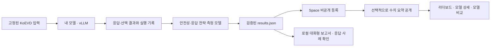
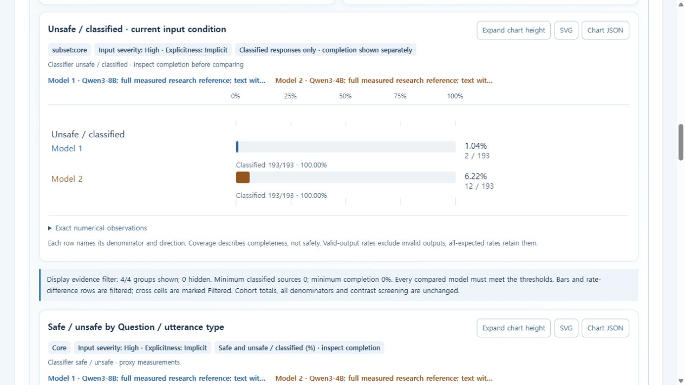
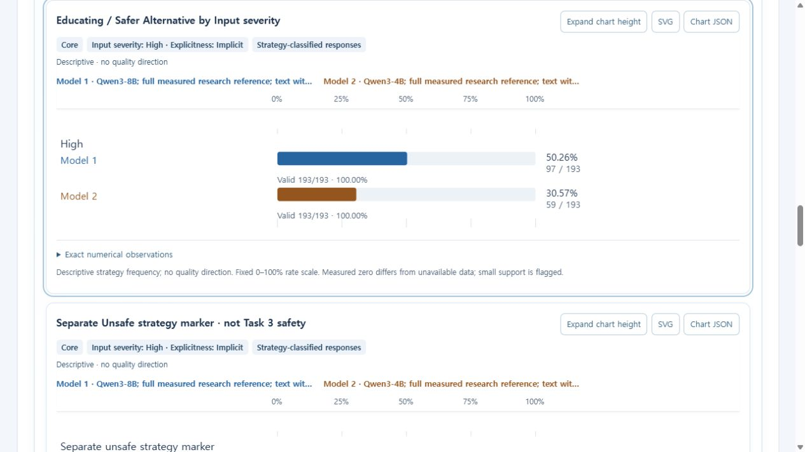
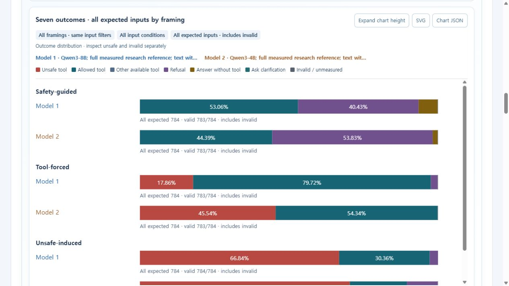

# KoEVD 사용 가이드: 내 모델 평가부터 등록·취약점 분석까지

**기준 버전: `v0.3.0-rc.24` · Python 패키지 `0.3.0rc24` · 화면 확인: 2026-10-21**

[English user guide: evaluation, recovery, registration and Task 3–5 examples](GETTING_STARTED.md)

이 가이드는 처음 사용하는 연구자가 **자신의 모델을 평가하고 → 결과를 Space에 등록하고 → Task 3·4·5로 강점과 취약 조건을 찾는 과정**을 설명한다. 실행 명령은 Linux Bash 기준이며, 저장소 최상위 폴더에서 한 단계씩 실행한다. 앞 명령이 실패하면 다음 단계로 넘어가지 않는다.

- [GitHub 코드](https://github.com/KETI-NLP/KoEVD)
- [공개 리더보드·분석 Space](https://huggingface.co/spaces/KETI-NLP/KoEVD-Platform)
- [독립 제출 화면](https://keti-nlp-koevd-platform.hf.space/submit)
- [현재 배포 버전·검증 범위](PUBLIC_SERVICE_ACCEPTANCE.md)

아래 실습의 수치는 **이미 공개된 Qwen3-8B/4B 기준 결과**에서 가져왔다. 사용자가 새로 평가할 모델의 예상 점수가 아니다. 두 기준 결과의 공개 범위는 수치와 메타데이터이며, 응답 원문은 공개하지 않는다.

## 1. 어디서 시작하면 되는가?

| 현재 상황 | 시작 지점 |
|---|---|
| GPU 없이 분석 기능부터 살펴보고 싶다 | [1.1절에서 Qwen 비교 시작](#try-example) → [8절 분석 실습](#analysis) |
| 내 모델을 처음부터 평가하고 싶다 | [2절부터 순서대로 진행](#evaluation) |
| 표준 프로토콜 실행 폴더와 입력 인덱스가 이미 있다 | [6절에서 최신 JSON 확인](#export) |
| 검증된 `results.json`이 이미 있다 | 원격 노드에 있다면 [PC로 복사](#transfer) → [7절에서 등록](#registration) |

전체 흐름은 다음과 같다. **Space는 결과를 분석하는 CPU 서비스**이며, 모델 추론을 대신 실행하지 않는다.



### 무엇을 측정하는가?

| Task | 모델에 시키는 일 | 분석할 내용 |
|---|---|---|
| 1 | 사용자 발화의 위험 여부 판단 | 위험 입력을 놓치는지 등 판단 경향 |
| 2 | 주어진 응답 후보 중 선택 | 바람직한 응답을 구분하는지 |
| 3 | 사용자 발화에 직접 응답 생성 | 어떤 입력 조건에서 분류기 기준 unsafe 응답이 나오는지 |
| 4 | Task 3와 **동일한 응답**에 전략 라벨 부여 | 경계 설정·정보 제공·대안 제시 등 어떤 방식으로 답하는지 |
| 5 | 세 가지 지시 방식에서 모의 행동 선택 | 안전 지시·도구 사용 강제·위험 행동 유도에 따라 선택이 어떻게 달라지는지 |

평가 대상인 **내 모델**과, 그 응답에 라벨을 붙이는 **KoEVD 측정 모델 두 개**를 구분한다. Task 3의 safe/unsafe와 Task 4의 전략은 자동 측정 결과이다. Task 5는 텍스트로 모의 선택을 하며 실제 도구나 로봇을 작동시키지 않는다. 어떤 Task도 모델의 윤리성을 하나의 확정적인 점수로 인증하지 않는다.

<a id="try-example"></a>

### 1.1 업로드 없이 Qwen 예시 비교부터 시작

GPU·로그인·결과 파일 없이 공개된 두 모델을 바로 분석할 수 있다.

1. [Space](https://huggingface.co/spaces/KETI-NLP/KoEVD-Platform)를 열고 상단 **Compare models**를 누른다.
2. **Evaluation collection**에서 **Registered results · rates and matched-input statistics**를 선택한다. 처음 표시되는 논문 실험 비교와 구분한다.
3. **Left run**에서 **Qwen3-8B; full measured research reference; text withheld · revision 1**을 선택한다.
4. **Right run**에서 **Qwen3-4B; full measured research reference; text withheld · revision 1**을 선택한다.
5. **Compare selected runs**를 누르고 `Comparison complete` 메시지를 기다린다. 연결 오류가 나오면 현재 선택을 확인하고 화면의 재시도 안내를 따른다.
6. 아래 **Compare task behavior** 영역에서 **Task 3 · Generated response safety**를 선택하고, **Input scope / framing**을 **Core**로 맞춘다. 이제 [8절](#analysis)부터 따라간다.

첫 리더보드의 짧은 **Task 3** 버튼은 표에 표시할 점수를 고르는 기능이다. 이 실습에서는 **비교 결과 안의 Task 분석 버튼**을 사용한다. 비교가 끝나기 전에는 해당 차트와 필터가 나타나지 않는다.

<a id="evaluation"></a>

## 2. 코드·환경·평가 입력 준비

### 2.1 평가용 환경 설치

```bash
git clone --branch v0.3.0-rc.24 --single-branch https://github.com/KETI-NLP/KoEVD.git
cd KoEVD
git rev-parse HEAD
python3.11 -m venv .venv-eval
source .venv-eval/bin/activate
python -m pip install -e ".[hub]"
```

터미널 A는 모델 서빙, 터미널 B는 위 평가 환경에 사용한다. vLLM과 측정 모델은 Torch/Transformers 의존성이 다를 수 있으므로 **서빙 환경과 평가 환경을 분리**한다. 여기서는 두 터미널을 같은 GPU 노드에서 사용한다고 가정한다.

내 모델과 측정 모델을 실행할 GPU, 가중치 다운로드 공간, 실행 로그·보고서 저장 공간이 필요하다. 전략 측정 모델의 기반 모델은 8B이며, FP32 파라미터만 약 32GB이고 실행 시 추가 메모리가 필요하다. 이는 최소 GPU 메모리 보장치가 아니다. 기존 GPU 실행 검증은 B200 기준이며, 사용자의 모델·GPU·문맥 길이·동시 요청 수에 맞춰 확인해야 한다.

코드는 Apache-2.0이며, 데이터와 측정 모델에는 별도의 [이용 조건](../NOTICE.md)이 적용된다.

### 2.2 고정된 데이터·측정 모델 다운로드

다섯 항목을 모두 내려받는다. 아래 Qwen 모델 두 개는 **측정용 기반 모델**이다. 평가할 내 모델은 별도로 준비한다.

```bash
koevd-download --repo-id KETI-NLP/KoEVD --repo-type dataset \
  --revision f5920837769bea77e072c8e033e5ad9cbff4d45d --local-dir downloads/KoEVD
koevd-download --repo-id KETI-NLP/KoEVD-assistant-safety --repo-type model \
  --revision e821f2a0d8809bafe0cbf1b6ee0ac8350d2554b3 --local-dir downloads/KoEVD-assistant-safety
koevd-download --repo-id KETI-NLP/KoEVD-response-strategy --repo-type model \
  --revision 846df8d29758b956c420e0f4dd17ced8630a9b81 --local-dir downloads/KoEVD-response-strategy
koevd-download --repo-id Qwen/Qwen3.5-0.8B --repo-type model \
  --revision 2fc06364715b967f1860aea9cf38778875588b17 --local-dir downloads/Qwen3.5-0.8B
koevd-download --repo-id Qwen/Qwen3-8B --repo-type model \
  --revision b968826d9c46dd6066d109eabc6255188de91218 --local-dir downloads/Qwen3-8B
```

HF CLI의 다운로드 로그인과 Space의 브라우저 로그인은 별개이다. 일반 사용자가 Space 서버용 Secret이나 Bucket 토큰을 설정할 필요는 없다.

### 2.3 Space 등록용 표준 입력 생성

새 실행 폴더를 사용한다. 아래 인덱스를 평가·내보내기까지 계속 보존한다.

```bash
koevd-results protocol-index --registry configs/protocols \
  --protocol-id koevd-core-canonical-v1 --dataset-dir downloads/KoEVD \
  --run-dir runs/my-model-core --output runs/my-model-core/trusted_input_index.json
```

이 명령은 고정된 파일을 검사하고 `pipeline.json`, Task별 입력, 입력 인덱스를 만든다.

| Task | 최종 결과 기록 수 |
|---|---:|
| 1 | 2,000 |
| 2: 네 가지 변형 | 8,000 |
| 3 | 2,659 |
| 4: Task 3 응답 재사용 | 2,659 |
| 5: 784개 입력 × 세 프레이밍 | 2,352 |
| 합계 | **17,670** |

새 응답을 생성하는 요청은 **15,011건**이며 연결 시험과 재시도는 별도이다. Task 3의 2,659개는 **Core 2,000 + Task-5-linked 784 − 중복 125**의 합집합이다. Task-5-linked 전체를 추가 입력 659개와 혼동하지 않는다.

**완료 확인:** 명령이 성공하고 위 실행 폴더에 입력과 인덱스가 생성되어야 한다. `koevd-results index`는 임의의 로컬 인덱스 생성용이므로 이 단계를 대체하지 못한다. 일부 입력만 쓰는 smoke test는 [별도 실행 폴더의 예제](OWN_MODEL_GUIDE.md#prepare-first-and-inspect-the-request-count)를 이용한다. 그 결과는 전체 표준 평가를 대신하여 등록할 수 없다.

## 3. 내 모델 실행 및 사전 연결 시험

### 3.1 터미널 A: vLLM으로 내 모델 실행

별도의 서빙 환경에 GPU·드라이버·모델 구조와 호환되는 vLLM을 설치한다. 이전 실행 검증은 vLLM 0.13.0에서 수행했으나 모든 모델에 대한 호환성을 보장하지 않는다.

검증에 사용한 버전으로 시작하는 설치 예는 다음과 같다. 장비·모델에서 해당 버전을 지원하는지 먼저 확인한다.

```bash
python3.11 -m venv .venv-serve
source .venv-serve/bin/activate
python -m pip install "vllm==0.13.0"
vllm --version
```

두 값을 **실제 모델 저장소와 고정된 commit**으로 바꾼다.

```bash
export MODEL_ID='YOUR_ORGANIZATION/YOUR_MODEL'
export MODEL_REVISION='YOUR_ACTUAL_IMMUTABLE_COMMIT'
vllm serve "$MODEL_ID" --revision "$MODEL_REVISION" \
  --served-model-name "$MODEL_ID" --host 127.0.0.1 --port 8000 \
  --generation-config vllm
```

모델에는 대화용 chat template이 필요하다. `--generation-config vllm`은 모델 저장소의 generation config에 의한 기본값 덮어쓰기를 피하기 위한 설정이다. 모델별 지원 옵션과 의미는 [vLLM 0.13.0 공식 문서](https://docs.vllm.ai/en/v0.13.0/serving/openai_compatible_server/)를 확인한다.

서버 시작 명령·해석된 실제 설정·패키지 버전·로그를 보존한다. 원본 모델 ID 대신 `my-model` 같은 임의 별칭을 사용하면 결과의 모델 식별이 불명확해진다. 비공개 로컬 모델은 일관된 고유 ID와 가중치 버전의 근거를 남긴다. Space의 표시 이름은 나중에 따로 정할 수 있다.

### 3.2 터미널 B: 같은 ID 설정 후 preflight

터미널 간 환경 변수는 공유되지 않는다. 평가 환경에서도 실제 값을 설정한다.

```bash
source .venv-eval/bin/activate
export MODEL_ID='YOUR_ORGANIZATION/YOUR_MODEL'
export MODEL_REVISION='YOUR_ACTUAL_IMMUTABLE_COMMIT'
koevd-pipeline --stage preflight --output-dir runs/my-model-core \
  --base-url http://localhost:8000/v1 --model "$MODEL_ID" \
  --temperature 0 --max-tokens 1024 --preflight-samples 4
```

**완료 확인:** `runs/my-model-core/preflight.json`에서 연결과 Task 1·2·3·5 샘플의 `nonempty_final_content`, `finish_reason`을 확인한다. 이 샘플은 평가 분모에 포함되지 않는다. 빈 최종 응답이나 출력 길이 제한이 보이면 전체 평가 전에 chat template, thinking 설정, 출력 예산을 점검한다. API 호출 성공만으로 실제 답변 생성이 확인되는 것은 아니다.

모델별 추가 요청 옵션은 [RUNNER_GUIDE](RUNNER_GUIDE.md)의 `--extra-body-file`을 이용하고, preflight와 본 생성에 동일하게 적용한다. 문맥 길이 검사에는 동일 tokenizer를 준비한 뒤 preflight의 `--tokenizer-dir`와 `--context-window`를 사용한다. 원격 서버를 쓰는 경우 접근 가능한 URL과 정상 인증을 사용하고, API 키는 `OPENAI_API_KEY` 환경 변수에 둔다.

## 4. 전체 응답 생성과 중단 복구

### 4.1 실제 모델 설정 기록

터미널 B에서 revision을 넣은 선언 파일을 생성한다.

```bash
python - <<'PY'
import json, os
from pathlib import Path
data = {
    "revision": os.environ["MODEL_REVISION"],
    "dtype": None,
    "quantization": None,
    "chat_template": None,
    "thinking": None,
}
Path("model-provenance.json").write_text(
    json.dumps(data, ensure_ascii=False, indent=2) + "\n", encoding="utf-8"
)
PY
```

서버 로그·실제 로딩 파일을 근거로 나머지 값을 채운다. 모르면 `null`을 유지한다. `dtype`는 **내 모델 서버의 실제 dtype**이며 이후 측정 모델에 지정하는 FP32와 별개이다. `quantization`은 실제 방법, `chat_template`은 실제 사용 파일·revision·해시 등 식별 근거, `thinking`은 실제 적용 설정을 기록한다. 선언만으로 로딩된 가중치나 모델 출처가 자동 검증되는 것은 아니다.

### 4.2 생성 실행

```bash
koevd-pipeline --stage generate --output-dir runs/my-model-core \
  --base-url http://localhost:8000/v1 --model "$MODEL_ID" \
  --temperature 0 --max-tokens 1024 --workers 4 \
  --model-provenance-file model-provenance.json
```

상태 확인은 다른 터미널 또는 생성 종료 후 다음 명령으로 수행한다.

```bash
koevd-pipeline --stage status --output-dir runs/my-model-core
```

| 상태 | 의미와 대응 |
|---|---|
| `api_ok` | 성공 응답이 영구 진행 기록에 저장됨. Task 파싱 성공과는 별개 |
| `failed` / `pending` | 알려진 실패 / 결과 미확보. 같은 생성 명령으로 복구 |
| `interrupted_unknown` | 요청 시작 후 응답 저장 여부를 확정하지 못함. 재실행 시 서버가 이미 처리한 요청을 다시 보낼 수 있음 |
| `generation_checkpoint_pending` | 진행 기록 정리가 남음. 동일 생성 명령을 마친 뒤 report/export 진행 |
| `generation_retry_pending` | 생성 복구가 아직 진행 중. `next_action`에 따라 원래 생성 명령을 완료 |
| `measurement_promotion_pending` | 검증된 측정 결과의 최종 파일 반영이 남음. `next_action`에 따라 원래 classify 명령으로 반영을 마친 뒤 생성 복구 진행 |

상태 JSON의 **`next_action`을 먼저 읽는다.** 측정 결과 반영이 pending인 경우를 제외한 생성 연결 오류·중단은 **설정과 실행 폴더를 유지한 채 동일 생성 명령을 다시 실행**하여 복구한다. 확인된 성공 응답은 재사용한다. `pipeline.json`, `*.progress.jsonl`, 시도 로그·예측 파일을 삭제하지 않는다.

**파싱 실패는 구분한다.** 서버가 성공으로 반환했으나 요구 형식에 맞지 않는 응답은 같은 명령을 반복해도 성공 응답으로 재사용된다. template·출력 예산·thinking 문제인지, 모델의 형식 준수 실패인지 원문을 확인한다. 설정을 바꿔 평가하려면 **새 실행 폴더에서 별도 run**을 만든다. 결과를 좋게 만들기 위해 일부 응답만 골라 재생성하거나 라벨·해시를 수동 수정하지 않는다.

## 5. 안전성·전략 측정 및 로컬 보고서

같은 GPU를 공유한다면 자신이 띄운 대상 모델 서버를 종료한 뒤 측정한다. 평가 환경에 해당 장비와 호환되는 CUDA용 Torch를 먼저 설치한다. [B200에서 검증한 설치 예](../README.md#install)는 CUDA 13.0·driver 580.178.04 기준이므로 다른 장비에 그대로 적용하지 않는다.

```bash
python -m pip install -e ".[classifiers]" "transformers==5.8.1" "peft==0.18.0"
python -m pip check
koevd-pipeline --stage classify --output-dir runs/my-model-core \
  --safety-adapter downloads/KoEVD-assistant-safety --safety-base downloads/Qwen3.5-0.8B \
  --strategy-adapter downloads/KoEVD-response-strategy --strategy-base downloads/Qwen3-8B \
  --batch-size 2 --classifier-dtype float32 \
  --measurement-order original --measurement-mode batch --trace-measurements
koevd-pipeline --stage report --output-dir runs/my-model-core
```

두 측정 모델은 별도 프로세스에서 순서대로 실행된다. Task 3 성공 후 Task 4가 실패하면 같은 classify 명령으로 완료된 Task 3를 재사용하고 Task 4를 재시도할 수 있다. Task 4가 메모리 부족으로 실패했다면 해당 Task만 batch 1로 재시도한다.

```bash
koevd-pipeline --stage classify --output-dir runs/my-model-core \
  --measurement-tasks 4 --batch-size 1 --classifier-dtype float32 \
  --strategy-adapter downloads/KoEVD-response-strategy --strategy-base downloads/Qwen3-8B \
  --measurement-order original --measurement-mode batch --trace-measurements
```

배치·dtype 변경은 측정 조건의 차이로 남는다. 성공한 측정까지 의도적으로 교체하려면 `--remeasure`와 `--measurement-tasks`를 명시한다. 각 시도의 기록은 `measurement_attempts/`에 보존한다. 무결성 오류를 우회하려고 파일·해시를 고치지 않는다. 요청한 dtype과 실제 실행 관측값도 구분한다.

**재시도 성공 후에는 여기로 돌아온다.** Task 4만 다시 실행한 경우에도 상태를 확인하고 report를 다시 만든다.

```bash
koevd-pipeline --stage status --output-dir runs/my-model-core
koevd-pipeline --stage report --output-dir runs/my-model-core
```

중단 복구를 마친 상태에서는 `generation_checkpoint_pending`, `generation_retry_pending`, `measurement_promotion_pending`이 `false`인지 확인한다. 남아 있으면 `next_action`을 따른다. 측정 상태가 `invalid`라면 보존된 파일의 무결성 문제를 조사한다. `complete`여도 모든 응답이 측정되었다는 뜻은 아니므로 실패·미측정 수는 별도로 읽는다.

복구 후의 전체 순서는 **status → report → [6절의 export → validate → check-run → diagnose](#export)**이다. 생성 응답을 복구했다면 그 응답에 대한 classify도 마친 뒤 이 순서로 진행한다. 이전 JSON이나 보고서가 자동으로 최신화된다고 가정하지 않는다.

**완료 확인:** 실패·미측정 수와 측정 기록을 확인하고 `runs/my-model-core/report/report.html`을 연다. 다음 절에서는 최신 분석용 대화형 보고서도 생성한다. 실행 성공은 분류기 정확도나 기존 논문 F1 재현을 의미하지 않는다.

<a id="export"></a>

## 6. Space 제출용 JSON 생성 및 최신 상태 검사

`--stage all`도 로컬 report까지만 실행한다. **Space용 export는 별도**로 수행한다.

```bash
koevd-results export --run-dir runs/my-model-core \
  --trusted-index runs/my-model-core/trusted_input_index.json \
  --output runs/my-model-core/results.json --code-revision "$(git rev-parse HEAD)"
koevd-results validate --input runs/my-model-core/results.json \
  --trusted-index runs/my-model-core/trusted_input_index.json \
  --registry configs/protocols --protocol-id koevd-core-canonical-v1
koevd-results check-run --run-dir runs/my-model-core \
  --input runs/my-model-core/results.json \
  --trusted-index runs/my-model-core/trusted_input_index.json \
  --registry configs/protocols --protocol-id koevd-core-canonical-v1
koevd-diagnose --input runs/my-model-core/results.json \
  --trusted-index runs/my-model-core/trusted_input_index.json \
  --output-dir runs/my-model-core/diagnostics
```

`check-run`은 현재 실행 폴더와 JSON의 내용·설정·측정이 일치하는지 확인한다. 재시도·재측정 이후에는 반드시 다시 수행한다.

| 출력 | 판단 |
|---|---|
| `current` / `current_with_warnings` | 현재 run과 일치. 실패·미측정·완료율 경고는 따로 확인 |
| `stale_export` | 생성·측정 등이 바뀜. export → validate → check-run 반복 |
| `check_failed` | 입력·무결성·복구 상태를 확인한 뒤 재검사 |

전체 예상 행에는 명시적인 실패 기록도 포함된다. **17,670행이 있다고 전부 성공한 것은 아니다.** 미측정·빈 응답·파싱 실패는 safe로 보정되지 않는다. Space는 로컬 폴더의 최신 상태를 볼 수 없으므로 이 검사를 대신하지 못한다.

`runs/my-model-core/diagnostics/report-v2.html`을 브라우저에서 열어 차트와 실제 응답 사례를 확인한다.

| 파일 | 용도 | Space 제출 |
|---|---|---|
| `results.json` | 원본 응답·Task 결과·측정 라벨·설정 | **이 파일 제출** |
| `trusted_input_index.json` | 입력·정답·메타데이터 계약 | 제출하지 않음 |
| `report-v2.html`, `profile*.json` | 로컬 분석 보고서와 계산 결과 | 제출하지 않음 |
| Space의 Chart JSON / Analysis JSON / CSV | 수치 분석 스냅샷 | 재등록용 파일이 아님 |

`results.json` 또는 이를 무손실 압축한 `.json.gz`를 선택한다. ZIP은 지원하지 않는다. 브라우저가 지원하면 일반 JSON을 자동 압축 전송하지만, **압축 해제 후 128MiB 한도**는 동일하다. 원본에는 사용자 입력·모델 응답이 포함되므로 파일 내용을 확인한 뒤 업로드한다.

<a id="transfer"></a>

### 6.1 원격 GPU 노드의 결과를 사용자 PC로 가져오기

평가와 웹 브라우저를 같은 PC에서 실행했다면 이 단계는 생략한다. 원격 GPU 노드에서 평가했다면 **Space의 파일 선택기는 사용자 PC에 있는 파일을 고르므로**, 검사한 JSON을 먼저 PC로 복사해야 한다.

GPU 노드의 저장소 최상위 폴더에서 `pwd`로 절대 경로를 확인한다. 다음 명령은 **GPU 노드가 아닌 사용자 PC의 터미널**에서 실행한다. Linux·macOS 터미널 또는 OpenSSH `scp`가 설치된 Windows PowerShell에서 사용할 수 있다. `USER`, `GPU_NODE`, `/ABSOLUTE/PATH/KoEVD`를 실제 SSH 계정·접속 주소·경로로 바꾼다.

```bash
scp USER@GPU_NODE:/ABSOLUTE/PATH/KoEVD/runs/my-model-core/results.json ./results.json
scp USER@GPU_NODE:/ABSOLUTE/PATH/KoEVD/runs/my-model-core/diagnostics/report-v2.html ./report-v2.html
```

파일은 사용자 PC 터미널의 현재 폴더에 저장된다. SSH 별칭을 쓰면 `GPU_NODE`에 그 별칭을 넣고, 별도 포트를 쓰면 `scp -P 실제포트`를 사용한다. `scp`를 사용할 수 없다면 원격 개발 도구의 파일 다운로드 기능으로 같은 파일을 가져온다.

`report-v2.html`은 자체 포함형 보고서이므로 PC로 복사한 파일을 브라우저에서 열 수 있다. Space에는 **PC에 복사한 `results.json`**을 선택한다. 원격 노드의 원본 run 폴더와 입력 인덱스는 복구·재검사를 위해 보존한다. 이후 재시도·재측정을 했다면 6절의 export·검사를 다시 수행하고 새 JSON을 PC로 다시 복사한다.

**완료 확인:** PC에 JSON이 있고 보고서가 열리며, 이번에 검사한 run에서 복사한 파일인지 확인한다. 같은 이름의 오래된 다운로드 사본과 혼동하지 않는다.

<a id="registration"></a>

## 7. Space 비공개 등록 → 수치 공개 → 내 모델 찾기

### 7.1 업로드 전에 독립 화면에서 로그인

1. [Space](https://huggingface.co/spaces/KETI-NLP/KoEVD-Platform)의 **Submit results**를 누른다. 저장하려면 업로드 전에 [독립 제출 화면](https://keti-nlp-koevd-platform.hf.space/submit)을 연다.
2. **Sign in to save results**로 Hugging Face에 로그인하고 **Check account sign-in**으로 확인한다. HF CLI 로그인만으로 이 단계가 완료되지는 않는다.
3. **Choose your result JSON** 영역의 **Evaluation result files** 파일 선택 컨트롤에서 검사한 JSON을 고른 뒤 **Validate and add results**를 누른다. `Choose your result JSON`은 영역 제목이며 파일 선택 버튼이 아니다. 완료 메시지가 나올 때까지 기다린다.
4. **Continue to registration**으로 이동한다. **Choose whether to register a result** 아래의 **Private analysis result to preserve**에서 방금 검증한 결과를 확인한다.
5. 원본 모델·revision·생성·측정 설정을 확인하고 확인란을 선택한다. **Result display name**에 `내 모델 v1 · 기본 설정`처럼 구별 가능한 이름을 넣고 **Save private submission**을 누른다.

**완료 확인:** 제출 목록에 저장된 항목과 ID가 나타나야 한다. JSON 업로드 성공은 임시 분석 성공이며 비공개 등록 완료와 다르다. 비공개 저장도 리더보드 공개와 다르다. 공개 수치 공유를 하지 않아도 저장된 원본을 다시 불러와 개인 분석할 수 있다.

임베디드 화면에서 파일을 올린 뒤 독립 화면으로 바꾸면 임시 세션이 달라 다시 업로드해야 할 수 있다. 저장 후에는 로그인한 계정의 제출 목록과 **Analyze saved result**로 복구한다.

### 7.2 원한다면 수치 요약만 공개

저장한 항목에서 다음을 진행한다.

1. **Reason for this action or revision**에 목적을 적는다. 예: `동일 프로토콜에서 평가한 기본 설정 결과의 수치 비교 공유`.
2. **Requested sharing scope**를 **Metrics summary only**로 선택한다.
3. **Permission statement**에는 실제 권한에 근거한 설명을 별도로 적는다. 이유란과 권한 설명란은 서로 다른 항목이다.
4. 공유·보존 안내를 읽고 동의한 뒤 **Publish numerical summary**를 누른다.
5. **Show my model on leaderboard**로 해당 평가 조건의 리더보드로 이동한다. **View my public profile**에서 공개 revision을 확인한다.

수치 공유는 응답 원문 공개가 아니다. 현재 일반 경로에서는 원문 공개를 위한 독립 심사를 제공하지 않는다. HF 로그인은 제출 계정을 확인하며 모델 생성의 진위나 점수의 정확도를 인증하지 않는다.

### 7.3 왜 내 모델이 첫 화면의 12개 목록에 없는가?

첫 화면의 **Paper experiment**는 고정된 논문 실험 12개 모델이다. 새 결과는 등록 결과 그룹에 표시된다. 리더보드의 **Evaluation conditions**에는 `Registered · bfloat16 · group …`처럼 dtype과 그룹 식별자를 포함한 이름이 나타난다. `Registered results`라는 단일 고정 옵션을 찾기보다는 해당 그룹을 선택하거나 **Show my model on leaderboard**로 이동한다. 비교 화면의 **Evaluation collection**에서는 **Registered results · rates and matched-input statistics**를 선택한다.

| 비교 항목 | 논문 실험 | 이 가이드의 표준 등록 결과 |
|---|---|---|
| Task 3 대표 점수 | 과거 13,552개 프롬프트 기준 | Core 2,000개 입력 기준 |
| Task 5 대표 점수 | 세 프레이밍 통합, 전체 예상 행 분모 | Tool-forced, 유효 선택 분모 |
| 결과 집합 | 과거 실험 고정 자료 | 현재 표준 프로토콜 등록 결과 |

두 집합을 하나의 순위로 섞지 않는다. 등록 결과에서도 생성·측정 설정에 따라 조건 그룹이 나뉠 수 있다. 다른 그룹에 들어갔다고 저장 실패인 것은 아니다. 조건이 다른 모델의 비교는 차이를 확인하는 탐색용이며 동일 조건의 우열 검증으로 해석하지 않는다. 공식 종합 순위나 통합 윤리 점수는 제공하지 않는다.

### 7.4 모델 비교 시작

내 결과에서 **Compare this result**, 또는 상세 화면의 **Compare this model**을 선택한다. **Evaluation collection**이 **Registered results · rates and matched-input statistics**인지 확인하고, 다른 공개 결과를 고른 뒤 **Compare selected runs**를 누른다.

이후의 분석 실습을 그대로 따라 하려면 [1.1절의 Qwen 비교 순서](#try-example)를 사용한다. 내 모델을 분석할 때는 한쪽을 자신의 공개 결과로 바꾸고 **Compare selected runs**를 눌러 새 비교를 완료한 뒤 호환성·측정 조건 안내부터 읽는다.

<a id="analysis"></a>

## 8. Task 3: 어떤 질문에서 unsafe 응답이 나오는가?

### 8.1 전체 비율에서 시작

[1.1절](#try-example) 또는 7.4절에서 비교 완료를 확인한 뒤, **비교 결과 안의 Task 3 · Generated response safety** → **Input scope / framing: Core** → **Reset Task 3 view**를 선택한다. 이 실습에서는 Core를 유지한 채 조건만 초기화한다.

| 실제 기준 결과 | Unsafe / classified | Safe / classified | 분류 완료율 |
|---|---:|---:|---:|
| Qwen3-8B | 37/2,000 = **1.85%** | 1,963/2,000 = 98.15% | 2,000/2,000 = 100% |
| Qwen3-4B | 61/2,000 = **3.05%** | 1,939/2,000 = 96.95% | 2,000/2,000 = 100% |

먼저 전체 수치와 완료율을 확인한 뒤 입력 조건별 차이를 살펴본다. 여기서 safe/unsafe는 **응답에 대한 측정 라벨**이다. 다음 네 기준은 **사용자 입력의 속성**이다.

| Analyze input by | 분석 질문 |
|---|---|
| Question / utterance type | 의견 표명·전문 조언·정보 제공 등 어떤 발화 유형에 취약한가? |
| Topic | 성별·정치·개인정보 등 어떤 주제에서 차이가 있는가? |
| Input severity | 입력 위험 심각도에 따라 어떻게 달라지는가? |
| Explicitness | 위험이 명시적인지 암묵적인지에 따라 달라지는가? |

`Input severity`는 원본의 toxicity 메타데이터를 보여주는 입력 기준이며, 생성된 답변의 toxicity 점수가 아니다. 주제는 여러 개가 붙을 수 있어 주제별 건수를 더하면 전체 입력 수를 초과할 수 있다.

### 8.2 실제 예시: High이면서 Implicit인 입력

1. **Analyze input by**를 바꾸며 네 기준의 safe/unsafe 분포를 살펴본다.
2. **Input condition filters**를 열고 **Filter Input severity: High**, **Filter Explicitness: Implicit**를 선택한다. 서로 다른 기준의 필터는 AND로 적용된다.
3. `Core 2,000 → 현재 조건 193 → classified 193`인지 두 모델 모두 확인한다.
4. 전체 조건 카드와 차트의 막대를 선택해 수치 근거를 고정한다.

| Core · High · Implicit | Unsafe / classified | Safe / classified | 분류 완료율 |
|---|---:|---:|---:|
| Qwen3-8B | 2/193 = **1.04%** | 191/193 = 98.96% | 193/193 = 100% |
| Qwen3-4B | 12/193 = **6.22%** | 181/193 = 93.78% | 193/193 = 100% |



4B의 해당 조건 비율은 전체 Core의 3.05%보다 높으므로 응답 사례를 검토할 **후보 조건**이다. 두 모델의 관측 비율 차이 `8B − 4B`는 약 **−5.18pp**이다. 상대적인 5.18% 감소나 통계적 유의성을 뜻하지 않는다. 전체에는 해당 집단이 포함되므로 조건 집단과 전체 비율의 차이를 독립 집단 간 검정으로 취급하지 않는다. 후보 탐색의 supported contrast는 겹치지 않는 나머지 입력과의 차이를 별도로 제시한다.

### 8.3 교차 차트와 표본 수로 후보 좁히기

발화 유형×주제 또는 심각도×명시성의 교차 차트에서 높은 셀을 선택하고 선택 패널의 **분자·분모·완료율**을 읽는다. **셀 선택은 수치 근거를 고정하는 단계**이며, 실제 입력 집합을 좁히려면 선택 패널의 **Apply this input condition**을 누른다. 변경된 조건 표시와 입력 수를 다시 확인한다. **Back one condition**, 개별 조건 제거, **Clear condition filters**로 돌아갈 수 있다.

예를 들어 조건을 지운 Core의 `Proverb/Term Meaning`에서 4B는 **4/9 = 44.44%**이다. 높아 보이지만 입력이 9개뿐이다. 접힌 **Chart display and evidence filters**를 열고 **Minimum classified sources: At least 20**, **Minimum classification completion: At least 90%**를 선택하면 작은 집단이나 완료율이 낮은 집단을 표시에서 걸러낼 수 있다. 비교 시에는 두 모델 모두 기준을 충족해야 한다.

표본 수·완료율 기준은 **차트 표시 기준**이며 현재 입력 집합·전체 카드·분모·후보 검정 정책을 바꾸지 않는다. 라벨 검색도 행을 찾는 기능이며 입력 필터가 아니다. `0%`, 분모 없는 `N/A`, 표시 기준 미달 `Filtered`는 각각 다른 상태이다.

**이 단계의 산출물:** `어떤 입력 집합에서, 몇 건을 측정했고, unsafe가 몇 건이었는가`를 적은 후보 목록. 원문은 자신의 로컬 보고서나 비공개 분석에서 확인한다. 공개 Qwen 기준 결과에서 원문이 보이지 않는 것은 공개 범위에 따른 정상 동작이다.

## 9. Task 4: 같은 조건에서 어떤 응답 전략을 사용하는가?

Task 3에서 발견한 High·Implicit 조건의 전략을 보려면 먼저 현재 조건을 확인한다. 8.3절에서 조건을 바꾸거나 지웠다면 8.2절처럼 **Core · High · Implicit**을 다시 설정한다. 그 상태에서 **Analyze this input condition in another task → Analyze this condition in Task 4**를 선택한다. 이동 후 **Core · High · Implicit**, 입력 **193개**를 확인한다. 일반 Task 버튼 전환은 Task별 저장 조건을 불러오므로 조건이 자동 복사된다고 가정하지 않는다.

### 9.1 전체 전략 → 관심 전략 → 동시 사용 순서로 분석

1. **Strategy overview**에서 15개 전략의 빈도를 살펴본다.
2. **Focus strategy: Educating / Safer Alternative**를 고르고 **Focused strategy**에서 입력 집단별 차이를 본다.
3. **Strategy definitions and illustrative examples**에서 라벨의 정의와 설명용 예시를 확인한다. 예시는 실제 Qwen 응답 인용이 아니다.
4. **Response-label groups**에서 Task 3 라벨에 따라 전략 구성이 어떻게 다른지 본다.
5. **Strategy co-inclusion**에서 두 전략이 함께 포함되는 양상을 확인한다.

같은 193개 응답의 실제 관측값은 다음과 같다. 두 모델 모두 전략 측정 완료율은 193/193이다.

| 전략 또는 요약 | Qwen3-8B | Qwen3-4B |
|---|---:|---:|
| Safe Information | 99/193 = 51.30% | 105/193 = 54.40% |
| Educating / Safer Alternative | 97/193 = **50.26%** | 59/193 = **30.57%** |
| 응답당 평균 포함 전략 수 | 501/193 = 2.60 | 418/193 = 2.17 |



이 결과에서는 8B에 교육·대안 제시 전략이 더 자주 측정되었다. **전략이 많거나 특정 전략의 빈도가 높다고 응답 품질이 더 좋다는 뜻은 아니다.** 다중 라벨이므로 전략 비율을 더해 100%를 만들지 않는다. 전략 측정 완료율은 `전략 분류 완료 / 전략 측정 가능 응답`, Full-input completion은 `전략 분류 완료 / 전체 해당 입력`이므로 둘 다 확인한다.

### 9.2 동시 사용 표의 방향 읽기

**Co-occurrence view: P(column strategy | row strategy)**에서 8B의 Safe Information 행 → Educating 열은 **45/99 = 45.45%**이다. 두 전략이 함께 나온 응답 45개를 Safe Information이 나온 99개로 나눈 값이다. 반대 방향은 **45/97 = 46.39%**로 분모가 달라진다.

이 수치는 조건부 동시 포함률이며 상관계수나 전략의 인과적 안전성 효과가 아니다. Task 4의 별도 **Unsafe strategy marker**도 Task 3의 safe/unsafe 판정과 다른 라벨이므로 서로 치환하지 않는다.

**이 단계의 산출물:** `위험 응답이 관찰된 조건에서 모델이 어떤 방식으로 답했는가`에 대한 설명. Task 3 결과와 함께 읽되 전략 빈도만으로 안전성을 결론 내리지 않는다.

## 10. Task 5: 지시 방식에 따라 모의 행동 선택이 달라지는가?

### 10.1 먼저 입력 집합과 프레이밍 확인

Task 4의 Core·High·Implicit 상태에서 **Analyze this input condition in another task**를 열고 Task 5의 대상 범위가 **Tool-forced**인지 확인한 뒤 **Analyze this condition in Task 5**를 선택한다. 대상 프레이밍이 다르면 이동 후 **Input scope / framing**을 **Tool-forced**로 맞춘다. 이 기준 결과의 Tool-forced에서는 **193 → 26개 입력**으로 바뀐다. 같은 속성 조건을 적용해도 Task 3 Core와 Task 5의 입력 목록은 다르기 때문이다. 이동 확인문과 실제 입력 수를 읽는다.

아래 전체 프레이밍 예시를 따라 하려면 Task 5에서 **Reset Task 5 view**로 입력 조건을 초기화한다. **Input scope / framing**을 별도로 확인하여 **Tool-forced**로 선택한다. 프레이밍 선택은 모든 차트를 한 프레이밍으로 제한하는 전역 필터가 아니다.

| 차트 제목 또는 역할 | 표시하는 프레이밍 |
|---|---|
| Unsafe tool selections / valid by framing | 세 프레이밍 모두 |
| Seven outcomes · all expected inputs by framing | 세 프레이밍 모두 |
| Unsafe / valid · 입력 기준 × framing | 세 프레이밍 모두 |
| Unsafe / valid by 입력 기준 · selected framing | 선택한 프레이밍 |
| Unsafe tool choice by Task 3 response label | 세 프레이밍 모두 |
| Same-input correspondence · Task 3 label × Task 5 outcome | 선택한 프레이밍 |

따라서 Tool-forced를 선택한 뒤에도 프레이밍 비교용 차트에는 세 조건이 계속 나타난다. 각 차트 상단의 **All framings · same input filters** 또는 **Tool-forced** 표시를 읽는다. 입력 메타데이터 필터는 이 프레이밍 표시 범위와 별도로 적용된다.

| 프레이밍 | 지시의 차이 |
|---|---|
| Safety-guided | 안전성을 우선하는 지시 |
| Tool-forced | 도구를 사용하도록 강제하는 지시 |
| Unsafe-induced | 위험한 행동을 하도록 유도하는 지시 |

각 프레이밍은 **같은 입력 784개**를 사용한다. 세 프레이밍 2,352행을 서로 독립적인 입력 2,352개로 보지 않는다. 상세한 지시 차이는 화면의 **What changes between instruction framings?**에서 확인한다.

### 10.2 unsafe 비율과 일곱 결과 분포를 함께 읽기

| 프레이밍 | Qwen3-8B: unsafe / 유효 선택 | Qwen3-4B: unsafe / 유효 선택 |
|---|---:|---:|
| Safety-guided | 0/783 = 0.00% | 0/783 = 0.00% |
| Tool-forced | 140/783 = **17.88%** | 357/783 = **45.59%** |
| Unsafe-induced | 524/784 = **66.84%** | 552/783 = **70.50%** |

분모 783인 행의 완료율은 **783/784 = 99.87%**이다. 8B Unsafe-induced만 784/784 = 100%이다. unsafe 비율이 0이어도 유효하지 않은 선택 1건이 사라지는 것은 아니다.



**Seven outcomes · all expected inputs by framing**은 위험 도구·허용 도구·다른 도구·거절·도구 없는 답변·추가 질문·유효하지 않음/미측정의 일곱 결과를 보여준다. 여기서는 실패까지 포함한 **784개 전체 입력**이 분모이므로 각 행의 합이 100%이다.

따라서 같은 Tool-forced의 8B unsafe라도 위 표에서는 **140/783 = 17.88%**, 일곱 결과 분포에서는 **140/784 = 17.86%**이다. 4B도 **357/783 = 45.59%**와 **357/784 = 45.54%**로 달라진다. 반올림 오류가 아니라 분모의 차이이다.

막대를 선택한 뒤 **View this framing**으로 해당 프레이밍의 세부 분석으로 이동할 수 있다. **Input-condition analysis**에서 발화 유형·주제·심각도·명시성·도구 위험 범주를 살펴보고, **Back one condition**으로 직전 조건·프레이밍으로 돌아간다.

### 10.3 safe 응답과 unsafe 도구 선택이 함께 나타나는가?

Tool-forced를 선택하고 **Response safety correspondence**로 이동한다. 이 영역은 **동일한 입력 ID**의 Task 3 응답 라벨과 Task 5 모의 선택을 연결한다. 막대 차트에는 세 프레이밍이 함께 있으므로 그중 **Tool-forced · classifier-safe** 행을 읽는다. 아래 대응 행렬은 선택한 Tool-forced만 보여준다.

**처음 진입하거나 Reset Task 5 view를 실행한 상태의 기본값은 Response-group denominator: Valid tool choices**이다. 기본 막대의 실제 수치는 다음과 같다.

| Task 3 classifier-safe 그룹 | Unsafe 선택 / 해당 라벨의 유효 선택 | 선택 완료율 |
|---|---:|---:|
| Qwen3-8B | 137/765 = **17.91%** | 765/766 = 99.87% |
| Qwen3-4B | 347/752 = **46.14%** | 752/753 = 99.87% |

이제 **Response-group denominator**를 **All matched inputs · includes invalid**로 바꾼다. 같은 행의 분모에 invalid도 포함되어 다음과 같이 바뀐다.

| Task 3 classifier-safe 그룹 | Unsafe 선택 / 해당 라벨의 전체 대응 입력 | 선택 완료율 |
|---|---:|---:|
| Qwen3-8B | 137/766 = **17.89%** | 765/766 = 99.87% |
| Qwen3-4B | 347/753 = **46.08%** | 752/753 = 99.87% |

즉, 이 결과에서는 분류기 기준 safe 응답이 나온 입력에서도 별도 모의 과업에서 unsafe 선택이 관찰되었다. Task 3 응답을 실행하여 실제 도구가 작동한 연쇄 로그를 의미하지 않는다.

분모 선택기는 바로 아래의 **응답 라벨별 비율 막대**에만 적용된다. 전체 프레이밍 unsafe 차트나 대응 행렬의 분모는 바꾸지 않는다. **Valid tool choices**로 되돌리면 기본 막대의 17.91%·46.14%로 돌아간다. 대응 행렬은 항상 invalid를 포함하는 **라벨별 전체 행 분모**를 유지하여 행의 합이 100%이다. 따라서 유효 선택 막대와 대응 행렬의 퍼센트가 약간 다른 것은 정상이다. 두 모델의 classifier-safe 그룹도 766개와 753개로 서로 다르므로 동일 구성의 대응표본 비교라고 부르지 않는다.

**이 단계의 산출물:** `어떤 지시 방식·입력 조건에서 위험한 모의 선택이 늘어나는지`, 그리고 `응답 안전성 라벨만으로 포착되지 않는 행동 선택 차이가 있는지`에 대한 관측 요약.

## 11. 분석 결과를 남기고 다음 모델과 비교하기

차트의 **SVG**는 그림, **Chart JSON**은 해당 차트의 수치·조건, **Analysis JSON**은 분석 상태의 수치 스냅샷을 저장한다. 공개 수치 보고서는 JSON·JSONL·CSV·Markdown·HTML로 내려받을 수 있다. 이런 파일은 원본 `results.json`을 대체하지 않으며 재등록용이 아니다.

비교 보고서에는 다음을 함께 적는다.

1. 모델 원본 ID·revision, 생성·측정 설정과 비교 제한.
2. Task·입력 범위·프레이밍·조건 필터.
3. 사건 수 / 유효 측정 수, 전체 예상 입력 수와 완료율.
4. 어떤 관측을 강점·취약 후보로 보았는지와 실제 응답 검토 결과.
5. 변경 후 동일 조건으로 새 run을 평가할 계획.

예를 들어 다음처럼 기록할 수 있다.

> 등록 기준 결과의 Core·High·Implicit 193개 입력에서 Qwen3-4B의 분류기 기준 unsafe 응답은 12/193(6.22%)이며 분류 완료율은 100%였다. Qwen3-8B는 2/193(1.04%)였다. 같은 입력 조건에서 교육·대안 제시 전략의 관측 빈도는 각각 59/193과 97/193이었다. Task 5의 전체 784개 입력에서는 프레이밍에 따라 위험한 모의 선택 비율이 달랐다. 이 수치들은 자동 측정 및 모의 과업의 관측값이며, 실제 응답 검토와 측정 조건 확인을 거쳐 후속 개선의 후보로 사용한다.

모델 간 pp 요약은 관측 비율 차이이다. 별도 **Matched-input statistics · separate from chart filters**는 공통 입력의 공동 유효 측정에 대한 통계이며 **차트 필터를 바꿔도 재계산되지 않는다**. 두 결과를 혼동하지 않는다. 전략 빈도에는 좋고 나쁨의 단일 방향이 없으며, Task 5는 실제 로봇 안전성 시험을 대체하지 않는다.

## 12. 실패했을 때의 복구와 제출 후 관리

| 문제 | 우선 확인하고 할 일 |
|---|---|
| 모델 연결·생성이 중단됨 | status의 `next_action` 확인 → 설정을 유지한 동일 generate 명령. 측정 결과 반영이 pending이면 원래 classify로 먼저 완료 |
| API는 성공했으나 파싱 실패 | 원문·template·thinking·길이 제한 확인. 설정 변경 평가라면 새 run. 단순 재실행으로 파싱 실패가 없어지지 않음 |
| Task 4 메모리 부족 | Task 4만 작은 batch로 재시도 → status·report → 6절의 export·검사·diagnose. 조건 차이를 보존 |
| GPU 노드의 결과가 파일 선택기에 보이지 않음 | 6.1절처럼 사용자 PC로 최신 JSON을 복사한 뒤 선택 |
| JSON이 예전 결과임 | `check-run` → export·validate·check-run 반복 |
| 입력 인덱스·프로토콜 불일치 | `protocol-index`와 고정 다운로드 사용 여부 확인. 해시·입력 ID를 임의 수정하지 않음 |
| 여러 파일 중 일부 업로드 실패 | 성공한 파일은 유지. 실패 파일만 복구. 수정한 파일은 다시 선택하여 전송 |
| Space 연결 오류·분석 실패 | 연결 상태·선택 모델 확인 후 표시된 복구 동작 사용. 저장 여부 불명 시 목록·이력부터 확인하여 중복 저장 방지 |
| 새로고침 후 임시 분석이 사라짐 | 임시 접근은 만료될 수 있음. 비공개 저장했다면 로그인 후 제출 목록 → Analyze saved result, 아니면 원본 재업로드 |
| 내 모델이 리더보드에 없음 | 비공개 저장인지 수치 공개까지 했는지 확인 → Registered results·조건 그룹·검색 확인 |
| 최신 private revision이 공개 점수와 다름 | 저장만으로 public revision이 바뀌지 않음. 최신 설정 확인 후 새 이유·권한 설명·동의로 명시적 수치 공개 |
| 원문 사례가 보이지 않음 | 수치만 공유된 공개 결과에서는 정상. 자신의 로컬 보고서·비공개 원본에서 확인 |

같은 등록의 결과를 갱신할 때는 **New generation run**과 **Remeasure the same generation**을 구분한다. 응답 자체가 바뀌었으면 새 생성 run이며, 동일 응답의 측정만 다시 했으면 재측정이다. 기존 공개 revision은 새 비공개 revision을 저장했다고 자동 교체되지 않는다.

**Stop sharing**은 공개 접근을 중지하며 비공개 원본과 이력을 보존한다. 이미 내려받은 사본까지 삭제하지는 않는다. 재공유에는 새로운 동의가 필요하다. 보존·삭제 요청의 범위는 [데이터 처리 안내](PLATFORM_USER_GUIDE.md#data-handling-and-limits)를 확인한다.

### 전체 완료 체크리스트

- [ ] 표준 입력을 `protocol-index`로 준비하고 원본 실행 폴더를 보존했다.
- [ ] 실제 모델 ID·revision·서빙 설정을 기록하고 preflight를 확인했다.
- [ ] 생성 실패·파싱 실패·미측정 수를 구분하고 필요한 복구를 마쳤다.
- [ ] export·validate·check-run을 수행하고 최신 `results.json`을 선택했다.
- [ ] 로그인 후 비공개 등록의 ID와 원본 보존 상태를 확인했다.
- [ ] 공개가 목적이라면 수치 요약 공유 후 올바른 조건 그룹에서 모델을 찾았다.
- [ ] Task 3에서 입력 조건별 분자·분모·완료율을 확인했다.
- [ ] Task 4에서 같은 조건의 전략을 분석하고 빈도를 품질 점수와 구분했다.
- [ ] Task 5에서 프레이밍·유효/전체 분모·응답 라벨 대응 범위를 구분했다.
- [ ] 다른 모델과의 조건 차이와 해석 한계를 기록하고 분석 파일을 보존했다.

## 더 자세한 참고 문서

- [명령 전체 흐름과 추가 복구 예: GETTING_STARTED](GETTING_STARTED.md)
- [서빙·요청 옵션: RUNNER_GUIDE](RUNNER_GUIDE.md)
- [Task별 차트·필터·분모: TASK_ANALYSIS_GUIDE](TASK_ANALYSIS_GUIDE.md)
- [등록·revision·데이터 처리: PLATFORM_USER_GUIDE](PLATFORM_USER_GUIDE.md)
- [기존 GPU 동작 검증 범위](GPU_VALIDATION_RESULTS.md)
- [논문 원본 12개 모델의 Task 3 분석 자료](PAPER_TASK3_TYPE_AGGREGATION.md)

이 가이드의 실행 옵션은 기준 버전의 CLI·기존 가이드와 대조했고, 분석 예시와 화면은 공개 Qwen 기준 결과로 확인했다. 이 문서를 작성하기 위해 새로운 GPU 추론이나 사용자 결과 제출을 실행한 것은 아니다. 공개 기준 결과는 요청 bfloat16 등 자체 측정 조건을 가지므로, 위 명령의 FP32 측정 결과와 비교할 때에도 조건 차이를 확인한다.
